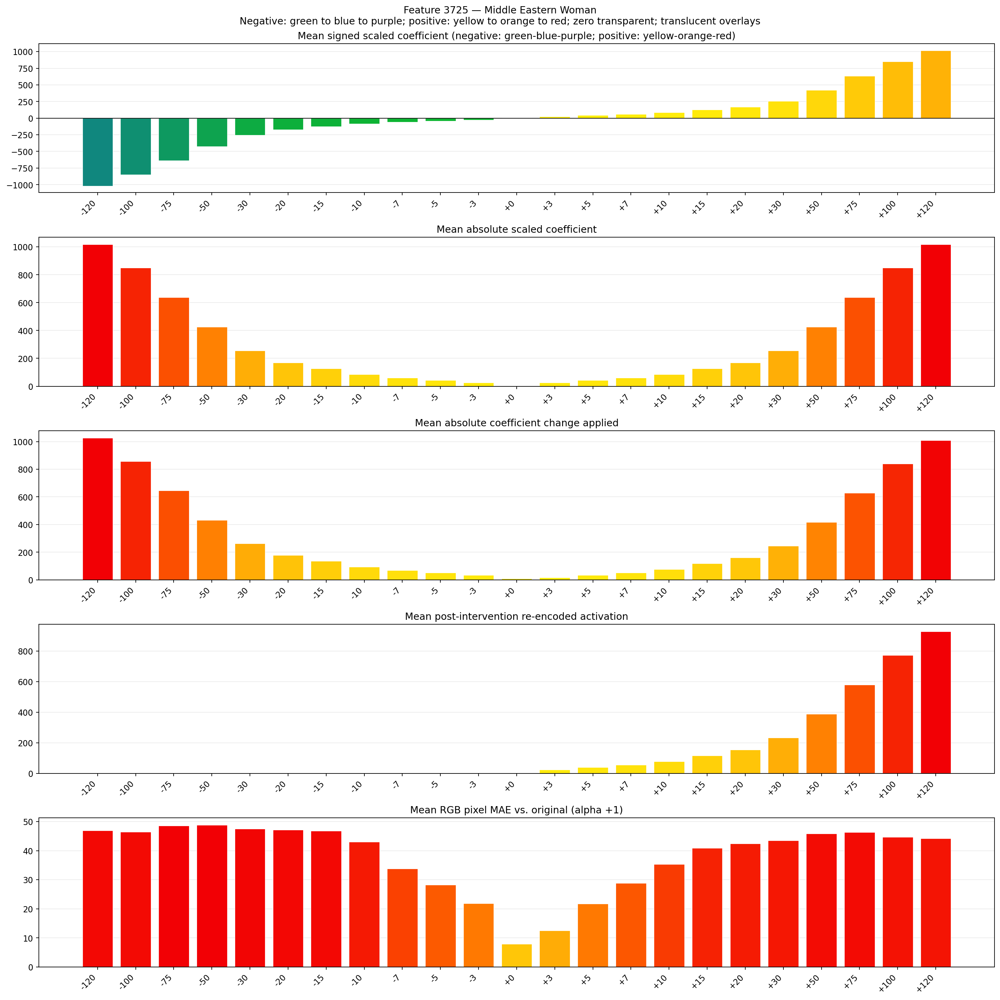
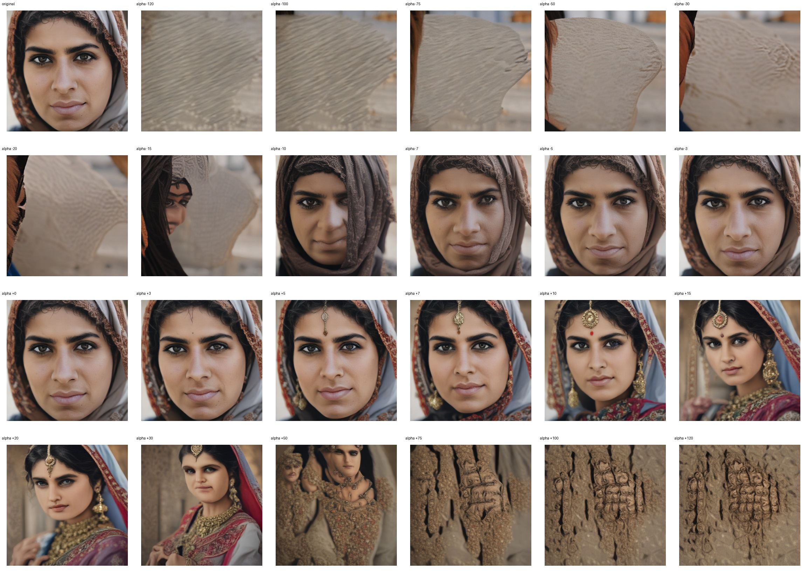
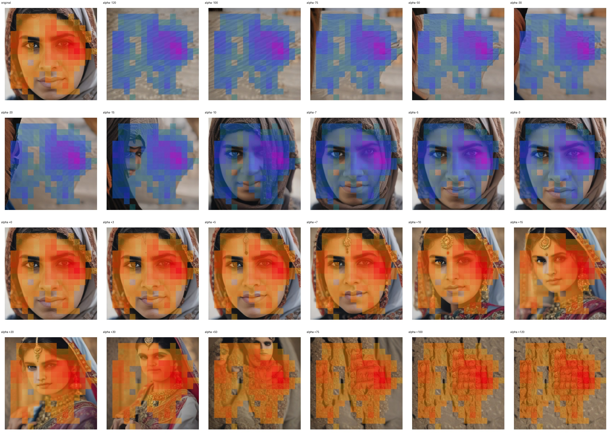
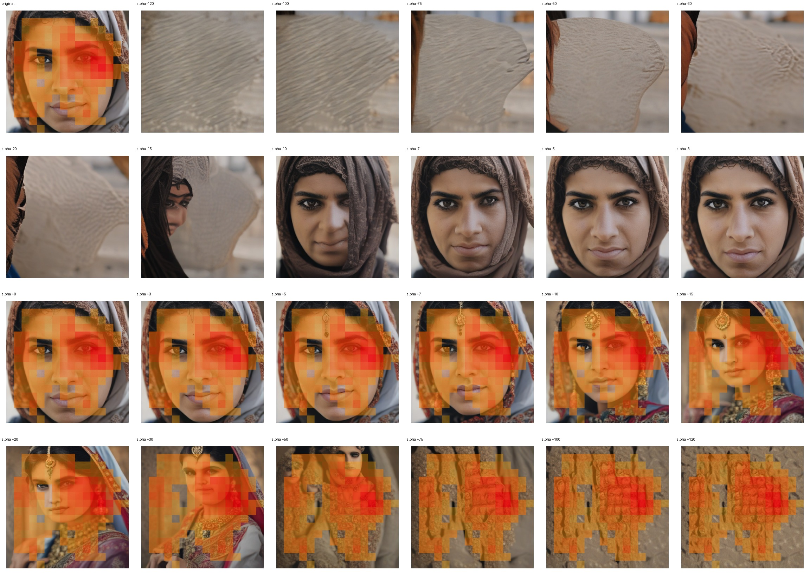

# Feature 3725 — Middle Eastern Woman

Biased dataset; original prompt and seed replay for seeds 0–19. Values are means across 20 source images. The table reports the mean post-re-encoded activation of feature 3725, the active spatial fraction, mean RGB pixel MAE versus the original image (0–255 scale), and coefficient change magnitudes for each alpha.

## Activation graph

## Mean metrics by alpha

| Alpha | Mean post-reencoded feature 3725 activation | Active spatial fraction | Mean pixel change (MAE) | Mean absolute coefficient change | Mean absolute scaled coefficient |
|---:|---:|---:|---:|---:|---:|
| -120 | 0.000 | 0.000 | 46.973 | 1026.841 | 1018.354 |
| -100 | 0.000 | 0.000 | 46.478 | 857.115 | 848.629 |
| -75 | 0.000 | 0.000 | 48.536 | 644.958 | 636.472 |
| -50 | 0.000 | 0.000 | 48.832 | 432.801 | 424.314 |
| -30 | 0.000 | 0.000 | 47.526 | 263.075 | 254.589 |
| -20 | 0.000 | 0.000 | 47.160 | 178.212 | 169.726 |
| -15 | 0.000 | 0.000 | 46.823 | 135.781 | 127.294 |
| -10 | 0.000 | 0.000 | 42.977 | 93.349 | 84.863 |
| -7 | 0.000 | 0.000 | 33.792 | 67.890 | 59.404 |
| -5 | 0.000 | 0.000 | 28.276 | 50.918 | 42.431 |
| -3 | 0.000 | 0.000 | 21.818 | 33.945 | 25.459 |
| +0 | 0.000 | 0.000 | 7.847 | 8.486 | 0.000 |
| +3 | 23.944 | 0.559 | 12.538 | 16.973 | 25.459 |
| +5 | 39.402 | 0.559 | 21.733 | 33.945 | 42.431 |
| +7 | 54.860 | 0.559 | 28.833 | 50.918 | 59.404 |
| +10 | 78.047 | 0.559 | 35.325 | 76.377 | 84.863 |
| +15 | 116.691 | 0.559 | 40.954 | 118.808 | 127.294 |
| +20 | 155.336 | 0.559 | 42.466 | 161.239 | 169.726 |
| +30 | 232.626 | 0.559 | 43.456 | 246.102 | 254.589 |
| +50 | 387.205 | 0.559 | 45.871 | 415.828 | 424.314 |
| +75 | 580.428 | 0.559 | 46.279 | 627.985 | 636.472 |
| +100 | 773.652 | 0.559 | 44.684 | 840.142 | 848.629 |
| +120 | 928.231 | 0.559 | 44.262 | 1009.868 | 1018.354 |

## Per-seed grids

Each 4×6 sheet contains the original followed by the 23 alpha variants in ascending alpha order, from −120 through +120.

### Plain images

[All 20 plain-image grids](seed_sheets/)

### Signed coefficient overlays

[All 20 signed coefficient grids](signed_coefficient_overlays/)

### Post-re-encoded activation overlays

[All 20 post-activation grids](post_activation_overlays/)

### Intervention-footprint overlays

[All 20 intervention-footprint grids](intervention_footprint_overlays/)

Zero is transparent. Negative coefficient colors progress green through blue to purple; positive colors progress yellow through orange to red. Each map tile is normalized individually for visibility. The original and alpha-zero tiles show the pre-intervention feature map so its location remains visible.
