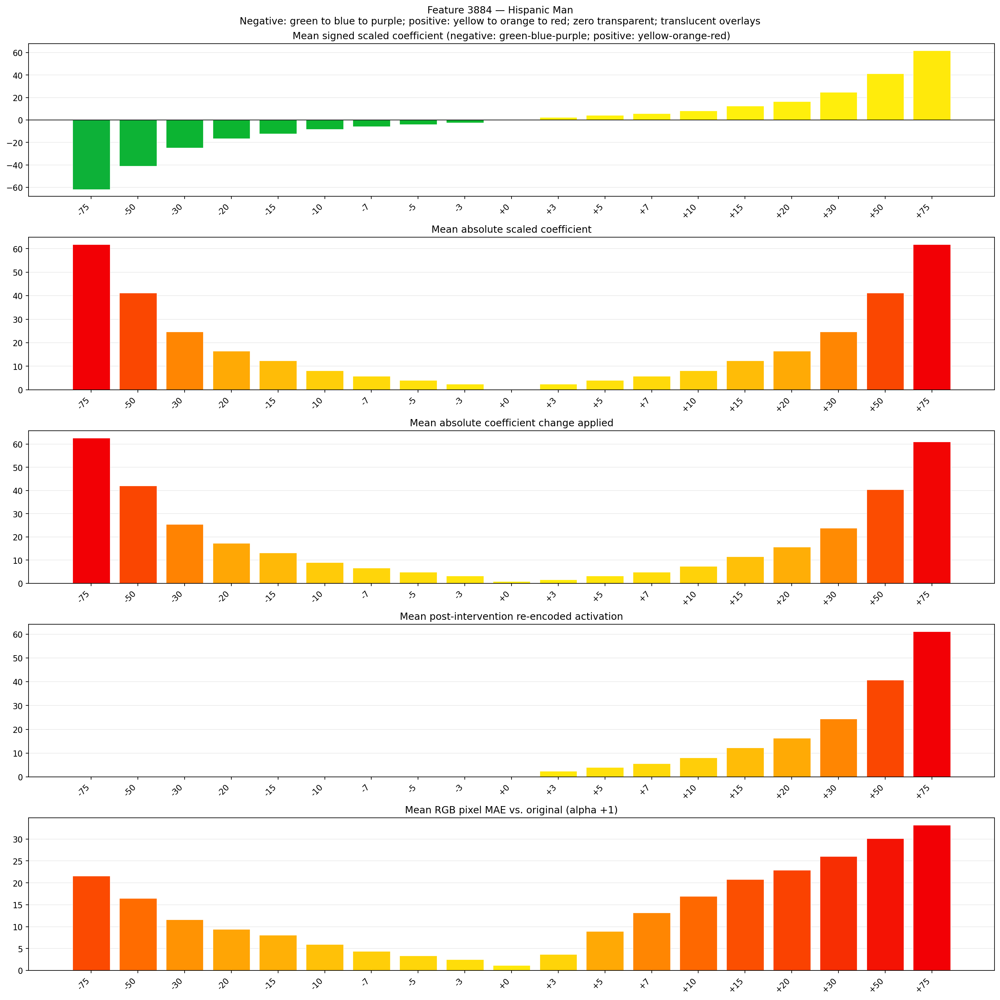
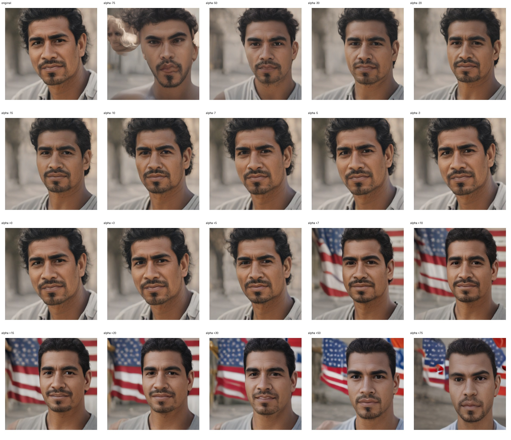
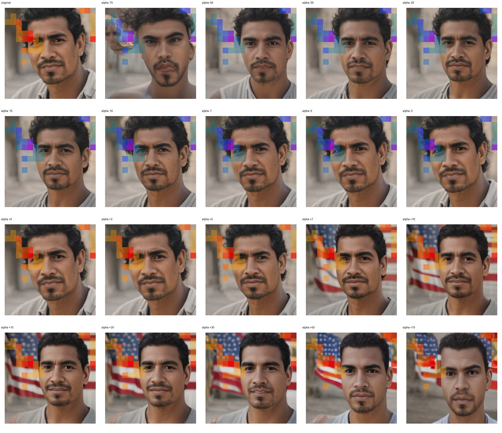
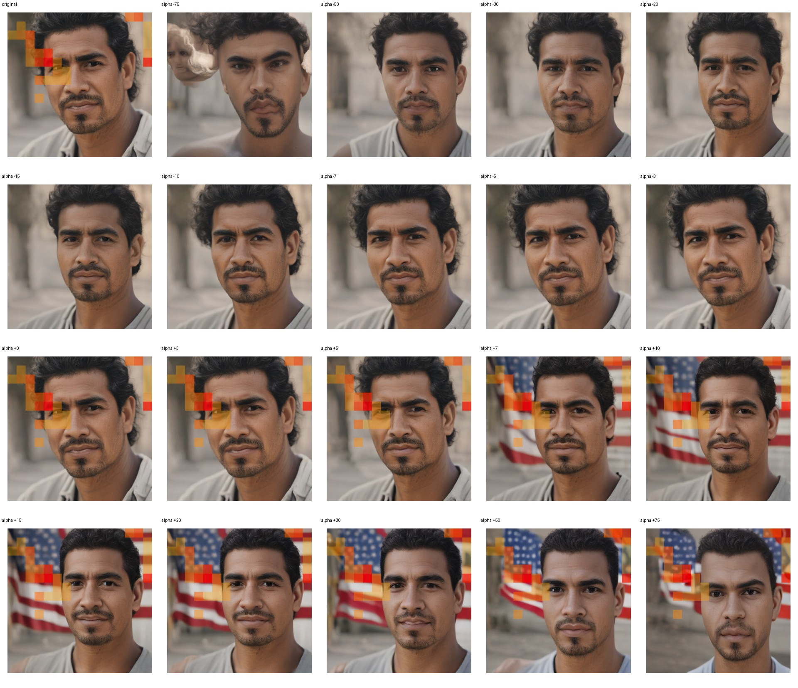

# Feature 3884 — Hispanic Man

Biased dataset; original prompt and seed replay for seeds 0–19. Values are means across 20 source images. The table reports the mean post-re-encoded activation of feature 3884, the active spatial fraction, mean RGB pixel MAE versus the original image (0–255 scale), and coefficient change magnitudes for each alpha.

## Activation graph

## Mean metrics by alpha

| Alpha | Mean post-reencoded feature 3884 activation | Active spatial fraction | Mean pixel change (MAE) | Mean absolute coefficient change | Mean absolute scaled coefficient |
|---:|---:|---:|---:|---:|---:|
| -75 | 0.000 | 0.000 | 21.572 | 62.595 | 61.771 |
| -50 | 0.000 | 0.000 | 16.453 | 42.004 | 41.181 |
| -30 | 0.000 | 0.000 | 11.644 | 25.532 | 24.709 |
| -20 | 0.000 | 0.000 | 9.445 | 17.296 | 16.472 |
| -15 | 0.000 | 0.000 | 8.075 | 13.178 | 12.354 |
| -10 | 0.000 | 0.000 | 5.999 | 9.060 | 8.236 |
| -7 | 0.000 | 0.000 | 4.423 | 6.589 | 5.765 |
| -5 | 0.000 | 0.000 | 3.421 | 4.942 | 4.118 |
| -3 | 0.000 | 0.000 | 2.533 | 3.294 | 2.471 |
| +0 | 0.000 | 0.000 | 1.185 | 0.824 | 0.000 |
| +3 | 2.451 | 0.066 | 3.702 | 1.647 | 2.471 |
| +5 | 4.079 | 0.066 | 8.974 | 3.294 | 4.118 |
| +7 | 5.707 | 0.066 | 13.214 | 4.942 | 5.765 |
| +10 | 8.148 | 0.066 | 16.959 | 7.413 | 8.236 |
| +15 | 12.218 | 0.066 | 20.793 | 11.531 | 12.354 |
| +20 | 16.287 | 0.066 | 22.945 | 15.649 | 16.472 |
| +30 | 24.426 | 0.066 | 26.034 | 23.885 | 24.709 |
| +50 | 40.703 | 0.066 | 30.133 | 40.357 | 41.181 |
| +75 | 61.050 | 0.066 | 33.165 | 60.948 | 61.771 |

## Per-seed grids

Each 5×4 sheet contains the original followed by the 19 alpha variants in ascending order.

### Plain images

[All 20 plain-image grids](seed_sheets/)

### Signed coefficient overlays

[All 20 signed coefficient grids](signed_coefficient_overlays/)

### Post-re-encoded activation overlays

[All 20 post-activation grids](post_activation_overlays/)

### Intervention-footprint overlays

[All 20 intervention-footprint grids](intervention_footprint_overlays/)

Zero is transparent. Negative coefficient colors progress green through blue to purple; positive colors progress yellow through orange to red. Each map tile is normalized individually for visibility. The original and alpha-zero tiles show the pre-intervention feature map so its location remains visible.
