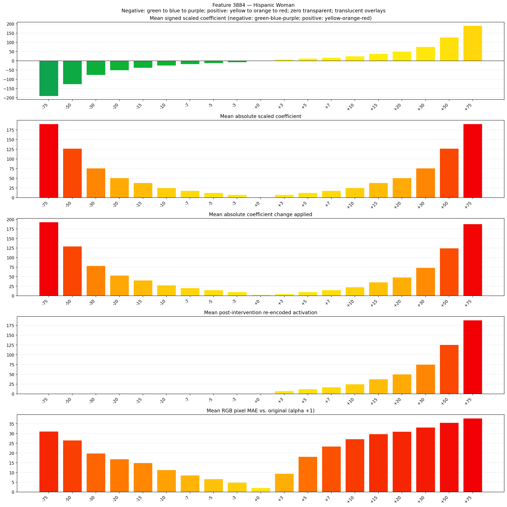
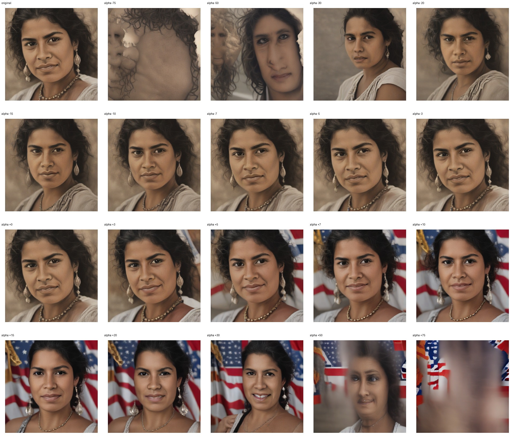
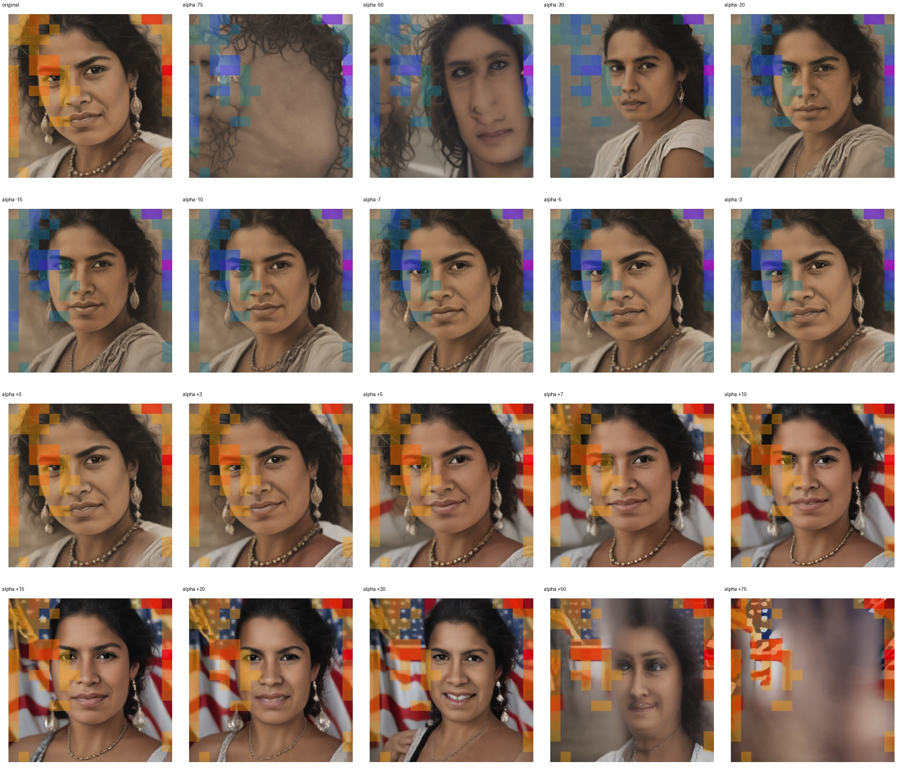
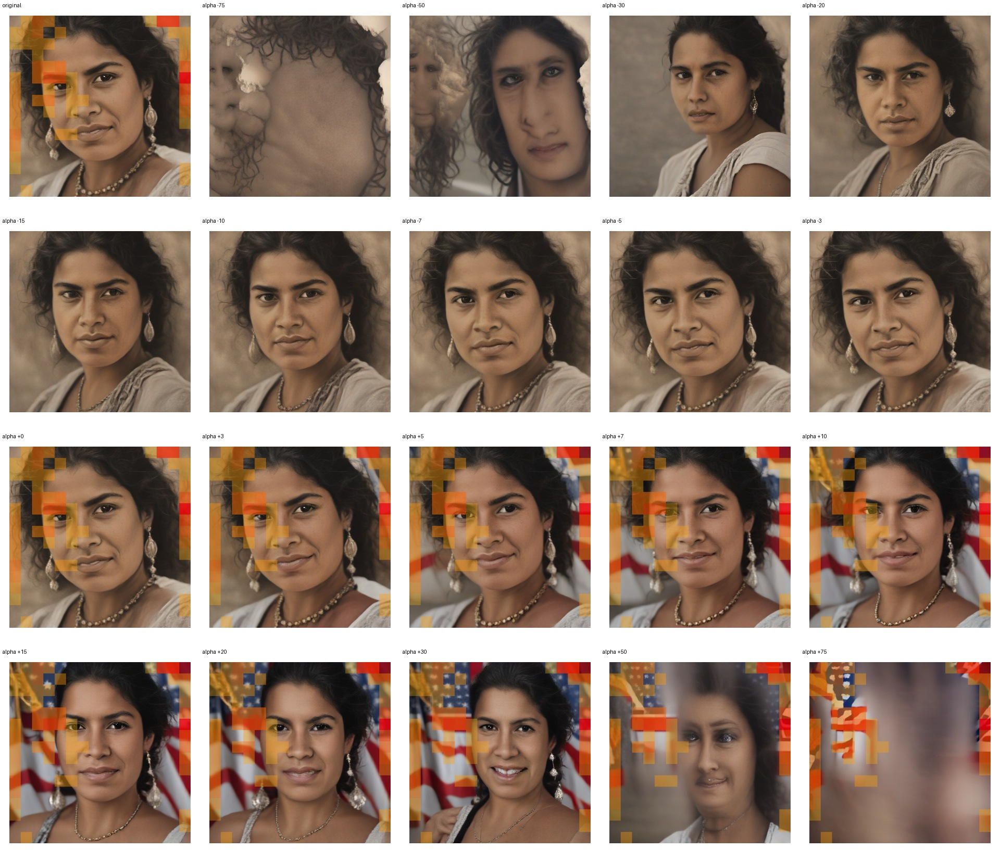

# Feature 3884 — Hispanic Woman

Biased dataset; original prompt and seed replay for seeds 0–19. Values are means across 20 source images. The table reports the mean post-re-encoded activation of feature 3884, the active spatial fraction, mean RGB pixel MAE versus the original image (0–255 scale), and coefficient change magnitudes for each alpha.

## Activation graph

## Mean metrics by alpha

| Alpha | Mean post-reencoded feature 3884 activation | Active spatial fraction | Mean pixel change (MAE) | Mean absolute coefficient change | Mean absolute scaled coefficient |
|---:|---:|---:|---:|---:|---:|
| -75 | 0.000 | 0.000 | 31.058 | 192.897 | 190.359 |
| -50 | 0.000 | 0.000 | 26.548 | 129.444 | 126.906 |
| -30 | 0.000 | 0.000 | 19.862 | 78.682 | 76.144 |
| -20 | 0.000 | 0.000 | 16.925 | 53.301 | 50.762 |
| -15 | 0.000 | 0.000 | 14.921 | 40.610 | 38.072 |
| -10 | 0.000 | 0.000 | 11.349 | 27.919 | 25.381 |
| -7 | 0.000 | 0.000 | 8.613 | 20.305 | 17.767 |
| -5 | 0.000 | 0.000 | 6.732 | 15.229 | 12.691 |
| -3 | 0.000 | 0.000 | 4.968 | 10.152 | 7.614 |
| +0 | 0.000 | 0.000 | 2.129 | 2.538 | 0.000 |
| +3 | 7.554 | 0.178 | 9.464 | 5.076 | 7.614 |
| +5 | 12.570 | 0.178 | 18.172 | 10.152 | 12.691 |
| +7 | 17.587 | 0.178 | 23.395 | 15.229 | 17.767 |
| +10 | 25.111 | 0.178 | 27.184 | 22.843 | 25.381 |
| +15 | 37.651 | 0.178 | 29.745 | 35.534 | 38.072 |
| +20 | 50.192 | 0.178 | 31.050 | 48.224 | 50.762 |
| +30 | 75.272 | 0.178 | 33.127 | 73.605 | 76.144 |
| +50 | 125.434 | 0.178 | 35.605 | 124.368 | 126.906 |
| +75 | 188.136 | 0.178 | 37.761 | 187.821 | 190.359 |

## Per-seed grids

Each 5×4 sheet contains the original followed by the 19 alpha variants in ascending order.

### Plain images

[All 20 plain-image grids](seed_sheets/)

### Signed coefficient overlays

[All 20 signed coefficient grids](signed_coefficient_overlays/)

### Post-re-encoded activation overlays

[All 20 post-activation grids](post_activation_overlays/)

### Intervention-footprint overlays

[All 20 intervention-footprint grids](intervention_footprint_overlays/)

Zero is transparent. Negative coefficient colors progress green through blue to purple; positive colors progress yellow through orange to red. Each map tile is normalized individually for visibility. The original and alpha-zero tiles show the pre-intervention feature map so its location remains visible.
