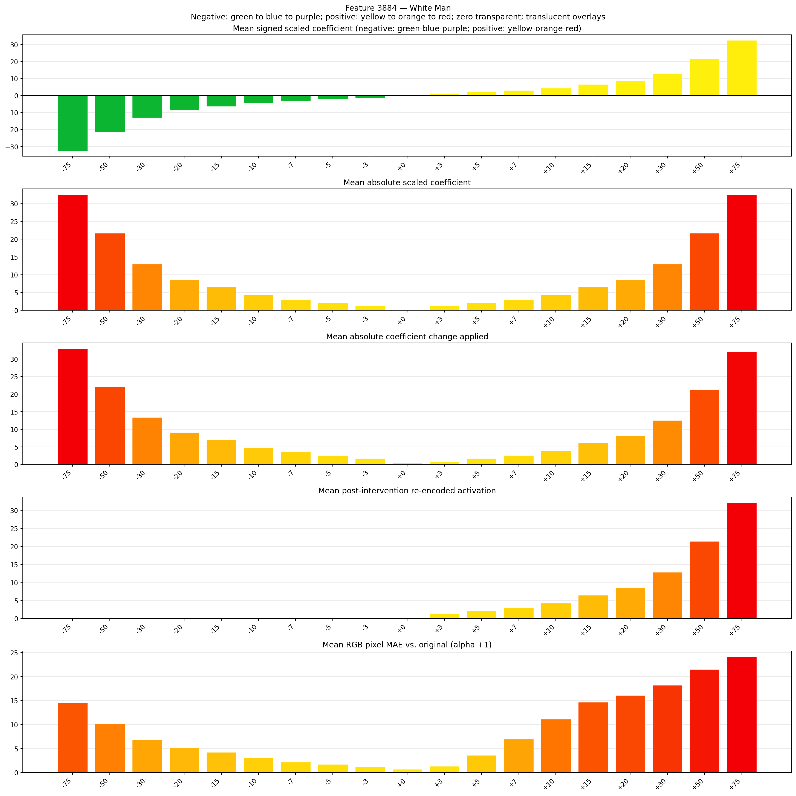
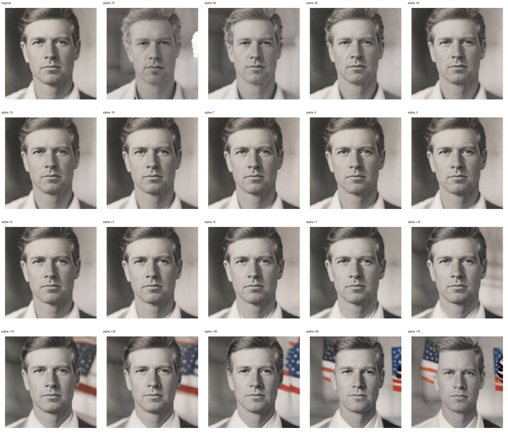
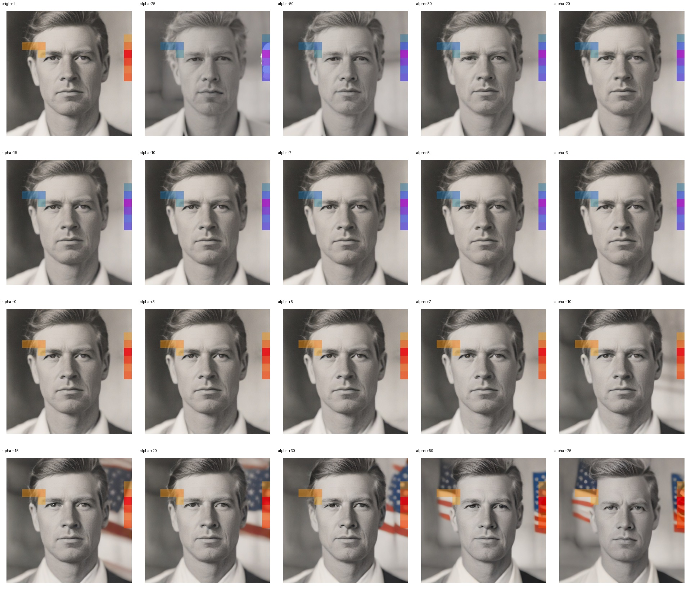
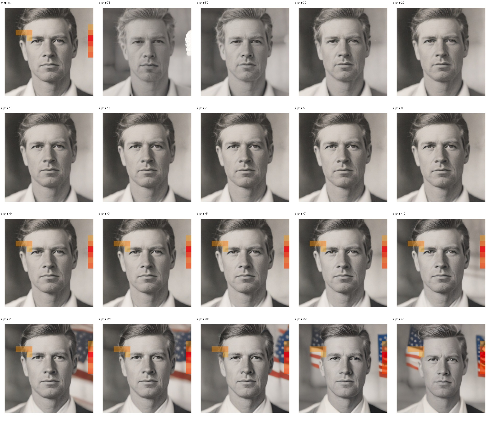

# Feature 3884 — White Man

Biased dataset; original prompt and seed replay for seeds 0–19. Values are means across 20 source images. The table reports the mean post-re-encoded activation of feature 3884, the active spatial fraction, mean RGB pixel MAE versus the original image (0–255 scale), and coefficient change magnitudes for each alpha.

## Activation graph

## Mean metrics by alpha

| Alpha | Mean post-reencoded feature 3884 activation | Active spatial fraction | Mean pixel change (MAE) | Mean absolute coefficient change | Mean absolute scaled coefficient |
|---:|---:|---:|---:|---:|---:|
| -75 | 0.000 | 0.000 | 14.496 | 32.917 | 32.484 |
| -50 | 0.000 | 0.000 | 10.139 | 22.089 | 21.656 |
| -30 | 0.000 | 0.000 | 6.768 | 13.427 | 12.994 |
| -20 | 0.000 | 0.000 | 5.127 | 9.096 | 8.662 |
| -15 | 0.000 | 0.000 | 4.215 | 6.930 | 6.497 |
| -10 | 0.000 | 0.000 | 3.036 | 4.764 | 4.331 |
| -7 | 0.000 | 0.000 | 2.199 | 3.465 | 3.032 |
| -5 | 0.000 | 0.000 | 1.705 | 2.599 | 2.166 |
| -3 | 0.000 | 0.000 | 1.274 | 1.732 | 1.299 |
| +0 | 0.000 | 0.000 | 0.674 | 0.433 | 0.000 |
| +3 | 1.289 | 0.033 | 1.293 | 0.866 | 1.299 |
| +5 | 2.145 | 0.033 | 3.591 | 1.732 | 2.166 |
| +7 | 3.001 | 0.033 | 6.972 | 2.599 | 3.032 |
| +10 | 4.285 | 0.033 | 11.137 | 3.898 | 4.331 |
| +15 | 6.425 | 0.033 | 14.679 | 6.064 | 6.497 |
| +20 | 8.565 | 0.033 | 16.095 | 8.229 | 8.662 |
| +30 | 12.845 | 0.033 | 18.183 | 12.561 | 12.994 |
| +50 | 21.405 | 0.033 | 21.489 | 21.223 | 21.656 |
| +75 | 32.105 | 0.033 | 24.095 | 32.051 | 32.484 |

## Per-seed grids

Each 5×4 sheet contains the original followed by the 19 alpha variants in ascending order.

### Plain images

[All 20 plain-image grids](seed_sheets/)

### Signed coefficient overlays

[All 20 signed coefficient grids](signed_coefficient_overlays/)

### Post-re-encoded activation overlays

[All 20 post-activation grids](post_activation_overlays/)

### Intervention-footprint overlays

[All 20 intervention-footprint grids](intervention_footprint_overlays/)

Zero is transparent. Negative coefficient colors progress green through blue to purple; positive colors progress yellow through orange to red. Each map tile is normalized individually for visibility. The original and alpha-zero tiles show the pre-intervention feature map so its location remains visible.
