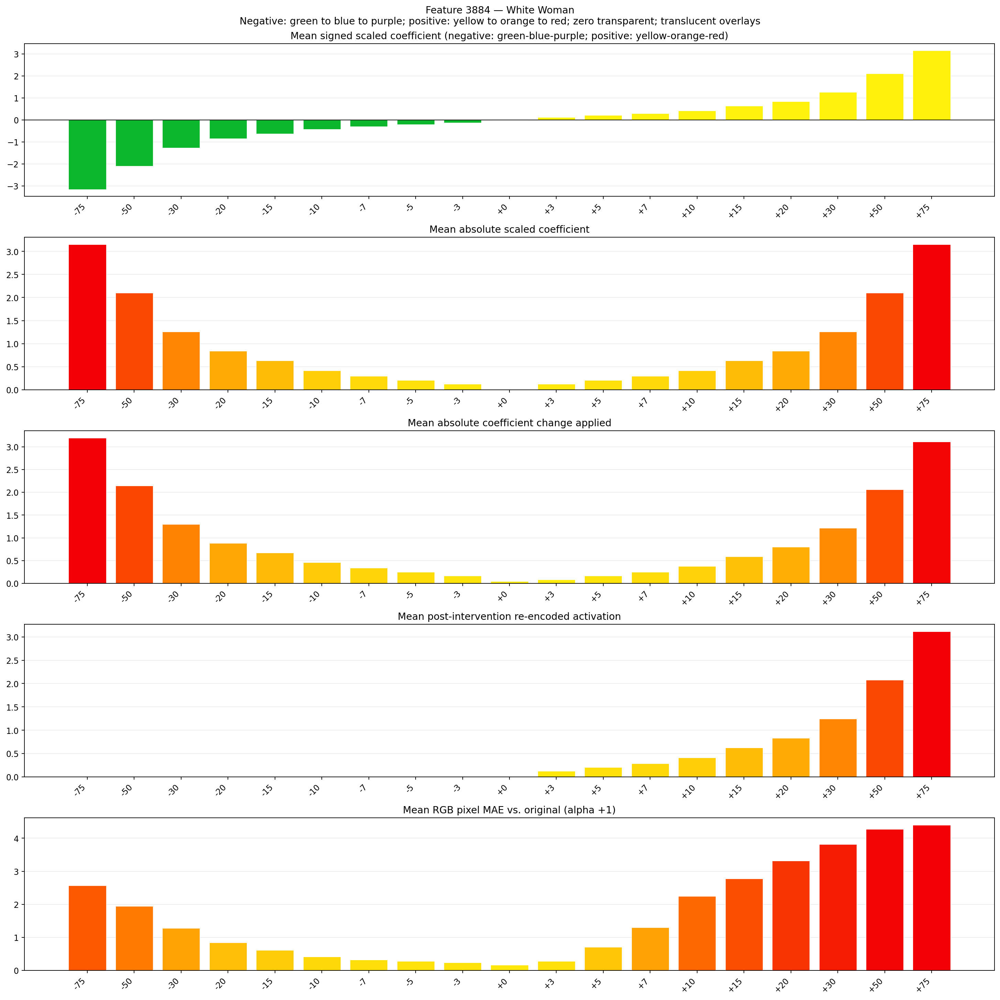
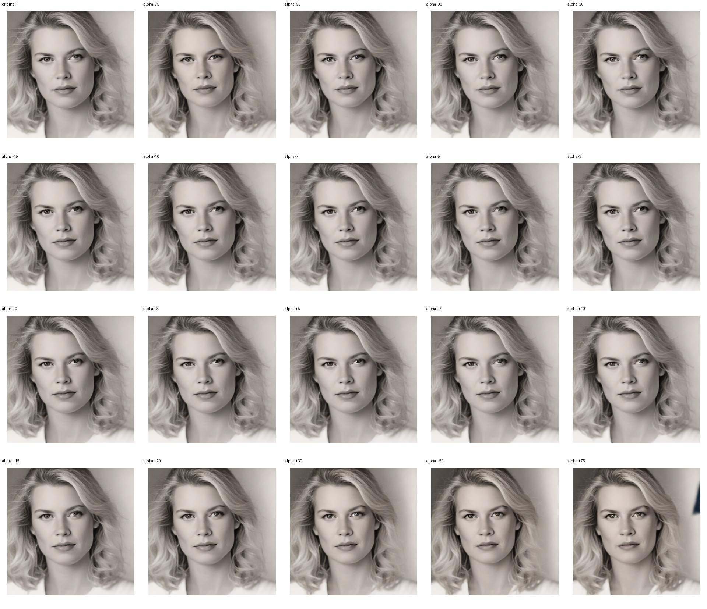
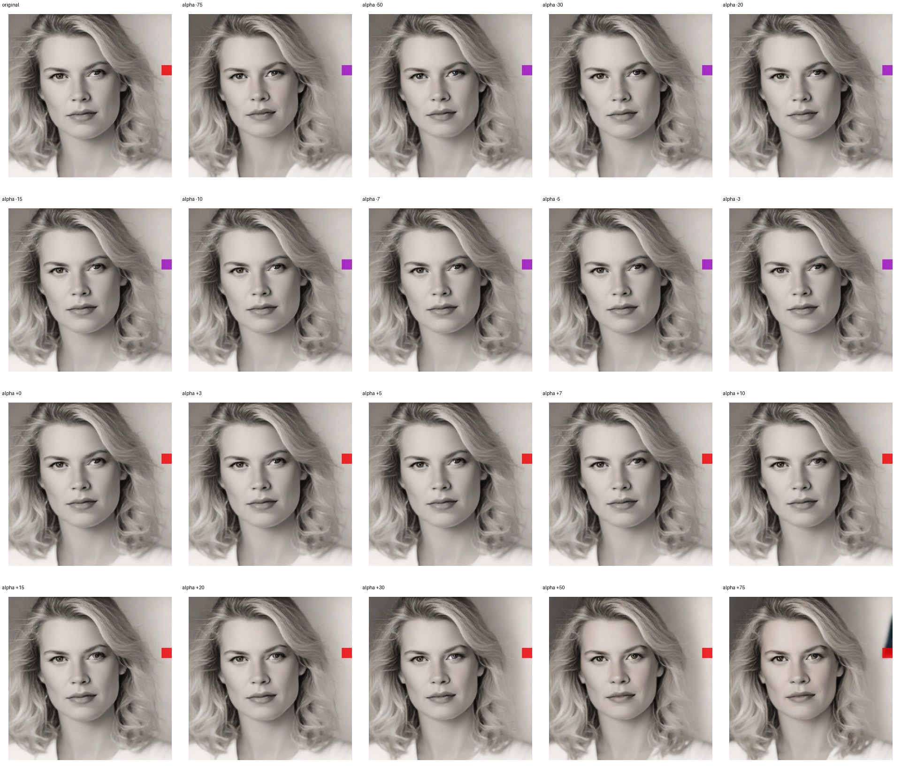
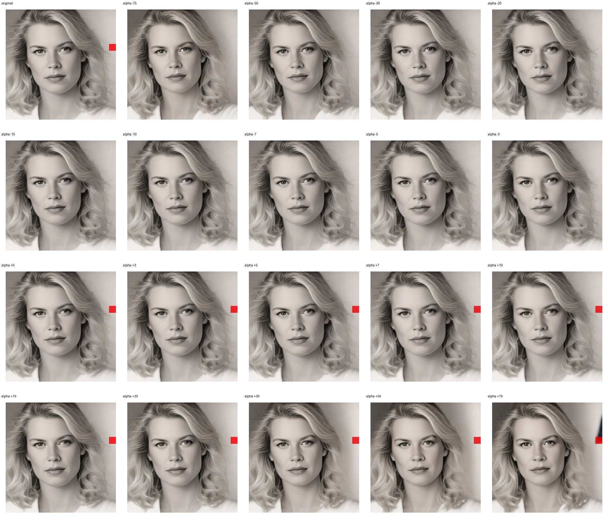

# Feature 3884 — White Woman

Biased dataset; original prompt and seed replay for seeds 0–19. Values are means across 20 source images. The table reports the mean post-re-encoded activation of feature 3884, the active spatial fraction, mean RGB pixel MAE versus the original image (0–255 scale), and coefficient change magnitudes for each alpha.

## Activation graph

## Mean metrics by alpha

| Alpha | Mean post-reencoded feature 3884 activation | Active spatial fraction | Mean pixel change (MAE) | Mean absolute coefficient change | Mean absolute scaled coefficient |
|---:|---:|---:|---:|---:|---:|
| -75 | 0.000 | 0.000 | 2.568 | 3.191 | 3.149 |
| -50 | 0.000 | 0.000 | 1.950 | 2.142 | 2.100 |
| -30 | 0.000 | 0.000 | 1.276 | 1.302 | 1.260 |
| -20 | 0.000 | 0.000 | 0.842 | 0.882 | 0.840 |
| -15 | 0.000 | 0.000 | 0.620 | 0.672 | 0.630 |
| -10 | 0.000 | 0.000 | 0.415 | 0.462 | 0.420 |
| -7 | 0.000 | 0.000 | 0.326 | 0.336 | 0.294 |
| -5 | 0.000 | 0.000 | 0.279 | 0.252 | 0.210 |
| -3 | 0.000 | 0.000 | 0.239 | 0.168 | 0.126 |
| +0 | 0.000 | 0.000 | 0.163 | 0.042 | 0.000 |
| +3 | 0.125 | 0.003 | 0.281 | 0.084 | 0.126 |
| +5 | 0.208 | 0.003 | 0.709 | 0.168 | 0.210 |
| +7 | 0.291 | 0.003 | 1.301 | 0.252 | 0.294 |
| +10 | 0.415 | 0.003 | 2.250 | 0.378 | 0.420 |
| +15 | 0.623 | 0.003 | 2.778 | 0.588 | 0.630 |
| +20 | 0.830 | 0.003 | 3.320 | 0.798 | 0.840 |
| +30 | 1.245 | 0.003 | 3.819 | 1.218 | 1.260 |
| +50 | 2.075 | 0.003 | 4.279 | 2.058 | 2.100 |
| +75 | 3.113 | 0.003 | 4.395 | 3.108 | 3.149 |

## Per-seed grids

Each 5×4 sheet contains the original followed by the 19 alpha variants in ascending order.

### Plain images

[All 20 plain-image grids](seed_sheets/)

### Signed coefficient overlays

[All 20 signed coefficient grids](signed_coefficient_overlays/)

### Post-re-encoded activation overlays

[All 20 post-activation grids](post_activation_overlays/)

### Intervention-footprint overlays

[All 20 intervention-footprint grids](intervention_footprint_overlays/)

Zero is transparent. Negative coefficient colors progress green through blue to purple; positive colors progress yellow through orange to red. Each map tile is normalized individually for visibility. The original and alpha-zero tiles show the pre-intervention feature map so its location remains visible.
