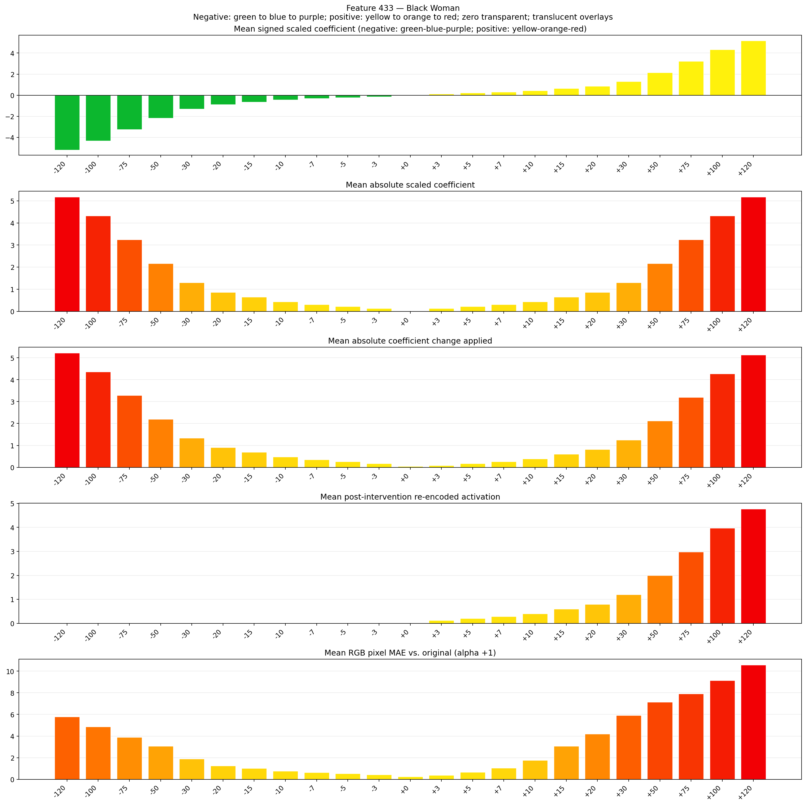

# Feature 433 — Black Woman

Biased dataset; original prompt and seed replay for seeds 0–19. Values are means across 20 source images. The table reports the mean post-re-encoded activation of feature 433, the active spatial fraction, mean RGB pixel MAE versus the original image (0–255 scale), and coefficient change magnitudes for each alpha.

## Activation graph

## Mean metrics by alpha

| Alpha | Mean post-reencoded feature 433 activation | Active spatial fraction | Mean pixel change (MAE) | Mean absolute coefficient change | Mean absolute scaled coefficient |
|---:|---:|---:|---:|---:|---:|
| -120 | 0.000 | 0.000 | 5.772 | 5.222 | 5.179 |
| -100 | 0.000 | 0.000 | 4.862 | 4.359 | 4.316 |
| -75 | 0.000 | 0.000 | 3.896 | 3.280 | 3.237 |
| -50 | 0.000 | 0.000 | 3.068 | 2.201 | 2.158 |
| -30 | 0.000 | 0.000 | 1.883 | 1.338 | 1.295 |
| -20 | 0.000 | 0.000 | 1.257 | 0.906 | 0.863 |
| -15 | 0.000 | 0.000 | 1.015 | 0.691 | 0.647 |
| -10 | 0.000 | 0.000 | 0.766 | 0.475 | 0.432 |
| -7 | 0.000 | 0.000 | 0.629 | 0.345 | 0.302 |
| -5 | 0.000 | 0.000 | 0.535 | 0.259 | 0.216 |
| -3 | 0.000 | 0.000 | 0.440 | 0.173 | 0.129 |
| +0 | 0.000 | 0.000 | 0.258 | 0.043 | 0.000 |
| +3 | 0.123 | 0.003 | 0.374 | 0.086 | 0.129 |
| +5 | 0.202 | 0.003 | 0.663 | 0.173 | 0.216 |
| +7 | 0.281 | 0.003 | 1.036 | 0.259 | 0.302 |
| +10 | 0.401 | 0.003 | 1.760 | 0.388 | 0.432 |
| +15 | 0.599 | 0.003 | 3.075 | 0.604 | 0.647 |
| +20 | 0.798 | 0.003 | 4.189 | 0.820 | 0.863 |
| +30 | 1.195 | 0.003 | 5.904 | 1.252 | 1.295 |
| +50 | 1.989 | 0.003 | 7.140 | 2.115 | 2.158 |
| +75 | 2.982 | 0.003 | 7.916 | 3.194 | 3.237 |
| +100 | 3.975 | 0.003 | 9.141 | 4.273 | 4.316 |
| +120 | 4.769 | 0.003 | 10.571 | 5.136 | 5.179 |

## Per-seed grids

Each 4×6 sheet contains the original followed by the 23 alpha variants in ascending alpha order, from −120 through +120.

### Plain images

[All 20 plain-image grids](seed_sheets/)

### Signed coefficient overlays

[All 20 signed coefficient grids](signed_coefficient_overlays/)

### Post-re-encoded activation overlays

[All 20 post-activation grids](post_activation_overlays/)

### Intervention-footprint overlays

[All 20 intervention-footprint grids](intervention_footprint_overlays/)

Zero is transparent. Negative coefficient colors progress green through blue to purple; positive colors progress yellow through orange to red. Each map tile is normalized individually for visibility. The original and alpha-zero tiles show the pre-intervention feature map so its location remains visible.
