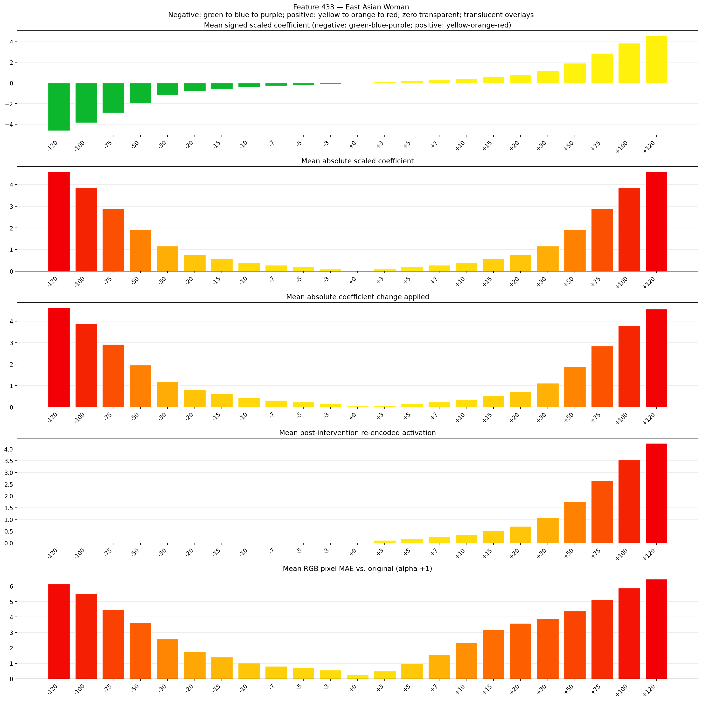
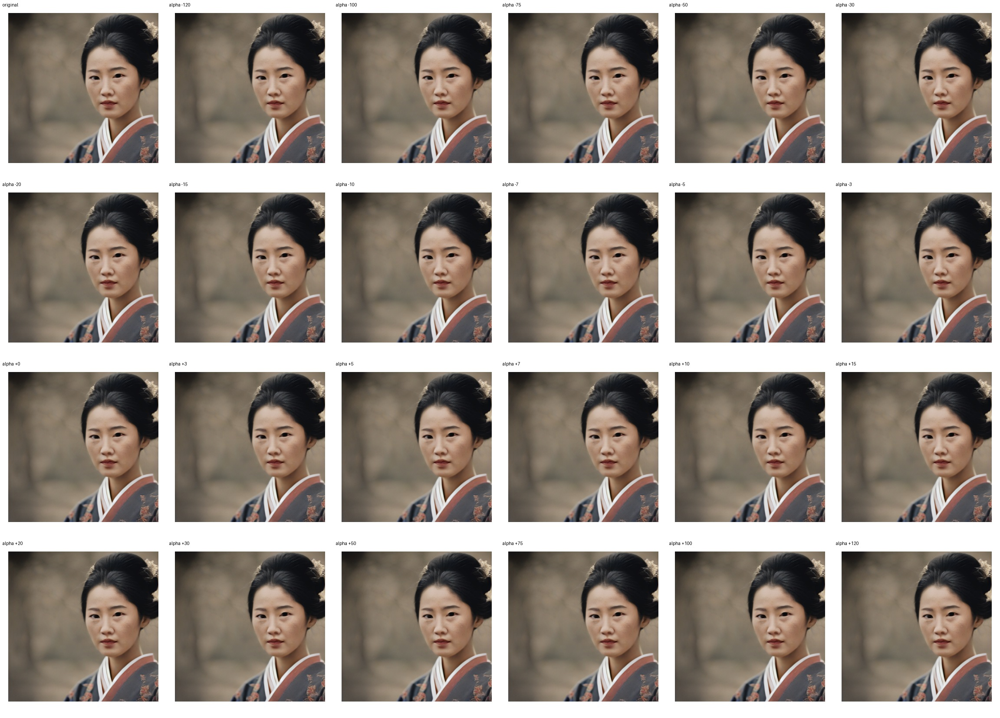

# Feature 433 — East Asian Woman

Biased dataset; original prompt and seed replay for seeds 0–19. Values are means across 20 source images. The table reports the mean post-re-encoded activation of feature 433, the active spatial fraction, mean RGB pixel MAE versus the original image (0–255 scale), and coefficient change magnitudes for each alpha.

## Activation graph

## Mean metrics by alpha

| Alpha | Mean post-reencoded feature 433 activation | Active spatial fraction | Mean pixel change (MAE) | Mean absolute coefficient change | Mean absolute scaled coefficient |
|---:|---:|---:|---:|---:|---:|
| -120 | 0.000 | 0.000 | 6.133 | 4.646 | 4.607 |
| -100 | 0.000 | 0.000 | 5.506 | 3.878 | 3.840 |
| -75 | 0.000 | 0.000 | 4.481 | 2.918 | 2.880 |
| -50 | 0.000 | 0.000 | 3.623 | 1.958 | 1.920 |
| -30 | 0.000 | 0.000 | 2.572 | 1.190 | 1.152 |
| -20 | 0.000 | 0.000 | 1.764 | 0.806 | 0.768 |
| -15 | 0.000 | 0.000 | 1.397 | 0.614 | 0.576 |
| -10 | 0.000 | 0.000 | 1.013 | 0.422 | 0.384 |
| -7 | 0.000 | 0.000 | 0.815 | 0.307 | 0.269 |
| -5 | 0.000 | 0.000 | 0.695 | 0.230 | 0.192 |
| -3 | 0.000 | 0.000 | 0.552 | 0.154 | 0.115 |
| +0 | 0.000 | 0.000 | 0.257 | 0.038 | 0.000 |
| +3 | 0.109 | 0.003 | 0.490 | 0.077 | 0.115 |
| +5 | 0.180 | 0.003 | 0.975 | 0.154 | 0.192 |
| +7 | 0.250 | 0.003 | 1.539 | 0.230 | 0.269 |
| +10 | 0.356 | 0.003 | 2.346 | 0.346 | 0.384 |
| +15 | 0.533 | 0.003 | 3.180 | 0.538 | 0.576 |
| +20 | 0.710 | 0.003 | 3.589 | 0.730 | 0.768 |
| +30 | 1.063 | 0.003 | 3.894 | 1.113 | 1.152 |
| +50 | 1.770 | 0.003 | 4.383 | 1.881 | 1.920 |
| +75 | 2.653 | 0.003 | 5.110 | 2.841 | 2.880 |
| +100 | 3.536 | 0.003 | 5.859 | 3.801 | 3.840 |
| +120 | 4.243 | 0.003 | 6.442 | 4.569 | 4.607 |

## Per-seed grids

Each 4×6 sheet contains the original followed by the 23 alpha variants in ascending alpha order, from −120 through +120.

### Plain images

[All 20 plain-image grids](seed_sheets/)

### Signed coefficient overlays

[All 20 signed coefficient grids](signed_coefficient_overlays/)

### Post-re-encoded activation overlays

[All 20 post-activation grids](post_activation_overlays/)

### Intervention-footprint overlays

[All 20 intervention-footprint grids](intervention_footprint_overlays/)

Zero is transparent. Negative coefficient colors progress green through blue to purple; positive colors progress yellow through orange to red. Each map tile is normalized individually for visibility. The original and alpha-zero tiles show the pre-intervention feature map so its location remains visible.
