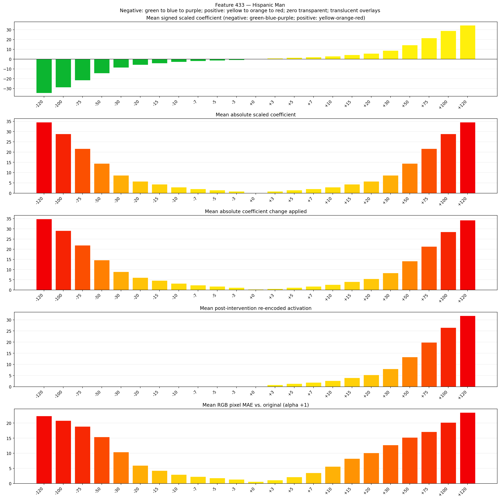
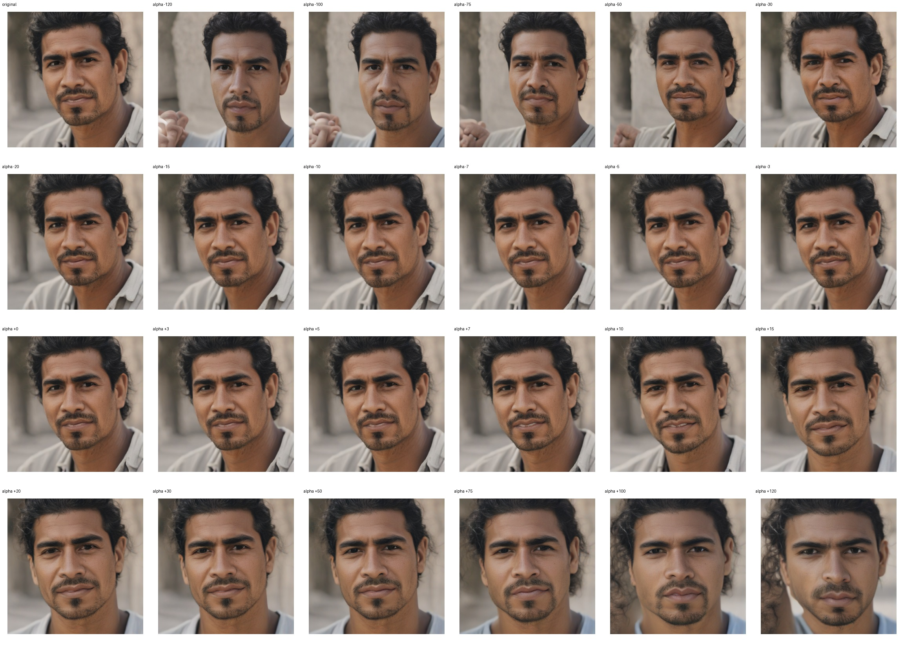
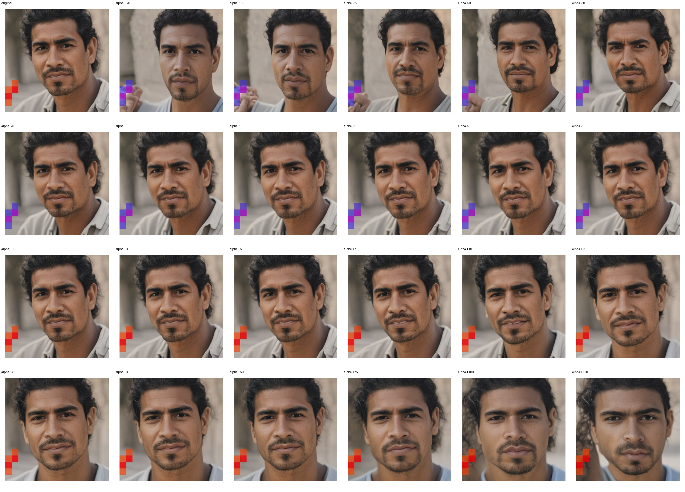
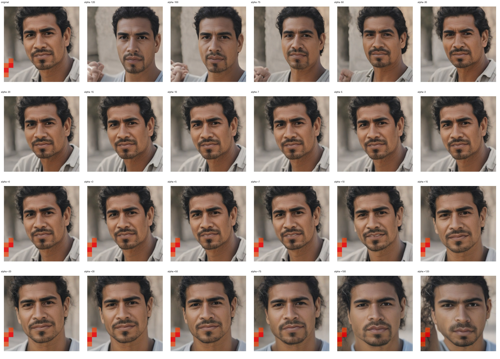

# Feature 433 — Hispanic Man

Biased dataset; original prompt and seed replay for seeds 0–19. Values are means across 20 source images. The table reports the mean post-re-encoded activation of feature 433, the active spatial fraction, mean RGB pixel MAE versus the original image (0–255 scale), and coefficient change magnitudes for each alpha.

## Activation graph

## Mean metrics by alpha

| Alpha | Mean post-reencoded feature 433 activation | Active spatial fraction | Mean pixel change (MAE) | Mean absolute coefficient change | Mean absolute scaled coefficient |
|---:|---:|---:|---:|---:|---:|
| -120 | 0.000 | 0.000 | 22.337 | 34.861 | 34.573 |
| -100 | 0.000 | 0.000 | 20.839 | 29.099 | 28.811 |
| -75 | 0.000 | 0.000 | 18.896 | 21.896 | 21.608 |
| -50 | 0.000 | 0.000 | 15.432 | 14.693 | 14.405 |
| -30 | 0.000 | 0.000 | 10.388 | 8.931 | 8.643 |
| -20 | 0.000 | 0.000 | 5.969 | 6.050 | 5.762 |
| -15 | 0.000 | 0.000 | 4.267 | 4.610 | 4.322 |
| -10 | 0.000 | 0.000 | 2.952 | 3.169 | 2.881 |
| -7 | 0.000 | 0.000 | 2.251 | 2.305 | 2.017 |
| -5 | 0.000 | 0.000 | 1.796 | 1.729 | 1.441 |
| -3 | 0.000 | 0.000 | 1.361 | 1.152 | 0.864 |
| +0 | 0.000 | 0.000 | 0.636 | 0.288 | 0.000 |
| +3 | 0.818 | 0.026 | 1.099 | 0.576 | 0.864 |
| +5 | 1.349 | 0.026 | 2.176 | 1.152 | 1.441 |
| +7 | 1.879 | 0.026 | 3.541 | 1.729 | 2.017 |
| +10 | 2.674 | 0.026 | 5.627 | 2.593 | 2.881 |
| +15 | 4.000 | 0.026 | 8.264 | 4.033 | 4.322 |
| +20 | 5.325 | 0.026 | 10.112 | 5.474 | 5.762 |
| +30 | 7.977 | 0.026 | 12.724 | 8.355 | 8.643 |
| +50 | 13.279 | 0.026 | 15.239 | 14.117 | 14.405 |
| +75 | 19.907 | 0.026 | 17.138 | 21.320 | 21.608 |
| +100 | 26.535 | 0.026 | 20.202 | 28.522 | 28.811 |
| +120 | 31.838 | 0.026 | 23.496 | 34.285 | 34.573 |

## Per-seed grids

Each 4×6 sheet contains the original followed by the 23 alpha variants in ascending alpha order, from −120 through +120.

### Plain images

[All 20 plain-image grids](seed_sheets/)

### Signed coefficient overlays

[All 20 signed coefficient grids](signed_coefficient_overlays/)

### Post-re-encoded activation overlays

[All 20 post-activation grids](post_activation_overlays/)

### Intervention-footprint overlays

[All 20 intervention-footprint grids](intervention_footprint_overlays/)

Zero is transparent. Negative coefficient colors progress green through blue to purple; positive colors progress yellow through orange to red. Each map tile is normalized individually for visibility. The original and alpha-zero tiles show the pre-intervention feature map so its location remains visible.
