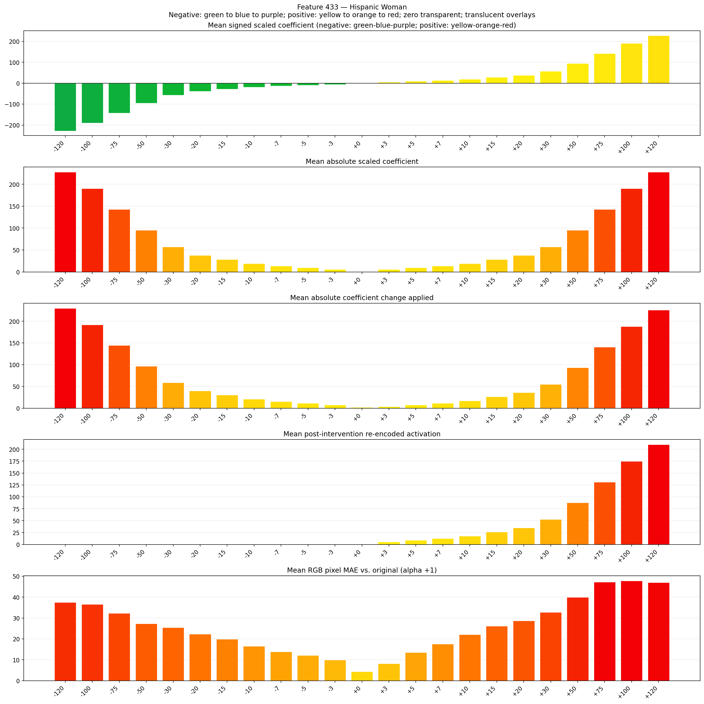
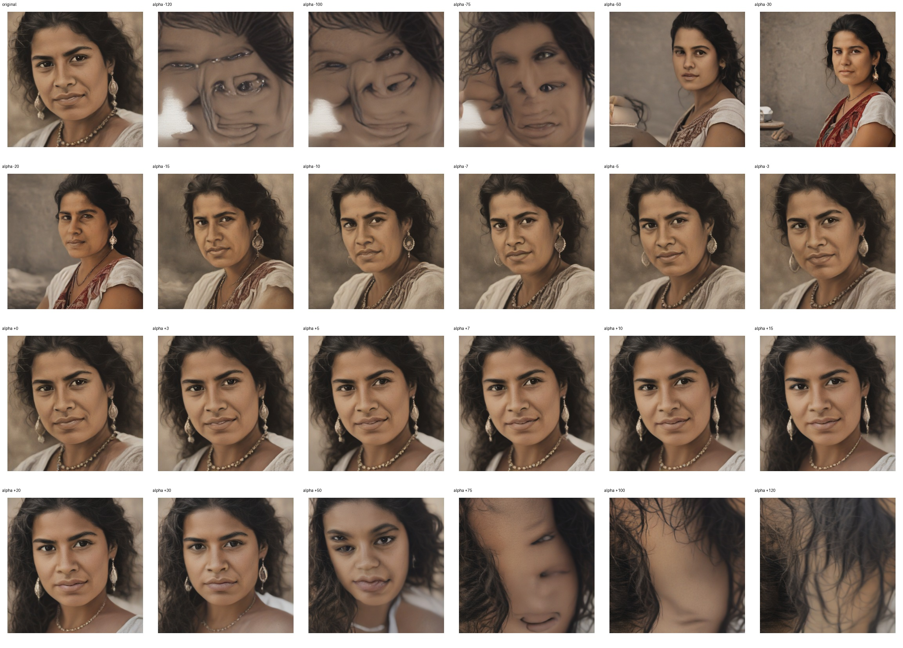
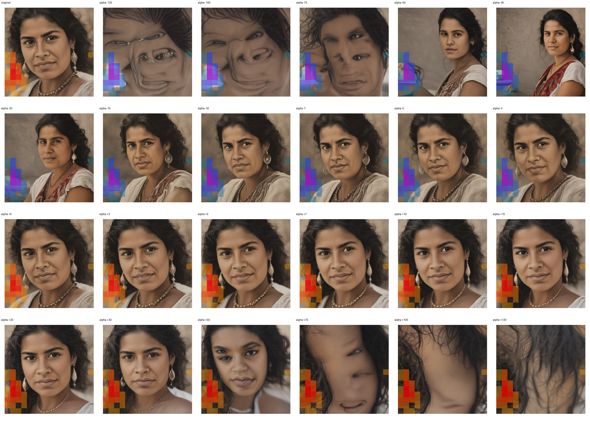
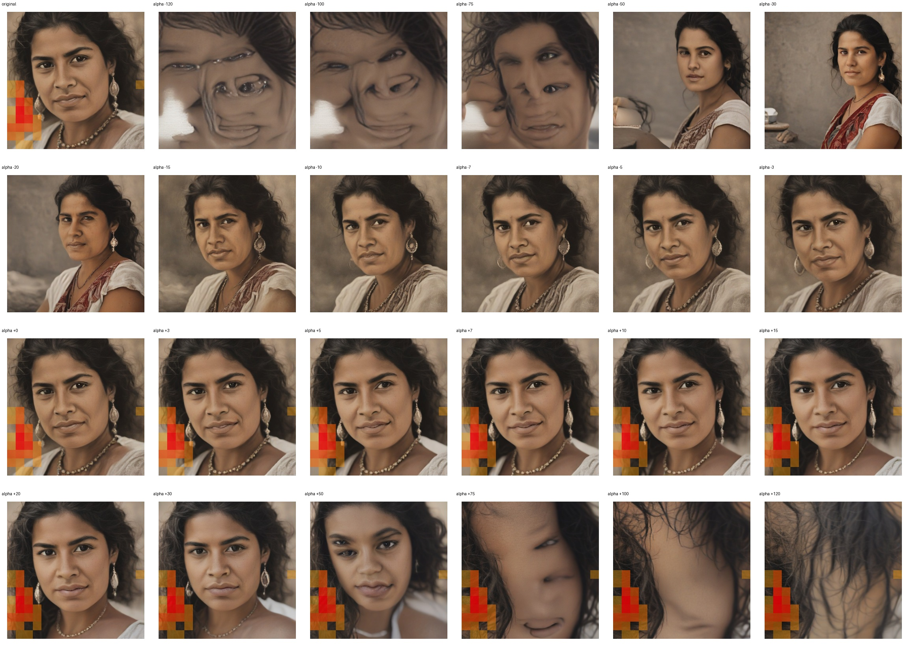

# Feature 433 — Hispanic Woman

Biased dataset; original prompt and seed replay for seeds 0–19. Values are means across 20 source images. The table reports the mean post-re-encoded activation of feature 433, the active spatial fraction, mean RGB pixel MAE versus the original image (0–255 scale), and coefficient change magnitudes for each alpha.

## Activation graph

## Mean metrics by alpha

| Alpha | Mean post-reencoded feature 433 activation | Active spatial fraction | Mean pixel change (MAE) | Mean absolute coefficient change | Mean absolute scaled coefficient |
|---:|---:|---:|---:|---:|---:|
| -120 | 0.000 | 0.000 | 37.532 | 229.831 | 227.931 |
| -100 | 0.000 | 0.000 | 36.551 | 191.842 | 189.943 |
| -75 | 0.000 | 0.000 | 32.239 | 144.357 | 142.457 |
| -50 | 0.000 | 0.000 | 27.253 | 96.871 | 94.971 |
| -30 | 0.000 | 0.000 | 25.418 | 58.882 | 56.983 |
| -20 | 0.000 | 0.000 | 22.264 | 39.888 | 37.989 |
| -15 | 0.000 | 0.000 | 19.893 | 30.391 | 28.491 |
| -10 | 0.000 | 0.000 | 16.472 | 20.894 | 18.994 |
| -7 | 0.000 | 0.000 | 13.919 | 15.195 | 13.296 |
| -5 | 0.000 | 0.000 | 12.179 | 11.397 | 9.497 |
| -3 | 0.000 | 0.000 | 9.979 | 7.598 | 5.698 |
| +0 | 0.000 | 0.000 | 4.349 | 1.899 | 0.000 |
| +3 | 5.395 | 0.118 | 8.146 | 3.799 | 5.698 |
| +5 | 8.891 | 0.118 | 13.519 | 7.598 | 9.497 |
| +7 | 12.387 | 0.118 | 17.613 | 11.397 | 13.296 |
| +10 | 17.631 | 0.118 | 22.076 | 17.095 | 18.994 |
| +15 | 26.370 | 0.118 | 26.137 | 26.592 | 28.491 |
| +20 | 35.110 | 0.118 | 28.739 | 36.089 | 37.989 |
| +30 | 52.589 | 0.118 | 32.731 | 55.083 | 56.983 |
| +50 | 87.547 | 0.118 | 39.856 | 93.072 | 94.971 |
| +75 | 131.245 | 0.118 | 47.171 | 140.558 | 142.457 |
| +100 | 174.944 | 0.118 | 47.792 | 188.043 | 189.943 |
| +120 | 209.902 | 0.118 | 46.934 | 226.032 | 227.931 |

## Per-seed grids

Each 4×6 sheet contains the original followed by the 23 alpha variants in ascending alpha order, from −120 through +120.

### Plain images

[All 20 plain-image grids](seed_sheets/)

### Signed coefficient overlays

[All 20 signed coefficient grids](signed_coefficient_overlays/)

### Post-re-encoded activation overlays

[All 20 post-activation grids](post_activation_overlays/)

### Intervention-footprint overlays

[All 20 intervention-footprint grids](intervention_footprint_overlays/)

Zero is transparent. Negative coefficient colors progress green through blue to purple; positive colors progress yellow through orange to red. Each map tile is normalized individually for visibility. The original and alpha-zero tiles show the pre-intervention feature map so its location remains visible.
