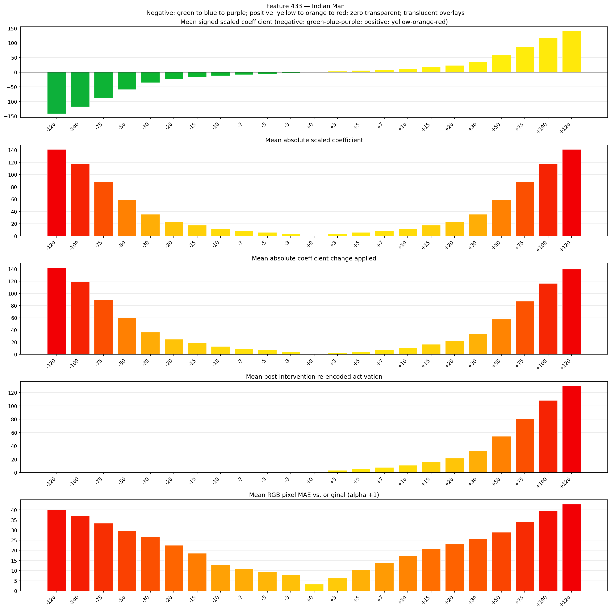
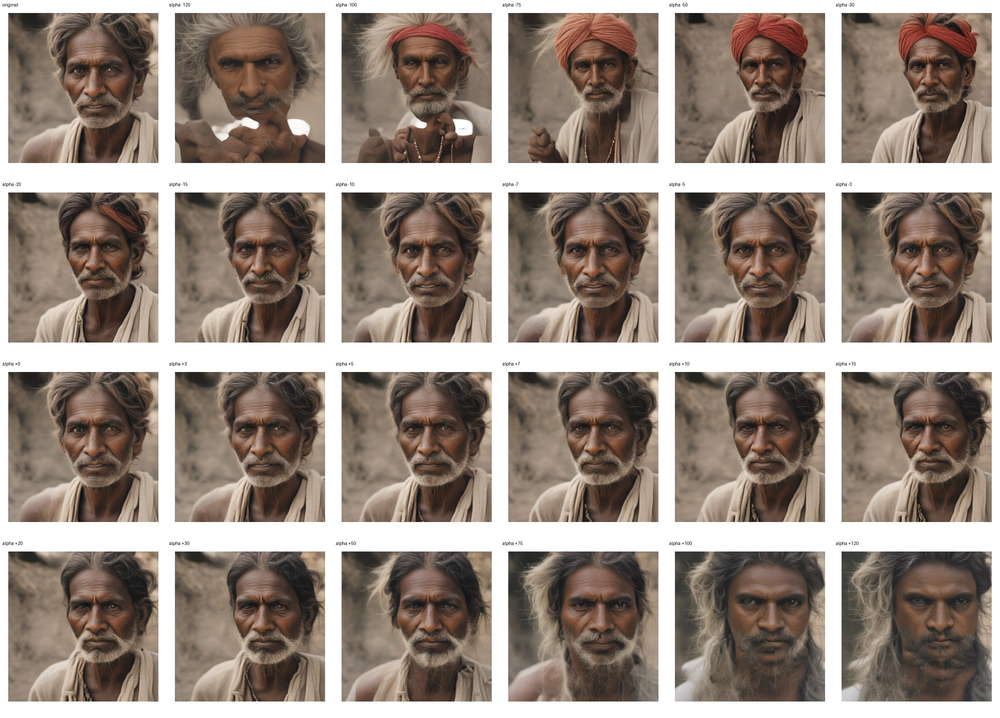
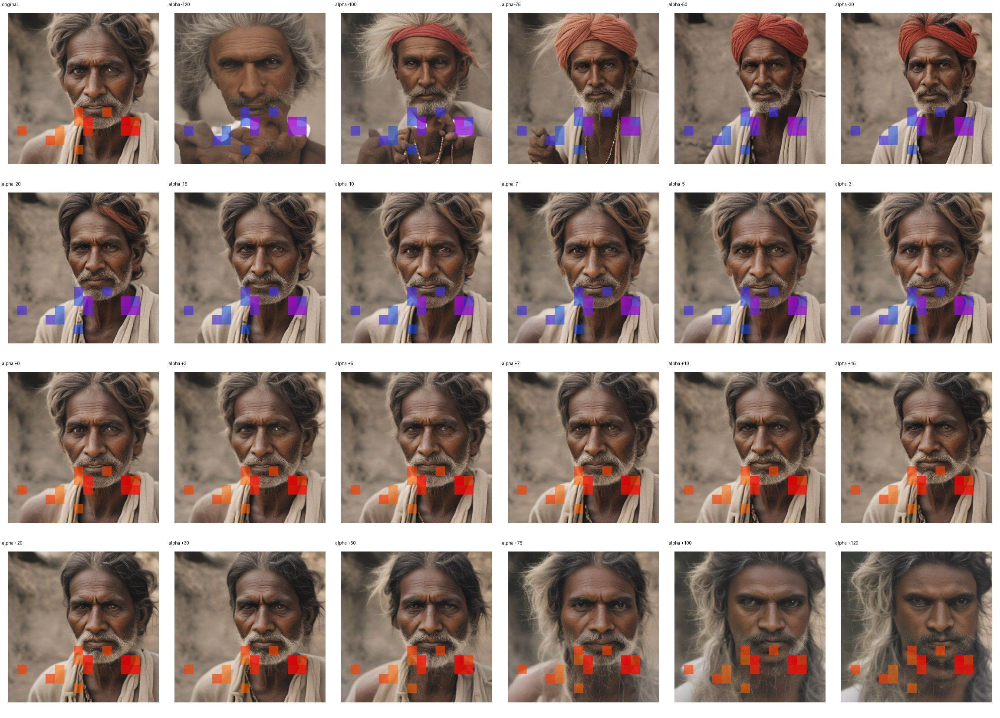
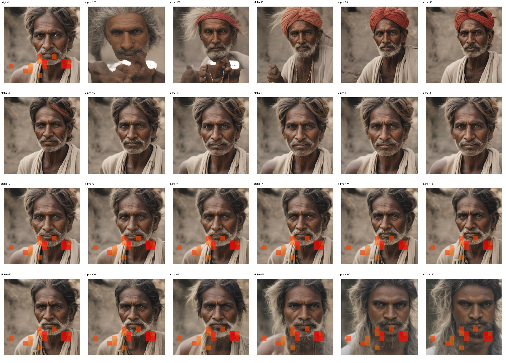

# Feature 433 — Indian Man

Biased dataset; original prompt and seed replay for seeds 0–19. Values are means across 20 source images. The table reports the mean post-re-encoded activation of feature 433, the active spatial fraction, mean RGB pixel MAE versus the original image (0–255 scale), and coefficient change magnitudes for each alpha.

## Activation graph

## Mean metrics by alpha

| Alpha | Mean post-reencoded feature 433 activation | Active spatial fraction | Mean pixel change (MAE) | Mean absolute coefficient change | Mean absolute scaled coefficient |
|---:|---:|---:|---:|---:|---:|
| -120 | 0.000 | 0.000 | 39.872 | 142.381 | 141.204 |
| -100 | 0.000 | 0.000 | 37.027 | 118.847 | 117.670 |
| -75 | 0.000 | 0.000 | 33.367 | 89.429 | 88.253 |
| -50 | 0.000 | 0.000 | 29.745 | 60.012 | 58.835 |
| -30 | 0.000 | 0.000 | 26.655 | 36.478 | 35.301 |
| -20 | 0.000 | 0.000 | 22.484 | 24.711 | 23.534 |
| -15 | 0.000 | 0.000 | 18.567 | 18.827 | 17.651 |
| -10 | 0.000 | 0.000 | 12.839 | 12.944 | 11.767 |
| -7 | 0.000 | 0.000 | 10.987 | 9.414 | 8.237 |
| -5 | 0.000 | 0.000 | 9.531 | 7.060 | 5.884 |
| -3 | 0.000 | 0.000 | 7.815 | 4.707 | 3.530 |
| +0 | 0.000 | 0.000 | 3.318 | 1.177 | 0.000 |
| +3 | 3.342 | 0.077 | 6.274 | 2.353 | 3.530 |
| +5 | 5.508 | 0.077 | 10.479 | 4.707 | 5.884 |
| +7 | 7.674 | 0.077 | 13.824 | 7.060 | 8.237 |
| +10 | 10.922 | 0.077 | 17.431 | 10.590 | 11.767 |
| +15 | 16.336 | 0.077 | 20.949 | 16.474 | 17.651 |
| +20 | 21.751 | 0.077 | 23.062 | 22.357 | 23.534 |
| +30 | 32.579 | 0.077 | 25.597 | 34.124 | 35.301 |
| +50 | 54.236 | 0.077 | 28.901 | 57.658 | 58.835 |
| +75 | 81.307 | 0.077 | 34.159 | 87.076 | 88.253 |
| +100 | 108.378 | 0.077 | 39.504 | 116.493 | 117.670 |
| +120 | 130.035 | 0.077 | 42.830 | 140.027 | 141.204 |

## Per-seed grids

Each 4×6 sheet contains the original followed by the 23 alpha variants in ascending alpha order, from −120 through +120.

### Plain images

[All 20 plain-image grids](seed_sheets/)

### Signed coefficient overlays

[All 20 signed coefficient grids](signed_coefficient_overlays/)

### Post-re-encoded activation overlays

[All 20 post-activation grids](post_activation_overlays/)

### Intervention-footprint overlays

[All 20 intervention-footprint grids](intervention_footprint_overlays/)

Zero is transparent. Negative coefficient colors progress green through blue to purple; positive colors progress yellow through orange to red. Each map tile is normalized individually for visibility. The original and alpha-zero tiles show the pre-intervention feature map so its location remains visible.
