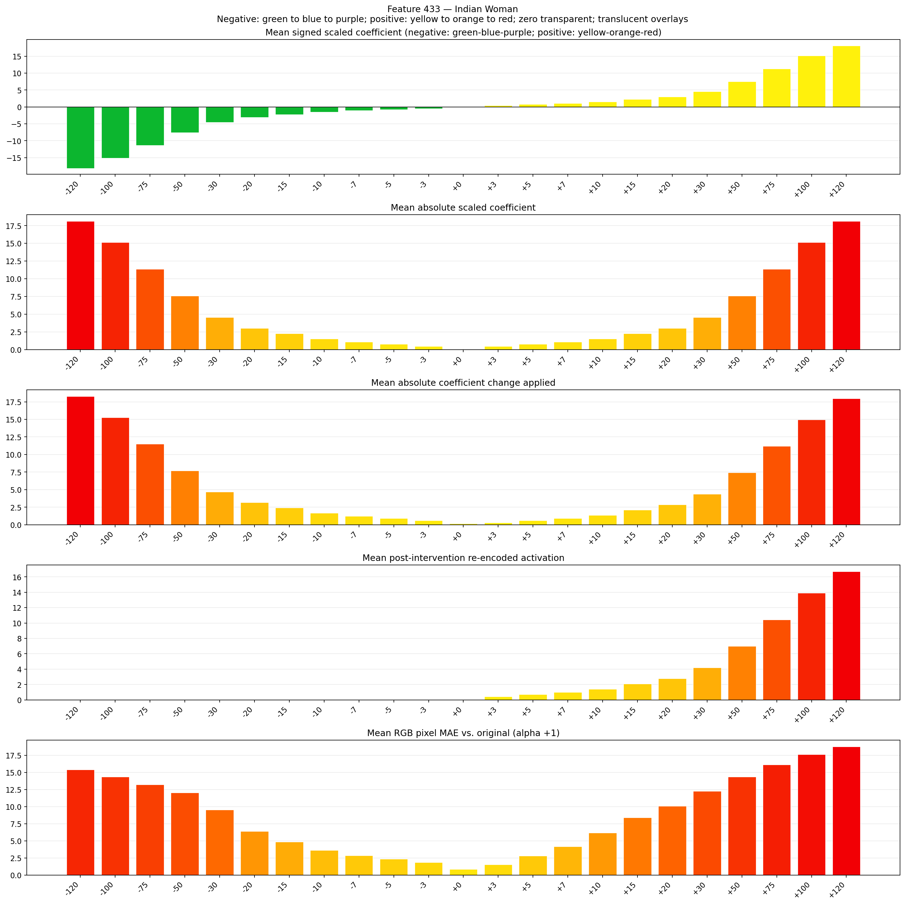
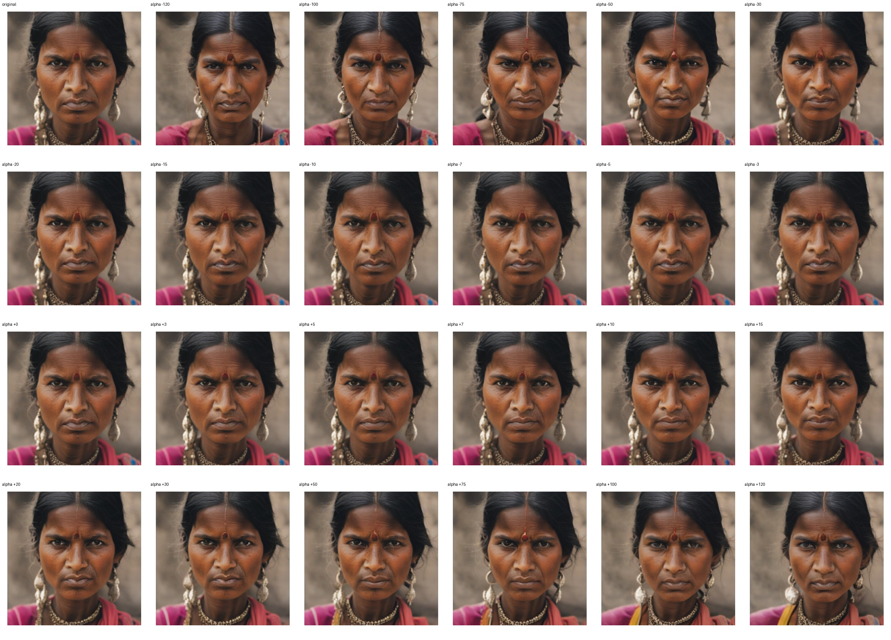
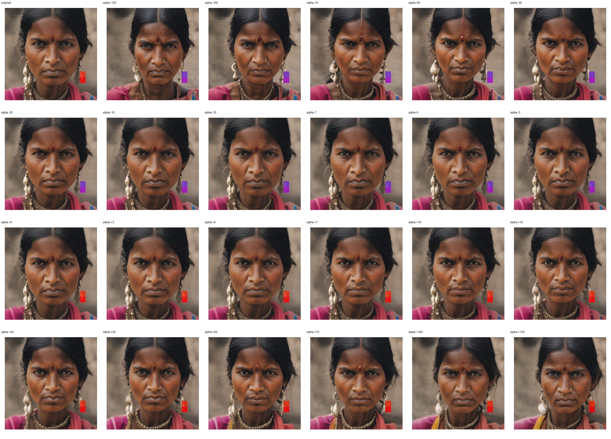
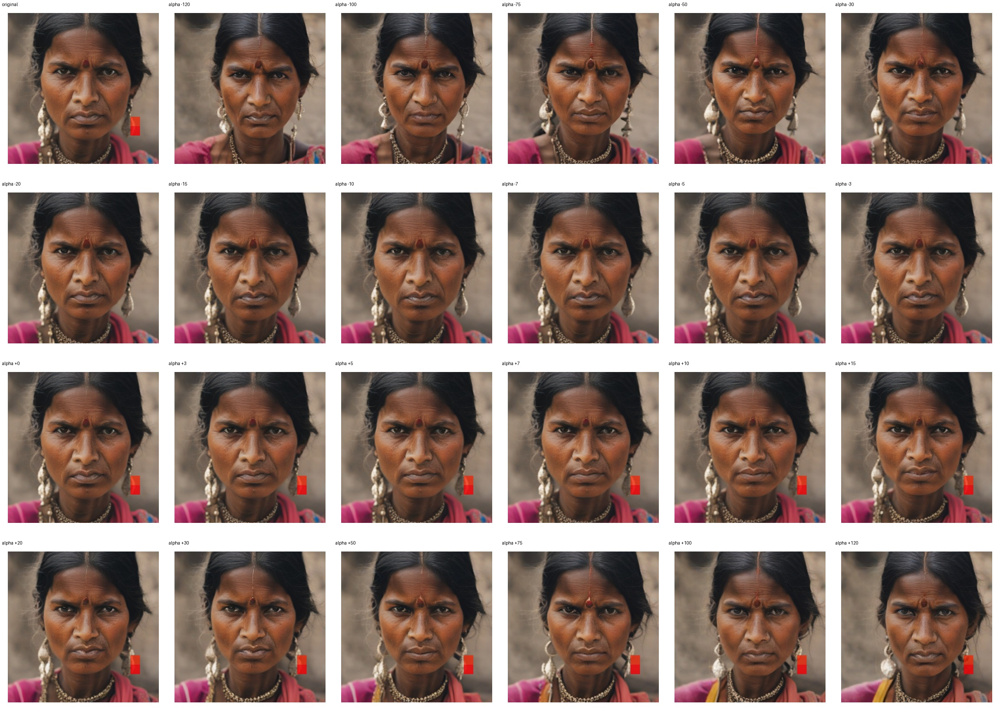

# Feature 433 — Indian Woman

Biased dataset; original prompt and seed replay for seeds 0–19. Values are means across 20 source images. The table reports the mean post-re-encoded activation of feature 433, the active spatial fraction, mean RGB pixel MAE versus the original image (0–255 scale), and coefficient change magnitudes for each alpha.

## Activation graph

## Mean metrics by alpha

| Alpha | Mean post-reencoded feature 433 activation | Active spatial fraction | Mean pixel change (MAE) | Mean absolute coefficient change | Mean absolute scaled coefficient |
|---:|---:|---:|---:|---:|---:|
| -120 | 0.000 | 0.000 | 15.413 | 18.291 | 18.140 |
| -100 | 0.000 | 0.000 | 14.335 | 15.268 | 15.116 |
| -75 | 0.000 | 0.000 | 13.224 | 11.488 | 11.337 |
| -50 | 0.000 | 0.000 | 12.012 | 7.709 | 7.558 |
| -30 | 0.000 | 0.000 | 9.536 | 4.686 | 4.535 |
| -20 | 0.000 | 0.000 | 6.387 | 3.174 | 3.023 |
| -15 | 0.000 | 0.000 | 4.839 | 2.419 | 2.267 |
| -10 | 0.000 | 0.000 | 3.624 | 1.663 | 1.512 |
| -7 | 0.000 | 0.000 | 2.856 | 1.209 | 1.058 |
| -5 | 0.000 | 0.000 | 2.370 | 0.907 | 0.756 |
| -3 | 0.000 | 0.000 | 1.867 | 0.605 | 0.453 |
| +0 | 0.000 | 0.000 | 0.873 | 0.151 | 0.000 |
| +3 | 0.429 | 0.012 | 1.546 | 0.302 | 0.453 |
| +5 | 0.708 | 0.012 | 2.797 | 0.605 | 0.756 |
| +7 | 0.986 | 0.012 | 4.158 | 0.907 | 1.058 |
| +10 | 1.403 | 0.012 | 6.162 | 1.360 | 1.512 |
| +15 | 2.099 | 0.012 | 8.416 | 2.116 | 2.267 |
| +20 | 2.794 | 0.012 | 10.071 | 2.872 | 3.023 |
| +30 | 4.185 | 0.012 | 12.267 | 4.384 | 4.535 |
| +50 | 6.967 | 0.012 | 14.367 | 7.407 | 7.558 |
| +75 | 10.445 | 0.012 | 16.100 | 11.186 | 11.337 |
| +100 | 13.923 | 0.012 | 17.620 | 14.965 | 15.116 |
| +120 | 16.705 | 0.012 | 18.761 | 17.988 | 18.140 |

## Per-seed grids

Each 4×6 sheet contains the original followed by the 23 alpha variants in ascending alpha order, from −120 through +120.

### Plain images

[All 20 plain-image grids](seed_sheets/)

### Signed coefficient overlays

[All 20 signed coefficient grids](signed_coefficient_overlays/)

### Post-re-encoded activation overlays

[All 20 post-activation grids](post_activation_overlays/)

### Intervention-footprint overlays

[All 20 intervention-footprint grids](intervention_footprint_overlays/)

Zero is transparent. Negative coefficient colors progress green through blue to purple; positive colors progress yellow through orange to red. Each map tile is normalized individually for visibility. The original and alpha-zero tiles show the pre-intervention feature map so its location remains visible.
