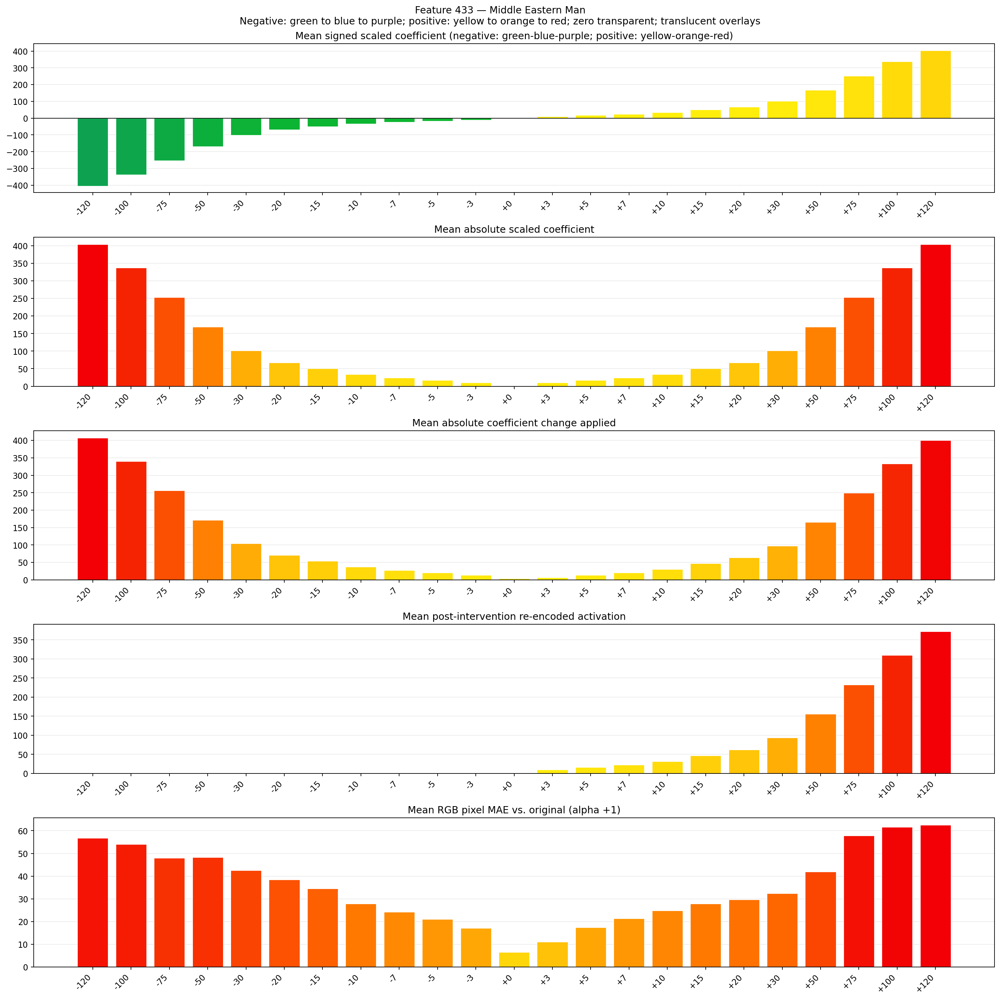
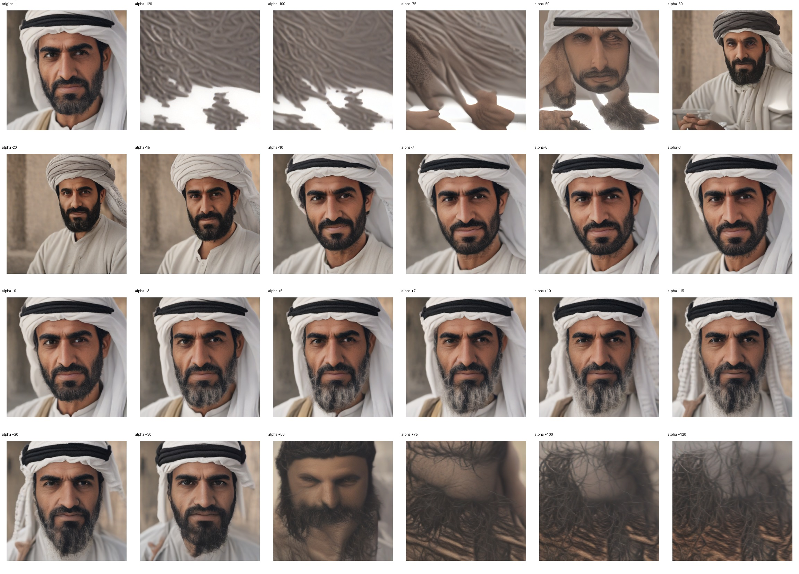
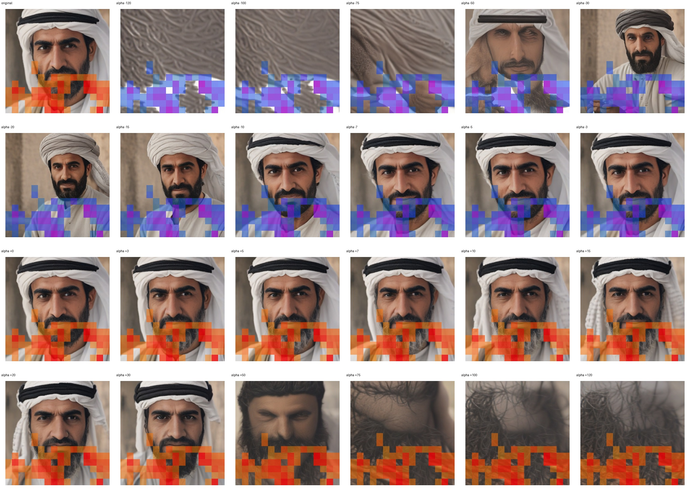
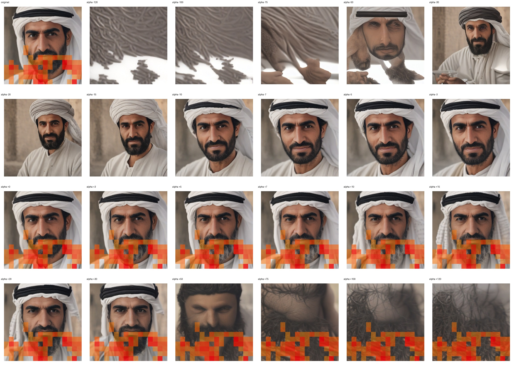

# Feature 433 — Middle Eastern Man

Biased dataset; original prompt and seed replay for seeds 0–19. Values are means across 20 source images. The table reports the mean post-re-encoded activation of feature 433, the active spatial fraction, mean RGB pixel MAE versus the original image (0–255 scale), and coefficient change magnitudes for each alpha.

## Activation graph

## Mean metrics by alpha

| Alpha | Mean post-reencoded feature 433 activation | Active spatial fraction | Mean pixel change (MAE) | Mean absolute coefficient change | Mean absolute scaled coefficient |
|---:|---:|---:|---:|---:|---:|
| -120 | 0.000 | 0.000 | 56.813 | 407.313 | 403.946 |
| -100 | 0.000 | 0.000 | 54.080 | 339.988 | 336.622 |
| -75 | 0.000 | 0.000 | 48.003 | 255.833 | 252.466 |
| -50 | 0.000 | 0.000 | 48.247 | 171.677 | 168.311 |
| -30 | 0.000 | 0.000 | 42.435 | 104.353 | 100.987 |
| -20 | 0.000 | 0.000 | 38.360 | 70.691 | 67.324 |
| -15 | 0.000 | 0.000 | 34.487 | 53.860 | 50.493 |
| -10 | 0.000 | 0.000 | 27.879 | 37.028 | 33.662 |
| -7 | 0.000 | 0.000 | 24.148 | 26.930 | 23.564 |
| -5 | 0.000 | 0.000 | 21.018 | 20.197 | 16.831 |
| -3 | 0.000 | 0.000 | 17.041 | 13.465 | 10.099 |
| +0 | 0.000 | 0.000 | 6.460 | 3.366 | 0.000 |
| +3 | 9.562 | 0.224 | 11.021 | 6.732 | 10.099 |
| +5 | 15.757 | 0.224 | 17.409 | 13.465 | 16.831 |
| +7 | 21.953 | 0.224 | 21.307 | 20.197 | 23.564 |
| +10 | 31.246 | 0.224 | 24.871 | 30.296 | 33.662 |
| +15 | 46.734 | 0.224 | 27.835 | 47.127 | 50.493 |
| +20 | 62.223 | 0.224 | 29.707 | 63.958 | 67.324 |
| +30 | 93.200 | 0.224 | 32.406 | 97.620 | 100.987 |
| +50 | 155.154 | 0.224 | 41.958 | 164.945 | 168.311 |
| +75 | 232.597 | 0.224 | 57.737 | 249.100 | 252.466 |
| +100 | 310.039 | 0.224 | 61.580 | 333.256 | 336.622 |
| +120 | 371.994 | 0.224 | 62.506 | 400.580 | 403.946 |

## Per-seed grids

Each 4×6 sheet contains the original followed by the 23 alpha variants in ascending alpha order, from −120 through +120.

### Plain images

[All 20 plain-image grids](seed_sheets/)

### Signed coefficient overlays

[All 20 signed coefficient grids](signed_coefficient_overlays/)

### Post-re-encoded activation overlays

[All 20 post-activation grids](post_activation_overlays/)

### Intervention-footprint overlays

[All 20 intervention-footprint grids](intervention_footprint_overlays/)

Zero is transparent. Negative coefficient colors progress green through blue to purple; positive colors progress yellow through orange to red. Each map tile is normalized individually for visibility. The original and alpha-zero tiles show the pre-intervention feature map so its location remains visible.
