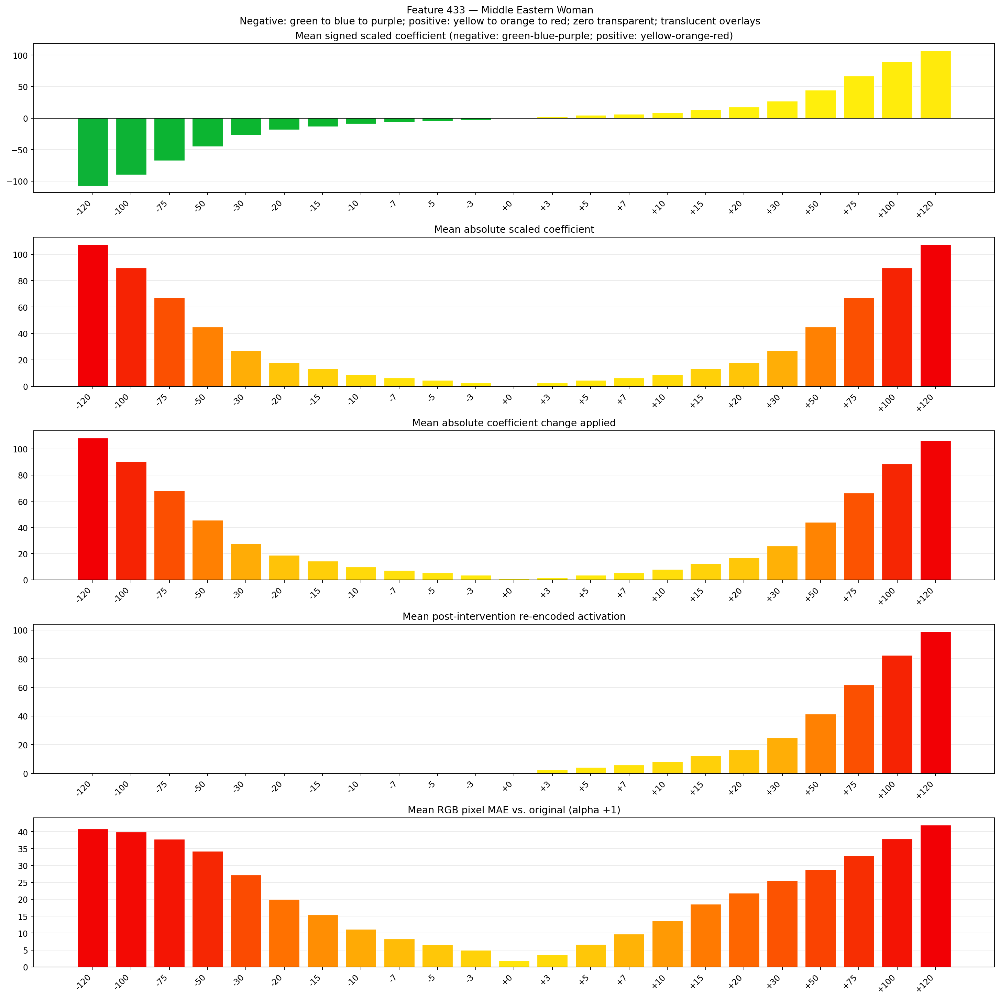
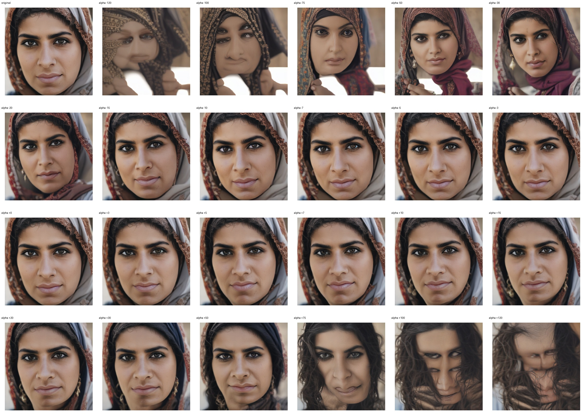
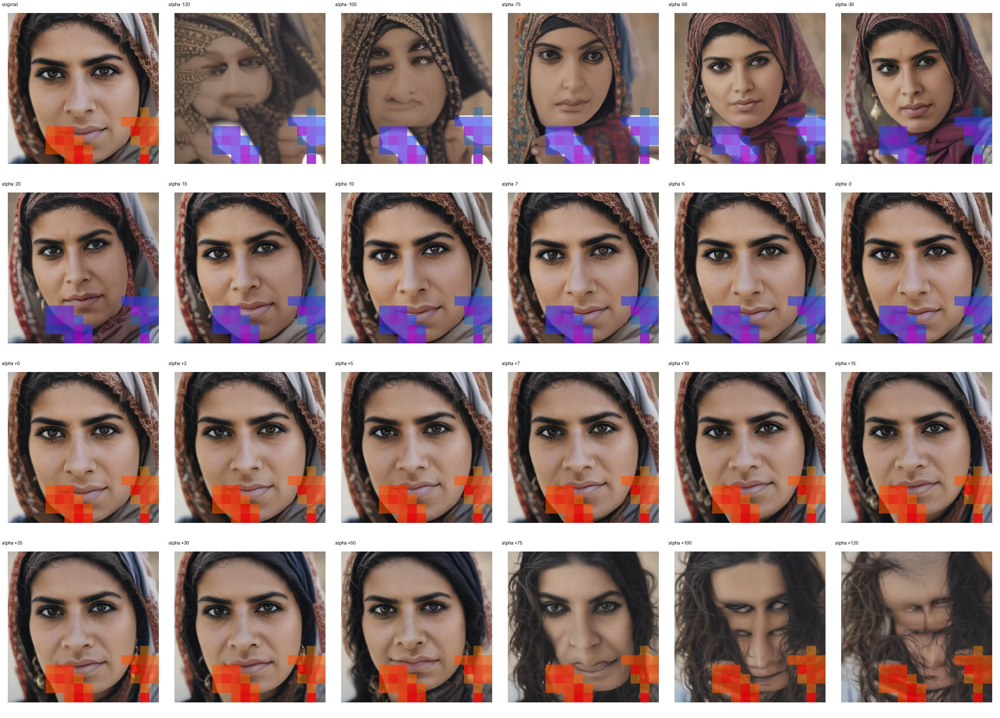
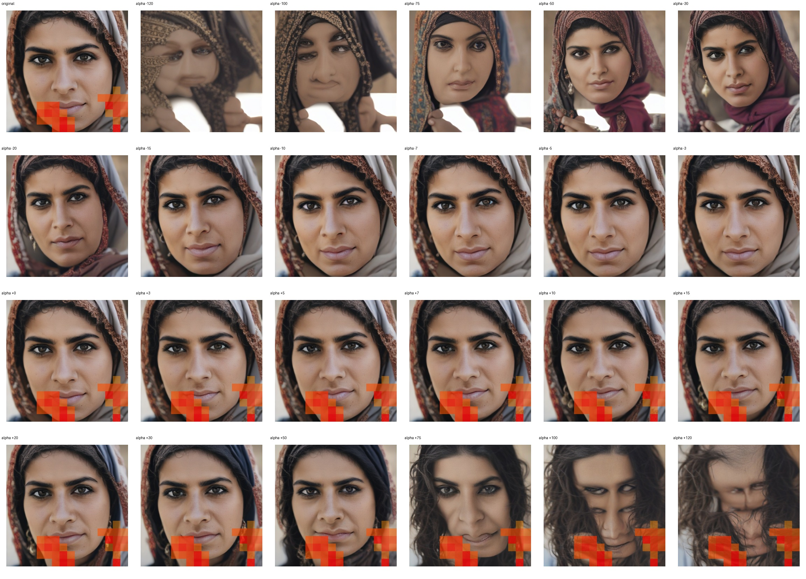

# Feature 433 — Middle Eastern Woman

Biased dataset; original prompt and seed replay for seeds 0–19. Values are means across 20 source images. The table reports the mean post-re-encoded activation of feature 433, the active spatial fraction, mean RGB pixel MAE versus the original image (0–255 scale), and coefficient change magnitudes for each alpha.

## Activation graph

## Mean metrics by alpha

| Alpha | Mean post-reencoded feature 433 activation | Active spatial fraction | Mean pixel change (MAE) | Mean absolute coefficient change | Mean absolute scaled coefficient |
|---:|---:|---:|---:|---:|---:|
| -120 | 0.000 | 0.000 | 40.826 | 108.442 | 107.546 |
| -100 | 0.000 | 0.000 | 39.881 | 90.518 | 89.622 |
| -75 | 0.000 | 0.000 | 37.843 | 68.113 | 67.216 |
| -50 | 0.000 | 0.000 | 34.250 | 45.707 | 44.811 |
| -30 | 0.000 | 0.000 | 27.256 | 27.783 | 26.887 |
| -20 | 0.000 | 0.000 | 20.006 | 18.821 | 17.924 |
| -15 | 0.000 | 0.000 | 15.450 | 14.339 | 13.443 |
| -10 | 0.000 | 0.000 | 11.169 | 9.858 | 8.962 |
| -7 | 0.000 | 0.000 | 8.311 | 7.170 | 6.274 |
| -5 | 0.000 | 0.000 | 6.619 | 5.377 | 4.481 |
| -3 | 0.000 | 0.000 | 4.981 | 3.585 | 2.689 |
| +0 | 0.000 | 0.000 | 1.922 | 0.896 | 0.000 |
| +3 | 2.546 | 0.077 | 3.628 | 1.792 | 2.689 |
| +5 | 4.195 | 0.077 | 6.701 | 3.585 | 4.481 |
| +7 | 5.845 | 0.077 | 9.696 | 5.377 | 6.274 |
| +10 | 8.319 | 0.077 | 13.670 | 8.066 | 8.962 |
| +15 | 12.442 | 0.077 | 18.538 | 12.547 | 13.443 |
| +20 | 16.566 | 0.077 | 21.857 | 17.028 | 17.924 |
| +30 | 24.813 | 0.077 | 25.612 | 25.990 | 26.887 |
| +50 | 41.308 | 0.077 | 28.804 | 43.915 | 44.811 |
| +75 | 61.926 | 0.077 | 32.919 | 66.320 | 67.216 |
| +100 | 82.544 | 0.077 | 37.886 | 88.726 | 89.622 |
| +120 | 99.039 | 0.077 | 41.971 | 106.650 | 107.546 |

## Per-seed grids

Each 4×6 sheet contains the original followed by the 23 alpha variants in ascending alpha order, from −120 through +120.

### Plain images

[All 20 plain-image grids](seed_sheets/)

### Signed coefficient overlays

[All 20 signed coefficient grids](signed_coefficient_overlays/)

### Post-re-encoded activation overlays

[All 20 post-activation grids](post_activation_overlays/)

### Intervention-footprint overlays

[All 20 intervention-footprint grids](intervention_footprint_overlays/)

Zero is transparent. Negative coefficient colors progress green through blue to purple; positive colors progress yellow through orange to red. Each map tile is normalized individually for visibility. The original and alpha-zero tiles show the pre-intervention feature map so its location remains visible.
