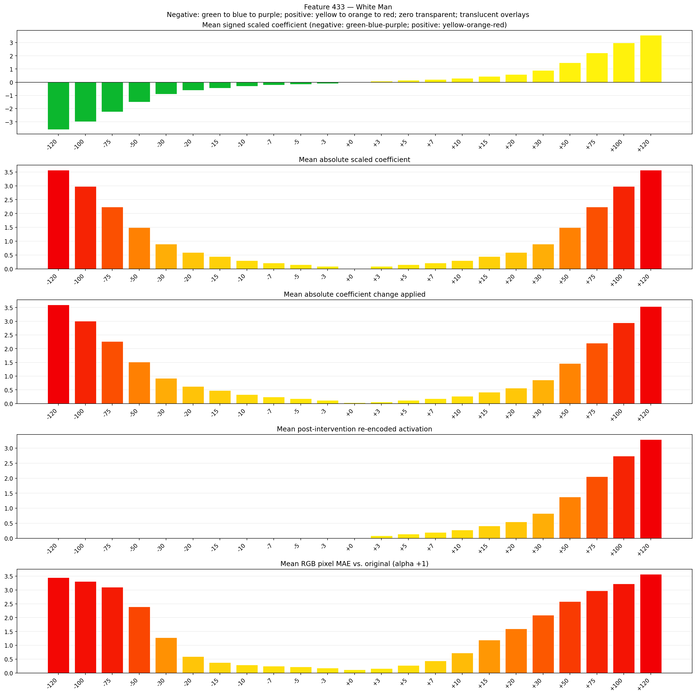
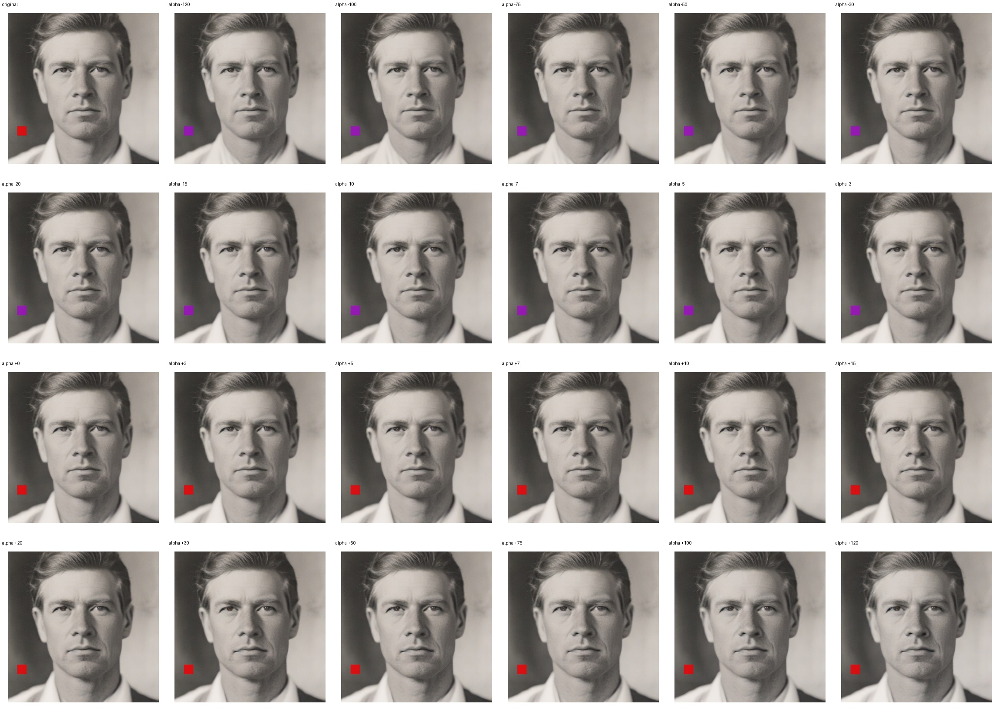
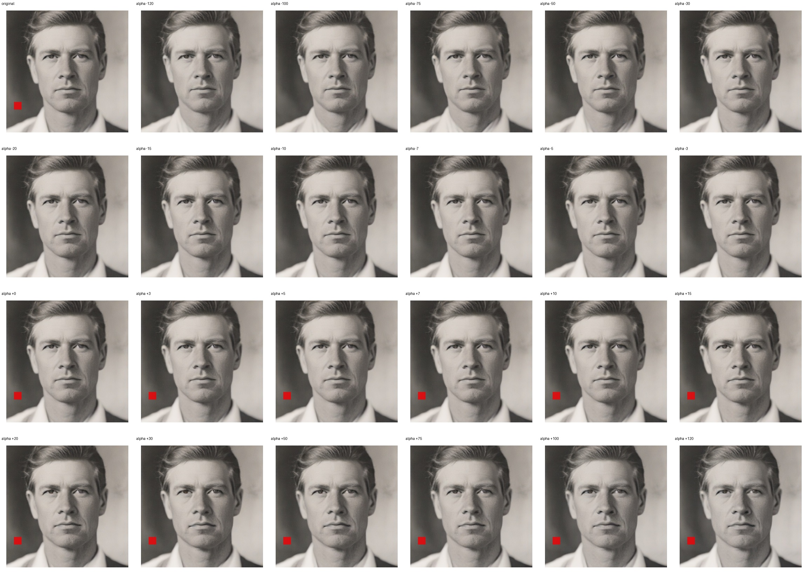

# Feature 433 — White Man

Biased dataset; original prompt and seed replay for seeds 0–19. Values are means across 20 source images. The table reports the mean post-re-encoded activation of feature 433, the active spatial fraction, mean RGB pixel MAE versus the original image (0–255 scale), and coefficient change magnitudes for each alpha.

## Activation graph

## Mean metrics by alpha

| Alpha | Mean post-reencoded feature 433 activation | Active spatial fraction | Mean pixel change (MAE) | Mean absolute coefficient change | Mean absolute scaled coefficient |
|---:|---:|---:|---:|---:|---:|
| -120 | 0.000 | 0.000 | 3.452 | 3.601 | 3.571 |
| -100 | 0.000 | 0.000 | 3.306 | 3.006 | 2.976 |
| -75 | 0.000 | 0.000 | 3.105 | 2.262 | 2.232 |
| -50 | 0.000 | 0.000 | 2.390 | 1.518 | 1.488 |
| -30 | 0.000 | 0.000 | 1.282 | 0.923 | 0.893 |
| -20 | 0.000 | 0.000 | 0.592 | 0.625 | 0.595 |
| -15 | 0.000 | 0.000 | 0.375 | 0.476 | 0.446 |
| -10 | 0.000 | 0.000 | 0.292 | 0.327 | 0.298 |
| -7 | 0.000 | 0.000 | 0.250 | 0.238 | 0.208 |
| -5 | 0.000 | 0.000 | 0.220 | 0.179 | 0.149 |
| -3 | 0.000 | 0.000 | 0.184 | 0.119 | 0.089 |
| +0 | 0.000 | 0.000 | 0.120 | 0.030 | 0.000 |
| +3 | 0.085 | 0.003 | 0.167 | 0.060 | 0.089 |
| +5 | 0.139 | 0.003 | 0.274 | 0.119 | 0.149 |
| +7 | 0.194 | 0.003 | 0.439 | 0.179 | 0.208 |
| +10 | 0.276 | 0.003 | 0.723 | 0.268 | 0.298 |
| +15 | 0.413 | 0.003 | 1.194 | 0.417 | 0.446 |
| +20 | 0.550 | 0.003 | 1.594 | 0.565 | 0.595 |
| +30 | 0.824 | 0.003 | 2.094 | 0.863 | 0.893 |
| +50 | 1.372 | 0.003 | 2.583 | 1.458 | 1.488 |
| +75 | 2.056 | 0.003 | 2.969 | 2.202 | 2.232 |
| +100 | 2.741 | 0.003 | 3.222 | 2.946 | 2.976 |
| +120 | 3.289 | 0.003 | 3.570 | 3.541 | 3.571 |

## Per-seed grids

Each 4×6 sheet contains the original followed by the 23 alpha variants in ascending alpha order, from −120 through +120.

### Plain images

[All 20 plain-image grids](seed_sheets/)

### Signed coefficient overlays

[All 20 signed coefficient grids](signed_coefficient_overlays/)

### Post-re-encoded activation overlays

[All 20 post-activation grids](post_activation_overlays/)

### Intervention-footprint overlays

[All 20 intervention-footprint grids](intervention_footprint_overlays/)

Zero is transparent. Negative coefficient colors progress green through blue to purple; positive colors progress yellow through orange to red. Each map tile is normalized individually for visibility. The original and alpha-zero tiles show the pre-intervention feature map so its location remains visible.
