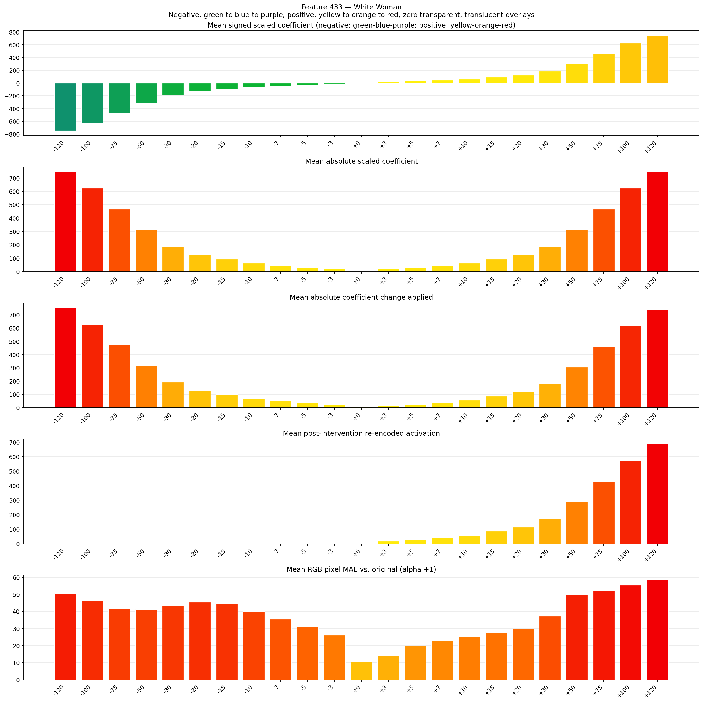
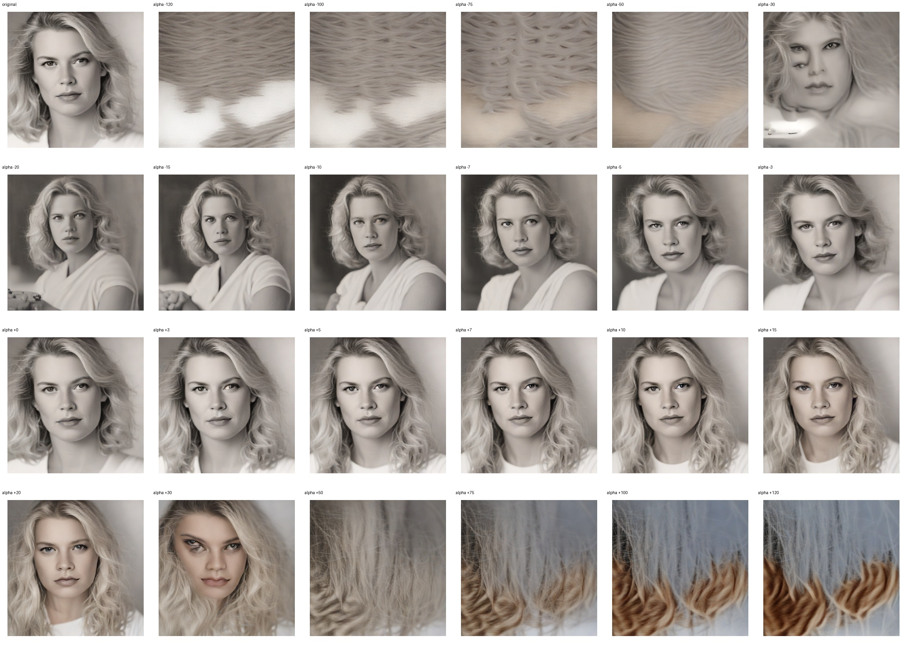
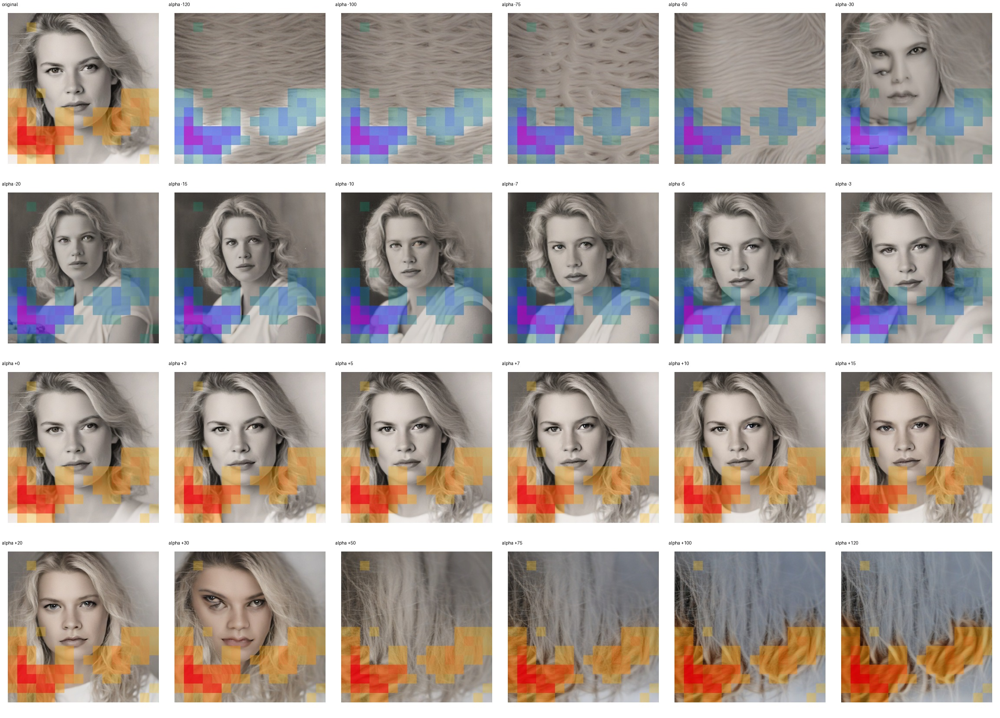
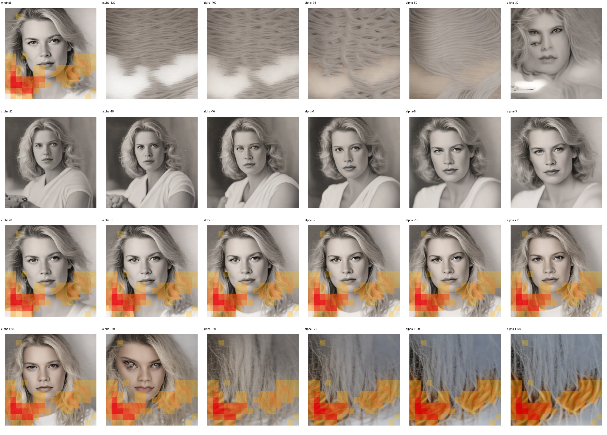

# Feature 433 — White Woman

Biased dataset; original prompt and seed replay for seeds 0–19. Values are means across 20 source images. The table reports the mean post-re-encoded activation of feature 433, the active spatial fraction, mean RGB pixel MAE versus the original image (0–255 scale), and coefficient change magnitudes for each alpha.

## Activation graph

## Mean metrics by alpha

| Alpha | Mean post-reencoded feature 433 activation | Active spatial fraction | Mean pixel change (MAE) | Mean absolute coefficient change | Mean absolute scaled coefficient |
|---:|---:|---:|---:|---:|---:|
| -120 | 0.000 | 0.000 | 50.669 | 752.930 | 746.708 |
| -100 | 0.000 | 0.000 | 46.349 | 628.479 | 622.256 |
| -75 | 0.000 | 0.000 | 41.852 | 472.915 | 466.692 |
| -50 | 0.000 | 0.000 | 41.189 | 317.351 | 311.128 |
| -30 | 0.000 | 0.000 | 43.375 | 192.899 | 186.677 |
| -20 | 0.000 | 0.000 | 45.391 | 130.674 | 124.451 |
| -15 | 0.000 | 0.000 | 44.633 | 99.561 | 93.338 |
| -10 | 0.000 | 0.000 | 40.071 | 68.448 | 62.226 |
| -7 | 0.000 | 0.000 | 35.432 | 49.781 | 43.558 |
| -5 | 0.000 | 0.000 | 31.176 | 37.335 | 31.113 |
| -3 | 0.000 | 0.000 | 26.157 | 24.890 | 18.668 |
| +0 | 0.000 | 0.000 | 10.630 | 6.223 | 0.000 |
| +3 | 17.675 | 0.304 | 14.207 | 12.445 | 18.668 |
| +5 | 29.127 | 0.304 | 19.943 | 24.890 | 31.113 |
| +7 | 40.580 | 0.304 | 22.877 | 37.335 | 43.558 |
| +10 | 57.759 | 0.304 | 25.228 | 56.003 | 62.226 |
| +15 | 86.390 | 0.304 | 27.658 | 87.116 | 93.338 |
| +20 | 115.021 | 0.304 | 29.896 | 118.229 | 124.451 |
| +30 | 172.283 | 0.304 | 37.197 | 180.454 | 186.677 |
| +50 | 286.807 | 0.304 | 49.878 | 304.906 | 311.128 |
| +75 | 429.963 | 0.304 | 52.035 | 460.470 | 466.692 |
| +100 | 573.119 | 0.304 | 55.387 | 616.034 | 622.256 |
| +120 | 687.642 | 0.304 | 58.434 | 740.485 | 746.708 |

## Per-seed grids

Each 4×6 sheet contains the original followed by the 23 alpha variants in ascending alpha order, from −120 through +120.

### Plain images

[All 20 plain-image grids](seed_sheets/)

### Signed coefficient overlays

[All 20 signed coefficient grids](signed_coefficient_overlays/)

### Post-re-encoded activation overlays

[All 20 post-activation grids](post_activation_overlays/)

### Intervention-footprint overlays

[All 20 intervention-footprint grids](intervention_footprint_overlays/)

Zero is transparent. Negative coefficient colors progress green through blue to purple; positive colors progress yellow through orange to red. Each map tile is normalized individually for visibility. The original and alpha-zero tiles show the pre-intervention feature map so its location remains visible.
