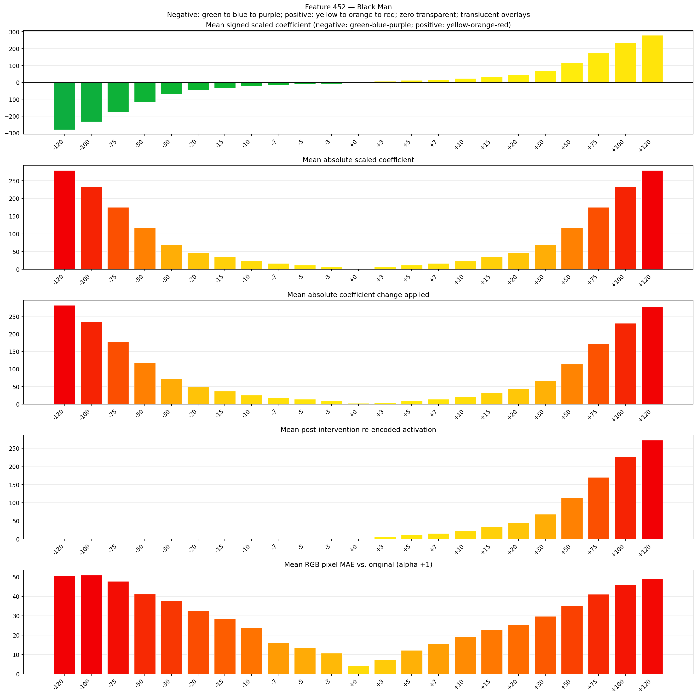
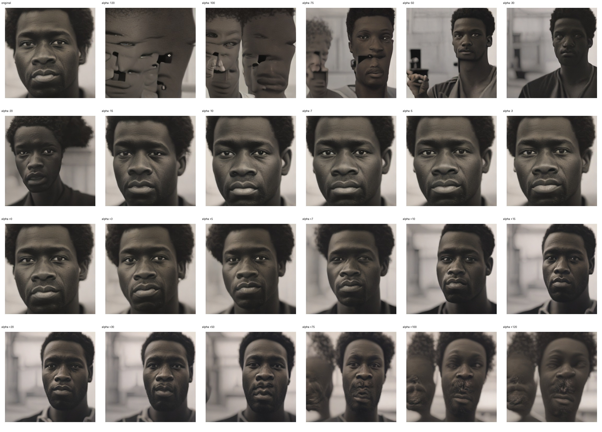
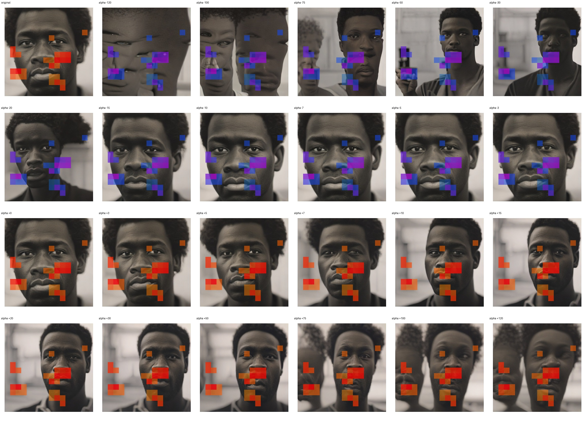
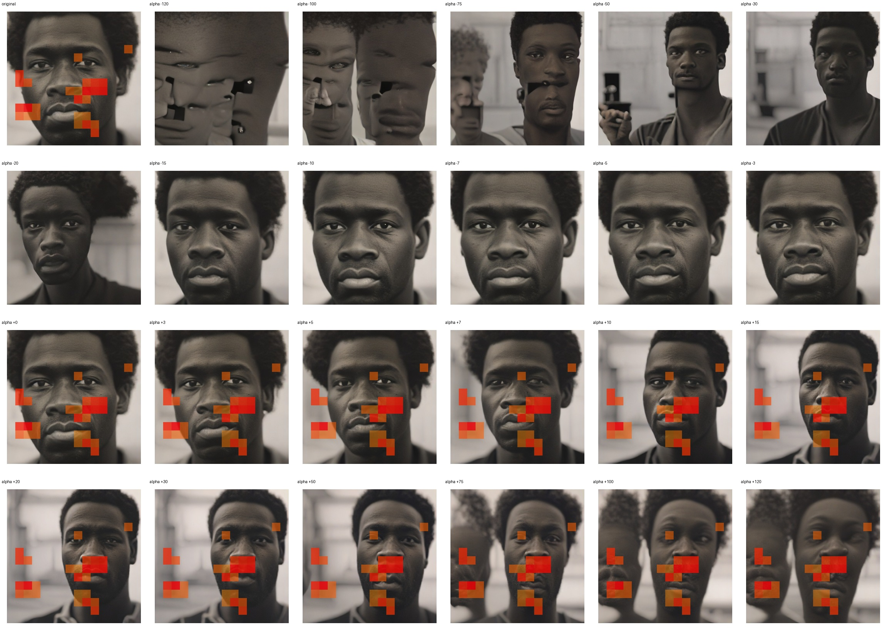

# Feature 452 — Black Man

Biased dataset; original prompt and seed replay for seeds 0–19. Values are means across 20 source images. The table reports the mean post-re-encoded activation of feature 452, the active spatial fraction, mean RGB pixel MAE versus the original image (0–255 scale), and coefficient change magnitudes for each alpha.

## Activation graph

## Mean metrics by alpha

| Alpha | Mean post-reencoded feature 452 activation | Active spatial fraction | Mean pixel change (MAE) | Mean absolute coefficient change | Mean absolute scaled coefficient |
|---:|---:|---:|---:|---:|---:|
| -120 | 0.000 | 0.000 | 50.660 | 281.885 | 279.556 |
| -100 | 0.000 | 0.000 | 50.968 | 235.293 | 232.963 |
| -75 | 0.000 | 0.000 | 47.721 | 177.052 | 174.722 |
| -50 | 0.000 | 0.000 | 41.196 | 118.811 | 116.482 |
| -30 | 0.000 | 0.000 | 37.783 | 72.219 | 69.889 |
| -20 | 0.000 | 0.000 | 32.623 | 48.922 | 46.593 |
| -15 | 0.000 | 0.000 | 28.645 | 37.274 | 34.944 |
| -10 | 0.000 | 0.000 | 23.837 | 25.626 | 23.296 |
| -7 | 0.000 | 0.000 | 16.126 | 18.637 | 16.307 |
| -5 | 0.000 | 0.000 | 13.423 | 13.978 | 11.648 |
| -3 | 0.000 | 0.000 | 10.674 | 9.319 | 6.989 |
| +0 | 0.000 | 0.000 | 4.297 | 2.330 | 0.000 |
| +3 | 6.867 | 0.129 | 7.389 | 4.659 | 6.989 |
| +5 | 11.405 | 0.129 | 12.156 | 9.319 | 11.648 |
| +7 | 15.942 | 0.129 | 15.617 | 13.978 | 16.307 |
| +10 | 22.748 | 0.129 | 19.368 | 20.967 | 23.296 |
| +15 | 34.092 | 0.129 | 22.895 | 32.615 | 34.944 |
| +20 | 45.436 | 0.129 | 25.234 | 44.263 | 46.593 |
| +30 | 68.123 | 0.129 | 29.693 | 67.559 | 69.889 |
| +50 | 113.497 | 0.129 | 35.307 | 114.152 | 116.482 |
| +75 | 170.216 | 0.129 | 41.067 | 172.393 | 174.722 |
| +100 | 226.933 | 0.129 | 45.848 | 230.634 | 232.963 |
| +120 | 272.308 | 0.129 | 48.947 | 277.226 | 279.556 |

## Per-seed grids

Each 4×6 sheet contains the original followed by the 23 alpha variants in ascending alpha order, from −120 through +120.

### Plain images

[All 20 plain-image grids](seed_sheets/)

### Signed coefficient overlays

[All 20 signed coefficient grids](signed_coefficient_overlays/)

### Post-re-encoded activation overlays

[All 20 post-activation grids](post_activation_overlays/)

### Intervention-footprint overlays

[All 20 intervention-footprint grids](intervention_footprint_overlays/)

Zero is transparent. Negative coefficient colors progress green through blue to purple; positive colors progress yellow through orange to red. Each map tile is normalized individually for visibility. The original and alpha-zero tiles show the pre-intervention feature map so its location remains visible.
