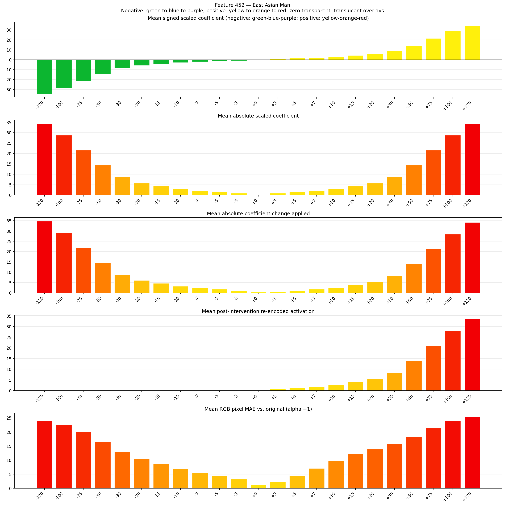

# Feature 452 — East Asian Man

Biased dataset; original prompt and seed replay for seeds 0–19. Values are means across 20 source images. The table reports the mean post-re-encoded activation of feature 452, the active spatial fraction, mean RGB pixel MAE versus the original image (0–255 scale), and coefficient change magnitudes for each alpha.

## Activation graph

## Mean metrics by alpha

| Alpha | Mean post-reencoded feature 452 activation | Active spatial fraction | Mean pixel change (MAE) | Mean absolute coefficient change | Mean absolute scaled coefficient |
|---:|---:|---:|---:|---:|---:|
| -120 | 0.000 | 0.000 | 23.899 | 34.755 | 34.468 |
| -100 | 0.000 | 0.000 | 22.578 | 29.011 | 28.723 |
| -75 | 0.000 | 0.000 | 20.161 | 21.830 | 21.542 |
| -50 | 0.000 | 0.000 | 16.503 | 14.649 | 14.362 |
| -30 | 0.000 | 0.000 | 12.965 | 8.904 | 8.617 |
| -20 | 0.000 | 0.000 | 10.433 | 6.032 | 5.745 |
| -15 | 0.000 | 0.000 | 8.651 | 4.596 | 4.308 |
| -10 | 0.000 | 0.000 | 6.810 | 3.160 | 2.872 |
| -7 | 0.000 | 0.000 | 5.502 | 2.298 | 2.011 |
| -5 | 0.000 | 0.000 | 4.450 | 1.723 | 1.436 |
| -3 | 0.000 | 0.000 | 3.267 | 1.149 | 0.862 |
| +0 | 0.000 | 0.000 | 1.195 | 0.287 | 0.000 |
| +3 | 0.847 | 0.022 | 2.254 | 0.574 | 0.862 |
| +5 | 1.406 | 0.022 | 4.546 | 1.149 | 1.436 |
| +7 | 1.966 | 0.022 | 7.076 | 1.723 | 2.011 |
| +10 | 2.805 | 0.022 | 9.747 | 2.585 | 2.872 |
| +15 | 4.203 | 0.022 | 12.361 | 4.021 | 4.308 |
| +20 | 5.602 | 0.022 | 13.890 | 5.457 | 5.745 |
| +30 | 8.399 | 0.022 | 15.815 | 8.330 | 8.617 |
| +50 | 13.994 | 0.022 | 18.330 | 14.074 | 14.362 |
| +75 | 20.987 | 0.022 | 21.351 | 21.255 | 21.542 |
| +100 | 27.980 | 0.022 | 23.967 | 28.436 | 28.723 |
| +120 | 33.575 | 0.022 | 25.443 | 34.181 | 34.468 |

## Per-seed grids

Each 4×6 sheet contains the original followed by the 23 alpha variants in ascending alpha order, from −120 through +120.

### Plain images

[All 20 plain-image grids](seed_sheets/)

### Signed coefficient overlays

[All 20 signed coefficient grids](signed_coefficient_overlays/)

### Post-re-encoded activation overlays

[All 20 post-activation grids](post_activation_overlays/)

### Intervention-footprint overlays

[All 20 intervention-footprint grids](intervention_footprint_overlays/)

Zero is transparent. Negative coefficient colors progress green through blue to purple; positive colors progress yellow through orange to red. Each map tile is normalized individually for visibility. The original and alpha-zero tiles show the pre-intervention feature map so its location remains visible.
