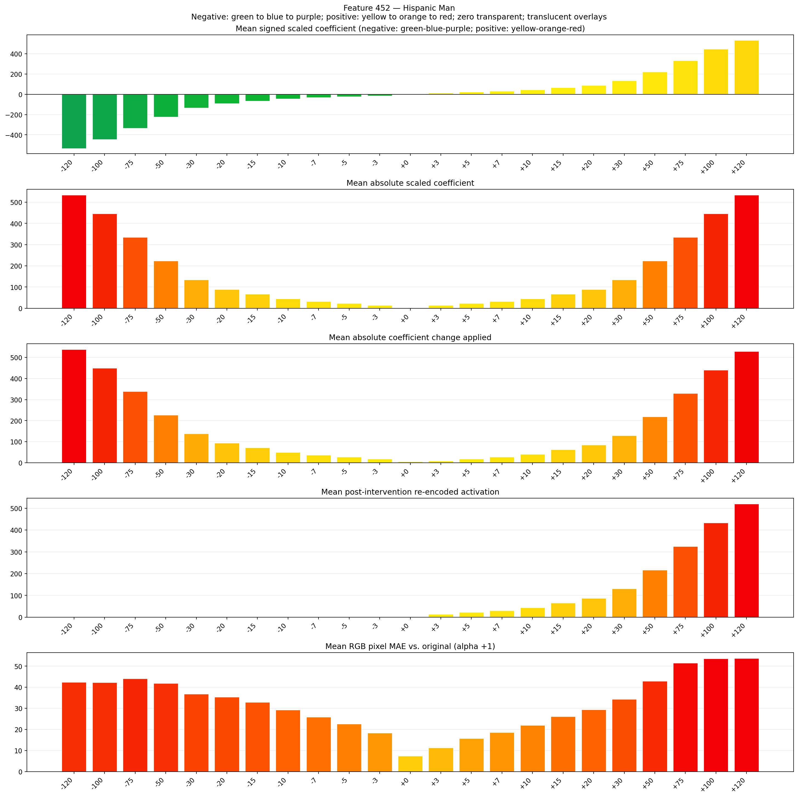
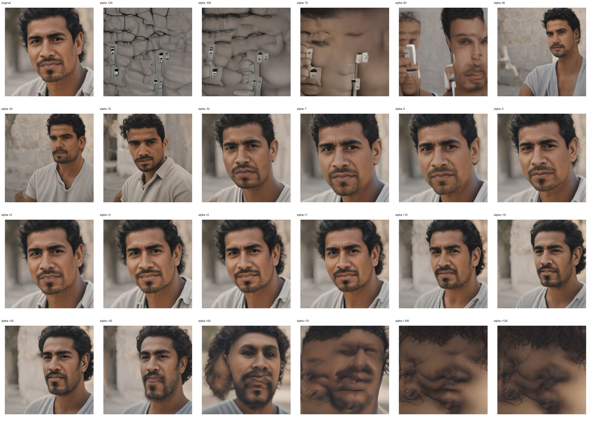
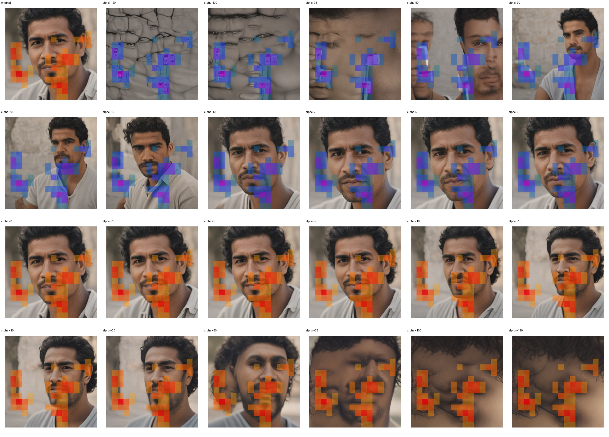
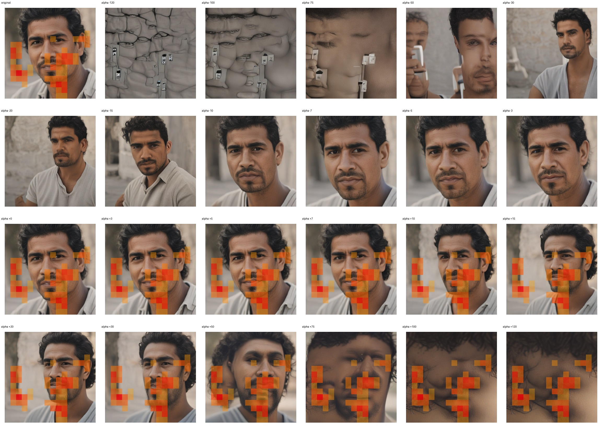

# Feature 452 — Hispanic Man

Biased dataset; original prompt and seed replay for seeds 0–19. Values are means across 20 source images. The table reports the mean post-re-encoded activation of feature 452, the active spatial fraction, mean RGB pixel MAE versus the original image (0–255 scale), and coefficient change magnitudes for each alpha.

## Activation graph

## Mean metrics by alpha

| Alpha | Mean post-reencoded feature 452 activation | Active spatial fraction | Mean pixel change (MAE) | Mean absolute coefficient change | Mean absolute scaled coefficient |
|---:|---:|---:|---:|---:|---:|
| -120 | 0.000 | 0.000 | 42.295 | 538.323 | 533.874 |
| -100 | 0.000 | 0.000 | 42.191 | 449.344 | 444.895 |
| -75 | 0.000 | 0.000 | 43.999 | 338.120 | 333.671 |
| -50 | 0.000 | 0.000 | 41.825 | 226.897 | 222.448 |
| -30 | 0.000 | 0.000 | 36.780 | 137.917 | 133.469 |
| -20 | 0.000 | 0.000 | 35.392 | 93.428 | 88.979 |
| -15 | 0.000 | 0.000 | 32.919 | 71.183 | 66.734 |
| -10 | 0.000 | 0.000 | 29.261 | 48.938 | 44.490 |
| -7 | 0.000 | 0.000 | 25.848 | 35.592 | 31.143 |
| -5 | 0.000 | 0.000 | 22.552 | 26.694 | 22.245 |
| -3 | 0.000 | 0.000 | 18.241 | 17.796 | 13.347 |
| +0 | 0.000 | 0.000 | 7.333 | 4.449 | 0.000 |
| +3 | 13.114 | 0.243 | 11.348 | 8.898 | 13.347 |
| +5 | 21.780 | 0.243 | 15.714 | 17.796 | 22.245 |
| +7 | 30.445 | 0.243 | 18.503 | 26.694 | 31.143 |
| +10 | 43.443 | 0.243 | 21.974 | 40.041 | 44.490 |
| +15 | 65.106 | 0.243 | 26.132 | 62.285 | 66.734 |
| +20 | 86.769 | 0.243 | 29.296 | 84.530 | 88.979 |
| +30 | 130.096 | 0.243 | 34.338 | 129.020 | 133.469 |
| +50 | 216.749 | 0.243 | 42.914 | 217.999 | 222.448 |
| +75 | 325.064 | 0.243 | 51.471 | 329.222 | 333.671 |
| +100 | 433.381 | 0.243 | 53.561 | 440.446 | 444.895 |
| +120 | 520.033 | 0.243 | 53.678 | 529.425 | 533.874 |

## Per-seed grids

Each 4×6 sheet contains the original followed by the 23 alpha variants in ascending alpha order, from −120 through +120.

### Plain images

[All 20 plain-image grids](seed_sheets/)

### Signed coefficient overlays

[All 20 signed coefficient grids](signed_coefficient_overlays/)

### Post-re-encoded activation overlays

[All 20 post-activation grids](post_activation_overlays/)

### Intervention-footprint overlays

[All 20 intervention-footprint grids](intervention_footprint_overlays/)

Zero is transparent. Negative coefficient colors progress green through blue to purple; positive colors progress yellow through orange to red. Each map tile is normalized individually for visibility. The original and alpha-zero tiles show the pre-intervention feature map so its location remains visible.
