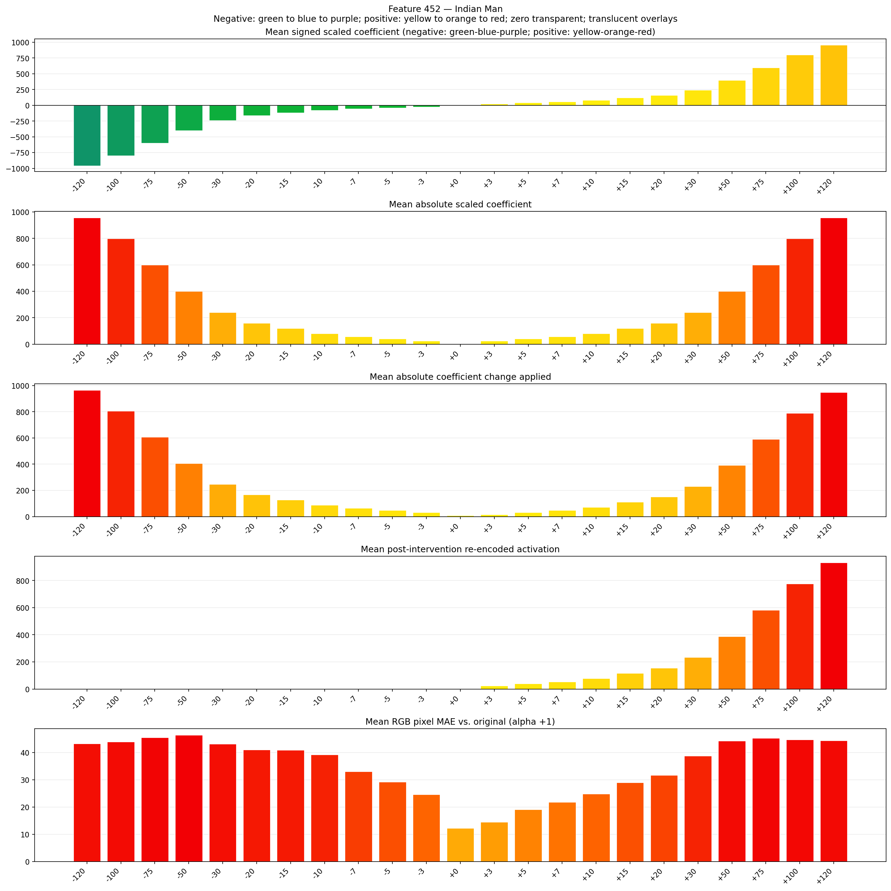
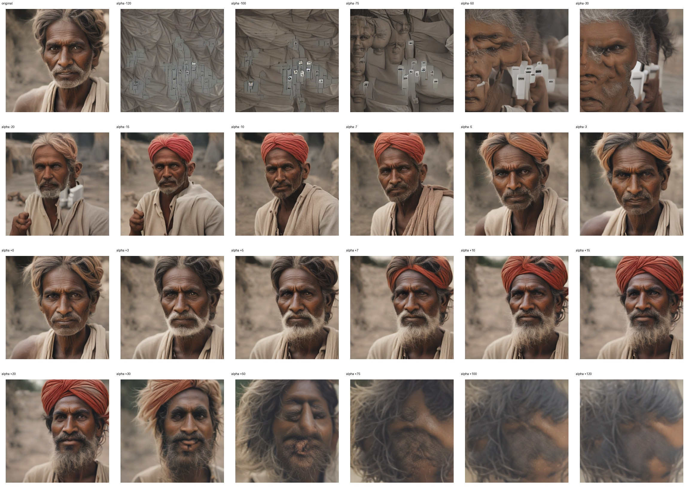
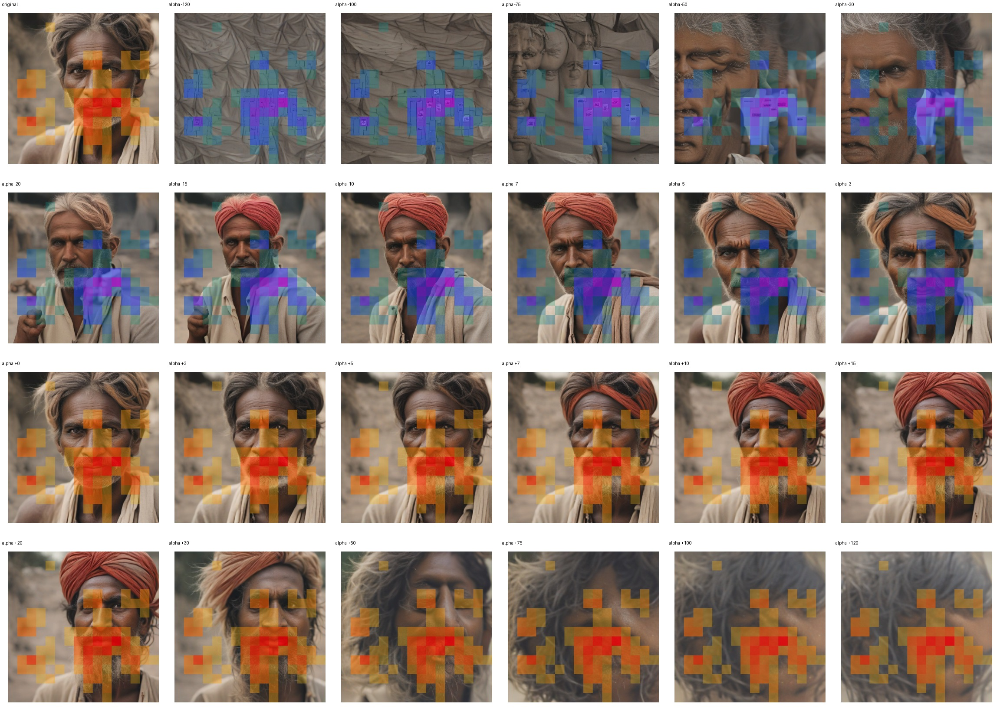
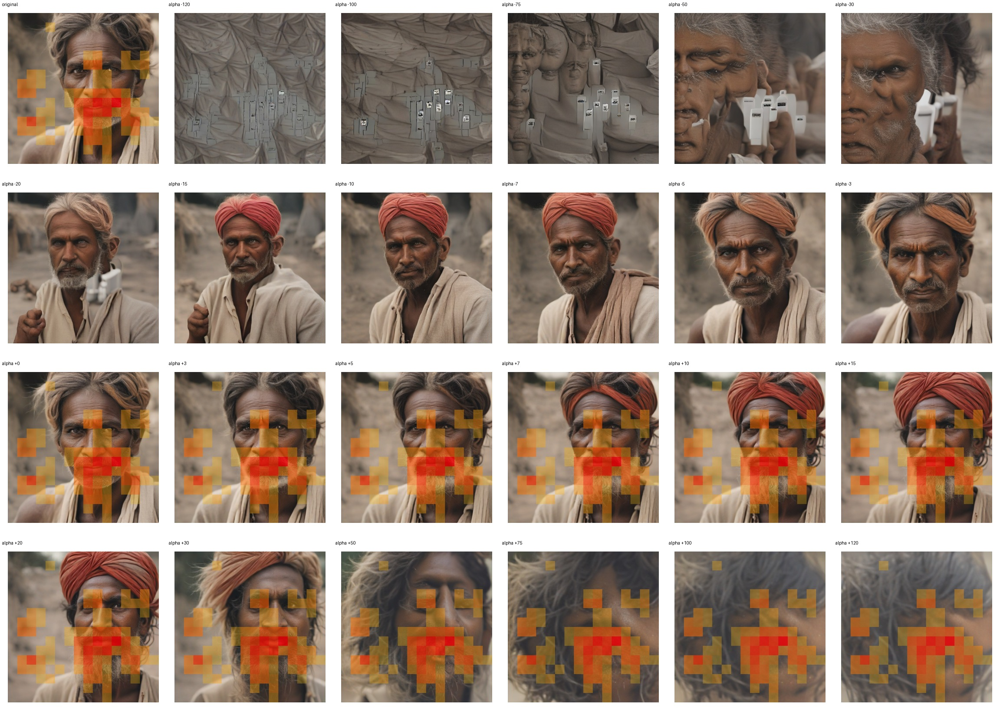

# Feature 452 — Indian Man

Biased dataset; original prompt and seed replay for seeds 0–19. Values are means across 20 source images. The table reports the mean post-re-encoded activation of feature 452, the active spatial fraction, mean RGB pixel MAE versus the original image (0–255 scale), and coefficient change magnitudes for each alpha.

## Activation graph

## Mean metrics by alpha

| Alpha | Mean post-reencoded feature 452 activation | Active spatial fraction | Mean pixel change (MAE) | Mean absolute coefficient change | Mean absolute scaled coefficient |
|---:|---:|---:|---:|---:|---:|
| -120 | 0.000 | 0.000 | 43.254 | 964.738 | 956.765 |
| -100 | 0.000 | 0.000 | 43.876 | 805.277 | 797.304 |
| -75 | 0.000 | 0.000 | 45.482 | 605.951 | 597.978 |
| -50 | 0.000 | 0.000 | 46.389 | 406.625 | 398.652 |
| -30 | 0.000 | 0.000 | 43.150 | 247.164 | 239.191 |
| -20 | 0.000 | 0.000 | 41.024 | 167.434 | 159.461 |
| -15 | 0.000 | 0.000 | 40.836 | 127.569 | 119.596 |
| -10 | 0.000 | 0.000 | 39.148 | 87.703 | 79.730 |
| -7 | 0.000 | 0.000 | 33.059 | 63.784 | 55.811 |
| -5 | 0.000 | 0.000 | 29.156 | 47.838 | 39.865 |
| -3 | 0.000 | 0.000 | 24.610 | 31.892 | 23.919 |
| +0 | 0.000 | 0.000 | 12.245 | 7.973 | 0.000 |
| +3 | 23.502 | 0.320 | 14.468 | 15.946 | 23.919 |
| +5 | 39.031 | 0.320 | 19.068 | 31.892 | 39.865 |
| +7 | 54.561 | 0.320 | 21.737 | 47.838 | 55.811 |
| +10 | 77.854 | 0.320 | 24.862 | 71.757 | 79.730 |
| +15 | 116.677 | 0.320 | 28.969 | 111.623 | 119.596 |
| +20 | 155.501 | 0.320 | 31.710 | 151.488 | 159.461 |
| +30 | 233.147 | 0.320 | 38.780 | 231.218 | 239.191 |
| +50 | 388.439 | 0.320 | 44.213 | 390.679 | 398.652 |
| +75 | 582.554 | 0.320 | 45.275 | 590.005 | 597.978 |
| +100 | 776.669 | 0.320 | 44.735 | 789.331 | 797.304 |
| +120 | 931.961 | 0.320 | 44.359 | 948.792 | 956.765 |

## Per-seed grids

Each 4×6 sheet contains the original followed by the 23 alpha variants in ascending alpha order, from −120 through +120.

### Plain images

[All 20 plain-image grids](seed_sheets/)

### Signed coefficient overlays

[All 20 signed coefficient grids](signed_coefficient_overlays/)

### Post-re-encoded activation overlays

[All 20 post-activation grids](post_activation_overlays/)

### Intervention-footprint overlays

[All 20 intervention-footprint grids](intervention_footprint_overlays/)

Zero is transparent. Negative coefficient colors progress green through blue to purple; positive colors progress yellow through orange to red. Each map tile is normalized individually for visibility. The original and alpha-zero tiles show the pre-intervention feature map so its location remains visible.
