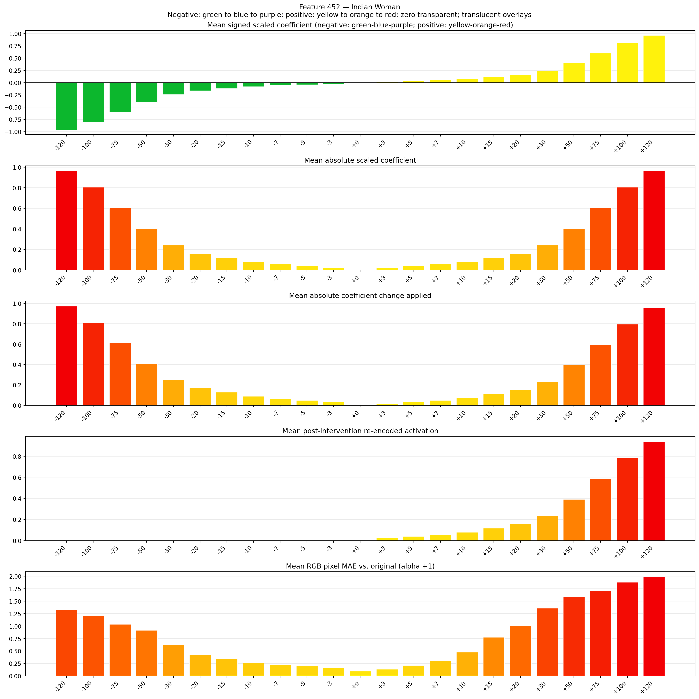
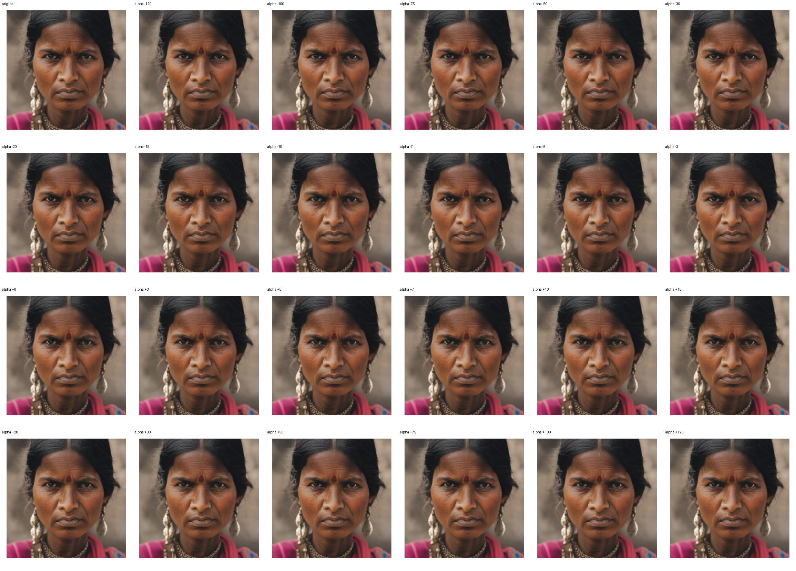
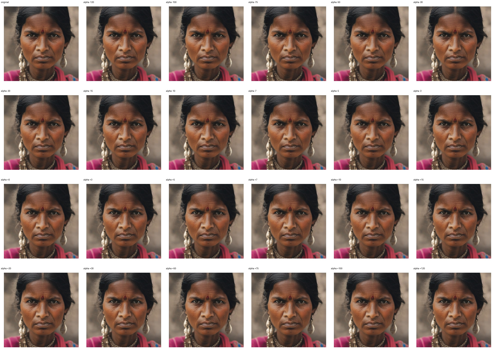

# Feature 452 — Indian Woman

Biased dataset; original prompt and seed replay for seeds 0–19. Values are means across 20 source images. The table reports the mean post-re-encoded activation of feature 452, the active spatial fraction, mean RGB pixel MAE versus the original image (0–255 scale), and coefficient change magnitudes for each alpha.

## Activation graph

## Mean metrics by alpha

| Alpha | Mean post-reencoded feature 452 activation | Active spatial fraction | Mean pixel change (MAE) | Mean absolute coefficient change | Mean absolute scaled coefficient |
|---:|---:|---:|---:|---:|---:|
| -120 | 0.000 | 0.000 | 1.324 | 0.974 | 0.966 |
| -100 | 0.000 | 0.000 | 1.202 | 0.813 | 0.805 |
| -75 | 0.000 | 0.000 | 1.036 | 0.612 | 0.604 |
| -50 | 0.000 | 0.000 | 0.915 | 0.410 | 0.402 |
| -30 | 0.000 | 0.000 | 0.620 | 0.249 | 0.241 |
| -20 | 0.000 | 0.000 | 0.425 | 0.169 | 0.161 |
| -15 | 0.000 | 0.000 | 0.340 | 0.129 | 0.121 |
| -10 | 0.000 | 0.000 | 0.268 | 0.089 | 0.080 |
| -7 | 0.000 | 0.000 | 0.225 | 0.064 | 0.056 |
| -5 | 0.000 | 0.000 | 0.195 | 0.048 | 0.040 |
| -3 | 0.000 | 0.000 | 0.160 | 0.032 | 0.024 |
| +0 | 0.000 | 0.000 | 0.093 | 0.008 | 0.000 |
| +3 | 0.024 | 0.001 | 0.134 | 0.016 | 0.024 |
| +5 | 0.039 | 0.001 | 0.213 | 0.032 | 0.040 |
| +7 | 0.055 | 0.001 | 0.307 | 0.048 | 0.056 |
| +10 | 0.079 | 0.001 | 0.478 | 0.072 | 0.080 |
| +15 | 0.118 | 0.001 | 0.773 | 0.113 | 0.121 |
| +20 | 0.157 | 0.001 | 1.013 | 0.153 | 0.161 |
| +30 | 0.235 | 0.001 | 1.360 | 0.233 | 0.241 |
| +50 | 0.392 | 0.001 | 1.589 | 0.394 | 0.402 |
| +75 | 0.588 | 0.001 | 1.709 | 0.596 | 0.604 |
| +100 | 0.784 | 0.001 | 1.880 | 0.797 | 0.805 |
| +120 | 0.941 | 0.001 | 1.990 | 0.958 | 0.966 |

## Per-seed grids

Each 4×6 sheet contains the original followed by the 23 alpha variants in ascending alpha order, from −120 through +120.

### Plain images

[All 20 plain-image grids](seed_sheets/)

### Signed coefficient overlays

[All 20 signed coefficient grids](signed_coefficient_overlays/)

### Post-re-encoded activation overlays

[All 20 post-activation grids](post_activation_overlays/)

### Intervention-footprint overlays

[All 20 intervention-footprint grids](intervention_footprint_overlays/)

Zero is transparent. Negative coefficient colors progress green through blue to purple; positive colors progress yellow through orange to red. Each map tile is normalized individually for visibility. The original and alpha-zero tiles show the pre-intervention feature map so its location remains visible.
