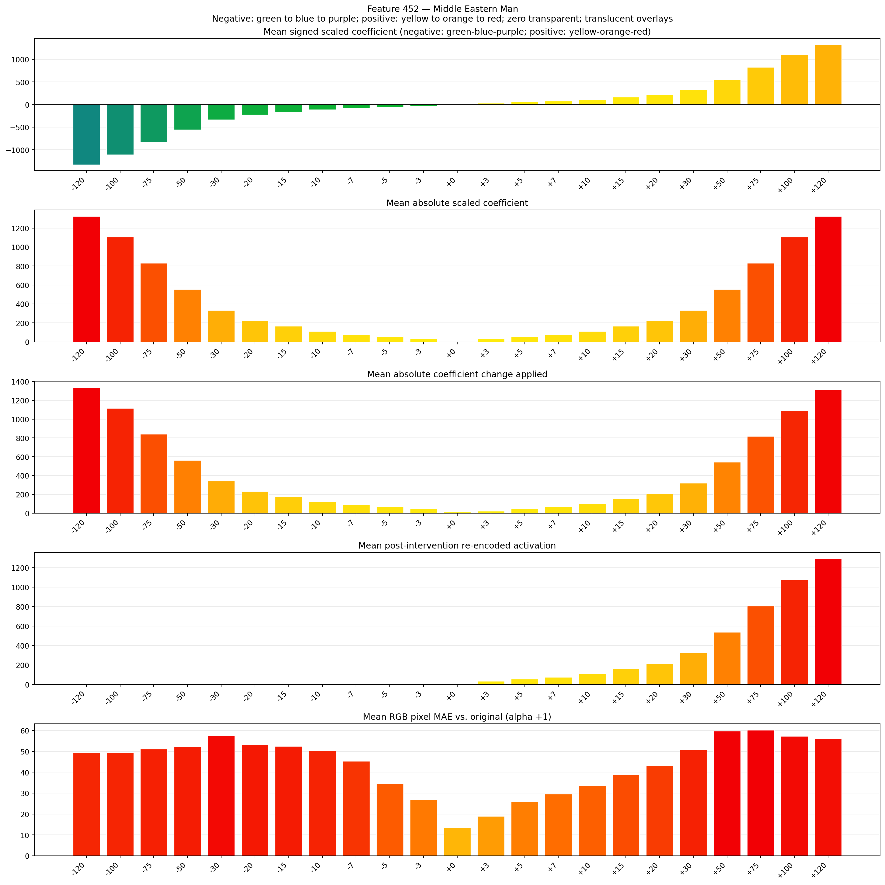
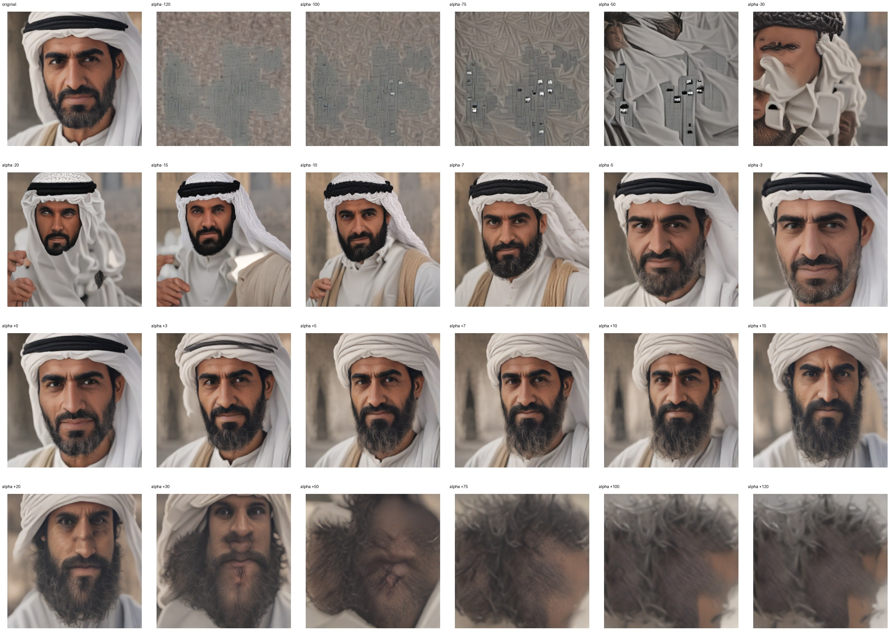
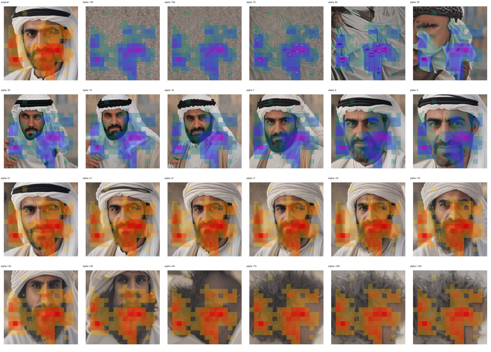
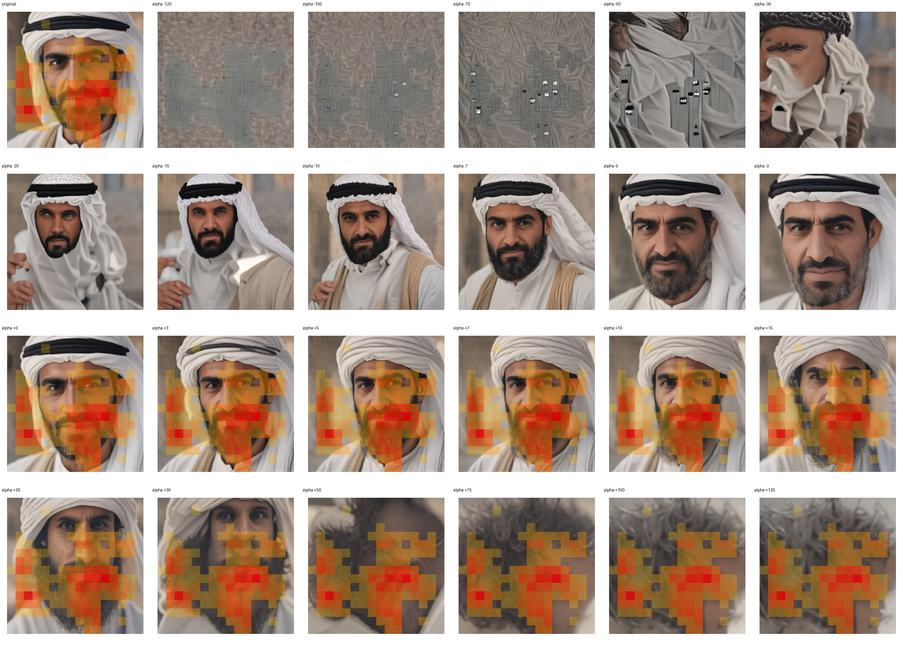

# Feature 452 — Middle Eastern Man

Biased dataset; original prompt and seed replay for seeds 0–19. Values are means across 20 source images. The table reports the mean post-re-encoded activation of feature 452, the active spatial fraction, mean RGB pixel MAE versus the original image (0–255 scale), and coefficient change magnitudes for each alpha.

## Activation graph

## Mean metrics by alpha

| Alpha | Mean post-reencoded feature 452 activation | Active spatial fraction | Mean pixel change (MAE) | Mean absolute coefficient change | Mean absolute scaled coefficient |
|---:|---:|---:|---:|---:|---:|
| -120 | 0.000 | 0.000 | 49.241 | 1335.971 | 1324.930 |
| -100 | 0.000 | 0.000 | 49.572 | 1115.149 | 1104.108 |
| -75 | 0.000 | 0.000 | 51.122 | 839.122 | 828.081 |
| -50 | 0.000 | 0.000 | 52.236 | 563.095 | 552.054 |
| -30 | 0.000 | 0.000 | 57.601 | 342.274 | 331.232 |
| -20 | 0.000 | 0.000 | 53.199 | 231.863 | 220.822 |
| -15 | 0.000 | 0.000 | 52.464 | 176.657 | 165.616 |
| -10 | 0.000 | 0.000 | 50.339 | 121.452 | 110.411 |
| -7 | 0.000 | 0.000 | 45.364 | 88.329 | 77.288 |
| -5 | 0.000 | 0.000 | 34.483 | 66.246 | 55.205 |
| -3 | 0.000 | 0.000 | 26.918 | 44.164 | 33.123 |
| +0 | 0.000 | 0.000 | 13.354 | 11.041 | 0.000 |
| +3 | 32.546 | 0.439 | 18.984 | 22.082 | 33.123 |
| +5 | 54.051 | 0.439 | 25.758 | 44.164 | 55.205 |
| +7 | 75.556 | 0.439 | 29.622 | 66.246 | 77.288 |
| +10 | 107.813 | 0.439 | 33.475 | 99.370 | 110.411 |
| +15 | 161.575 | 0.439 | 38.770 | 154.575 | 165.616 |
| +20 | 215.337 | 0.439 | 43.271 | 209.781 | 220.822 |
| +30 | 322.862 | 0.439 | 50.857 | 320.191 | 331.232 |
| +50 | 537.910 | 0.439 | 59.747 | 541.013 | 552.054 |
| +75 | 806.722 | 0.439 | 60.184 | 817.040 | 828.081 |
| +100 | 1075.532 | 0.439 | 57.287 | 1093.067 | 1104.108 |
| +120 | 1290.581 | 0.439 | 56.185 | 1313.889 | 1324.930 |

## Per-seed grids

Each 4×6 sheet contains the original followed by the 23 alpha variants in ascending alpha order, from −120 through +120.

### Plain images

[All 20 plain-image grids](seed_sheets/)

### Signed coefficient overlays

[All 20 signed coefficient grids](signed_coefficient_overlays/)

### Post-re-encoded activation overlays

[All 20 post-activation grids](post_activation_overlays/)

### Intervention-footprint overlays

[All 20 intervention-footprint grids](intervention_footprint_overlays/)

Zero is transparent. Negative coefficient colors progress green through blue to purple; positive colors progress yellow through orange to red. Each map tile is normalized individually for visibility. The original and alpha-zero tiles show the pre-intervention feature map so its location remains visible.
