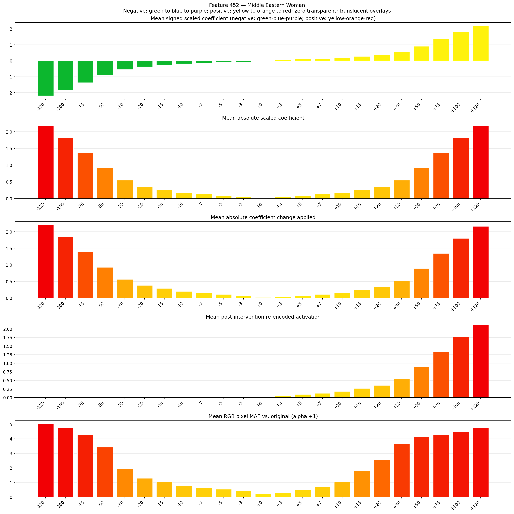

# Feature 452 — Middle Eastern Woman

Biased dataset; original prompt and seed replay for seeds 0–19. Values are means across 20 source images. The table reports the mean post-re-encoded activation of feature 452, the active spatial fraction, mean RGB pixel MAE versus the original image (0–255 scale), and coefficient change magnitudes for each alpha.

## Activation graph

## Mean metrics by alpha

| Alpha | Mean post-reencoded feature 452 activation | Active spatial fraction | Mean pixel change (MAE) | Mean absolute coefficient change | Mean absolute scaled coefficient |
|---:|---:|---:|---:|---:|---:|
| -120 | 0.000 | 0.000 | 5.009 | 2.201 | 2.183 |
| -100 | 0.000 | 0.000 | 4.731 | 1.837 | 1.819 |
| -75 | 0.000 | 0.000 | 4.277 | 1.383 | 1.364 |
| -50 | 0.000 | 0.000 | 3.420 | 0.928 | 0.910 |
| -30 | 0.000 | 0.000 | 1.945 | 0.564 | 0.546 |
| -20 | 0.000 | 0.000 | 1.289 | 0.382 | 0.364 |
| -15 | 0.000 | 0.000 | 1.026 | 0.291 | 0.273 |
| -10 | 0.000 | 0.000 | 0.788 | 0.200 | 0.182 |
| -7 | 0.000 | 0.000 | 0.641 | 0.146 | 0.127 |
| -5 | 0.000 | 0.000 | 0.530 | 0.109 | 0.091 |
| -3 | 0.000 | 0.000 | 0.415 | 0.073 | 0.055 |
| +0 | 0.000 | 0.000 | 0.218 | 0.018 | 0.000 |
| +3 | 0.054 | 0.002 | 0.303 | 0.036 | 0.055 |
| +5 | 0.089 | 0.002 | 0.473 | 0.073 | 0.091 |
| +7 | 0.124 | 0.002 | 0.676 | 0.109 | 0.127 |
| +10 | 0.178 | 0.002 | 1.046 | 0.164 | 0.182 |
| +15 | 0.266 | 0.002 | 1.797 | 0.255 | 0.273 |
| +20 | 0.355 | 0.002 | 2.562 | 0.346 | 0.364 |
| +30 | 0.532 | 0.002 | 3.632 | 0.528 | 0.546 |
| +50 | 0.886 | 0.002 | 4.117 | 0.891 | 0.910 |
| +75 | 1.329 | 0.002 | 4.298 | 1.346 | 1.364 |
| +100 | 1.772 | 0.002 | 4.499 | 1.801 | 1.819 |
| +120 | 2.127 | 0.002 | 4.749 | 2.165 | 2.183 |

## Per-seed grids

Each 4×6 sheet contains the original followed by the 23 alpha variants in ascending alpha order, from −120 through +120.

### Plain images

[All 20 plain-image grids](seed_sheets/)

### Signed coefficient overlays

[All 20 signed coefficient grids](signed_coefficient_overlays/)

### Post-re-encoded activation overlays

[All 20 post-activation grids](post_activation_overlays/)

### Intervention-footprint overlays

[All 20 intervention-footprint grids](intervention_footprint_overlays/)

Zero is transparent. Negative coefficient colors progress green through blue to purple; positive colors progress yellow through orange to red. Each map tile is normalized individually for visibility. The original and alpha-zero tiles show the pre-intervention feature map so its location remains visible.
