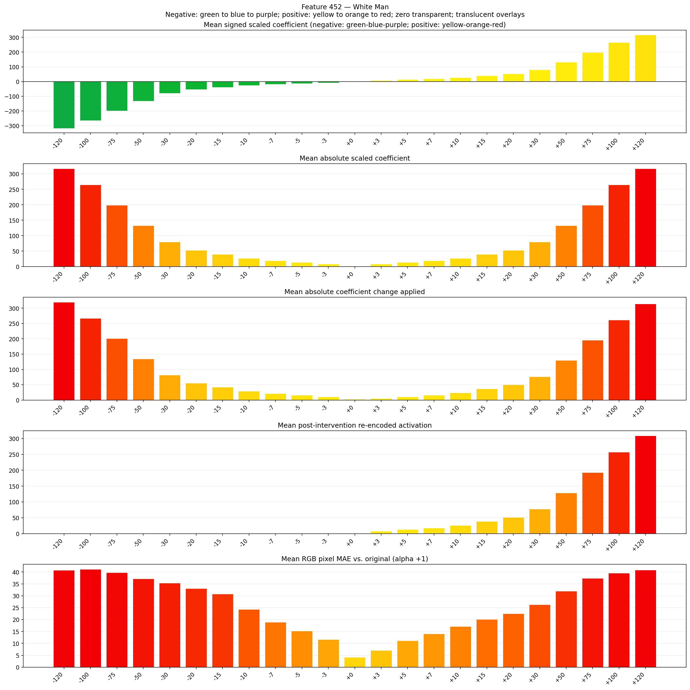
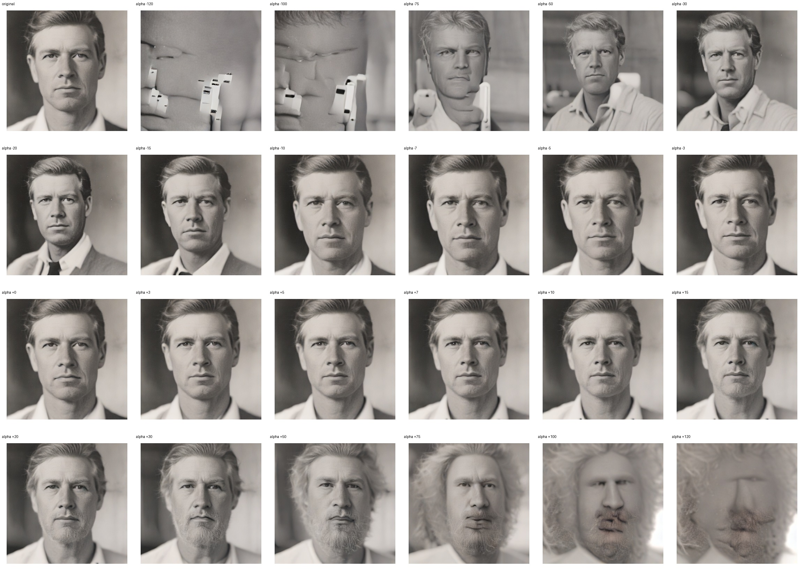
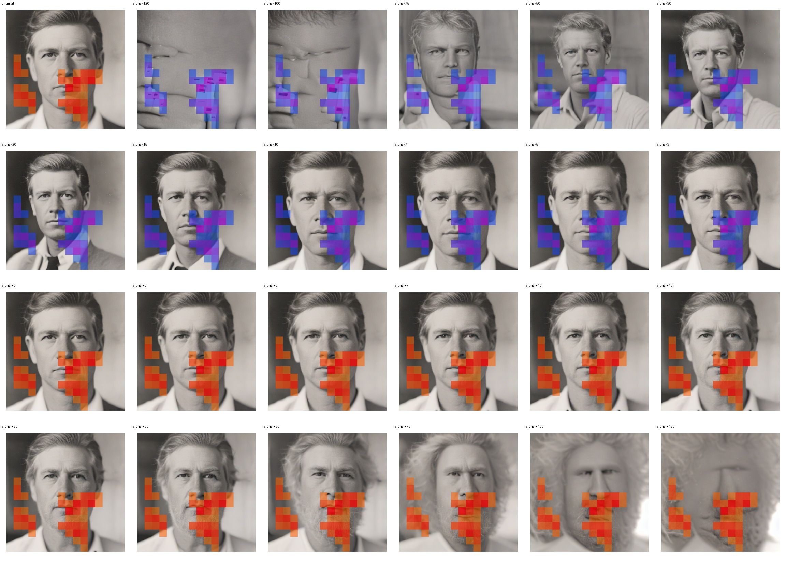
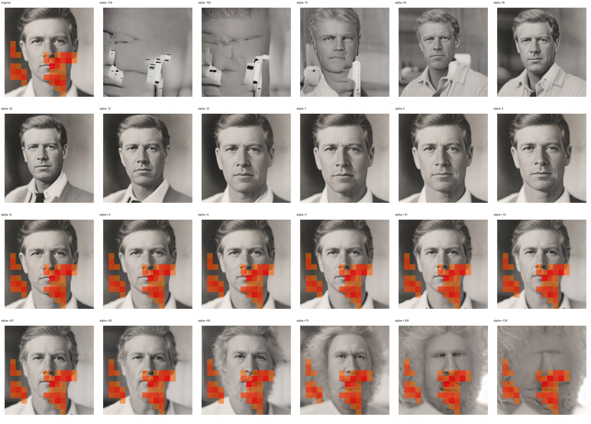

# Feature 452 — White Man

Biased dataset; original prompt and seed replay for seeds 0–19. Values are means across 20 source images. The table reports the mean post-re-encoded activation of feature 452, the active spatial fraction, mean RGB pixel MAE versus the original image (0–255 scale), and coefficient change magnitudes for each alpha.

## Activation graph

## Mean metrics by alpha

| Alpha | Mean post-reencoded feature 452 activation | Active spatial fraction | Mean pixel change (MAE) | Mean absolute coefficient change | Mean absolute scaled coefficient |
|---:|---:|---:|---:|---:|---:|
| -120 | 0.000 | 0.000 | 40.738 | 319.912 | 317.268 |
| -100 | 0.000 | 0.000 | 41.153 | 267.034 | 264.390 |
| -75 | 0.000 | 0.000 | 39.755 | 200.936 | 198.292 |
| -50 | 0.000 | 0.000 | 37.120 | 134.839 | 132.195 |
| -30 | 0.000 | 0.000 | 35.385 | 81.961 | 79.317 |
| -20 | 0.000 | 0.000 | 33.087 | 55.522 | 52.878 |
| -15 | 0.000 | 0.000 | 30.822 | 42.302 | 39.658 |
| -10 | 0.000 | 0.000 | 24.320 | 29.083 | 26.439 |
| -7 | 0.000 | 0.000 | 18.962 | 21.151 | 18.507 |
| -5 | 0.000 | 0.000 | 15.221 | 15.863 | 13.219 |
| -3 | 0.000 | 0.000 | 11.611 | 10.576 | 7.932 |
| +0 | 0.000 | 0.000 | 4.132 | 2.644 | 0.000 |
| +3 | 7.793 | 0.157 | 7.083 | 5.288 | 7.932 |
| +5 | 12.943 | 0.157 | 11.164 | 10.576 | 13.219 |
| +7 | 18.093 | 0.157 | 14.002 | 15.863 | 18.507 |
| +10 | 25.817 | 0.157 | 17.096 | 23.795 | 26.439 |
| +15 | 38.691 | 0.157 | 20.140 | 37.015 | 39.658 |
| +20 | 51.565 | 0.157 | 22.489 | 50.234 | 52.878 |
| +30 | 77.312 | 0.157 | 26.325 | 76.673 | 79.317 |
| +50 | 128.808 | 0.157 | 31.953 | 129.551 | 132.195 |
| +75 | 193.178 | 0.157 | 37.353 | 195.648 | 198.292 |
| +100 | 257.547 | 0.157 | 39.503 | 261.746 | 264.390 |
| +120 | 309.042 | 0.157 | 40.824 | 314.624 | 317.268 |

## Per-seed grids

Each 4×6 sheet contains the original followed by the 23 alpha variants in ascending alpha order, from −120 through +120.

### Plain images

[All 20 plain-image grids](seed_sheets/)

### Signed coefficient overlays

[All 20 signed coefficient grids](signed_coefficient_overlays/)

### Post-re-encoded activation overlays

[All 20 post-activation grids](post_activation_overlays/)

### Intervention-footprint overlays

[All 20 intervention-footprint grids](intervention_footprint_overlays/)

Zero is transparent. Negative coefficient colors progress green through blue to purple; positive colors progress yellow through orange to red. Each map tile is normalized individually for visibility. The original and alpha-zero tiles show the pre-intervention feature map so its location remains visible.
