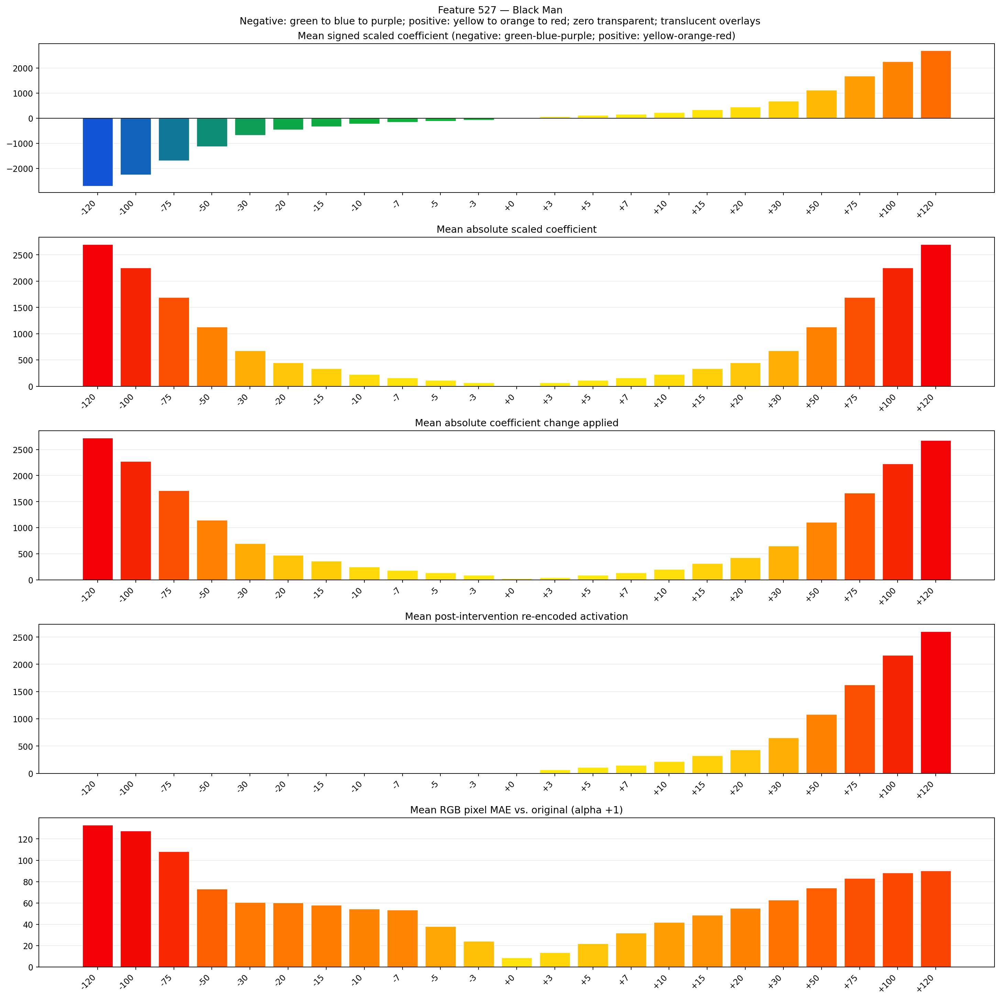
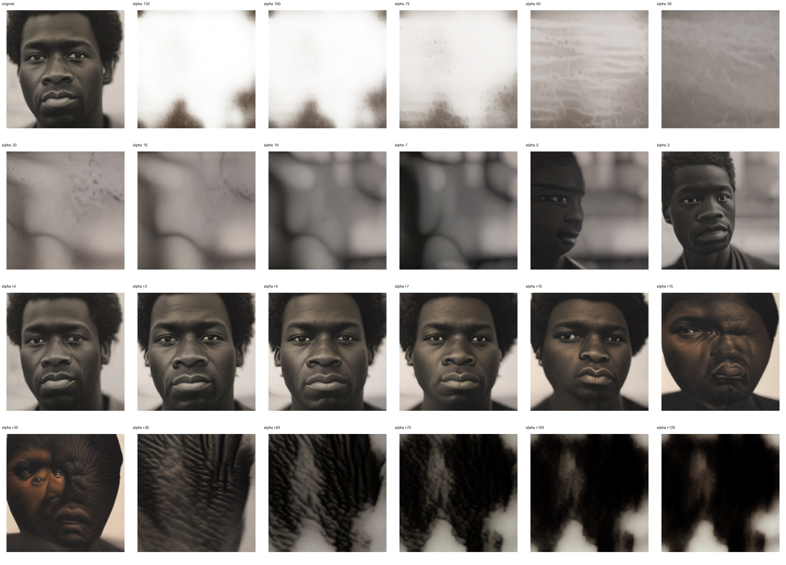
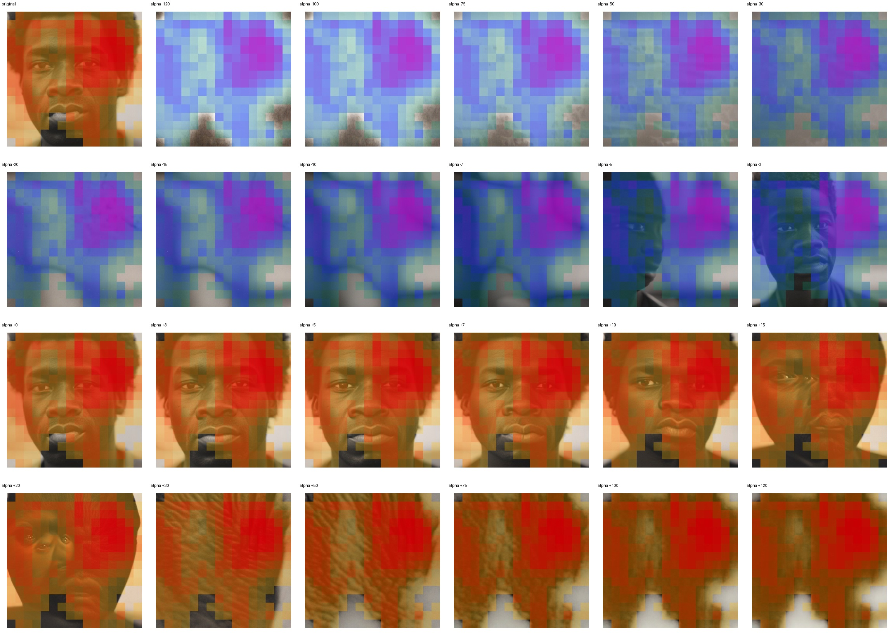
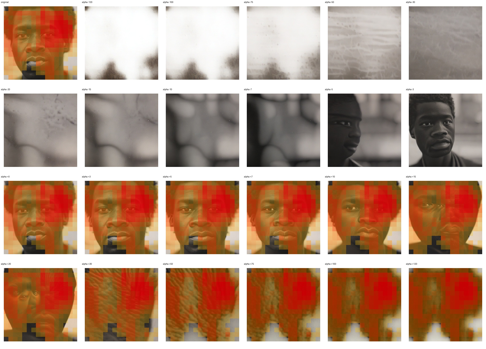

# Feature 527 — Black Man

Biased dataset; original prompt and seed replay for seeds 0–19. Values are means across 20 source images. The table reports the mean post-re-encoded activation of feature 527, the active spatial fraction, mean RGB pixel MAE versus the original image (0–255 scale), and coefficient change magnitudes for each alpha.

## Activation graph

## Mean metrics by alpha

| Alpha | Mean post-reencoded feature 527 activation | Active spatial fraction | Mean pixel change (MAE) | Mean absolute coefficient change | Mean absolute scaled coefficient |
|---:|---:|---:|---:|---:|---:|
| -120 | 0.000 | 0.000 | 133.082 | 2723.825 | 2701.314 |
| -100 | 0.000 | 0.000 | 127.478 | 2273.606 | 2251.095 |
| -75 | 0.000 | 0.000 | 108.159 | 1710.832 | 1688.321 |
| -50 | 0.000 | 0.000 | 72.947 | 1148.058 | 1125.547 |
| -30 | 0.000 | 0.000 | 60.432 | 697.839 | 675.328 |
| -20 | 0.000 | 0.000 | 60.266 | 472.730 | 450.219 |
| -15 | 0.000 | 0.000 | 57.799 | 360.175 | 337.664 |
| -10 | 0.000 | 0.000 | 54.351 | 247.620 | 225.109 |
| -7 | 0.000 | 0.000 | 53.512 | 180.088 | 157.577 |
| -5 | 0.000 | 0.000 | 38.002 | 135.066 | 112.555 |
| -3 | 0.000 | 0.000 | 24.095 | 90.044 | 67.533 |
| +0 | 0.000 | 0.000 | 8.490 | 22.511 | 0.000 |
| +3 | 65.885 | 0.940 | 13.545 | 45.022 | 67.533 |
| +5 | 109.258 | 0.940 | 21.808 | 90.044 | 112.555 |
| +7 | 152.632 | 0.940 | 31.753 | 135.066 | 157.577 |
| +10 | 217.692 | 0.940 | 41.726 | 202.599 | 225.109 |
| +15 | 326.126 | 0.940 | 48.690 | 315.153 | 337.664 |
| +20 | 434.560 | 0.940 | 55.040 | 427.708 | 450.219 |
| +30 | 651.428 | 0.940 | 62.913 | 652.817 | 675.328 |
| +50 | 1085.165 | 0.940 | 74.075 | 1103.036 | 1125.547 |
| +75 | 1627.334 | 0.940 | 83.185 | 1665.810 | 1688.321 |
| +100 | 2169.503 | 0.940 | 88.158 | 2228.584 | 2251.095 |
| +120 | 2603.241 | 0.940 | 90.238 | 2678.803 | 2701.314 |

## Per-seed grids

Each 4×6 sheet contains the original followed by the 23 alpha variants in ascending alpha order, from −120 through +120.

### Plain images

[All 20 plain-image grids](seed_sheets/)

### Signed coefficient overlays

[All 20 signed coefficient grids](signed_coefficient_overlays/)

### Post-re-encoded activation overlays

[All 20 post-activation grids](post_activation_overlays/)

### Intervention-footprint overlays

[All 20 intervention-footprint grids](intervention_footprint_overlays/)

Zero is transparent. Negative coefficient colors progress green through blue to purple; positive colors progress yellow through orange to red. Each map tile is normalized individually for visibility. The original and alpha-zero tiles show the pre-intervention feature map so its location remains visible.
