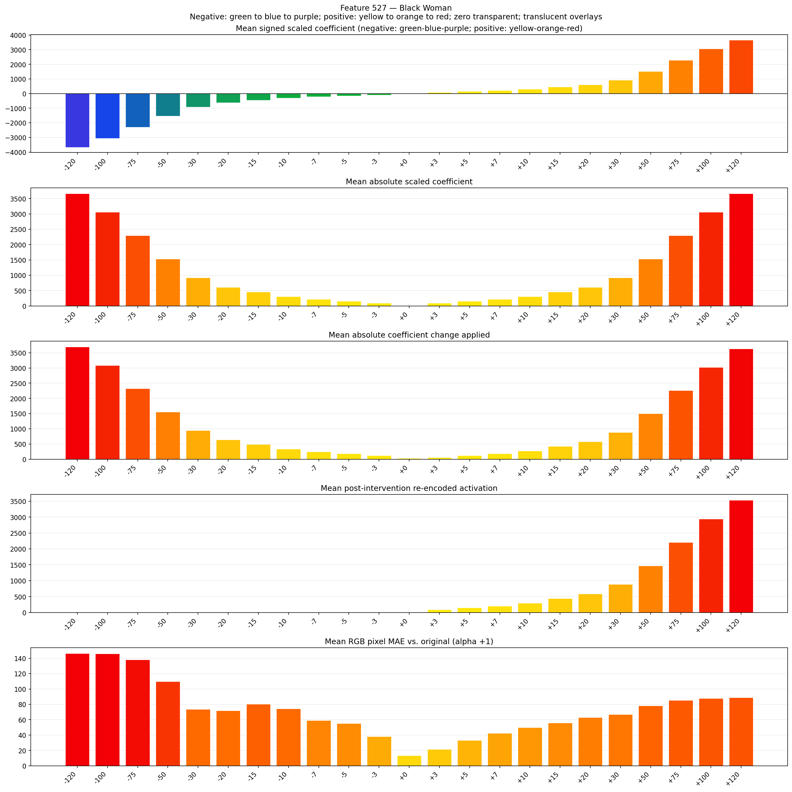
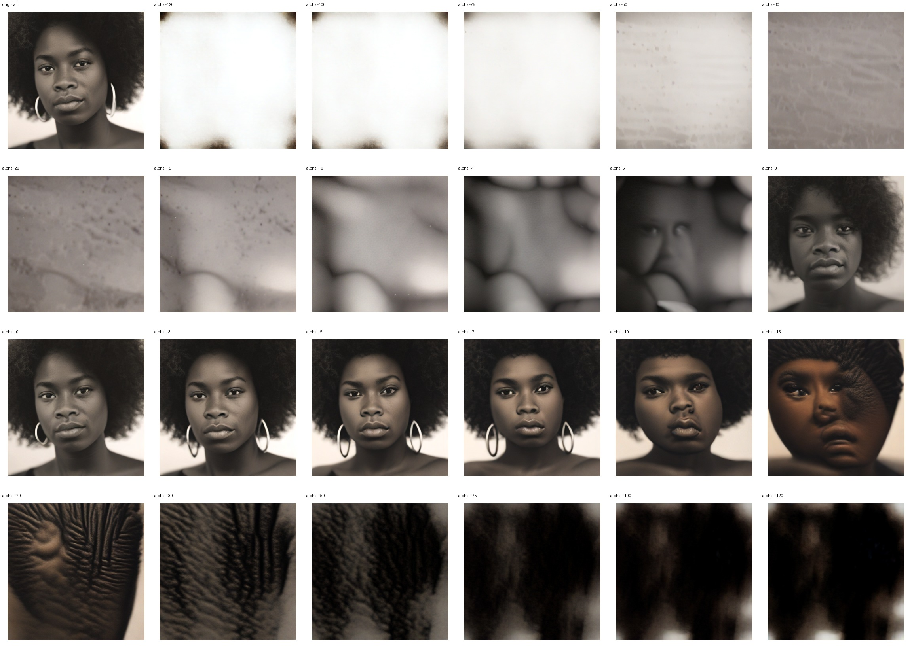
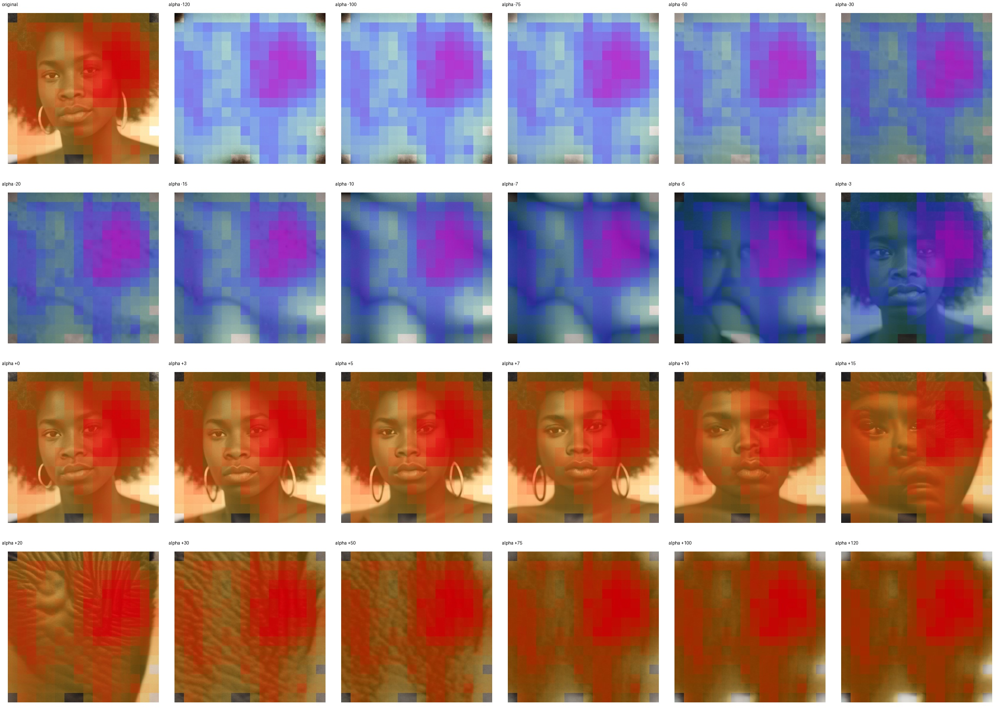
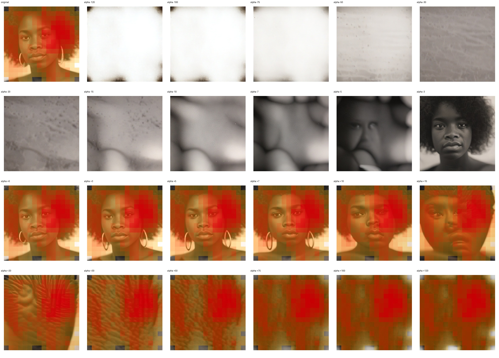

# Feature 527 — Black Woman

Biased dataset; original prompt and seed replay for seeds 0–19. Values are means across 20 source images. The table reports the mean post-re-encoded activation of feature 527, the active spatial fraction, mean RGB pixel MAE versus the original image (0–255 scale), and coefficient change magnitudes for each alpha.

## Activation graph

## Mean metrics by alpha

| Alpha | Mean post-reencoded feature 527 activation | Active spatial fraction | Mean pixel change (MAE) | Mean absolute coefficient change | Mean absolute scaled coefficient |
|---:|---:|---:|---:|---:|---:|
| -120 | 0.000 | 0.000 | 146.275 | 3697.901 | 3667.340 |
| -100 | 0.000 | 0.000 | 145.847 | 3086.678 | 3056.117 |
| -75 | 0.000 | 0.000 | 138.004 | 2322.649 | 2292.088 |
| -50 | 0.000 | 0.000 | 109.733 | 1558.620 | 1528.058 |
| -30 | 0.000 | 0.000 | 73.755 | 947.396 | 916.835 |
| -20 | 0.000 | 0.000 | 71.983 | 641.784 | 611.223 |
| -15 | 0.000 | 0.000 | 80.386 | 488.979 | 458.418 |
| -10 | 0.000 | 0.000 | 74.285 | 336.173 | 305.612 |
| -7 | 0.000 | 0.000 | 59.025 | 244.489 | 213.928 |
| -5 | 0.000 | 0.000 | 55.040 | 183.367 | 152.806 |
| -3 | 0.000 | 0.000 | 38.206 | 122.245 | 91.684 |
| +0 | 0.000 | 0.000 | 13.247 | 30.561 | 0.000 |
| +3 | 89.446 | 0.976 | 21.637 | 61.122 | 91.684 |
| +5 | 148.330 | 0.976 | 33.160 | 122.245 | 152.806 |
| +7 | 207.215 | 0.976 | 42.318 | 183.367 | 213.928 |
| +10 | 295.542 | 0.976 | 49.916 | 275.051 | 305.612 |
| +15 | 442.753 | 0.976 | 55.905 | 427.856 | 458.418 |
| +20 | 589.965 | 0.976 | 63.122 | 580.662 | 611.223 |
| +30 | 884.388 | 0.976 | 66.953 | 886.274 | 916.835 |
| +50 | 1473.234 | 0.976 | 78.100 | 1497.497 | 1528.058 |
| +75 | 2209.291 | 0.976 | 85.154 | 2261.526 | 2292.088 |
| +100 | 2945.348 | 0.976 | 87.682 | 3025.556 | 3056.117 |
| +120 | 3534.193 | 0.976 | 88.918 | 3636.779 | 3667.340 |

## Per-seed grids

Each 4×6 sheet contains the original followed by the 23 alpha variants in ascending alpha order, from −120 through +120.

### Plain images

[All 20 plain-image grids](seed_sheets/)

### Signed coefficient overlays

[All 20 signed coefficient grids](signed_coefficient_overlays/)

### Post-re-encoded activation overlays

[All 20 post-activation grids](post_activation_overlays/)

### Intervention-footprint overlays

[All 20 intervention-footprint grids](intervention_footprint_overlays/)

Zero is transparent. Negative coefficient colors progress green through blue to purple; positive colors progress yellow through orange to red. Each map tile is normalized individually for visibility. The original and alpha-zero tiles show the pre-intervention feature map so its location remains visible.
