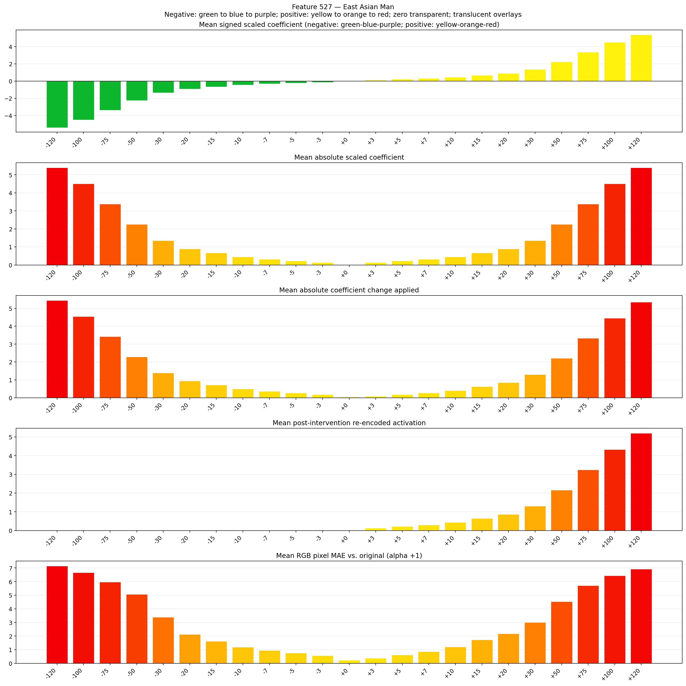
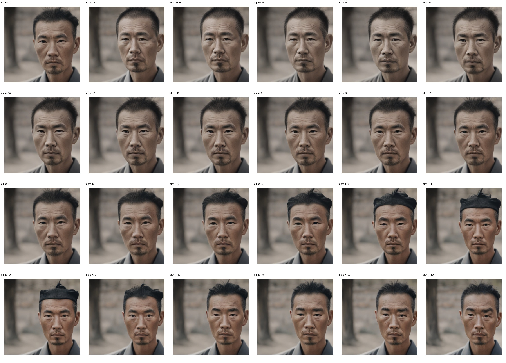
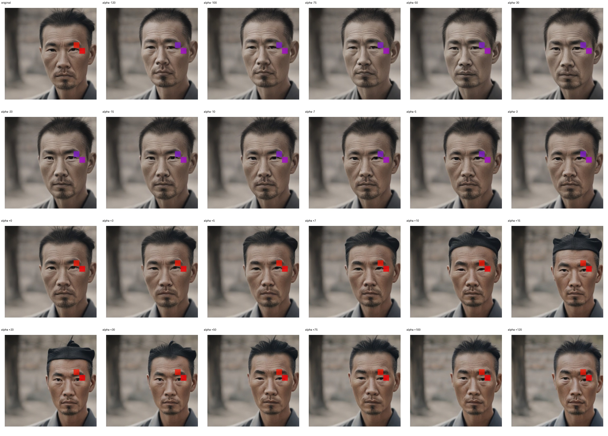
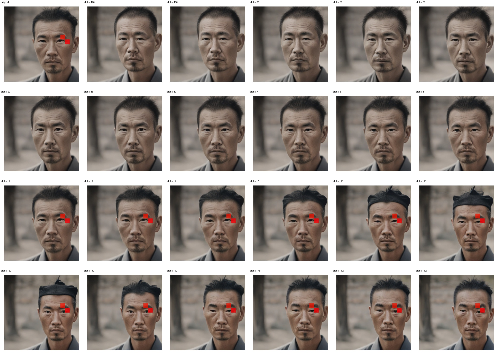

# Feature 527 — East Asian Man

Biased dataset; original prompt and seed replay for seeds 0–19. Values are means across 20 source images. The table reports the mean post-re-encoded activation of feature 527, the active spatial fraction, mean RGB pixel MAE versus the original image (0–255 scale), and coefficient change magnitudes for each alpha.

## Activation graph

## Mean metrics by alpha

| Alpha | Mean post-reencoded feature 527 activation | Active spatial fraction | Mean pixel change (MAE) | Mean absolute coefficient change | Mean absolute scaled coefficient |
|---:|---:|---:|---:|---:|---:|
| -120 | 0.000 | 0.000 | 7.148 | 5.446 | 5.401 |
| -100 | 0.000 | 0.000 | 6.661 | 4.546 | 4.501 |
| -75 | 0.000 | 0.000 | 5.962 | 3.421 | 3.376 |
| -50 | 0.000 | 0.000 | 5.065 | 2.296 | 2.251 |
| -30 | 0.000 | 0.000 | 3.391 | 1.395 | 1.350 |
| -20 | 0.000 | 0.000 | 2.123 | 0.945 | 0.900 |
| -15 | 0.000 | 0.000 | 1.618 | 0.720 | 0.675 |
| -10 | 0.000 | 0.000 | 1.192 | 0.495 | 0.450 |
| -7 | 0.000 | 0.000 | 0.941 | 0.360 | 0.315 |
| -5 | 0.000 | 0.000 | 0.762 | 0.270 | 0.225 |
| -3 | 0.000 | 0.000 | 0.568 | 0.180 | 0.135 |
| +0 | 0.000 | 0.000 | 0.247 | 0.045 | 0.000 |
| +3 | 0.132 | 0.004 | 0.379 | 0.090 | 0.135 |
| +5 | 0.218 | 0.004 | 0.626 | 0.180 | 0.225 |
| +7 | 0.305 | 0.004 | 0.864 | 0.270 | 0.315 |
| +10 | 0.435 | 0.004 | 1.202 | 0.405 | 0.450 |
| +15 | 0.652 | 0.004 | 1.723 | 0.630 | 0.675 |
| +20 | 0.869 | 0.004 | 2.184 | 0.855 | 0.900 |
| +30 | 1.303 | 0.004 | 3.013 | 1.305 | 1.350 |
| +50 | 2.170 | 0.004 | 4.540 | 2.206 | 2.251 |
| +75 | 3.254 | 0.004 | 5.709 | 3.331 | 3.376 |
| +100 | 4.338 | 0.004 | 6.439 | 4.456 | 4.501 |
| +120 | 5.205 | 0.004 | 6.913 | 5.356 | 5.401 |

## Per-seed grids

Each 4×6 sheet contains the original followed by the 23 alpha variants in ascending alpha order, from −120 through +120.

### Plain images

[All 20 plain-image grids](seed_sheets/)

### Signed coefficient overlays

[All 20 signed coefficient grids](signed_coefficient_overlays/)

### Post-re-encoded activation overlays

[All 20 post-activation grids](post_activation_overlays/)

### Intervention-footprint overlays

[All 20 intervention-footprint grids](intervention_footprint_overlays/)

Zero is transparent. Negative coefficient colors progress green through blue to purple; positive colors progress yellow through orange to red. Each map tile is normalized individually for visibility. The original and alpha-zero tiles show the pre-intervention feature map so its location remains visible.
