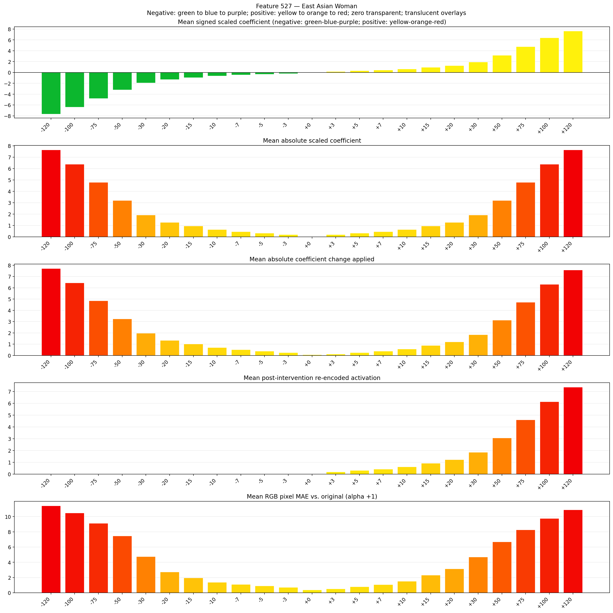
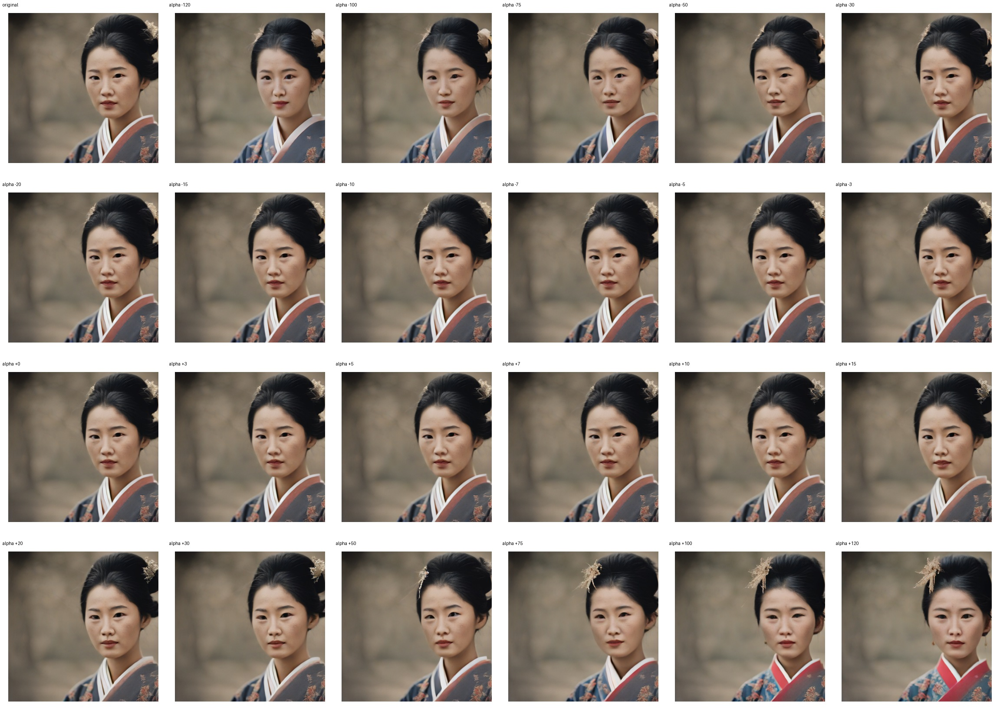
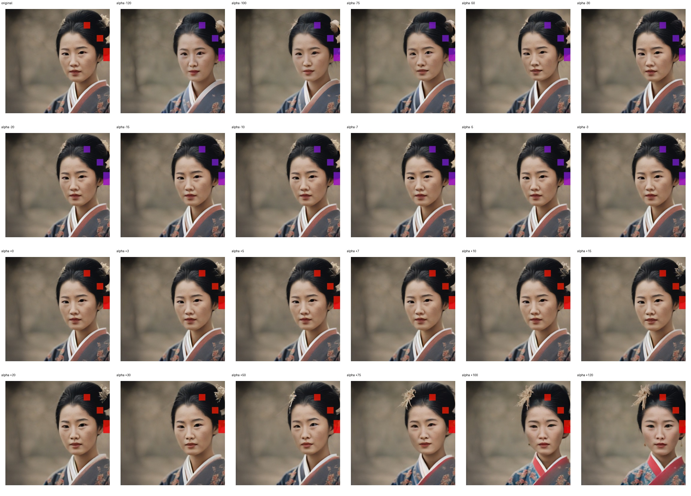
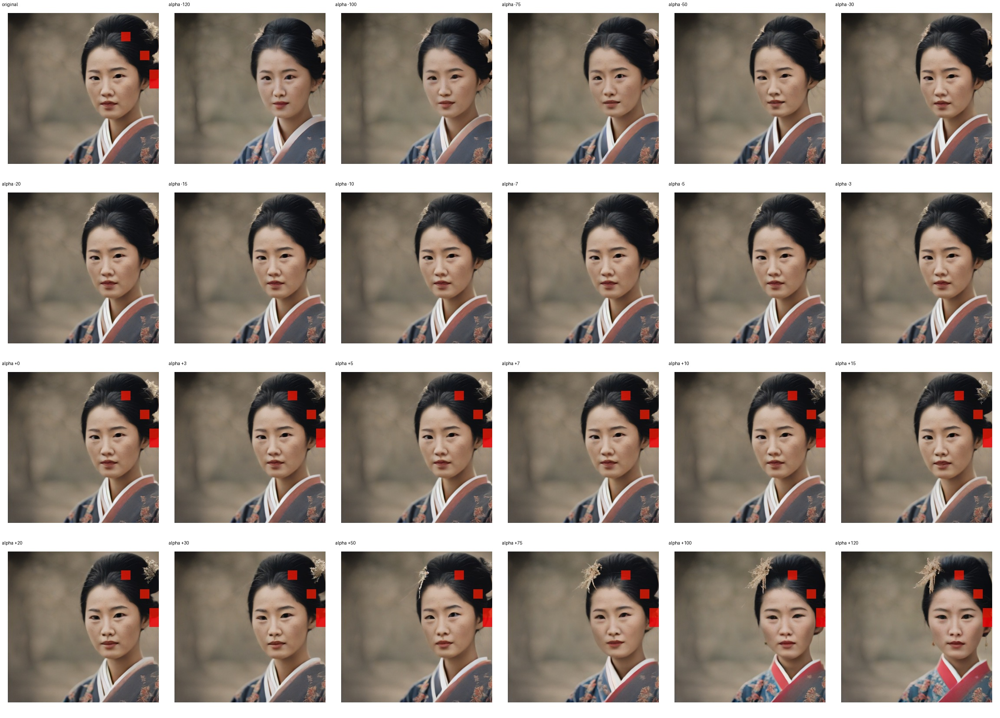

# Feature 527 — East Asian Woman

Biased dataset; original prompt and seed replay for seeds 0–19. Values are means across 20 source images. The table reports the mean post-re-encoded activation of feature 527, the active spatial fraction, mean RGB pixel MAE versus the original image (0–255 scale), and coefficient change magnitudes for each alpha.

## Activation graph

## Mean metrics by alpha

| Alpha | Mean post-reencoded feature 527 activation | Active spatial fraction | Mean pixel change (MAE) | Mean absolute coefficient change | Mean absolute scaled coefficient |
|---:|---:|---:|---:|---:|---:|
| -120 | 0.000 | 0.000 | 11.422 | 7.718 | 7.655 |
| -100 | 0.000 | 0.000 | 10.476 | 6.443 | 6.379 |
| -75 | 0.000 | 0.000 | 9.131 | 4.848 | 4.784 |
| -50 | 0.000 | 0.000 | 7.459 | 3.253 | 3.189 |
| -30 | 0.000 | 0.000 | 4.747 | 1.977 | 1.914 |
| -20 | 0.000 | 0.000 | 2.722 | 1.340 | 1.276 |
| -15 | 0.000 | 0.000 | 1.959 | 1.021 | 0.957 |
| -10 | 0.000 | 0.000 | 1.381 | 0.702 | 0.638 |
| -7 | 0.000 | 0.000 | 1.092 | 0.510 | 0.447 |
| -5 | 0.000 | 0.000 | 0.909 | 0.383 | 0.319 |
| -3 | 0.000 | 0.000 | 0.709 | 0.255 | 0.191 |
| +0 | 0.000 | 0.000 | 0.391 | 0.064 | 0.000 |
| +3 | 0.187 | 0.006 | 0.519 | 0.128 | 0.191 |
| +5 | 0.310 | 0.006 | 0.786 | 0.255 | 0.319 |
| +7 | 0.432 | 0.006 | 1.062 | 0.383 | 0.447 |
| +10 | 0.617 | 0.006 | 1.510 | 0.574 | 0.638 |
| +15 | 0.924 | 0.006 | 2.318 | 0.893 | 0.957 |
| +20 | 1.231 | 0.006 | 3.142 | 1.212 | 1.276 |
| +30 | 1.846 | 0.006 | 4.705 | 1.850 | 1.914 |
| +50 | 3.075 | 0.006 | 6.689 | 3.126 | 3.189 |
| +75 | 4.611 | 0.006 | 8.258 | 4.720 | 4.784 |
| +100 | 6.148 | 0.006 | 9.761 | 6.315 | 6.379 |
| +120 | 7.377 | 0.006 | 10.889 | 7.591 | 7.655 |

## Per-seed grids

Each 4×6 sheet contains the original followed by the 23 alpha variants in ascending alpha order, from −120 through +120.

### Plain images

[All 20 plain-image grids](seed_sheets/)

### Signed coefficient overlays

[All 20 signed coefficient grids](signed_coefficient_overlays/)

### Post-re-encoded activation overlays

[All 20 post-activation grids](post_activation_overlays/)

### Intervention-footprint overlays

[All 20 intervention-footprint grids](intervention_footprint_overlays/)

Zero is transparent. Negative coefficient colors progress green through blue to purple; positive colors progress yellow through orange to red. Each map tile is normalized individually for visibility. The original and alpha-zero tiles show the pre-intervention feature map so its location remains visible.
