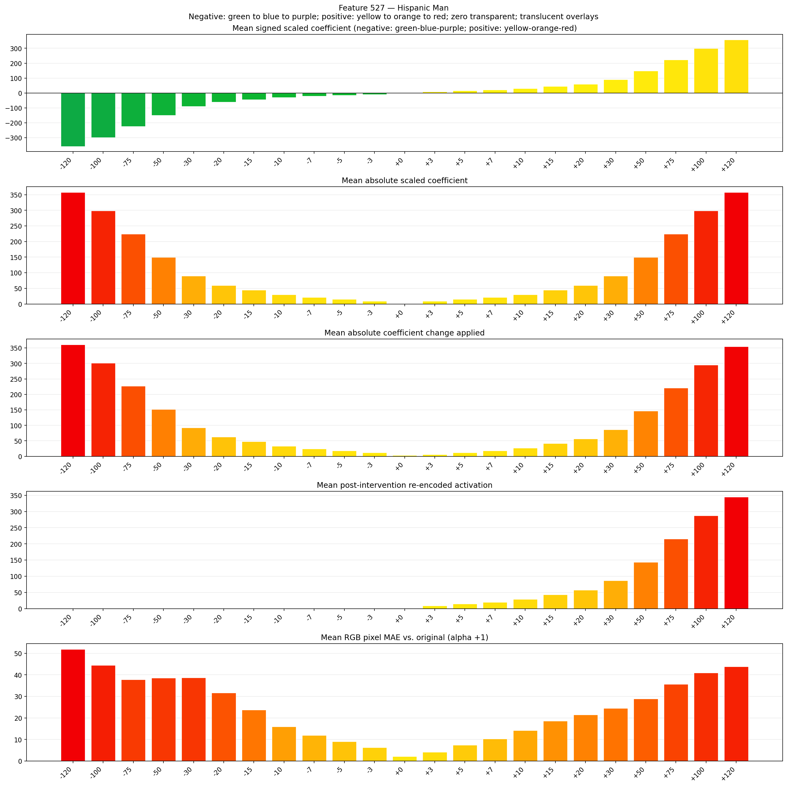
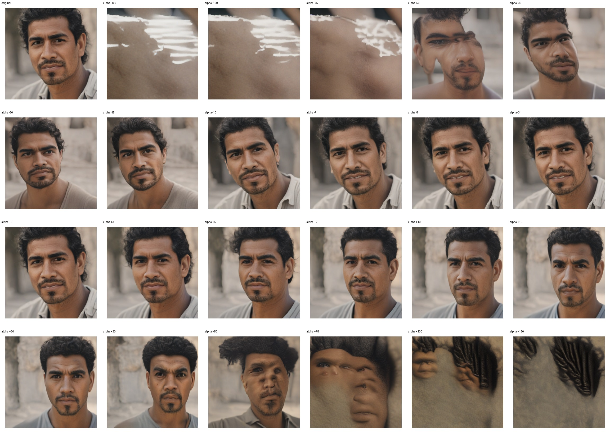
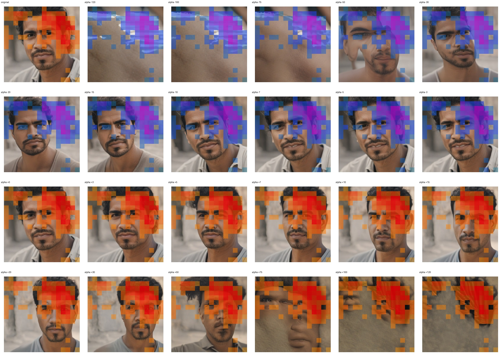
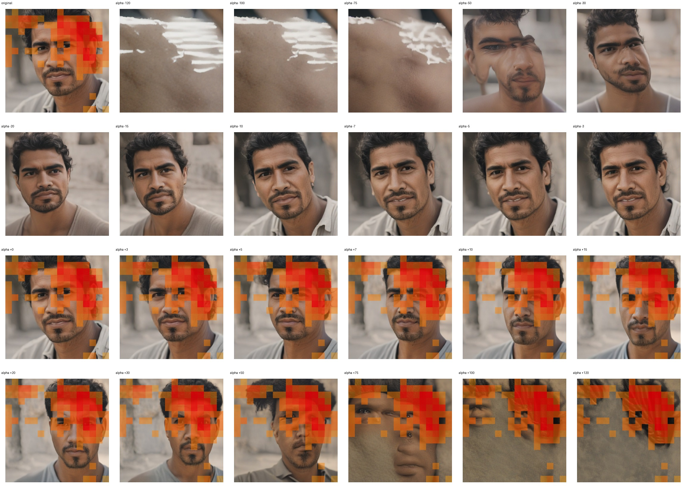

# Feature 527 — Hispanic Man

Biased dataset; original prompt and seed replay for seeds 0–19. Values are means across 20 source images. The table reports the mean post-re-encoded activation of feature 527, the active spatial fraction, mean RGB pixel MAE versus the original image (0–255 scale), and coefficient change magnitudes for each alpha.

## Activation graph

## Mean metrics by alpha

| Alpha | Mean post-reencoded feature 527 activation | Active spatial fraction | Mean pixel change (MAE) | Mean absolute coefficient change | Mean absolute scaled coefficient |
|---:|---:|---:|---:|---:|---:|
| -120 | 0.000 | 0.000 | 51.855 | 360.821 | 357.839 |
| -100 | 0.000 | 0.000 | 44.465 | 301.181 | 298.199 |
| -75 | 0.000 | 0.000 | 37.770 | 226.631 | 223.649 |
| -50 | 0.000 | 0.000 | 38.534 | 152.082 | 149.100 |
| -30 | 0.000 | 0.000 | 38.707 | 92.442 | 89.460 |
| -20 | 0.000 | 0.000 | 31.660 | 62.622 | 59.640 |
| -15 | 0.000 | 0.000 | 23.659 | 47.712 | 44.730 |
| -10 | 0.000 | 0.000 | 15.949 | 32.802 | 29.820 |
| -7 | 0.000 | 0.000 | 11.885 | 23.856 | 20.874 |
| -5 | 0.000 | 0.000 | 9.037 | 17.892 | 14.910 |
| -3 | 0.000 | 0.000 | 6.216 | 11.928 | 8.946 |
| +0 | 0.000 | 0.000 | 2.055 | 2.982 | 0.000 |
| +3 | 8.728 | 0.250 | 4.079 | 5.964 | 8.946 |
| +5 | 14.473 | 0.250 | 7.350 | 11.928 | 14.910 |
| +7 | 20.219 | 0.250 | 10.300 | 17.892 | 20.874 |
| +10 | 28.837 | 0.250 | 14.195 | 26.838 | 29.820 |
| +15 | 43.201 | 0.250 | 18.565 | 41.748 | 44.730 |
| +20 | 57.566 | 0.250 | 21.467 | 56.658 | 59.640 |
| +30 | 86.294 | 0.250 | 24.410 | 86.478 | 89.460 |
| +50 | 143.750 | 0.250 | 28.862 | 146.118 | 149.100 |
| +75 | 215.571 | 0.250 | 35.607 | 220.667 | 223.649 |
| +100 | 287.391 | 0.250 | 40.926 | 295.217 | 298.199 |
| +120 | 344.847 | 0.250 | 43.834 | 354.857 | 357.839 |

## Per-seed grids

Each 4×6 sheet contains the original followed by the 23 alpha variants in ascending alpha order, from −120 through +120.

### Plain images

[All 20 plain-image grids](seed_sheets/)

### Signed coefficient overlays

[All 20 signed coefficient grids](signed_coefficient_overlays/)

### Post-re-encoded activation overlays

[All 20 post-activation grids](post_activation_overlays/)

### Intervention-footprint overlays

[All 20 intervention-footprint grids](intervention_footprint_overlays/)

Zero is transparent. Negative coefficient colors progress green through blue to purple; positive colors progress yellow through orange to red. Each map tile is normalized individually for visibility. The original and alpha-zero tiles show the pre-intervention feature map so its location remains visible.
