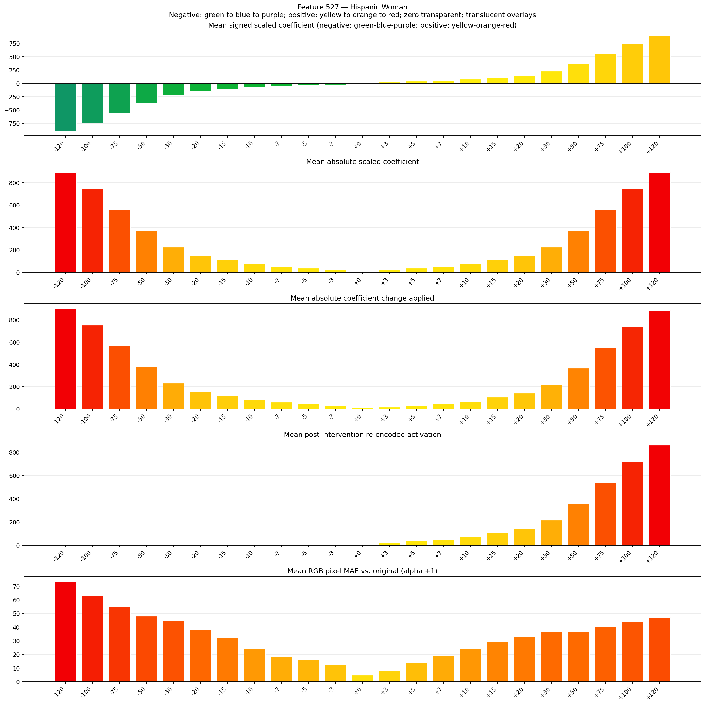
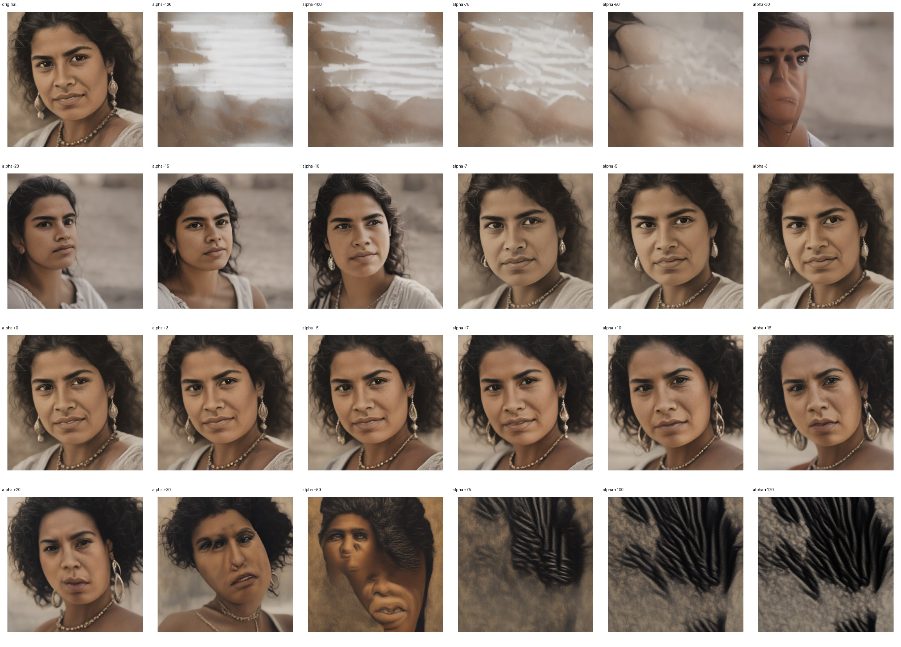
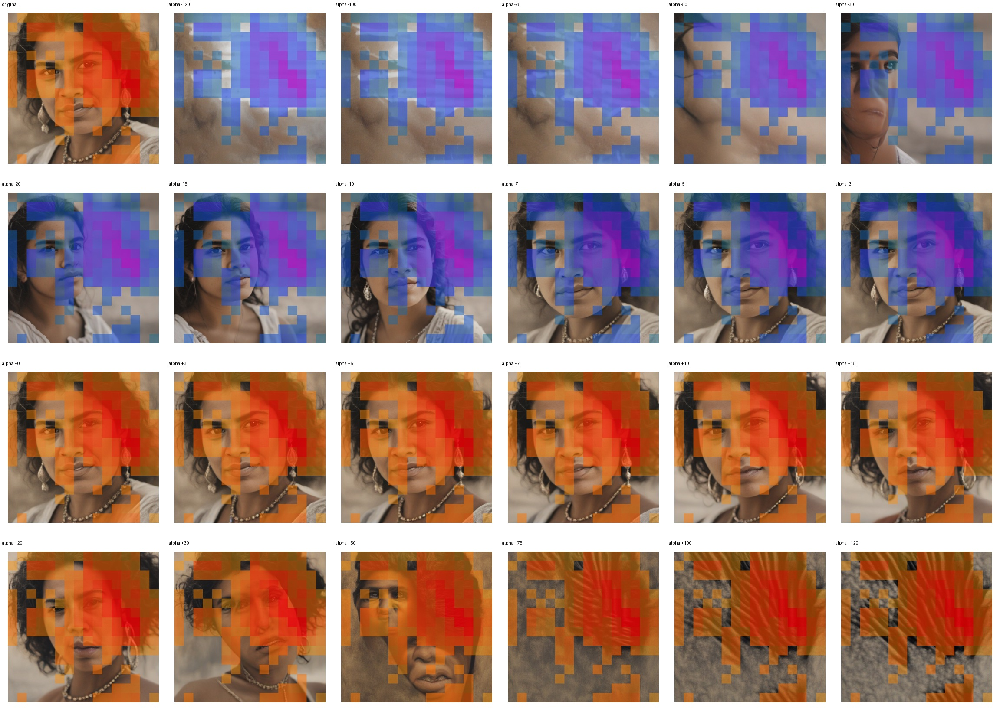
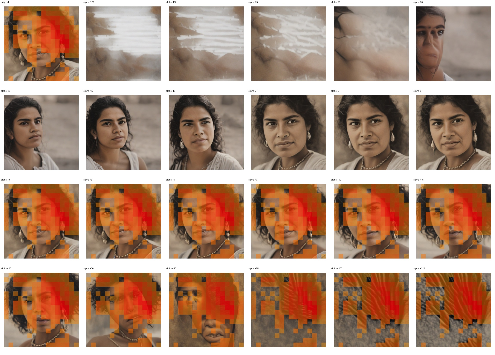

# Feature 527 — Hispanic Woman

Biased dataset; original prompt and seed replay for seeds 0–19. Values are means across 20 source images. The table reports the mean post-re-encoded activation of feature 527, the active spatial fraction, mean RGB pixel MAE versus the original image (0–255 scale), and coefficient change magnitudes for each alpha.

## Activation graph

## Mean metrics by alpha

| Alpha | Mean post-reencoded feature 527 activation | Active spatial fraction | Mean pixel change (MAE) | Mean absolute coefficient change | Mean absolute scaled coefficient |
|---:|---:|---:|---:|---:|---:|
| -120 | 0.000 | 0.000 | 73.281 | 900.594 | 893.151 |
| -100 | 0.000 | 0.000 | 62.843 | 751.736 | 744.293 |
| -75 | 0.000 | 0.000 | 55.060 | 565.663 | 558.220 |
| -50 | 0.000 | 0.000 | 48.065 | 379.589 | 372.146 |
| -30 | 0.000 | 0.000 | 44.923 | 230.731 | 223.288 |
| -20 | 0.000 | 0.000 | 37.918 | 156.302 | 148.859 |
| -15 | 0.000 | 0.000 | 32.335 | 119.087 | 111.644 |
| -10 | 0.000 | 0.000 | 24.149 | 81.872 | 74.429 |
| -7 | 0.000 | 0.000 | 18.564 | 59.543 | 52.101 |
| -5 | 0.000 | 0.000 | 16.067 | 44.658 | 37.215 |
| -3 | 0.000 | 0.000 | 12.544 | 29.772 | 22.329 |
| +0 | 0.000 | 0.000 | 4.685 | 7.443 | 0.000 |
| +3 | 21.784 | 0.537 | 8.246 | 14.886 | 22.329 |
| +5 | 36.125 | 0.537 | 14.160 | 29.772 | 37.215 |
| +7 | 50.466 | 0.537 | 19.158 | 44.658 | 52.101 |
| +10 | 71.977 | 0.537 | 24.523 | 66.986 | 74.429 |
| +15 | 107.829 | 0.537 | 29.626 | 104.201 | 111.644 |
| +20 | 143.681 | 0.537 | 32.739 | 141.416 | 148.859 |
| +30 | 215.386 | 0.537 | 36.735 | 215.845 | 223.288 |
| +50 | 358.794 | 0.537 | 36.767 | 364.704 | 372.146 |
| +75 | 538.056 | 0.537 | 40.251 | 550.777 | 558.220 |
| +100 | 717.316 | 0.537 | 43.981 | 736.850 | 744.293 |
| +120 | 860.725 | 0.537 | 47.176 | 885.709 | 893.151 |

## Per-seed grids

Each 4×6 sheet contains the original followed by the 23 alpha variants in ascending alpha order, from −120 through +120.

### Plain images

[All 20 plain-image grids](seed_sheets/)

### Signed coefficient overlays

[All 20 signed coefficient grids](signed_coefficient_overlays/)

### Post-re-encoded activation overlays

[All 20 post-activation grids](post_activation_overlays/)

### Intervention-footprint overlays

[All 20 intervention-footprint grids](intervention_footprint_overlays/)

Zero is transparent. Negative coefficient colors progress green through blue to purple; positive colors progress yellow through orange to red. Each map tile is normalized individually for visibility. The original and alpha-zero tiles show the pre-intervention feature map so its location remains visible.
