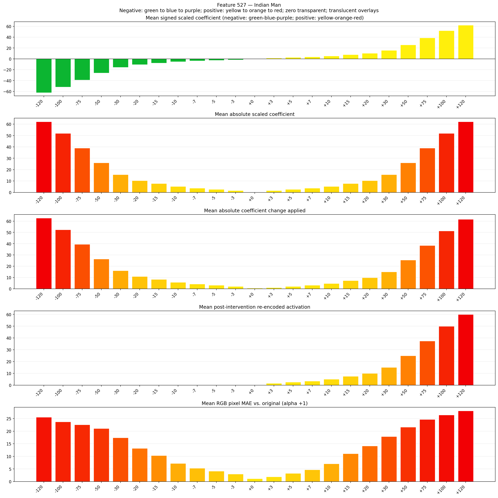
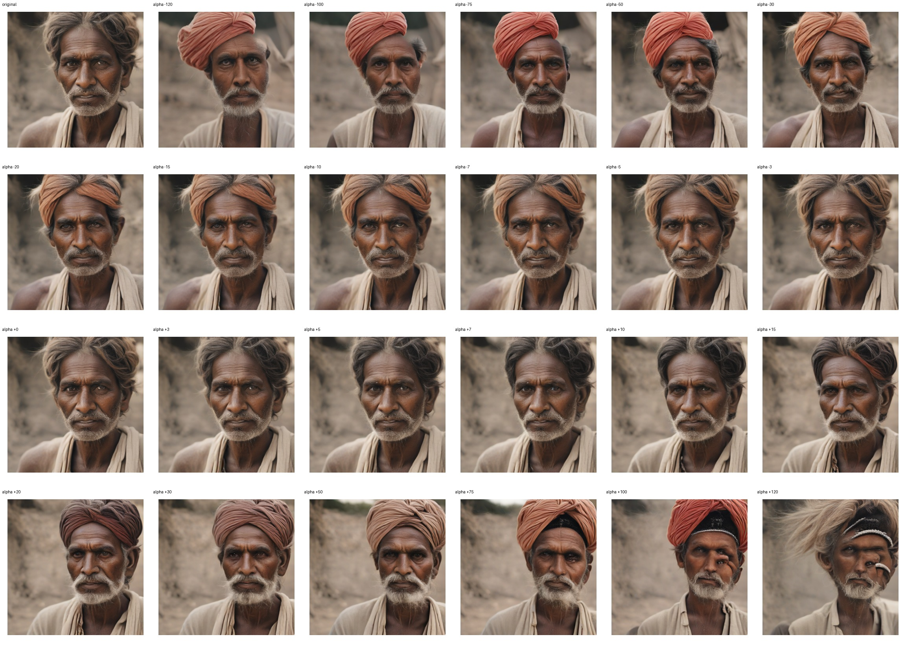
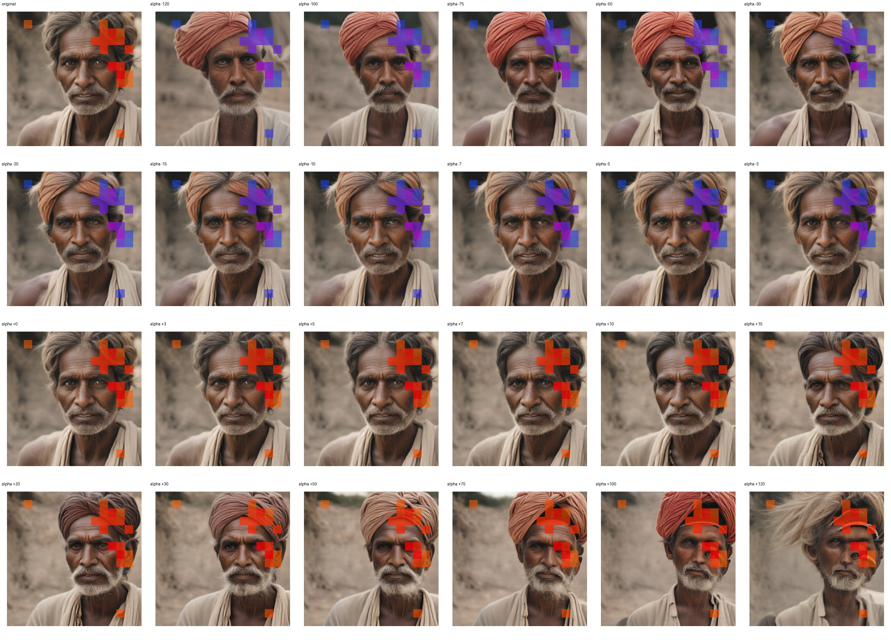
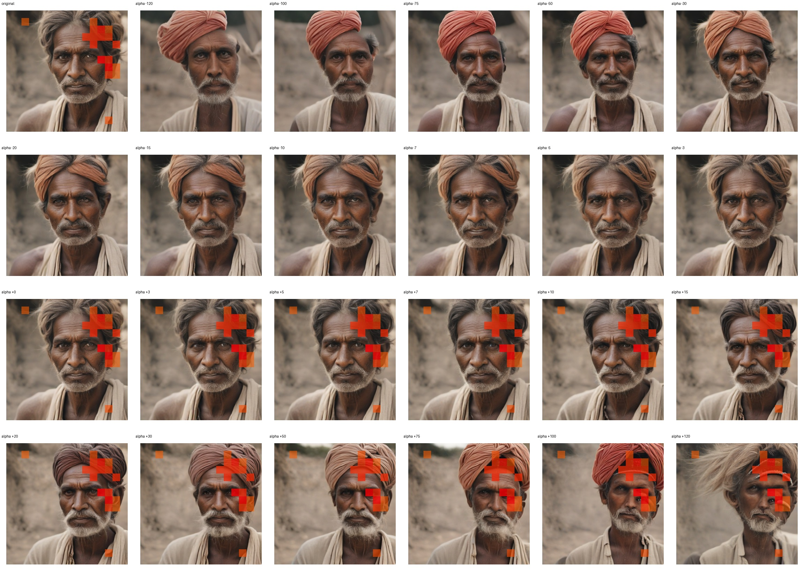

# Feature 527 — Indian Man

Biased dataset; original prompt and seed replay for seeds 0–19. Values are means across 20 source images. The table reports the mean post-re-encoded activation of feature 527, the active spatial fraction, mean RGB pixel MAE versus the original image (0–255 scale), and coefficient change magnitudes for each alpha.

## Activation graph

## Mean metrics by alpha

| Alpha | Mean post-reencoded feature 527 activation | Active spatial fraction | Mean pixel change (MAE) | Mean absolute coefficient change | Mean absolute scaled coefficient |
|---:|---:|---:|---:|---:|---:|
| -120 | 0.000 | 0.000 | 25.552 | 62.702 | 62.184 |
| -100 | 0.000 | 0.000 | 23.704 | 52.338 | 51.820 |
| -75 | 0.000 | 0.000 | 22.571 | 39.383 | 38.865 |
| -50 | 0.000 | 0.000 | 21.075 | 26.428 | 25.910 |
| -30 | 0.000 | 0.000 | 17.398 | 16.064 | 15.546 |
| -20 | 0.000 | 0.000 | 13.174 | 10.882 | 10.364 |
| -15 | 0.000 | 0.000 | 10.351 | 8.291 | 7.773 |
| -10 | 0.000 | 0.000 | 7.170 | 5.700 | 5.182 |
| -7 | 0.000 | 0.000 | 5.296 | 4.146 | 3.627 |
| -5 | 0.000 | 0.000 | 4.148 | 3.109 | 2.591 |
| -3 | 0.000 | 0.000 | 3.011 | 2.073 | 1.555 |
| +0 | 0.000 | 0.000 | 1.173 | 0.518 | 0.000 |
| +3 | 1.517 | 0.045 | 1.891 | 1.036 | 1.555 |
| +5 | 2.515 | 0.045 | 3.265 | 2.073 | 2.591 |
| +7 | 3.514 | 0.045 | 4.693 | 3.109 | 3.627 |
| +10 | 5.011 | 0.045 | 7.044 | 4.664 | 5.182 |
| +15 | 7.507 | 0.045 | 11.040 | 7.255 | 7.773 |
| +20 | 10.004 | 0.045 | 14.117 | 9.846 | 10.364 |
| +30 | 14.996 | 0.045 | 17.882 | 15.028 | 15.546 |
| +50 | 24.980 | 0.045 | 21.611 | 25.392 | 25.910 |
| +75 | 37.461 | 0.045 | 24.677 | 38.347 | 38.865 |
| +100 | 49.942 | 0.045 | 26.454 | 51.302 | 51.820 |
| +120 | 59.926 | 0.045 | 28.069 | 61.666 | 62.184 |

## Per-seed grids

Each 4×6 sheet contains the original followed by the 23 alpha variants in ascending alpha order, from −120 through +120.

### Plain images

[All 20 plain-image grids](seed_sheets/)

### Signed coefficient overlays

[All 20 signed coefficient grids](signed_coefficient_overlays/)

### Post-re-encoded activation overlays

[All 20 post-activation grids](post_activation_overlays/)

### Intervention-footprint overlays

[All 20 intervention-footprint grids](intervention_footprint_overlays/)

Zero is transparent. Negative coefficient colors progress green through blue to purple; positive colors progress yellow through orange to red. Each map tile is normalized individually for visibility. The original and alpha-zero tiles show the pre-intervention feature map so its location remains visible.
