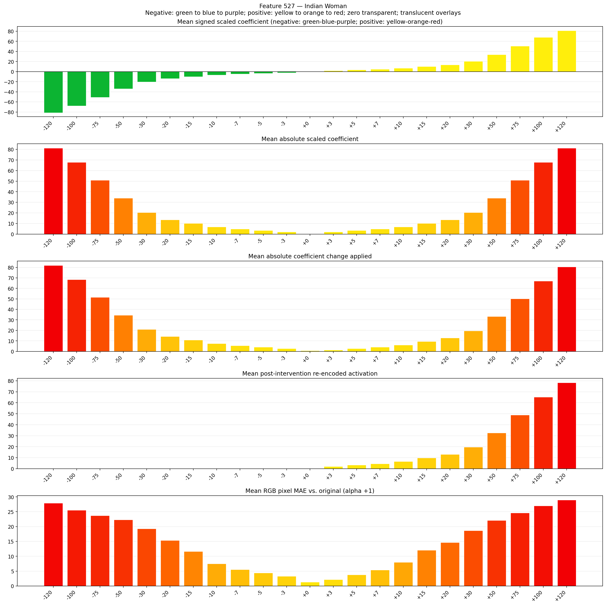
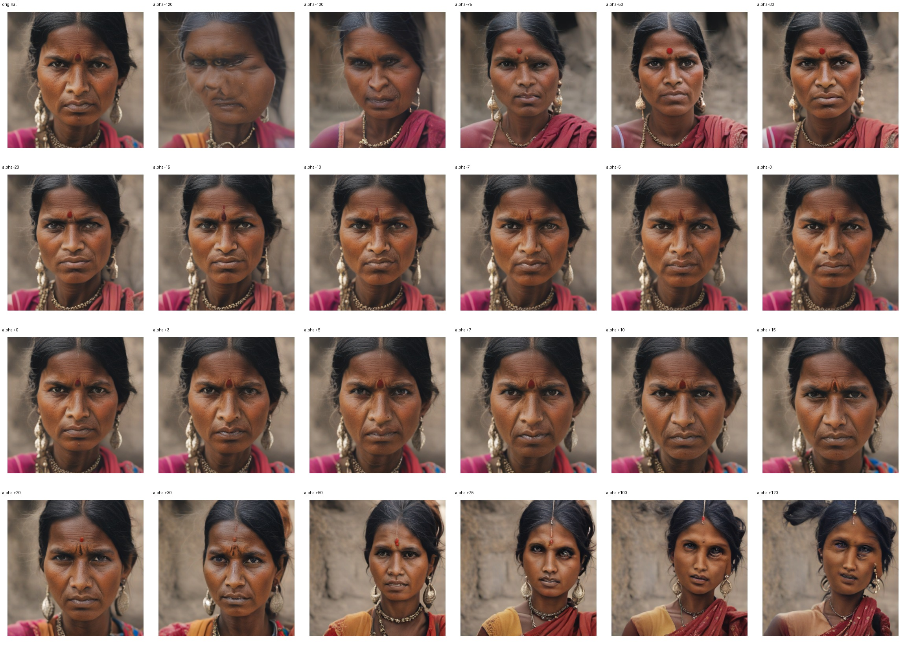
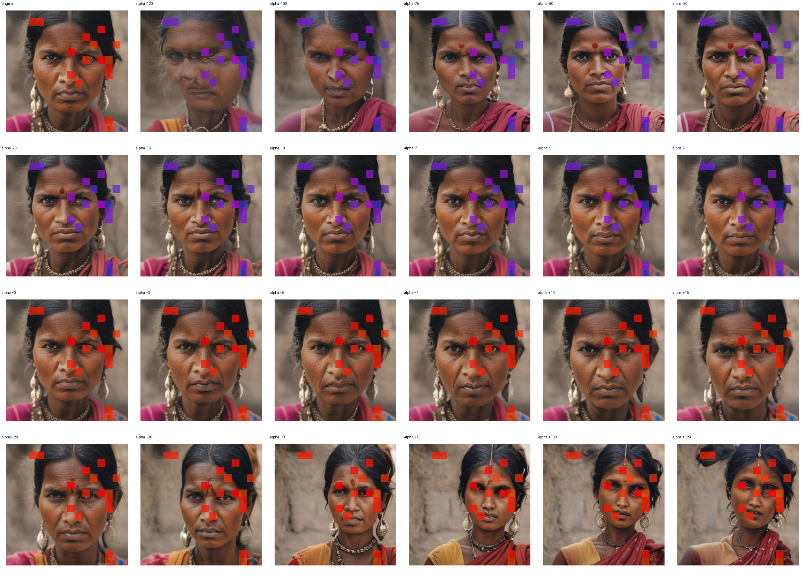
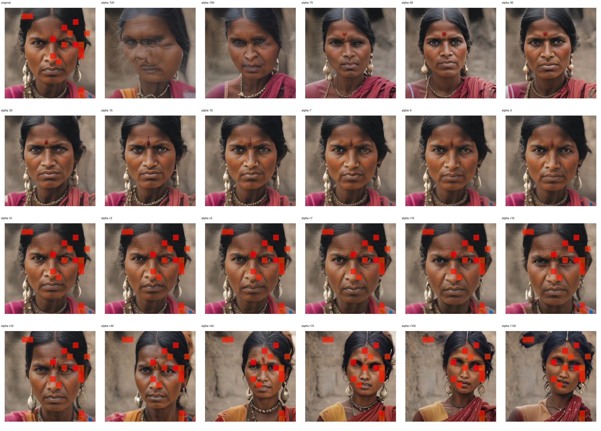

# Feature 527 — Indian Woman

Biased dataset; original prompt and seed replay for seeds 0–19. Values are means across 20 source images. The table reports the mean post-re-encoded activation of feature 527, the active spatial fraction, mean RGB pixel MAE versus the original image (0–255 scale), and coefficient change magnitudes for each alpha.

## Activation graph

## Mean metrics by alpha

| Alpha | Mean post-reencoded feature 527 activation | Active spatial fraction | Mean pixel change (MAE) | Mean absolute coefficient change | Mean absolute scaled coefficient |
|---:|---:|---:|---:|---:|---:|
| -120 | 0.000 | 0.000 | 27.912 | 81.962 | 81.284 |
| -100 | 0.000 | 0.000 | 25.504 | 68.414 | 67.737 |
| -75 | 0.000 | 0.000 | 23.730 | 51.480 | 50.803 |
| -50 | 0.000 | 0.000 | 22.291 | 34.546 | 33.869 |
| -30 | 0.000 | 0.000 | 19.262 | 20.998 | 20.321 |
| -20 | 0.000 | 0.000 | 15.317 | 14.225 | 13.547 |
| -15 | 0.000 | 0.000 | 11.628 | 10.838 | 10.161 |
| -10 | 0.000 | 0.000 | 7.511 | 7.451 | 6.774 |
| -7 | 0.000 | 0.000 | 5.559 | 5.419 | 4.742 |
| -5 | 0.000 | 0.000 | 4.397 | 4.064 | 3.387 |
| -3 | 0.000 | 0.000 | 3.256 | 2.709 | 2.032 |
| +0 | 0.000 | 0.000 | 1.303 | 0.677 | 0.000 |
| +3 | 1.983 | 0.056 | 2.195 | 1.355 | 2.032 |
| +5 | 3.288 | 0.056 | 3.790 | 2.709 | 3.387 |
| +7 | 4.593 | 0.056 | 5.419 | 4.064 | 4.742 |
| +10 | 6.551 | 0.056 | 7.985 | 6.096 | 6.774 |
| +15 | 9.813 | 0.056 | 12.024 | 9.483 | 10.161 |
| +20 | 13.076 | 0.056 | 14.675 | 12.870 | 13.547 |
| +30 | 19.602 | 0.056 | 18.653 | 19.644 | 20.321 |
| +50 | 32.653 | 0.056 | 22.094 | 33.191 | 33.869 |
| +75 | 48.968 | 0.056 | 24.625 | 50.125 | 50.803 |
| +100 | 65.282 | 0.056 | 26.992 | 67.060 | 67.737 |
| +120 | 78.333 | 0.056 | 28.969 | 80.607 | 81.284 |

## Per-seed grids

Each 4×6 sheet contains the original followed by the 23 alpha variants in ascending alpha order, from −120 through +120.

### Plain images

[All 20 plain-image grids](seed_sheets/)

### Signed coefficient overlays

[All 20 signed coefficient grids](signed_coefficient_overlays/)

### Post-re-encoded activation overlays

[All 20 post-activation grids](post_activation_overlays/)

### Intervention-footprint overlays

[All 20 intervention-footprint grids](intervention_footprint_overlays/)

Zero is transparent. Negative coefficient colors progress green through blue to purple; positive colors progress yellow through orange to red. Each map tile is normalized individually for visibility. The original and alpha-zero tiles show the pre-intervention feature map so its location remains visible.
