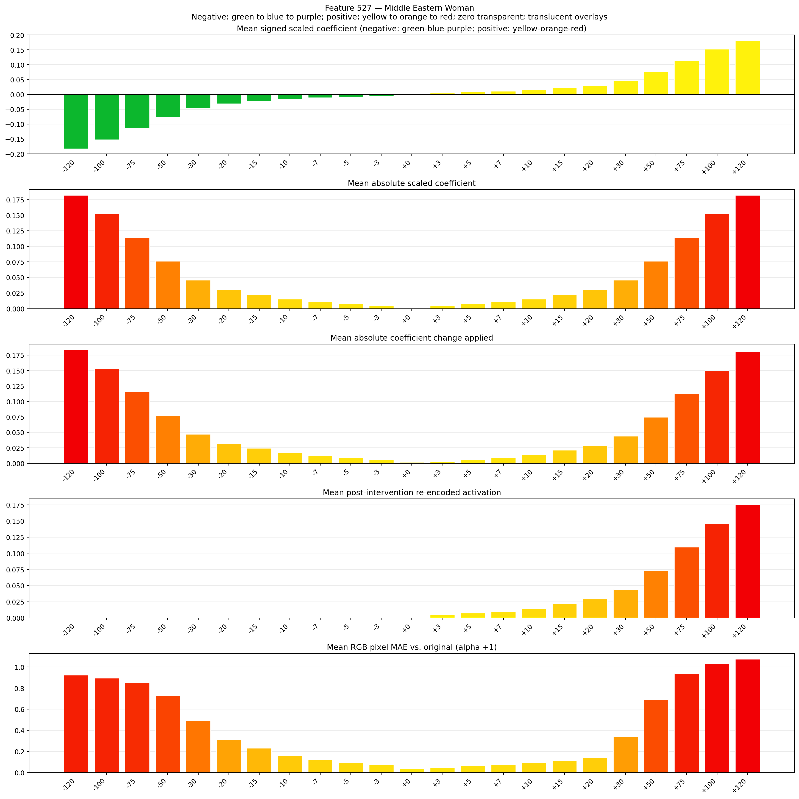
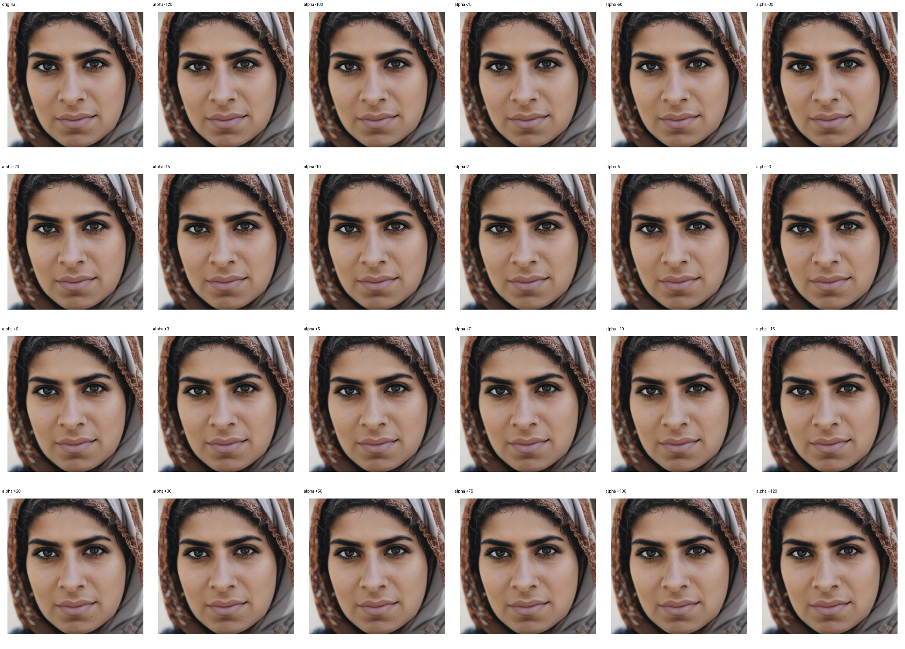
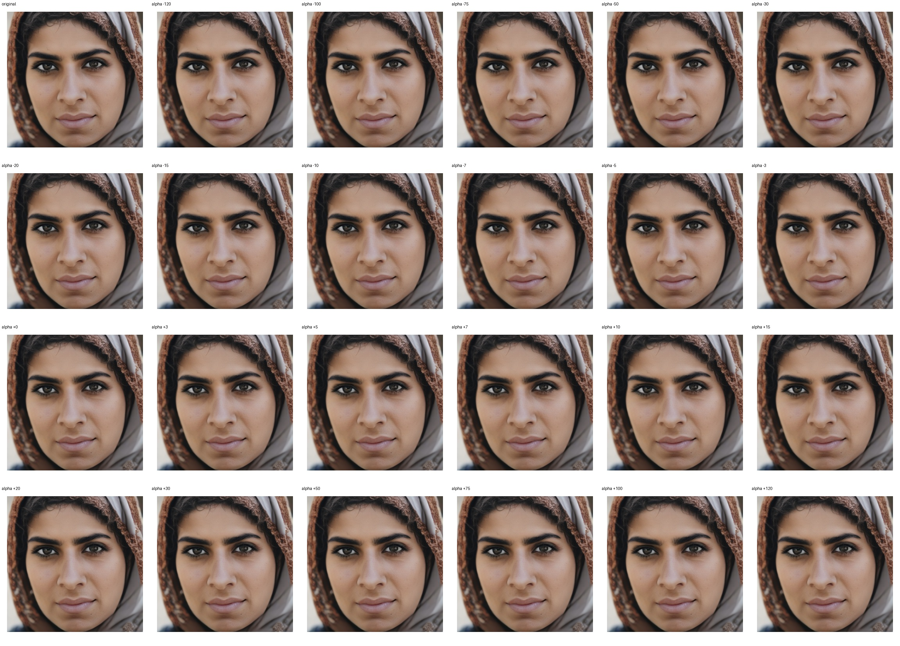

# Feature 527 — Middle Eastern Woman

Biased dataset; original prompt and seed replay for seeds 0–19. Values are means across 20 source images. The table reports the mean post-re-encoded activation of feature 527, the active spatial fraction, mean RGB pixel MAE versus the original image (0–255 scale), and coefficient change magnitudes for each alpha.

## Activation graph

## Mean metrics by alpha

| Alpha | Mean post-reencoded feature 527 activation | Active spatial fraction | Mean pixel change (MAE) | Mean absolute coefficient change | Mean absolute scaled coefficient |
|---:|---:|---:|---:|---:|---:|
| -120 | 0.000 | 0.000 | 0.923 | 0.184 | 0.182 |
| -100 | 0.000 | 0.000 | 0.894 | 0.153 | 0.152 |
| -75 | 0.000 | 0.000 | 0.851 | 0.115 | 0.114 |
| -50 | 0.000 | 0.000 | 0.729 | 0.077 | 0.076 |
| -30 | 0.000 | 0.000 | 0.490 | 0.047 | 0.046 |
| -20 | 0.000 | 0.000 | 0.311 | 0.032 | 0.030 |
| -15 | 0.000 | 0.000 | 0.230 | 0.024 | 0.023 |
| -10 | 0.000 | 0.000 | 0.158 | 0.017 | 0.015 |
| -7 | 0.000 | 0.000 | 0.120 | 0.012 | 0.011 |
| -5 | 0.000 | 0.000 | 0.096 | 0.009 | 0.008 |
| -3 | 0.000 | 0.000 | 0.072 | 0.006 | 0.005 |
| +0 | 0.000 | 0.000 | 0.039 | 0.002 | 0.000 |
| +3 | 0.004 | 0.000 | 0.049 | 0.003 | 0.005 |
| +5 | 0.007 | 0.000 | 0.065 | 0.006 | 0.008 |
| +7 | 0.010 | 0.000 | 0.079 | 0.009 | 0.011 |
| +10 | 0.015 | 0.000 | 0.097 | 0.014 | 0.015 |
| +15 | 0.022 | 0.000 | 0.114 | 0.021 | 0.023 |
| +20 | 0.029 | 0.000 | 0.140 | 0.029 | 0.030 |
| +30 | 0.044 | 0.000 | 0.337 | 0.044 | 0.046 |
| +50 | 0.073 | 0.000 | 0.692 | 0.074 | 0.076 |
| +75 | 0.110 | 0.000 | 0.937 | 0.112 | 0.114 |
| +100 | 0.146 | 0.000 | 1.030 | 0.150 | 0.152 |
| +120 | 0.175 | 0.000 | 1.074 | 0.181 | 0.182 |

## Per-seed grids

Each 4×6 sheet contains the original followed by the 23 alpha variants in ascending alpha order, from −120 through +120.

### Plain images

[All 20 plain-image grids](seed_sheets/)

### Signed coefficient overlays

[All 20 signed coefficient grids](signed_coefficient_overlays/)

### Post-re-encoded activation overlays

[All 20 post-activation grids](post_activation_overlays/)

### Intervention-footprint overlays

[All 20 intervention-footprint grids](intervention_footprint_overlays/)

Zero is transparent. Negative coefficient colors progress green through blue to purple; positive colors progress yellow through orange to red. Each map tile is normalized individually for visibility. The original and alpha-zero tiles show the pre-intervention feature map so its location remains visible.
