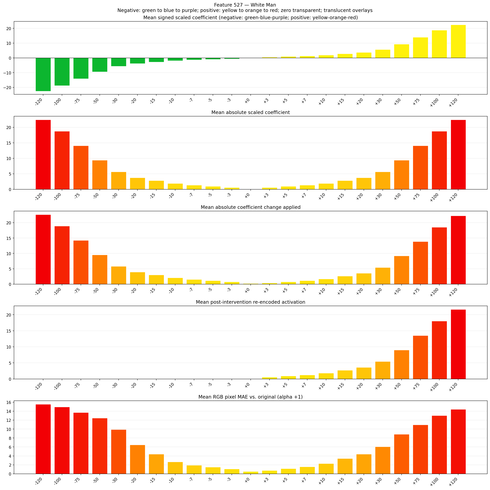
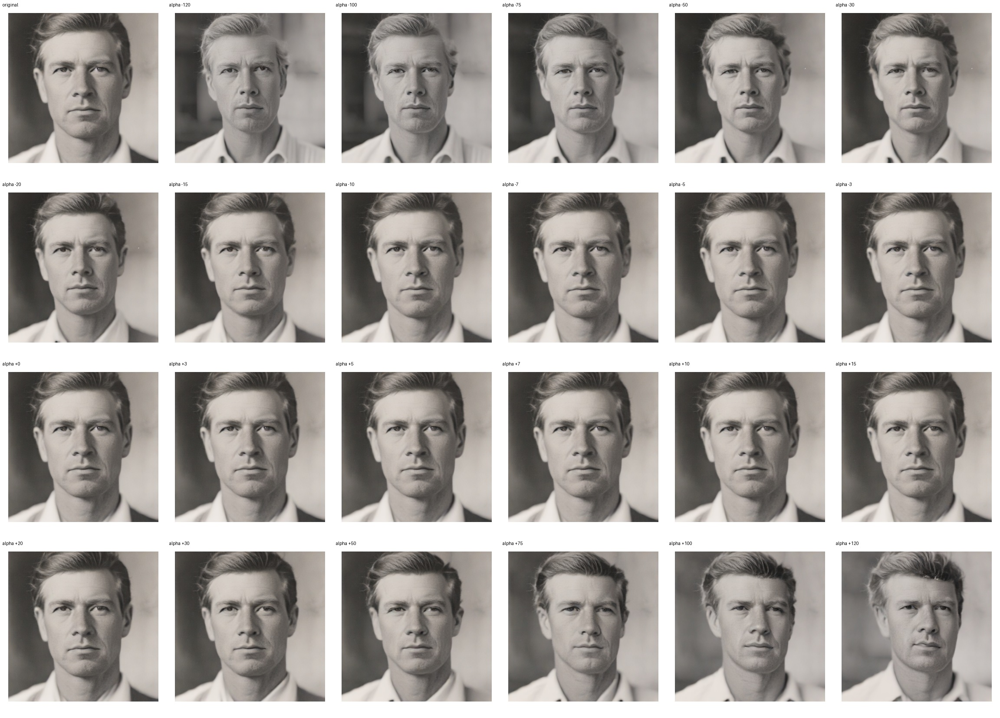
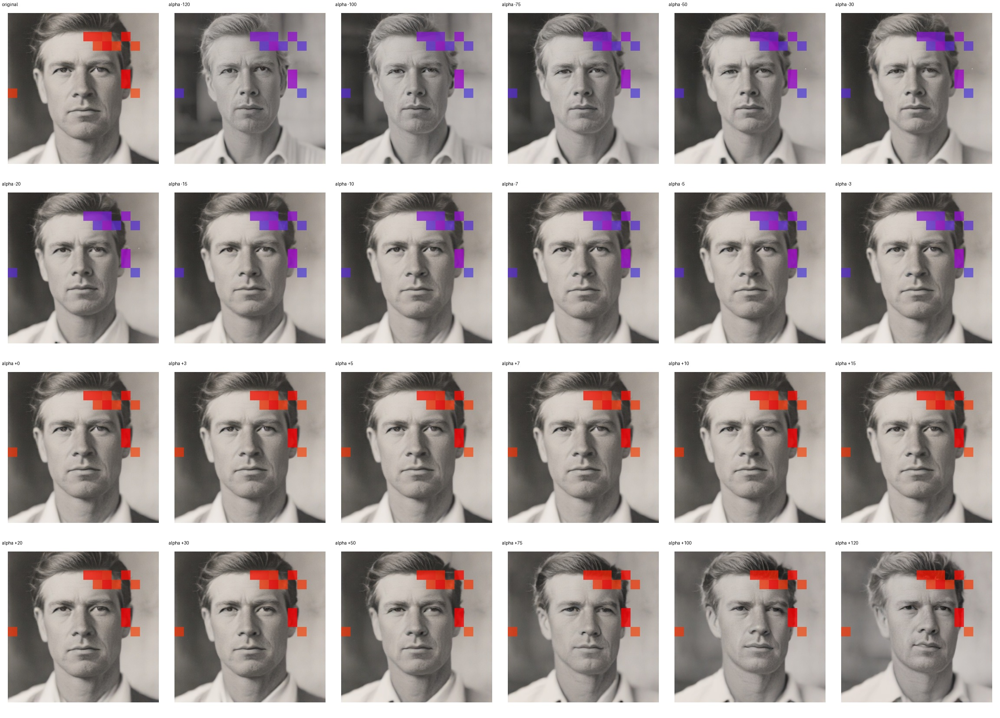
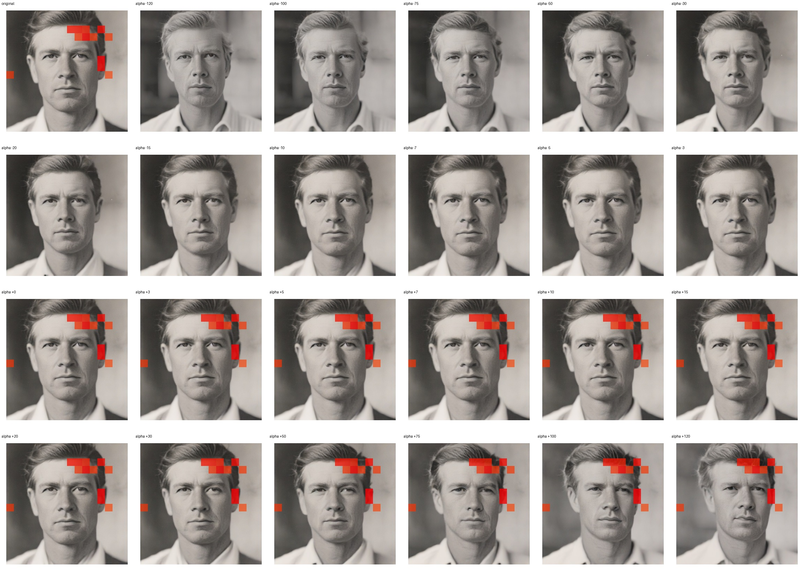

# Feature 527 — White Man

Biased dataset; original prompt and seed replay for seeds 0–19. Values are means across 20 source images. The table reports the mean post-re-encoded activation of feature 527, the active spatial fraction, mean RGB pixel MAE versus the original image (0–255 scale), and coefficient change magnitudes for each alpha.

## Activation graph

## Mean metrics by alpha

| Alpha | Mean post-reencoded feature 527 activation | Active spatial fraction | Mean pixel change (MAE) | Mean absolute coefficient change | Mean absolute scaled coefficient |
|---:|---:|---:|---:|---:|---:|
| -120 | 0.000 | 0.000 | 15.544 | 22.658 | 22.470 |
| -100 | 0.000 | 0.000 | 14.927 | 18.912 | 18.725 |
| -75 | 0.000 | 0.000 | 13.690 | 14.231 | 14.044 |
| -50 | 0.000 | 0.000 | 12.445 | 9.550 | 9.363 |
| -30 | 0.000 | 0.000 | 9.878 | 5.805 | 5.618 |
| -20 | 0.000 | 0.000 | 6.460 | 3.932 | 3.745 |
| -15 | 0.000 | 0.000 | 4.400 | 2.996 | 2.809 |
| -10 | 0.000 | 0.000 | 2.680 | 2.060 | 1.873 |
| -7 | 0.000 | 0.000 | 1.931 | 1.498 | 1.311 |
| -5 | 0.000 | 0.000 | 1.494 | 1.124 | 0.936 |
| -3 | 0.000 | 0.000 | 1.100 | 0.749 | 0.562 |
| +0 | 0.000 | 0.000 | 0.510 | 0.187 | 0.000 |
| +3 | 0.548 | 0.019 | 0.728 | 0.375 | 0.562 |
| +5 | 0.909 | 0.019 | 1.143 | 0.749 | 0.936 |
| +7 | 1.270 | 0.019 | 1.577 | 1.124 | 1.311 |
| +10 | 1.811 | 0.019 | 2.287 | 1.685 | 1.873 |
| +15 | 2.713 | 0.019 | 3.421 | 2.622 | 2.809 |
| +20 | 3.615 | 0.019 | 4.415 | 3.558 | 3.745 |
| +30 | 5.419 | 0.019 | 6.039 | 5.430 | 5.618 |
| +50 | 9.027 | 0.019 | 8.826 | 9.175 | 9.363 |
| +75 | 13.537 | 0.019 | 10.937 | 13.857 | 14.044 |
| +100 | 18.047 | 0.019 | 13.034 | 18.538 | 18.725 |
| +120 | 21.655 | 0.019 | 14.413 | 22.283 | 22.470 |

## Per-seed grids

Each 4×6 sheet contains the original followed by the 23 alpha variants in ascending alpha order, from −120 through +120.

### Plain images

[All 20 plain-image grids](seed_sheets/)

### Signed coefficient overlays

[All 20 signed coefficient grids](signed_coefficient_overlays/)

### Post-re-encoded activation overlays

[All 20 post-activation grids](post_activation_overlays/)

### Intervention-footprint overlays

[All 20 intervention-footprint grids](intervention_footprint_overlays/)

Zero is transparent. Negative coefficient colors progress green through blue to purple; positive colors progress yellow through orange to red. Each map tile is normalized individually for visibility. The original and alpha-zero tiles show the pre-intervention feature map so its location remains visible.
