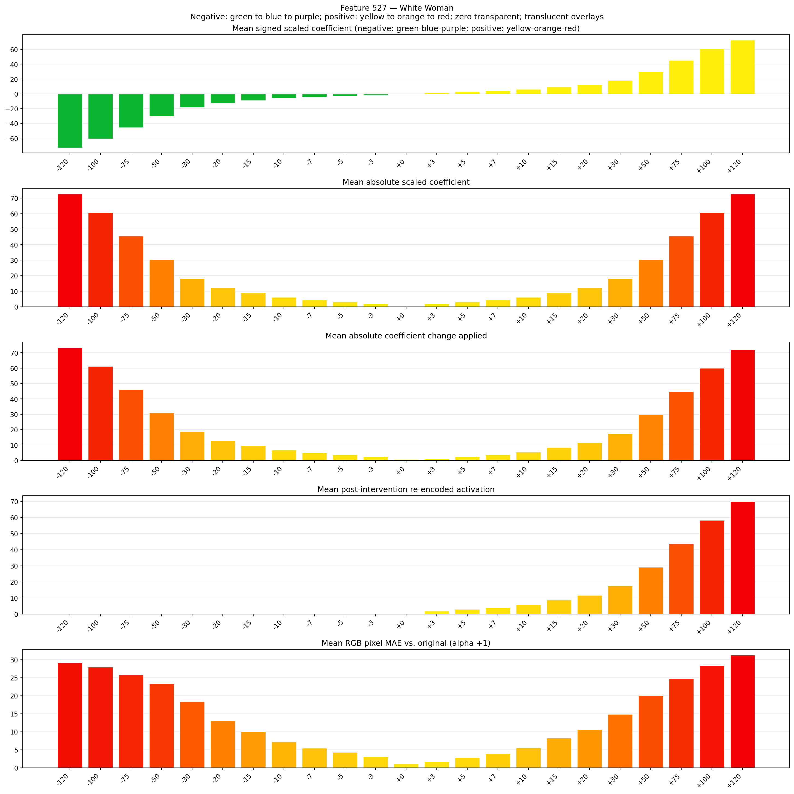
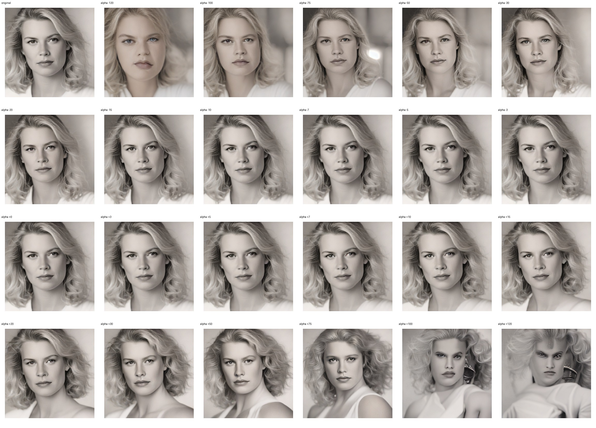
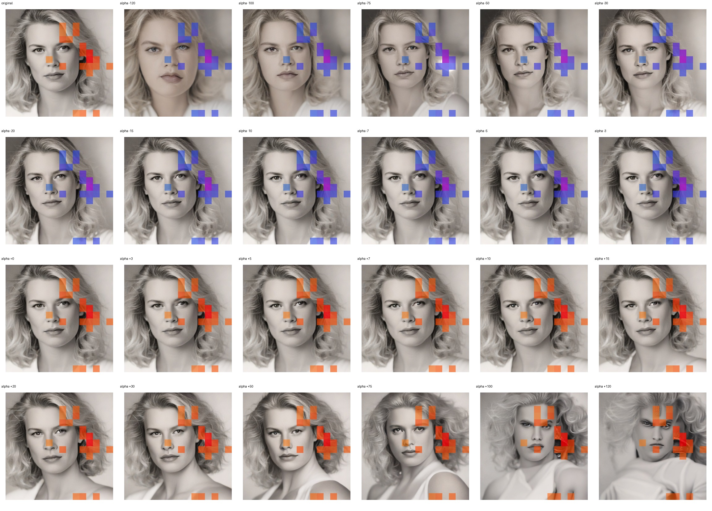
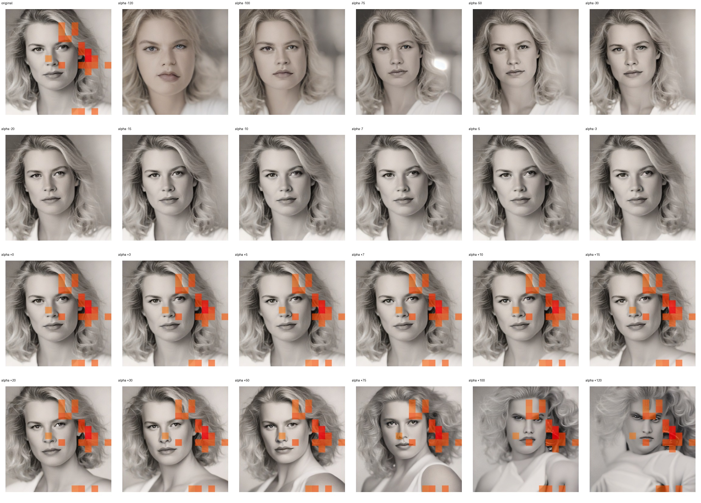

# Feature 527 — White Woman

Biased dataset; original prompt and seed replay for seeds 0–19. Values are means across 20 source images. The table reports the mean post-re-encoded activation of feature 527, the active spatial fraction, mean RGB pixel MAE versus the original image (0–255 scale), and coefficient change magnitudes for each alpha.

## Activation graph

## Mean metrics by alpha

| Alpha | Mean post-reencoded feature 527 activation | Active spatial fraction | Mean pixel change (MAE) | Mean absolute coefficient change | Mean absolute scaled coefficient |
|---:|---:|---:|---:|---:|---:|
| -120 | 0.000 | 0.000 | 29.136 | 73.288 | 72.682 |
| -100 | 0.000 | 0.000 | 27.916 | 61.174 | 60.569 |
| -75 | 0.000 | 0.000 | 25.754 | 46.032 | 45.426 |
| -50 | 0.000 | 0.000 | 23.301 | 30.890 | 30.284 |
| -30 | 0.000 | 0.000 | 18.297 | 18.776 | 18.171 |
| -20 | 0.000 | 0.000 | 13.084 | 12.719 | 12.114 |
| -15 | 0.000 | 0.000 | 10.060 | 9.691 | 9.085 |
| -10 | 0.000 | 0.000 | 7.147 | 6.663 | 6.057 |
| -7 | 0.000 | 0.000 | 5.453 | 4.845 | 4.240 |
| -5 | 0.000 | 0.000 | 4.284 | 3.634 | 3.028 |
| -3 | 0.000 | 0.000 | 3.069 | 2.423 | 1.817 |
| +0 | 0.000 | 0.000 | 1.079 | 0.606 | 0.000 |
| +3 | 1.773 | 0.058 | 1.695 | 1.211 | 1.817 |
| +5 | 2.940 | 0.058 | 2.844 | 2.423 | 3.028 |
| +7 | 4.107 | 0.058 | 3.911 | 3.634 | 4.240 |
| +10 | 5.857 | 0.058 | 5.506 | 5.451 | 6.057 |
| +15 | 8.775 | 0.058 | 8.201 | 8.480 | 9.085 |
| +20 | 11.692 | 0.058 | 10.569 | 11.508 | 12.114 |
| +30 | 17.527 | 0.058 | 14.810 | 17.565 | 18.171 |
| +50 | 29.198 | 0.058 | 19.942 | 29.679 | 30.284 |
| +75 | 43.785 | 0.058 | 24.683 | 44.821 | 45.426 |
| +100 | 58.373 | 0.058 | 28.406 | 59.963 | 60.569 |
| +120 | 70.043 | 0.058 | 31.265 | 72.077 | 72.682 |

## Per-seed grids

Each 4×6 sheet contains the original followed by the 23 alpha variants in ascending alpha order, from −120 through +120.

### Plain images

[All 20 plain-image grids](seed_sheets/)

### Signed coefficient overlays

[All 20 signed coefficient grids](signed_coefficient_overlays/)

### Post-re-encoded activation overlays

[All 20 post-activation grids](post_activation_overlays/)

### Intervention-footprint overlays

[All 20 intervention-footprint grids](intervention_footprint_overlays/)

Zero is transparent. Negative coefficient colors progress green through blue to purple; positive colors progress yellow through orange to red. Each map tile is normalized individually for visibility. The original and alpha-zero tiles show the pre-intervention feature map so its location remains visible.
