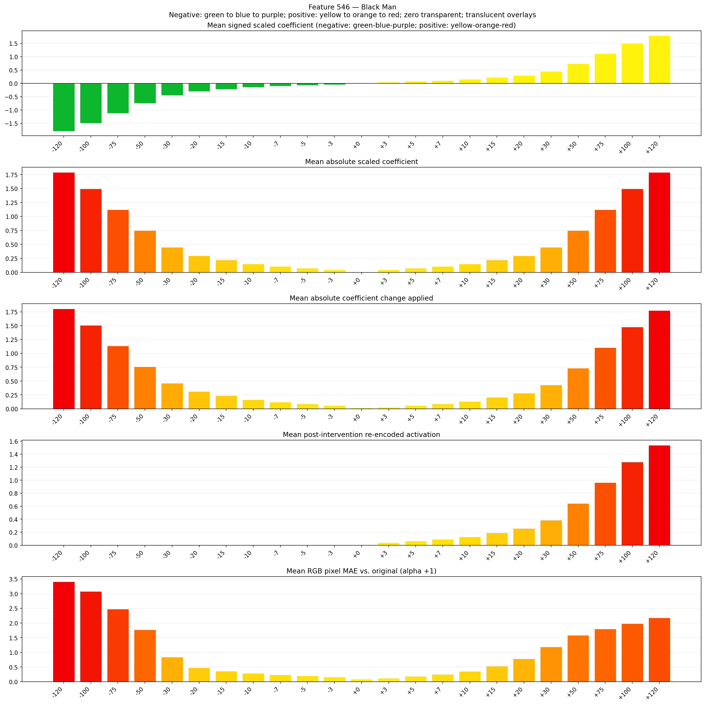
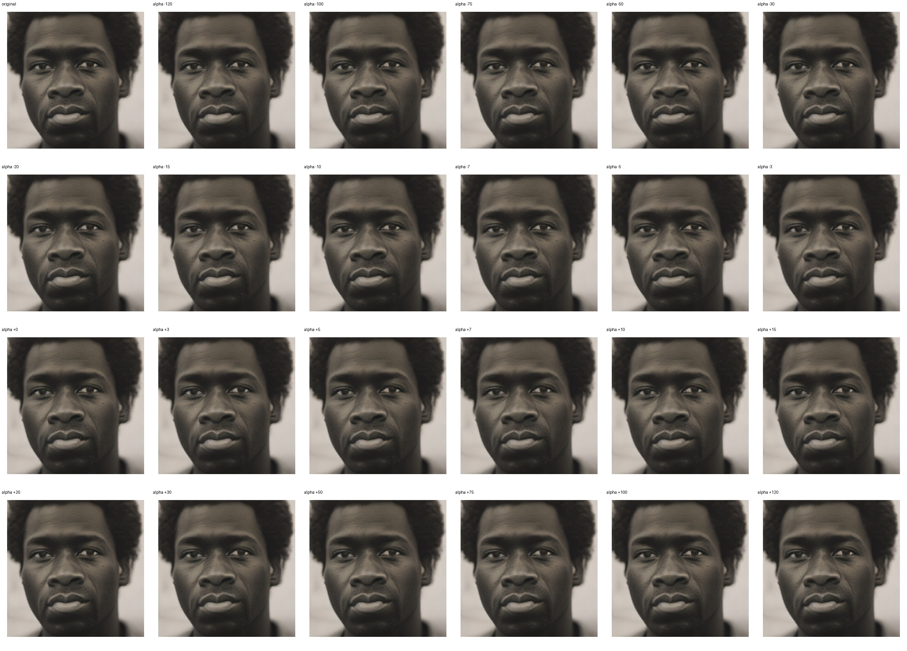

# Feature 546 — Black Man

Biased dataset; original prompt and seed replay for seeds 0–19. Values are means across 20 source images. The table reports the mean post-re-encoded activation of feature 546, the active spatial fraction, mean RGB pixel MAE versus the original image (0–255 scale), and coefficient change magnitudes for each alpha.

## Activation graph

## Mean metrics by alpha

| Alpha | Mean post-reencoded feature 546 activation | Active spatial fraction | Mean pixel change (MAE) | Mean absolute coefficient change | Mean absolute scaled coefficient |
|---:|---:|---:|---:|---:|---:|
| -120 | 0.000 | 0.000 | 3.410 | 1.806 | 1.791 |
| -100 | 0.000 | 0.000 | 3.077 | 1.508 | 1.493 |
| -75 | 0.000 | 0.000 | 2.476 | 1.135 | 1.120 |
| -50 | 0.000 | 0.000 | 1.772 | 0.761 | 0.746 |
| -30 | 0.000 | 0.000 | 0.845 | 0.463 | 0.448 |
| -20 | 0.000 | 0.000 | 0.481 | 0.313 | 0.299 |
| -15 | 0.000 | 0.000 | 0.364 | 0.239 | 0.224 |
| -10 | 0.000 | 0.000 | 0.286 | 0.164 | 0.149 |
| -7 | 0.000 | 0.000 | 0.238 | 0.119 | 0.104 |
| -5 | 0.000 | 0.000 | 0.203 | 0.090 | 0.075 |
| -3 | 0.000 | 0.000 | 0.160 | 0.060 | 0.045 |
| +0 | 0.000 | 0.000 | 0.090 | 0.015 | 0.000 |
| +3 | 0.041 | 0.001 | 0.120 | 0.030 | 0.045 |
| +5 | 0.066 | 0.001 | 0.185 | 0.060 | 0.075 |
| +7 | 0.092 | 0.001 | 0.251 | 0.090 | 0.104 |
| +10 | 0.130 | 0.001 | 0.354 | 0.134 | 0.149 |
| +15 | 0.194 | 0.001 | 0.534 | 0.209 | 0.224 |
| +20 | 0.258 | 0.001 | 0.785 | 0.284 | 0.299 |
| +30 | 0.386 | 0.001 | 1.191 | 0.433 | 0.448 |
| +50 | 0.643 | 0.001 | 1.585 | 0.731 | 0.746 |
| +75 | 0.963 | 0.001 | 1.800 | 1.105 | 1.120 |
| +100 | 1.283 | 0.001 | 1.980 | 1.478 | 1.493 |
| +120 | 1.539 | 0.001 | 2.181 | 1.776 | 1.791 |

## Per-seed grids

Each 4×6 sheet contains the original followed by the 23 alpha variants in ascending alpha order, from −120 through +120.

### Plain images

[All 20 plain-image grids](seed_sheets/)

### Signed coefficient overlays

[All 20 signed coefficient grids](signed_coefficient_overlays/)

### Post-re-encoded activation overlays

[All 20 post-activation grids](post_activation_overlays/)

### Intervention-footprint overlays

[All 20 intervention-footprint grids](intervention_footprint_overlays/)

Zero is transparent. Negative coefficient colors progress green through blue to purple; positive colors progress yellow through orange to red. Each map tile is normalized individually for visibility. The original and alpha-zero tiles show the pre-intervention feature map so its location remains visible.
