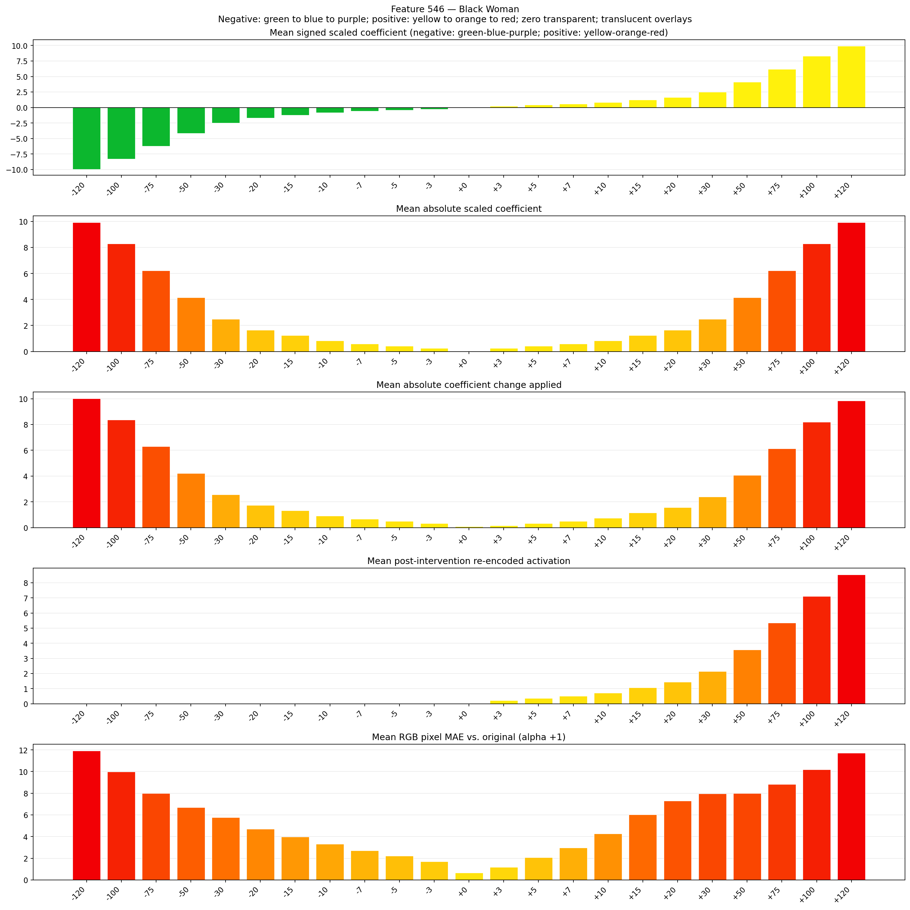

# Feature 546 — Black Woman

Biased dataset; original prompt and seed replay for seeds 0–19. Values are means across 20 source images. The table reports the mean post-re-encoded activation of feature 546, the active spatial fraction, mean RGB pixel MAE versus the original image (0–255 scale), and coefficient change magnitudes for each alpha.

## Activation graph

## Mean metrics by alpha

| Alpha | Mean post-reencoded feature 546 activation | Active spatial fraction | Mean pixel change (MAE) | Mean absolute coefficient change | Mean absolute scaled coefficient |
|---:|---:|---:|---:|---:|---:|
| -120 | 0.000 | 0.000 | 11.923 | 10.021 | 9.938 |
| -100 | 0.000 | 0.000 | 9.993 | 8.365 | 8.282 |
| -75 | 0.000 | 0.000 | 7.991 | 6.294 | 6.211 |
| -50 | 0.000 | 0.000 | 6.695 | 4.224 | 4.141 |
| -30 | 0.000 | 0.000 | 5.756 | 2.567 | 2.485 |
| -20 | 0.000 | 0.000 | 4.703 | 1.739 | 1.656 |
| -15 | 0.000 | 0.000 | 3.975 | 1.325 | 1.242 |
| -10 | 0.000 | 0.000 | 3.313 | 0.911 | 0.828 |
| -7 | 0.000 | 0.000 | 2.708 | 0.663 | 0.580 |
| -5 | 0.000 | 0.000 | 2.230 | 0.497 | 0.414 |
| -3 | 0.000 | 0.000 | 1.703 | 0.331 | 0.248 |
| +0 | 0.000 | 0.000 | 0.670 | 0.083 | 0.000 |
| +3 | 0.225 | 0.006 | 1.178 | 0.166 | 0.248 |
| +5 | 0.367 | 0.006 | 2.062 | 0.331 | 0.414 |
| +7 | 0.509 | 0.006 | 2.961 | 0.497 | 0.580 |
| +10 | 0.722 | 0.006 | 4.282 | 0.745 | 0.828 |
| +15 | 1.078 | 0.006 | 6.041 | 1.159 | 1.242 |
| +20 | 1.433 | 0.006 | 7.294 | 1.574 | 1.656 |
| +30 | 2.144 | 0.006 | 7.960 | 2.402 | 2.485 |
| +50 | 3.565 | 0.006 | 8.004 | 4.058 | 4.141 |
| +75 | 5.341 | 0.006 | 8.821 | 6.129 | 6.211 |
| +100 | 7.118 | 0.006 | 10.178 | 8.199 | 8.282 |
| +120 | 8.539 | 0.006 | 11.707 | 9.855 | 9.938 |

## Per-seed grids

Each 4×6 sheet contains the original followed by the 23 alpha variants in ascending alpha order, from −120 through +120.

### Plain images

[All 20 plain-image grids](seed_sheets/)

### Signed coefficient overlays

[All 20 signed coefficient grids](signed_coefficient_overlays/)

### Post-re-encoded activation overlays

[All 20 post-activation grids](post_activation_overlays/)

### Intervention-footprint overlays

[All 20 intervention-footprint grids](intervention_footprint_overlays/)

Zero is transparent. Negative coefficient colors progress green through blue to purple; positive colors progress yellow through orange to red. Each map tile is normalized individually for visibility. The original and alpha-zero tiles show the pre-intervention feature map so its location remains visible.
