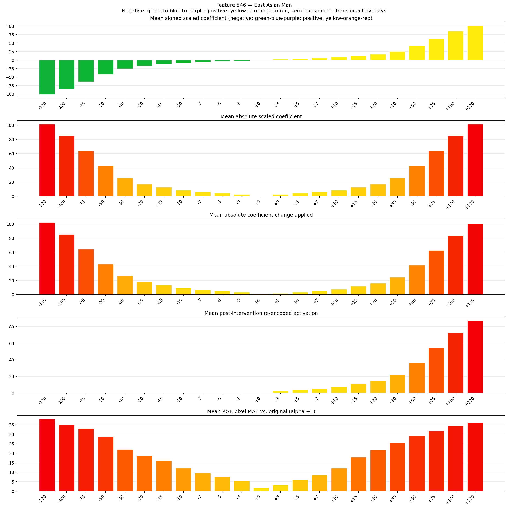
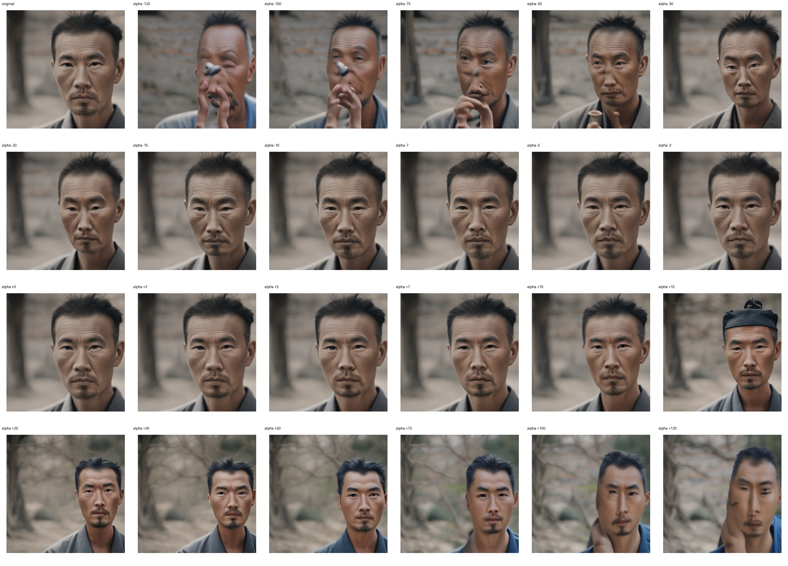
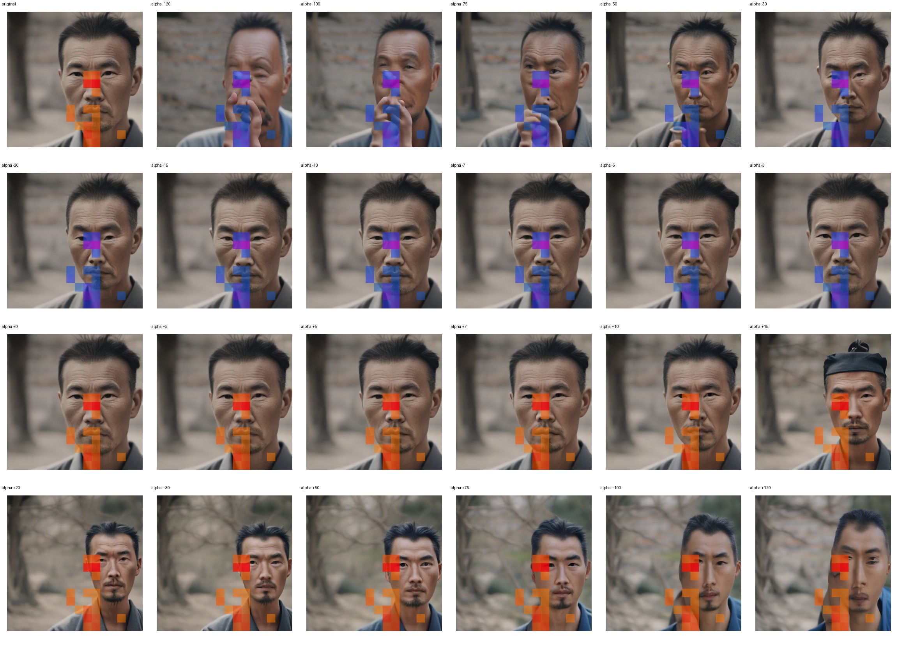
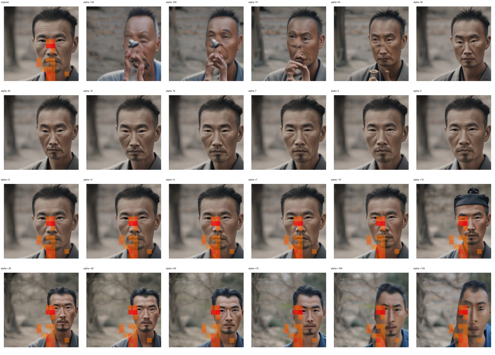

# Feature 546 — East Asian Man

Biased dataset; original prompt and seed replay for seeds 0–19. Values are means across 20 source images. The table reports the mean post-re-encoded activation of feature 546, the active spatial fraction, mean RGB pixel MAE versus the original image (0–255 scale), and coefficient change magnitudes for each alpha.

## Activation graph

## Mean metrics by alpha

| Alpha | Mean post-reencoded feature 546 activation | Active spatial fraction | Mean pixel change (MAE) | Mean absolute coefficient change | Mean absolute scaled coefficient |
|---:|---:|---:|---:|---:|---:|
| -120 | 0.000 | 0.000 | 37.946 | 102.218 | 101.373 |
| -100 | 0.000 | 0.000 | 34.992 | 85.323 | 84.478 |
| -75 | 0.000 | 0.000 | 32.983 | 64.203 | 63.358 |
| -50 | 0.000 | 0.000 | 28.603 | 43.084 | 42.239 |
| -30 | 0.000 | 0.000 | 21.932 | 26.188 | 25.343 |
| -20 | 0.000 | 0.000 | 18.641 | 17.740 | 16.896 |
| -15 | 0.000 | 0.000 | 16.107 | 13.516 | 12.672 |
| -10 | 0.000 | 0.000 | 12.230 | 9.293 | 8.448 |
| -7 | 0.000 | 0.000 | 9.549 | 6.758 | 5.913 |
| -5 | 0.000 | 0.000 | 7.623 | 5.069 | 4.224 |
| -3 | 0.000 | 0.000 | 5.464 | 3.379 | 2.534 |
| +0 | 0.000 | 0.000 | 1.851 | 0.845 | 0.000 |
| +3 | 2.294 | 0.064 | 3.295 | 1.690 | 2.534 |
| +5 | 3.744 | 0.064 | 5.990 | 3.379 | 4.224 |
| +7 | 5.194 | 0.064 | 8.501 | 5.069 | 5.913 |
| +10 | 7.368 | 0.064 | 12.142 | 7.603 | 8.448 |
| +15 | 10.992 | 0.064 | 17.906 | 11.827 | 12.672 |
| +20 | 14.616 | 0.064 | 21.714 | 16.051 | 16.896 |
| +30 | 21.865 | 0.064 | 25.563 | 24.499 | 25.343 |
| +50 | 36.361 | 0.064 | 29.192 | 41.394 | 42.239 |
| +75 | 54.482 | 0.064 | 31.672 | 62.514 | 63.358 |
| +100 | 72.602 | 0.064 | 34.366 | 83.633 | 84.478 |
| +120 | 87.099 | 0.064 | 36.004 | 100.529 | 101.373 |

## Per-seed grids

Each 4×6 sheet contains the original followed by the 23 alpha variants in ascending alpha order, from −120 through +120.

### Plain images

[All 20 plain-image grids](seed_sheets/)

### Signed coefficient overlays

[All 20 signed coefficient grids](signed_coefficient_overlays/)

### Post-re-encoded activation overlays

[All 20 post-activation grids](post_activation_overlays/)

### Intervention-footprint overlays

[All 20 intervention-footprint grids](intervention_footprint_overlays/)

Zero is transparent. Negative coefficient colors progress green through blue to purple; positive colors progress yellow through orange to red. Each map tile is normalized individually for visibility. The original and alpha-zero tiles show the pre-intervention feature map so its location remains visible.
