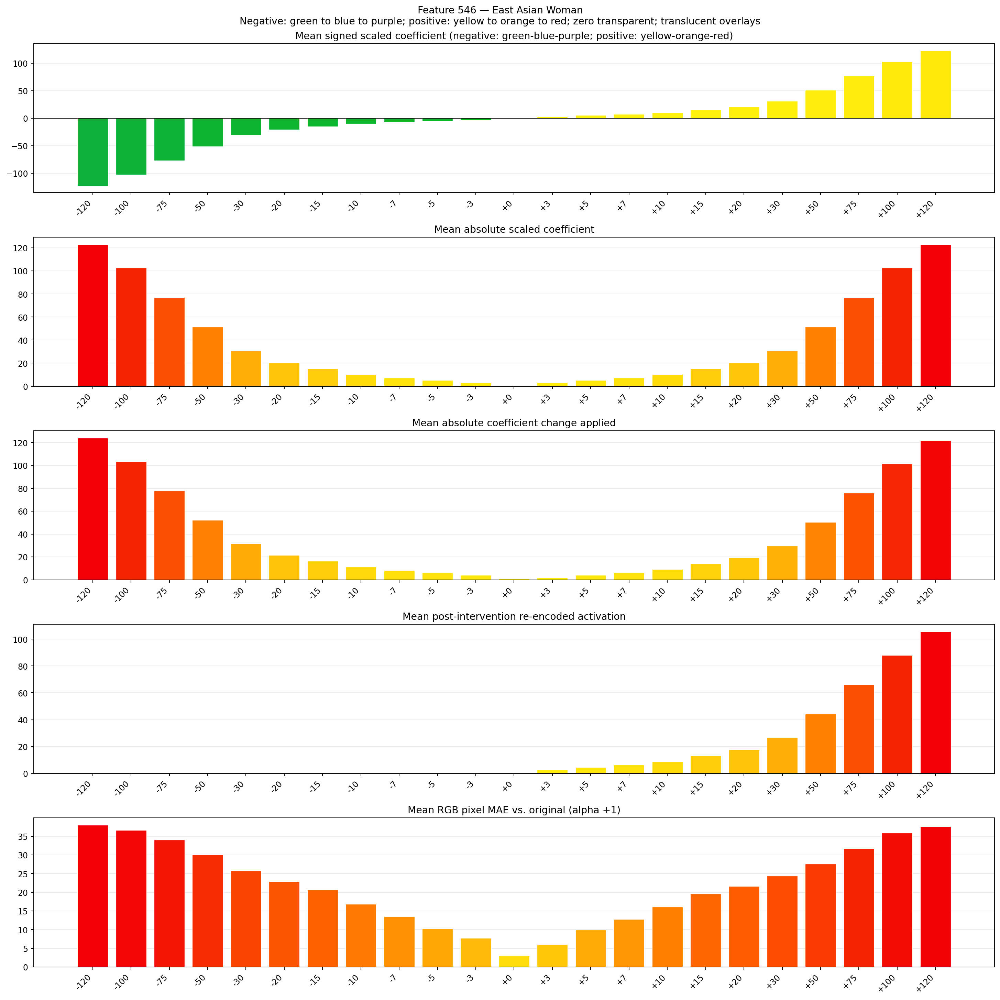
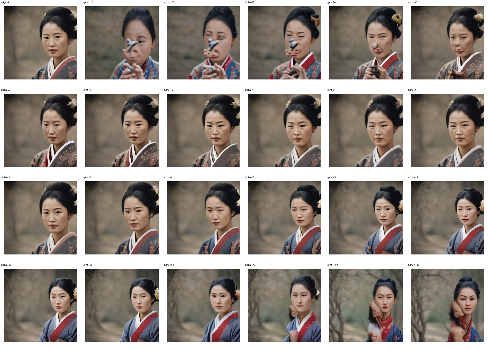
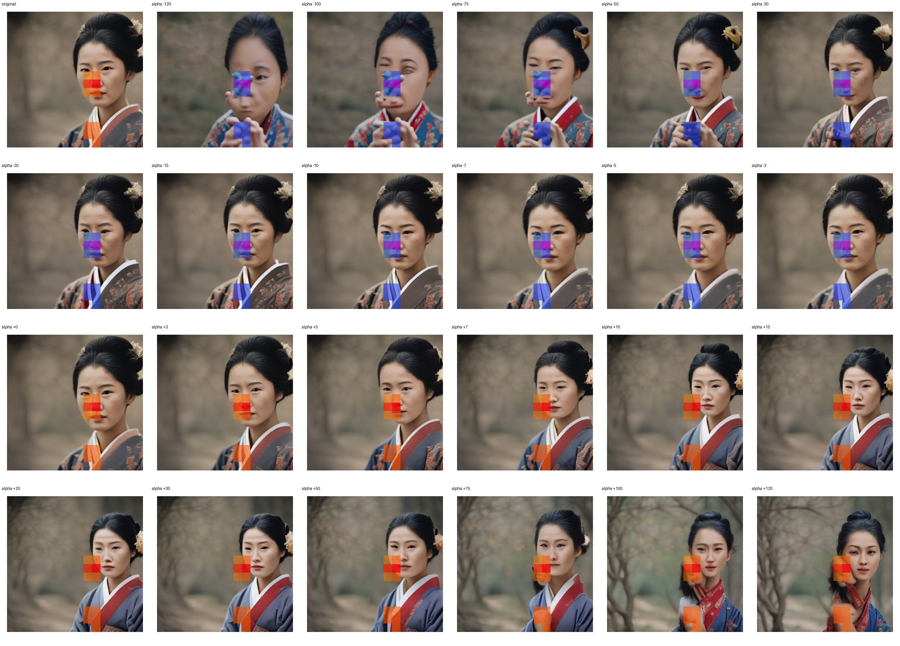
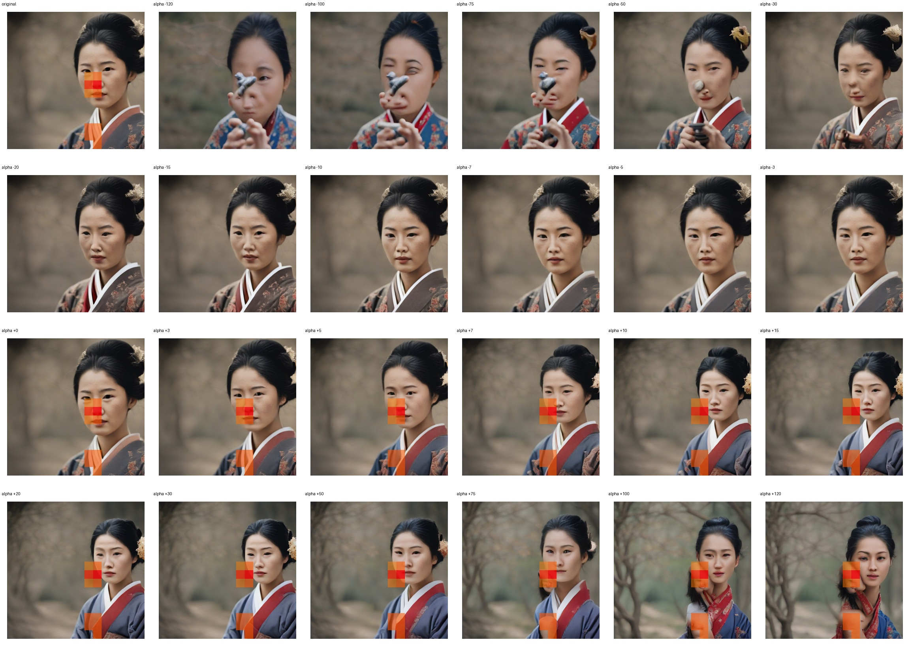

# Feature 546 — East Asian Woman

Biased dataset; original prompt and seed replay for seeds 0–19. Values are means across 20 source images. The table reports the mean post-re-encoded activation of feature 546, the active spatial fraction, mean RGB pixel MAE versus the original image (0–255 scale), and coefficient change magnitudes for each alpha.

## Activation graph

## Mean metrics by alpha

| Alpha | Mean post-reencoded feature 546 activation | Active spatial fraction | Mean pixel change (MAE) | Mean absolute coefficient change | Mean absolute scaled coefficient |
|---:|---:|---:|---:|---:|---:|
| -120 | 0.000 | 0.000 | 38.040 | 124.126 | 123.100 |
| -100 | 0.000 | 0.000 | 36.654 | 103.609 | 102.583 |
| -75 | 0.000 | 0.000 | 34.047 | 77.963 | 76.937 |
| -50 | 0.000 | 0.000 | 30.127 | 52.317 | 51.292 |
| -30 | 0.000 | 0.000 | 25.744 | 31.801 | 30.775 |
| -20 | 0.000 | 0.000 | 22.884 | 21.542 | 20.517 |
| -15 | 0.000 | 0.000 | 20.704 | 16.413 | 15.387 |
| -10 | 0.000 | 0.000 | 16.806 | 11.284 | 10.258 |
| -7 | 0.000 | 0.000 | 13.554 | 8.207 | 7.181 |
| -5 | 0.000 | 0.000 | 10.339 | 6.155 | 5.129 |
| -3 | 0.000 | 0.000 | 7.735 | 4.103 | 3.077 |
| +0 | 0.000 | 0.000 | 3.031 | 1.026 | 0.000 |
| +3 | 2.786 | 0.059 | 6.074 | 2.052 | 3.077 |
| +5 | 4.547 | 0.059 | 9.933 | 4.103 | 5.129 |
| +7 | 6.307 | 0.059 | 12.812 | 6.155 | 7.181 |
| +10 | 8.947 | 0.059 | 16.065 | 9.232 | 10.258 |
| +15 | 13.348 | 0.059 | 19.579 | 14.362 | 15.387 |
| +20 | 17.749 | 0.059 | 21.590 | 19.491 | 20.517 |
| +30 | 26.551 | 0.059 | 24.431 | 29.749 | 30.775 |
| +50 | 44.154 | 0.059 | 27.590 | 50.266 | 51.292 |
| +75 | 66.158 | 0.059 | 31.727 | 75.912 | 76.937 |
| +100 | 88.162 | 0.059 | 35.869 | 101.557 | 102.583 |
| +120 | 105.766 | 0.059 | 37.651 | 122.074 | 123.100 |

## Per-seed grids

Each 4×6 sheet contains the original followed by the 23 alpha variants in ascending alpha order, from −120 through +120.

### Plain images

[All 20 plain-image grids](seed_sheets/)

### Signed coefficient overlays

[All 20 signed coefficient grids](signed_coefficient_overlays/)

### Post-re-encoded activation overlays

[All 20 post-activation grids](post_activation_overlays/)

### Intervention-footprint overlays

[All 20 intervention-footprint grids](intervention_footprint_overlays/)

Zero is transparent. Negative coefficient colors progress green through blue to purple; positive colors progress yellow through orange to red. Each map tile is normalized individually for visibility. The original and alpha-zero tiles show the pre-intervention feature map so its location remains visible.
