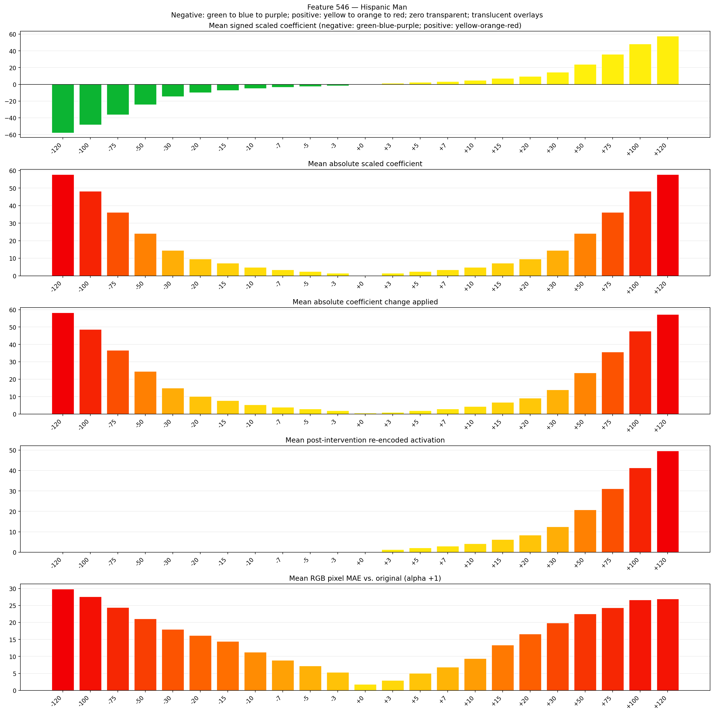
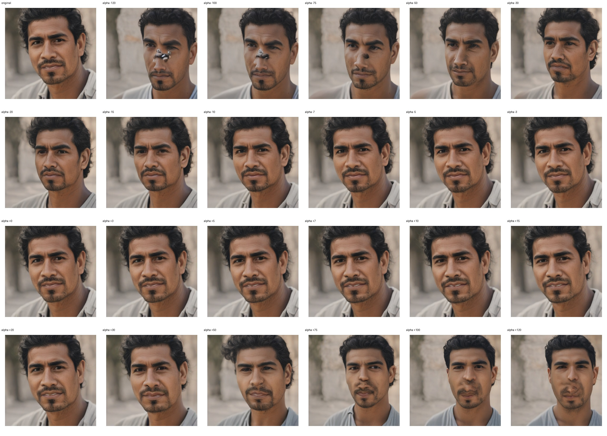
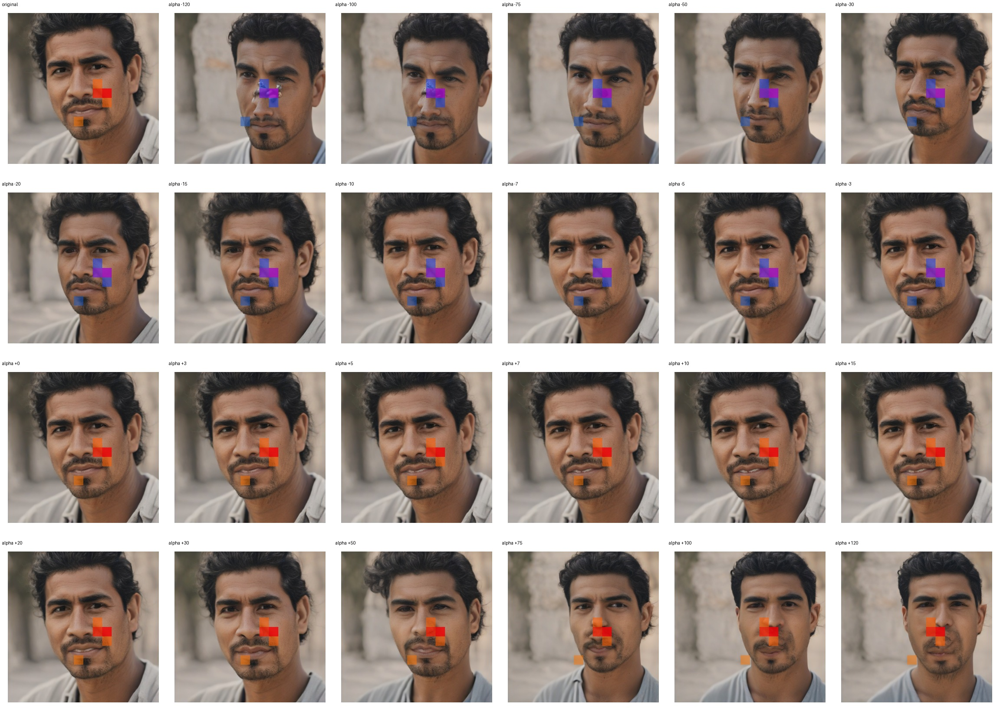
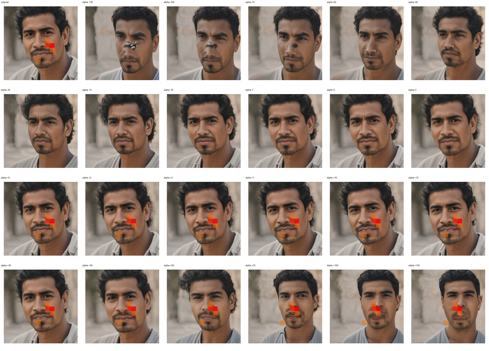

# Feature 546 — Hispanic Man

Biased dataset; original prompt and seed replay for seeds 0–19. Values are means across 20 source images. The table reports the mean post-re-encoded activation of feature 546, the active spatial fraction, mean RGB pixel MAE versus the original image (0–255 scale), and coefficient change magnitudes for each alpha.

## Activation graph

## Mean metrics by alpha

| Alpha | Mean post-reencoded feature 546 activation | Active spatial fraction | Mean pixel change (MAE) | Mean absolute coefficient change | Mean absolute scaled coefficient |
|---:|---:|---:|---:|---:|---:|
| -120 | 0.000 | 0.000 | 29.844 | 58.283 | 57.801 |
| -100 | 0.000 | 0.000 | 27.598 | 48.649 | 48.168 |
| -75 | 0.000 | 0.000 | 24.394 | 36.607 | 36.126 |
| -50 | 0.000 | 0.000 | 21.092 | 24.565 | 24.084 |
| -30 | 0.000 | 0.000 | 18.006 | 14.932 | 14.450 |
| -20 | 0.000 | 0.000 | 16.164 | 10.115 | 9.634 |
| -15 | 0.000 | 0.000 | 14.445 | 7.707 | 7.225 |
| -10 | 0.000 | 0.000 | 11.280 | 5.298 | 4.817 |
| -7 | 0.000 | 0.000 | 8.894 | 3.853 | 3.372 |
| -5 | 0.000 | 0.000 | 7.184 | 2.890 | 2.408 |
| -3 | 0.000 | 0.000 | 5.298 | 1.927 | 1.445 |
| +0 | 0.000 | 0.000 | 1.769 | 0.482 | 0.000 |
| +3 | 1.308 | 0.037 | 2.921 | 0.963 | 1.445 |
| +5 | 2.135 | 0.037 | 5.016 | 1.927 | 2.408 |
| +7 | 2.961 | 0.037 | 6.829 | 2.890 | 3.372 |
| +10 | 4.201 | 0.037 | 9.365 | 4.335 | 4.817 |
| +15 | 6.268 | 0.037 | 13.375 | 6.743 | 7.225 |
| +20 | 8.334 | 0.037 | 16.594 | 9.152 | 9.634 |
| +30 | 12.467 | 0.037 | 19.844 | 13.969 | 14.450 |
| +50 | 20.732 | 0.037 | 22.553 | 23.602 | 24.084 |
| +75 | 31.064 | 0.037 | 24.351 | 35.644 | 36.126 |
| +100 | 41.396 | 0.037 | 26.683 | 47.686 | 48.168 |
| +120 | 49.662 | 0.037 | 26.976 | 57.319 | 57.801 |

## Per-seed grids

Each 4×6 sheet contains the original followed by the 23 alpha variants in ascending alpha order, from −120 through +120.

### Plain images

[All 20 plain-image grids](seed_sheets/)

### Signed coefficient overlays

[All 20 signed coefficient grids](signed_coefficient_overlays/)

### Post-re-encoded activation overlays

[All 20 post-activation grids](post_activation_overlays/)

### Intervention-footprint overlays

[All 20 intervention-footprint grids](intervention_footprint_overlays/)

Zero is transparent. Negative coefficient colors progress green through blue to purple; positive colors progress yellow through orange to red. Each map tile is normalized individually for visibility. The original and alpha-zero tiles show the pre-intervention feature map so its location remains visible.
