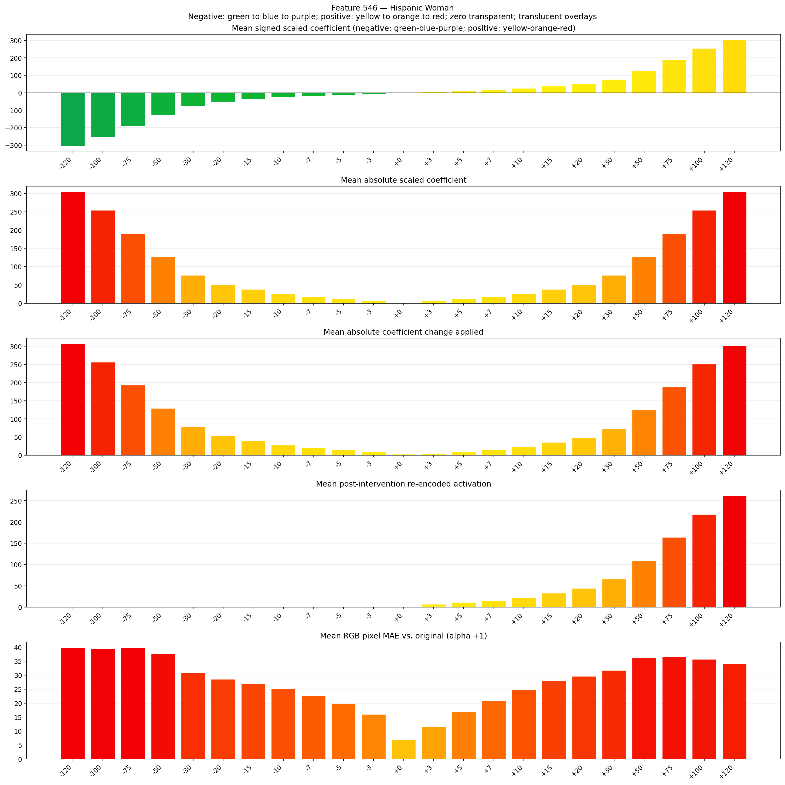
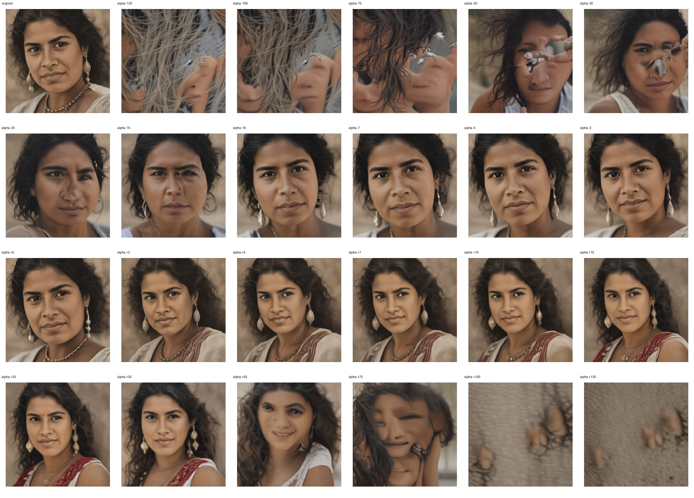
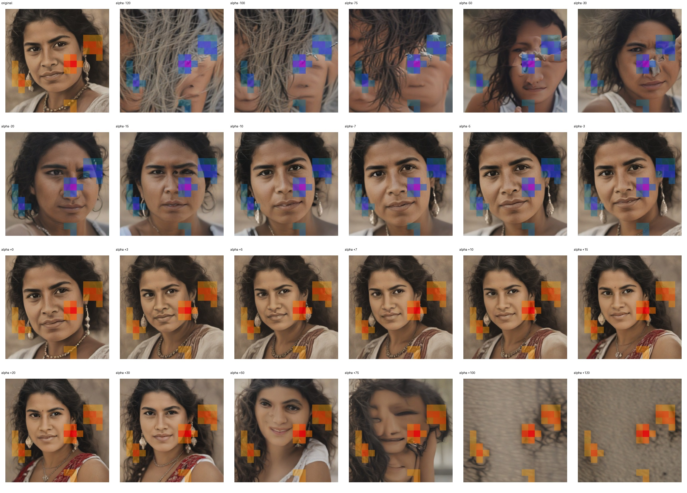
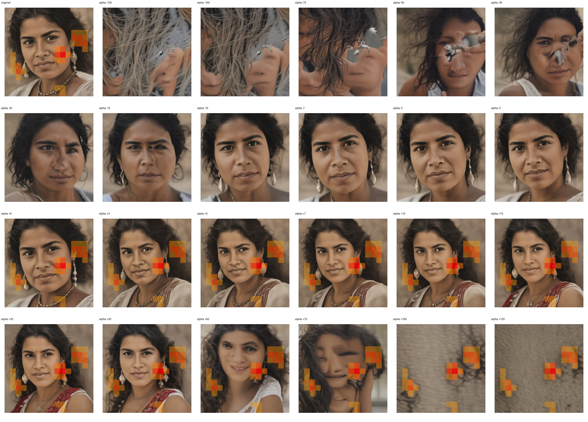

# Feature 546 — Hispanic Woman

Biased dataset; original prompt and seed replay for seeds 0–19. Values are means across 20 source images. The table reports the mean post-re-encoded activation of feature 546, the active spatial fraction, mean RGB pixel MAE versus the original image (0–255 scale), and coefficient change magnitudes for each alpha.

## Activation graph

## Mean metrics by alpha

| Alpha | Mean post-reencoded feature 546 activation | Active spatial fraction | Mean pixel change (MAE) | Mean absolute coefficient change | Mean absolute scaled coefficient |
|---:|---:|---:|---:|---:|---:|
| -120 | 0.000 | 0.000 | 39.837 | 307.195 | 304.656 |
| -100 | 0.000 | 0.000 | 39.507 | 256.419 | 253.880 |
| -75 | 0.000 | 0.000 | 39.798 | 192.949 | 190.410 |
| -50 | 0.000 | 0.000 | 37.572 | 129.479 | 126.940 |
| -30 | 0.000 | 0.000 | 30.949 | 78.703 | 76.164 |
| -20 | 0.000 | 0.000 | 28.495 | 53.315 | 50.776 |
| -15 | 0.000 | 0.000 | 26.982 | 40.621 | 38.082 |
| -10 | 0.000 | 0.000 | 25.154 | 27.927 | 25.388 |
| -7 | 0.000 | 0.000 | 22.744 | 20.310 | 17.772 |
| -5 | 0.000 | 0.000 | 19.886 | 15.233 | 12.694 |
| -3 | 0.000 | 0.000 | 15.954 | 10.155 | 7.616 |
| +0 | 0.004 | 0.001 | 7.004 | 2.539 | 0.000 |
| +3 | 6.895 | 0.124 | 11.556 | 5.078 | 7.616 |
| +5 | 11.252 | 0.124 | 16.883 | 10.155 | 12.694 |
| +7 | 15.609 | 0.124 | 20.773 | 15.233 | 17.772 |
| +10 | 22.143 | 0.124 | 24.711 | 22.849 | 25.388 |
| +15 | 33.035 | 0.124 | 28.061 | 35.543 | 38.082 |
| +20 | 43.926 | 0.124 | 29.633 | 48.237 | 50.776 |
| +30 | 65.710 | 0.124 | 31.712 | 73.625 | 76.164 |
| +50 | 109.276 | 0.124 | 36.123 | 124.401 | 126.940 |
| +75 | 163.733 | 0.124 | 36.575 | 187.871 | 190.410 |
| +100 | 218.190 | 0.124 | 35.675 | 251.341 | 253.880 |
| +120 | 261.756 | 0.124 | 34.149 | 302.117 | 304.656 |

## Per-seed grids

Each 4×6 sheet contains the original followed by the 23 alpha variants in ascending alpha order, from −120 through +120.

### Plain images

[All 20 plain-image grids](seed_sheets/)

### Signed coefficient overlays

[All 20 signed coefficient grids](signed_coefficient_overlays/)

### Post-re-encoded activation overlays

[All 20 post-activation grids](post_activation_overlays/)

### Intervention-footprint overlays

[All 20 intervention-footprint grids](intervention_footprint_overlays/)

Zero is transparent. Negative coefficient colors progress green through blue to purple; positive colors progress yellow through orange to red. Each map tile is normalized individually for visibility. The original and alpha-zero tiles show the pre-intervention feature map so its location remains visible.
