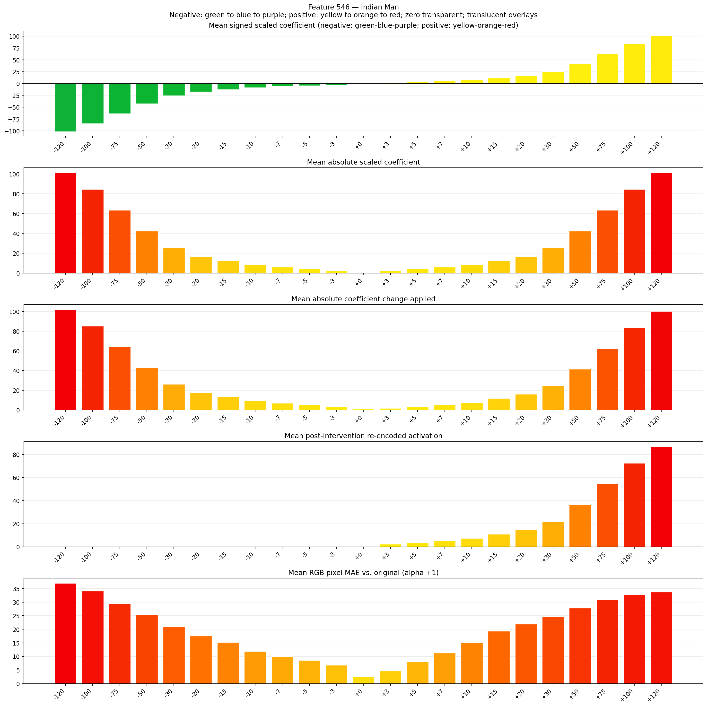
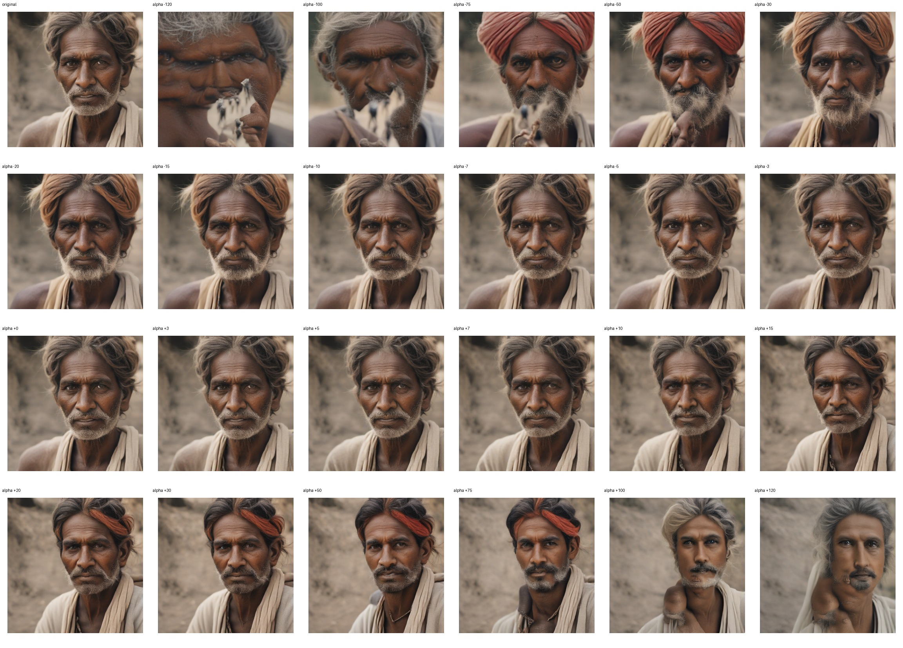
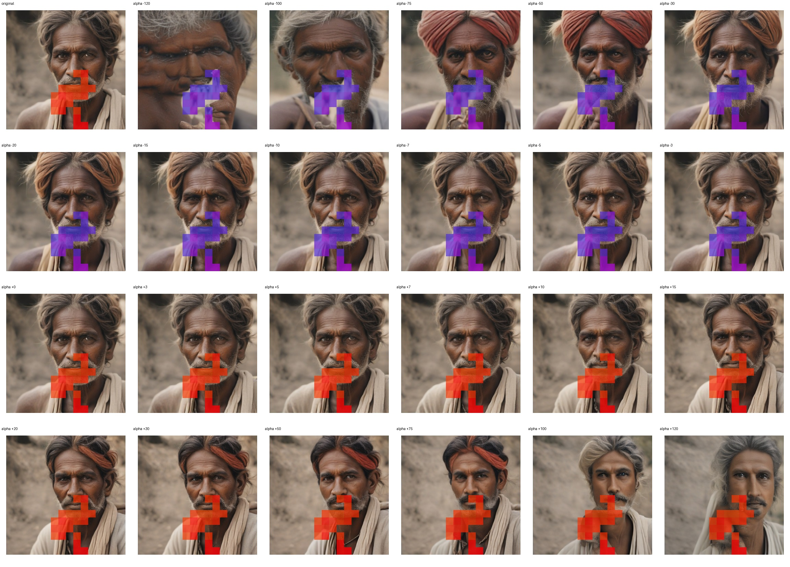
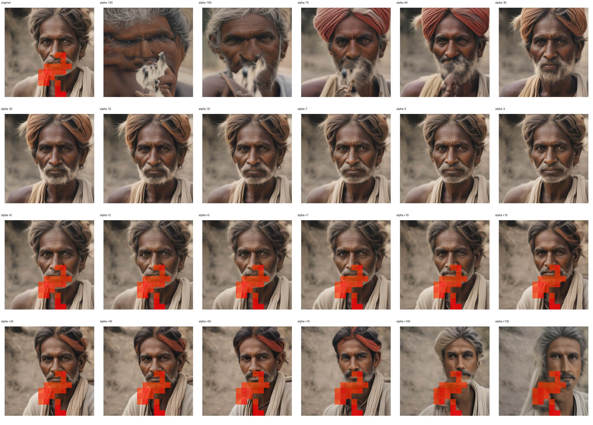

# Feature 546 — Indian Man

Biased dataset; original prompt and seed replay for seeds 0–19. Values are means across 20 source images. The table reports the mean post-re-encoded activation of feature 546, the active spatial fraction, mean RGB pixel MAE versus the original image (0–255 scale), and coefficient change magnitudes for each alpha.

## Activation graph

## Mean metrics by alpha

| Alpha | Mean post-reencoded feature 546 activation | Active spatial fraction | Mean pixel change (MAE) | Mean absolute coefficient change | Mean absolute scaled coefficient |
|---:|---:|---:|---:|---:|---:|
| -120 | 0.000 | 0.000 | 36.951 | 102.086 | 101.243 |
| -100 | 0.000 | 0.000 | 34.058 | 85.213 | 84.369 |
| -75 | 0.000 | 0.000 | 29.459 | 64.120 | 63.277 |
| -50 | 0.000 | 0.000 | 25.274 | 43.028 | 42.184 |
| -30 | 0.000 | 0.000 | 20.930 | 26.154 | 25.311 |
| -20 | 0.000 | 0.000 | 17.558 | 17.717 | 16.874 |
| -15 | 0.000 | 0.000 | 15.171 | 13.499 | 12.655 |
| -10 | 0.000 | 0.000 | 11.888 | 9.281 | 8.437 |
| -7 | 0.000 | 0.000 | 9.987 | 6.750 | 5.906 |
| -5 | 0.000 | 0.000 | 8.593 | 5.062 | 4.218 |
| -3 | 0.000 | 0.000 | 6.823 | 3.375 | 2.531 |
| +0 | 0.000 | 0.000 | 2.681 | 0.844 | 0.000 |
| +3 | 2.291 | 0.063 | 4.628 | 1.687 | 2.531 |
| +5 | 3.739 | 0.063 | 8.126 | 3.375 | 4.218 |
| +7 | 5.187 | 0.063 | 11.292 | 5.062 | 5.906 |
| +10 | 7.359 | 0.063 | 15.075 | 7.593 | 8.437 |
| +15 | 10.978 | 0.063 | 19.294 | 11.812 | 12.655 |
| +20 | 14.598 | 0.063 | 21.864 | 16.030 | 16.874 |
| +30 | 21.836 | 0.063 | 24.632 | 24.467 | 25.311 |
| +50 | 36.314 | 0.063 | 27.774 | 41.341 | 42.184 |
| +75 | 54.411 | 0.063 | 30.859 | 62.433 | 63.277 |
| +100 | 72.509 | 0.063 | 32.732 | 83.525 | 84.369 |
| +120 | 86.986 | 0.063 | 33.684 | 100.399 | 101.243 |

## Per-seed grids

Each 4×6 sheet contains the original followed by the 23 alpha variants in ascending alpha order, from −120 through +120.

### Plain images

[All 20 plain-image grids](seed_sheets/)

### Signed coefficient overlays

[All 20 signed coefficient grids](signed_coefficient_overlays/)

### Post-re-encoded activation overlays

[All 20 post-activation grids](post_activation_overlays/)

### Intervention-footprint overlays

[All 20 intervention-footprint grids](intervention_footprint_overlays/)

Zero is transparent. Negative coefficient colors progress green through blue to purple; positive colors progress yellow through orange to red. Each map tile is normalized individually for visibility. The original and alpha-zero tiles show the pre-intervention feature map so its location remains visible.
