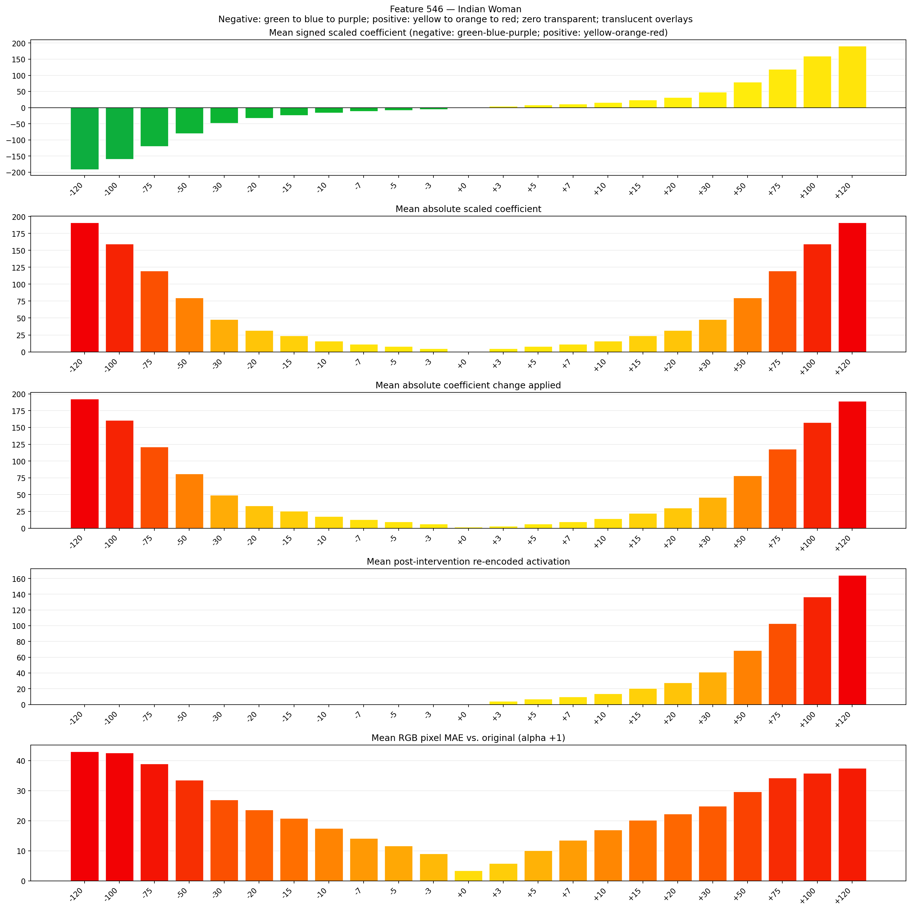
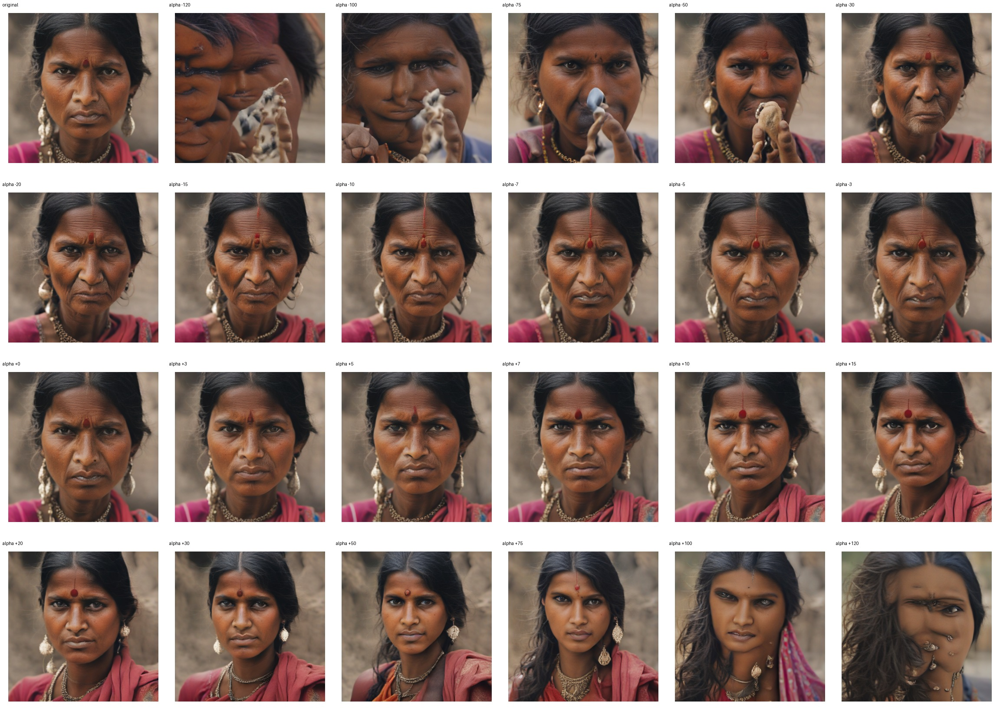
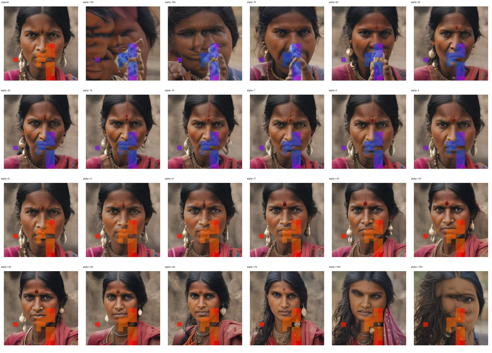
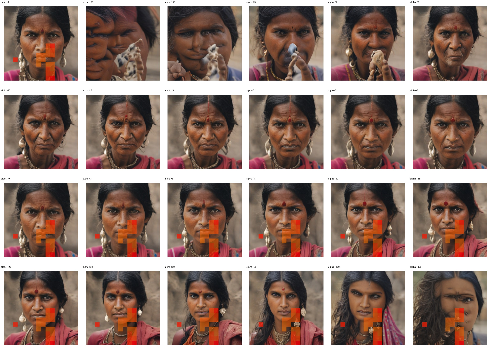

# Feature 546 — Indian Woman

Biased dataset; original prompt and seed replay for seeds 0–19. Values are means across 20 source images. The table reports the mean post-re-encoded activation of feature 546, the active spatial fraction, mean RGB pixel MAE versus the original image (0–255 scale), and coefficient change magnitudes for each alpha.

## Activation graph

## Mean metrics by alpha

| Alpha | Mean post-reencoded feature 546 activation | Active spatial fraction | Mean pixel change (MAE) | Mean absolute coefficient change | Mean absolute scaled coefficient |
|---:|---:|---:|---:|---:|---:|
| -120 | 0.000 | 0.000 | 43.001 | 192.610 | 191.018 |
| -100 | 0.000 | 0.000 | 42.526 | 160.774 | 159.182 |
| -75 | 0.000 | 0.000 | 38.914 | 120.978 | 119.386 |
| -50 | 0.000 | 0.000 | 33.514 | 81.183 | 79.591 |
| -30 | 0.000 | 0.000 | 26.932 | 49.346 | 47.755 |
| -20 | 0.000 | 0.000 | 23.654 | 33.428 | 31.836 |
| -15 | 0.000 | 0.000 | 20.811 | 25.469 | 23.877 |
| -10 | 0.000 | 0.000 | 17.455 | 17.510 | 15.918 |
| -7 | 0.000 | 0.000 | 14.107 | 12.735 | 11.143 |
| -5 | 0.000 | 0.000 | 11.684 | 9.551 | 7.959 |
| -3 | 0.000 | 0.000 | 9.062 | 6.367 | 4.775 |
| +0 | 0.000 | 0.000 | 3.438 | 1.592 | 0.000 |
| +3 | 4.323 | 0.104 | 5.844 | 3.184 | 4.775 |
| +5 | 7.055 | 0.104 | 10.121 | 6.367 | 7.959 |
| +7 | 9.787 | 0.104 | 13.543 | 9.551 | 11.143 |
| +10 | 13.884 | 0.104 | 16.976 | 14.326 | 15.918 |
| +15 | 20.713 | 0.104 | 20.231 | 22.285 | 23.877 |
| +20 | 27.542 | 0.104 | 22.226 | 30.245 | 31.836 |
| +30 | 41.200 | 0.104 | 24.860 | 46.163 | 47.755 |
| +50 | 68.515 | 0.104 | 29.650 | 77.999 | 79.591 |
| +75 | 102.660 | 0.104 | 34.259 | 117.795 | 119.386 |
| +100 | 136.805 | 0.104 | 35.801 | 157.590 | 159.182 |
| +120 | 164.120 | 0.104 | 37.482 | 189.427 | 191.018 |

## Per-seed grids

Each 4×6 sheet contains the original followed by the 23 alpha variants in ascending alpha order, from −120 through +120.

### Plain images

[All 20 plain-image grids](seed_sheets/)

### Signed coefficient overlays

[All 20 signed coefficient grids](signed_coefficient_overlays/)

### Post-re-encoded activation overlays

[All 20 post-activation grids](post_activation_overlays/)

### Intervention-footprint overlays

[All 20 intervention-footprint grids](intervention_footprint_overlays/)

Zero is transparent. Negative coefficient colors progress green through blue to purple; positive colors progress yellow through orange to red. Each map tile is normalized individually for visibility. The original and alpha-zero tiles show the pre-intervention feature map so its location remains visible.
