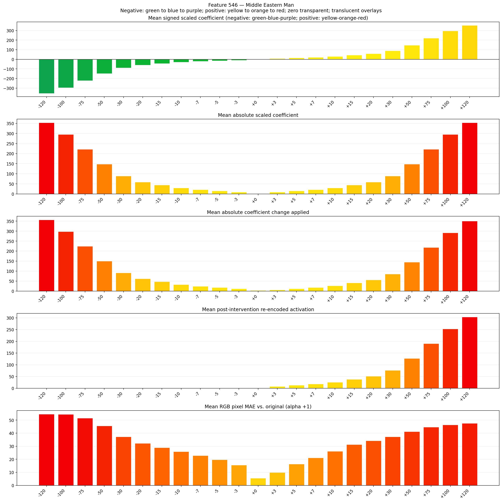
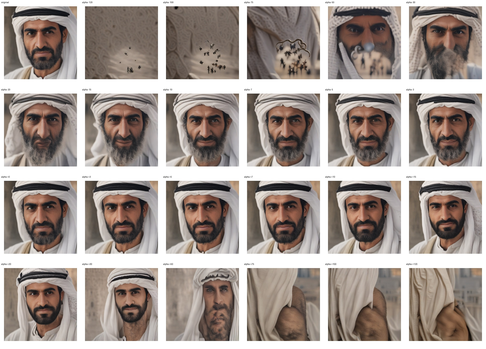
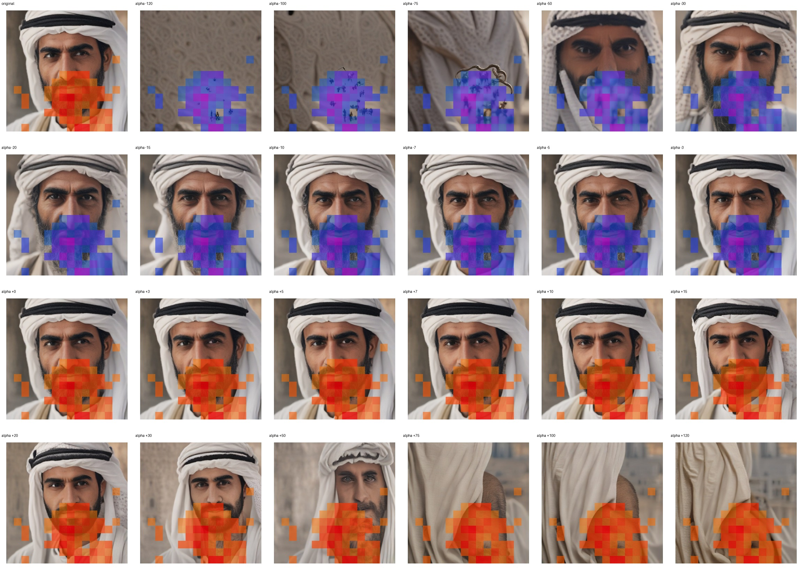
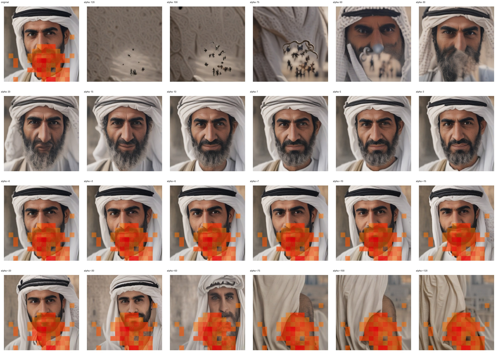

# Feature 546 — Middle Eastern Man

Biased dataset; original prompt and seed replay for seeds 0–19. Values are means across 20 source images. The table reports the mean post-re-encoded activation of feature 546, the active spatial fraction, mean RGB pixel MAE versus the original image (0–255 scale), and coefficient change magnitudes for each alpha.

## Activation graph

## Mean metrics by alpha

| Alpha | Mean post-reencoded feature 546 activation | Active spatial fraction | Mean pixel change (MAE) | Mean absolute coefficient change | Mean absolute scaled coefficient |
|---:|---:|---:|---:|---:|---:|
| -120 | 0.000 | 0.000 | 54.551 | 356.633 | 353.685 |
| -100 | 0.000 | 0.000 | 54.393 | 297.685 | 294.738 |
| -75 | 0.000 | 0.000 | 51.445 | 224.001 | 221.053 |
| -50 | 0.000 | 0.000 | 45.493 | 150.316 | 147.369 |
| -30 | 0.000 | 0.000 | 37.195 | 91.369 | 88.421 |
| -20 | 0.000 | 0.000 | 32.151 | 61.895 | 58.948 |
| -15 | 0.000 | 0.000 | 28.897 | 47.158 | 44.211 |
| -10 | 0.000 | 0.000 | 25.812 | 32.421 | 29.474 |
| -7 | 0.000 | 0.000 | 22.844 | 23.579 | 20.632 |
| -5 | 0.000 | 0.000 | 19.709 | 17.684 | 14.737 |
| -3 | 0.000 | 0.000 | 15.533 | 11.790 | 8.842 |
| +0 | 0.000 | 0.000 | 5.567 | 2.947 | 0.000 |
| +3 | 8.005 | 0.206 | 9.915 | 5.895 | 8.842 |
| +5 | 13.063 | 0.206 | 16.329 | 11.790 | 14.737 |
| +7 | 18.121 | 0.206 | 21.104 | 17.684 | 20.632 |
| +10 | 25.707 | 0.206 | 26.073 | 26.526 | 29.474 |
| +15 | 38.351 | 0.206 | 31.232 | 41.263 | 44.211 |
| +20 | 50.996 | 0.206 | 34.145 | 56.000 | 58.948 |
| +30 | 76.284 | 0.206 | 37.271 | 85.474 | 88.421 |
| +50 | 126.862 | 0.206 | 41.219 | 144.422 | 147.369 |
| +75 | 190.083 | 0.206 | 44.641 | 218.106 | 221.053 |
| +100 | 253.305 | 0.206 | 46.328 | 291.791 | 294.738 |
| +120 | 303.882 | 0.206 | 47.507 | 350.738 | 353.685 |

## Per-seed grids

Each 4×6 sheet contains the original followed by the 23 alpha variants in ascending alpha order, from −120 through +120.

### Plain images

[All 20 plain-image grids](seed_sheets/)

### Signed coefficient overlays

[All 20 signed coefficient grids](signed_coefficient_overlays/)

### Post-re-encoded activation overlays

[All 20 post-activation grids](post_activation_overlays/)

### Intervention-footprint overlays

[All 20 intervention-footprint grids](intervention_footprint_overlays/)

Zero is transparent. Negative coefficient colors progress green through blue to purple; positive colors progress yellow through orange to red. Each map tile is normalized individually for visibility. The original and alpha-zero tiles show the pre-intervention feature map so its location remains visible.
