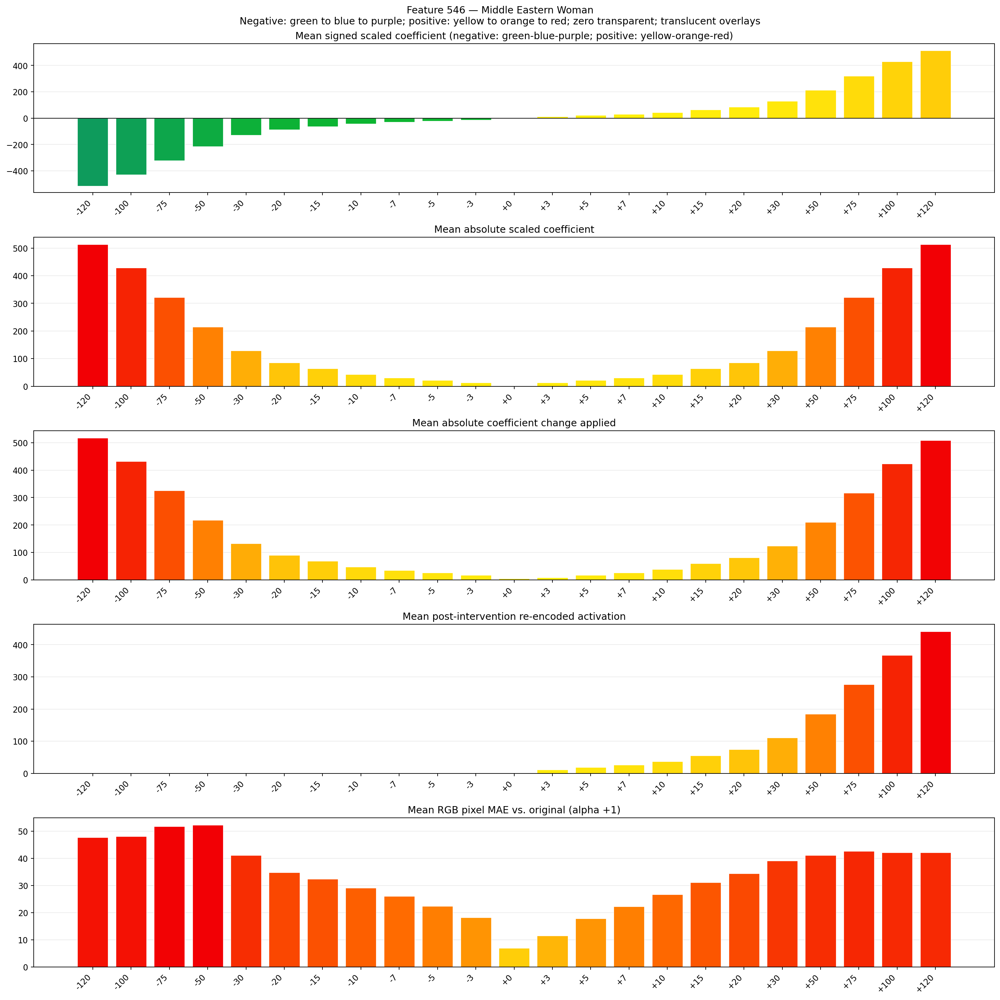
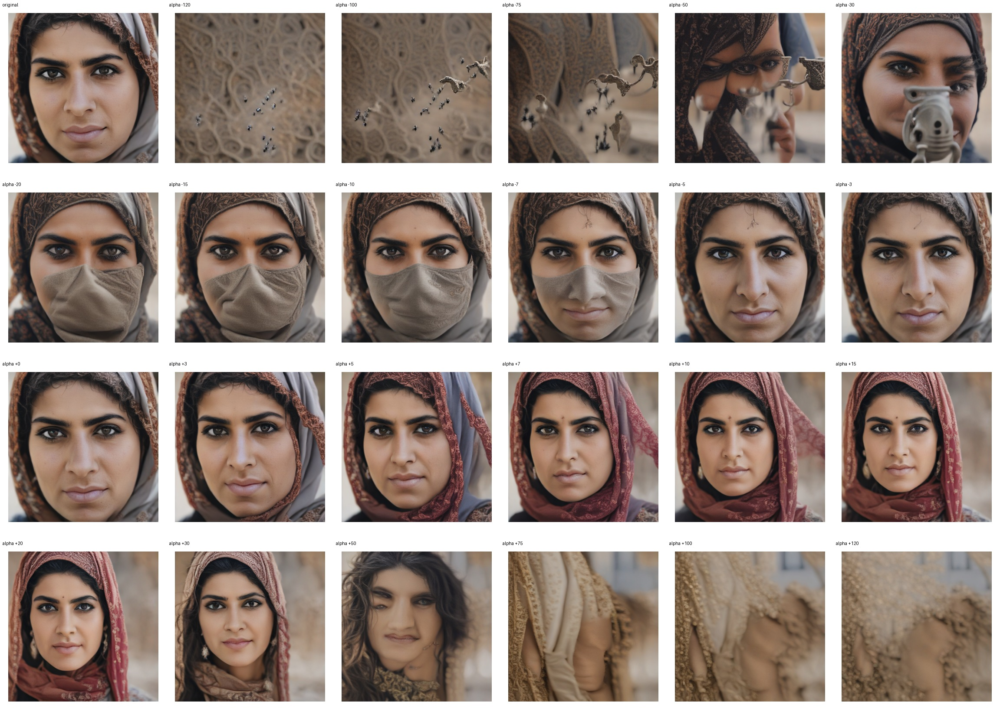
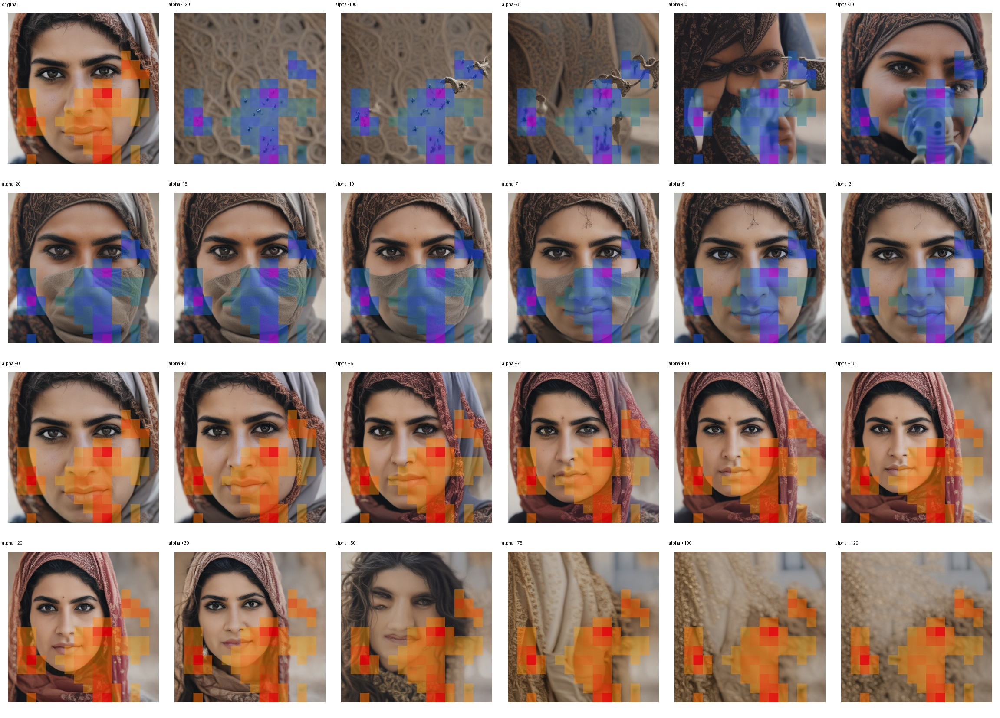
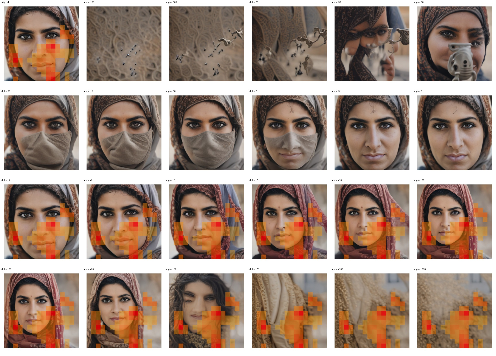

# Feature 546 — Middle Eastern Woman

Biased dataset; original prompt and seed replay for seeds 0–19. Values are means across 20 source images. The table reports the mean post-re-encoded activation of feature 546, the active spatial fraction, mean RGB pixel MAE versus the original image (0–255 scale), and coefficient change magnitudes for each alpha.

## Activation graph

## Mean metrics by alpha

| Alpha | Mean post-reencoded feature 546 activation | Active spatial fraction | Mean pixel change (MAE) | Mean absolute coefficient change | Mean absolute scaled coefficient |
|---:|---:|---:|---:|---:|---:|
| -120 | 0.000 | 0.000 | 47.785 | 517.879 | 513.599 |
| -100 | 0.000 | 0.000 | 48.135 | 432.279 | 427.999 |
| -75 | 0.000 | 0.000 | 51.774 | 325.279 | 320.999 |
| -50 | 0.000 | 0.000 | 52.304 | 218.279 | 213.999 |
| -30 | 0.000 | 0.000 | 41.098 | 132.680 | 128.400 |
| -20 | 0.000 | 0.000 | 34.776 | 89.880 | 85.600 |
| -15 | 0.000 | 0.000 | 32.404 | 68.480 | 64.200 |
| -10 | 0.000 | 0.000 | 29.069 | 47.080 | 42.800 |
| -7 | 0.000 | 0.000 | 26.091 | 34.240 | 29.960 |
| -5 | 0.000 | 0.000 | 22.449 | 25.680 | 21.400 |
| -3 | 0.000 | 0.000 | 18.218 | 17.120 | 12.840 |
| +0 | 0.001 | 0.000 | 6.936 | 4.280 | 0.000 |
| +3 | 11.625 | 0.261 | 11.471 | 8.560 | 12.840 |
| +5 | 18.969 | 0.261 | 17.865 | 17.120 | 21.400 |
| +7 | 26.313 | 0.261 | 22.283 | 25.680 | 29.960 |
| +10 | 37.330 | 0.261 | 26.670 | 38.520 | 42.800 |
| +15 | 55.691 | 0.261 | 31.077 | 59.920 | 64.200 |
| +20 | 74.053 | 0.261 | 34.403 | 81.320 | 85.600 |
| +30 | 110.775 | 0.261 | 39.109 | 124.120 | 128.400 |
| +50 | 184.220 | 0.261 | 41.109 | 209.720 | 213.999 |
| +75 | 276.027 | 0.261 | 42.683 | 316.719 | 320.999 |
| +100 | 367.832 | 0.261 | 42.153 | 423.719 | 427.999 |
| +120 | 441.277 | 0.261 | 42.098 | 509.319 | 513.599 |

## Per-seed grids

Each 4×6 sheet contains the original followed by the 23 alpha variants in ascending alpha order, from −120 through +120.

### Plain images

[All 20 plain-image grids](seed_sheets/)

### Signed coefficient overlays

[All 20 signed coefficient grids](signed_coefficient_overlays/)

### Post-re-encoded activation overlays

[All 20 post-activation grids](post_activation_overlays/)

### Intervention-footprint overlays

[All 20 intervention-footprint grids](intervention_footprint_overlays/)

Zero is transparent. Negative coefficient colors progress green through blue to purple; positive colors progress yellow through orange to red. Each map tile is normalized individually for visibility. The original and alpha-zero tiles show the pre-intervention feature map so its location remains visible.
