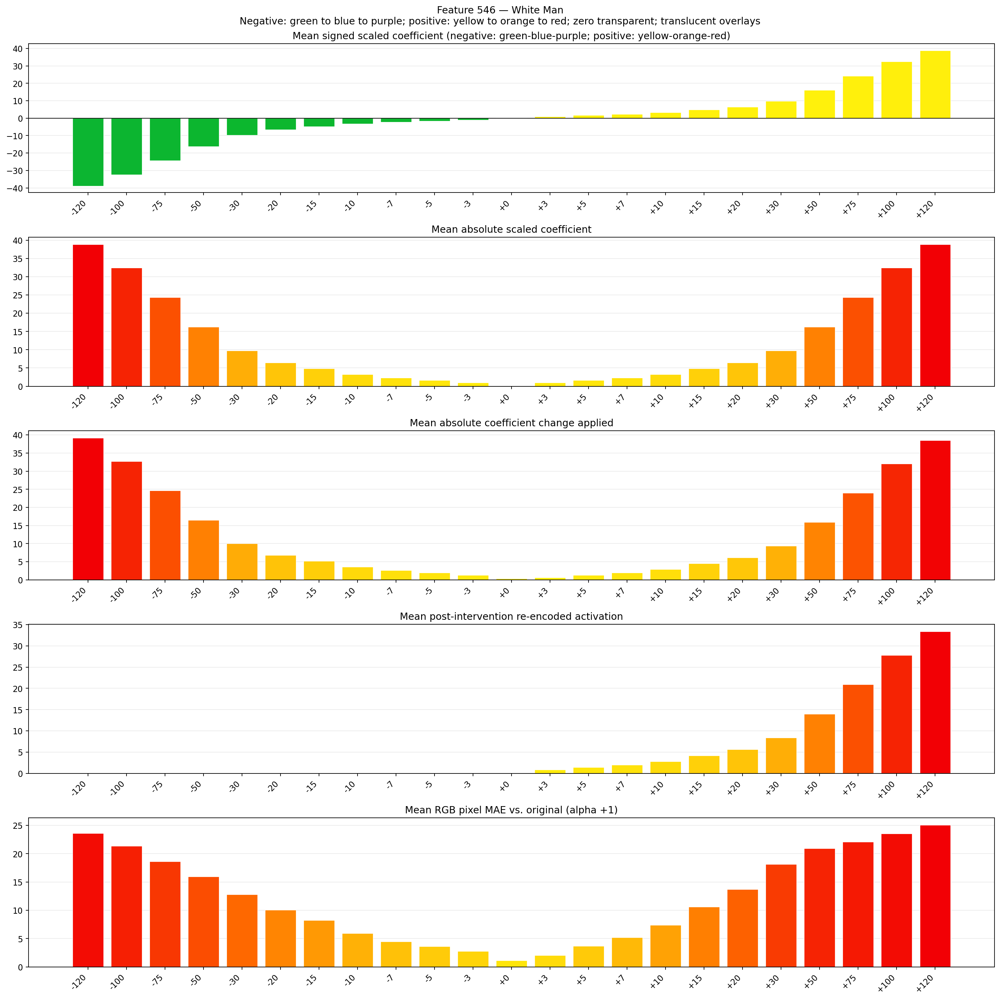
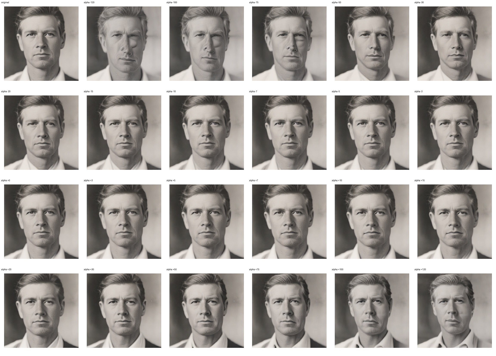
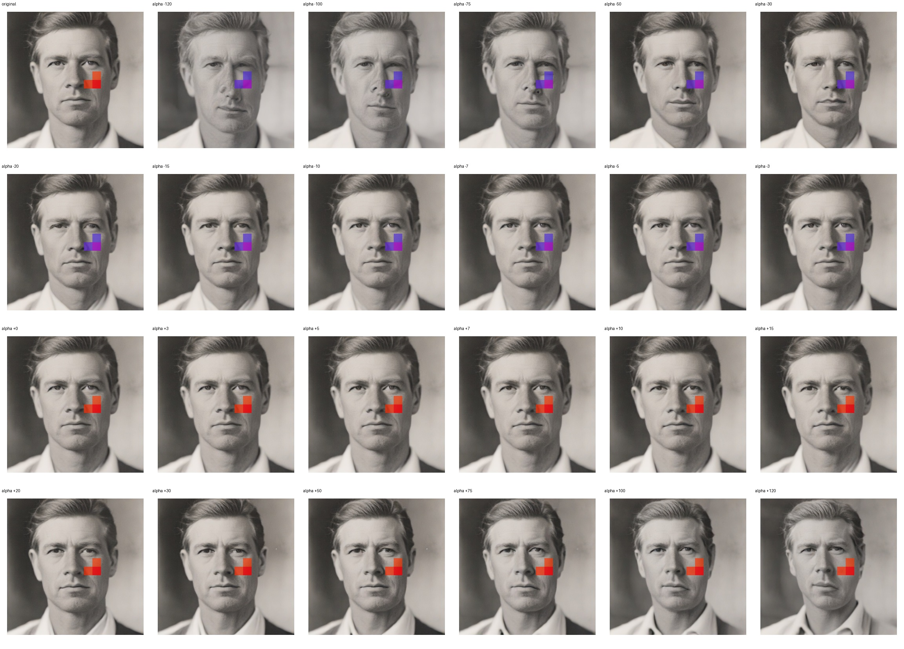
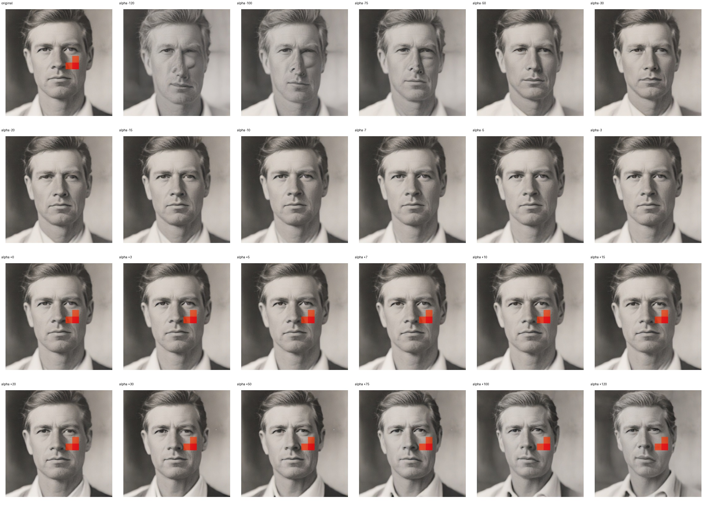

# Feature 546 — White Man

Biased dataset; original prompt and seed replay for seeds 0–19. Values are means across 20 source images. The table reports the mean post-re-encoded activation of feature 546, the active spatial fraction, mean RGB pixel MAE versus the original image (0–255 scale), and coefficient change magnitudes for each alpha.

## Activation graph

## Mean metrics by alpha

| Alpha | Mean post-reencoded feature 546 activation | Active spatial fraction | Mean pixel change (MAE) | Mean absolute coefficient change | Mean absolute scaled coefficient |
|---:|---:|---:|---:|---:|---:|
| -120 | 0.000 | 0.000 | 23.595 | 39.187 | 38.863 |
| -100 | 0.000 | 0.000 | 21.344 | 32.710 | 32.386 |
| -75 | 0.000 | 0.000 | 18.632 | 24.613 | 24.289 |
| -50 | 0.000 | 0.000 | 15.980 | 16.517 | 16.193 |
| -30 | 0.000 | 0.000 | 12.814 | 10.040 | 9.716 |
| -20 | 0.000 | 0.000 | 10.079 | 6.801 | 6.477 |
| -15 | 0.000 | 0.000 | 8.224 | 5.182 | 4.858 |
| -10 | 0.000 | 0.000 | 5.961 | 3.562 | 3.239 |
| -7 | 0.000 | 0.000 | 4.489 | 2.591 | 2.267 |
| -5 | 0.000 | 0.000 | 3.614 | 1.943 | 1.619 |
| -3 | 0.000 | 0.000 | 2.765 | 1.295 | 0.972 |
| +0 | 0.000 | 0.000 | 1.167 | 0.324 | 0.000 |
| +3 | 0.880 | 0.025 | 2.071 | 0.648 | 0.972 |
| +5 | 1.435 | 0.025 | 3.681 | 1.295 | 1.619 |
| +7 | 1.991 | 0.025 | 5.218 | 1.943 | 2.267 |
| +10 | 2.825 | 0.025 | 7.406 | 2.915 | 3.239 |
| +15 | 4.214 | 0.025 | 10.642 | 4.534 | 4.858 |
| +20 | 5.603 | 0.025 | 13.687 | 6.153 | 6.477 |
| +30 | 8.382 | 0.025 | 18.139 | 9.392 | 9.716 |
| +50 | 13.940 | 0.025 | 20.948 | 15.869 | 16.193 |
| +75 | 20.886 | 0.025 | 22.097 | 23.966 | 24.289 |
| +100 | 27.833 | 0.025 | 23.563 | 32.062 | 32.386 |
| +120 | 33.391 | 0.025 | 25.070 | 38.539 | 38.863 |

## Per-seed grids

Each 4×6 sheet contains the original followed by the 23 alpha variants in ascending alpha order, from −120 through +120.

### Plain images

[All 20 plain-image grids](seed_sheets/)

### Signed coefficient overlays

[All 20 signed coefficient grids](signed_coefficient_overlays/)

### Post-re-encoded activation overlays

[All 20 post-activation grids](post_activation_overlays/)

### Intervention-footprint overlays

[All 20 intervention-footprint grids](intervention_footprint_overlays/)

Zero is transparent. Negative coefficient colors progress green through blue to purple; positive colors progress yellow through orange to red. Each map tile is normalized individually for visibility. The original and alpha-zero tiles show the pre-intervention feature map so its location remains visible.
