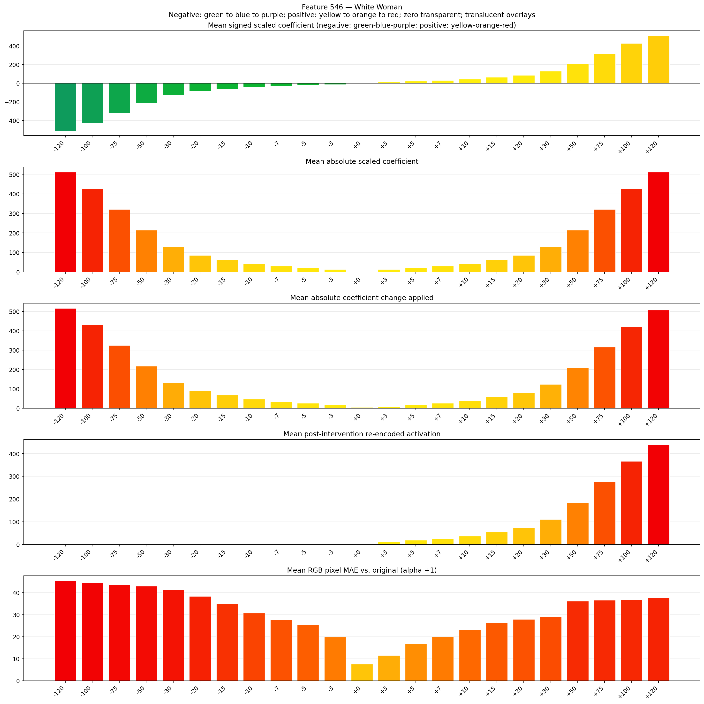
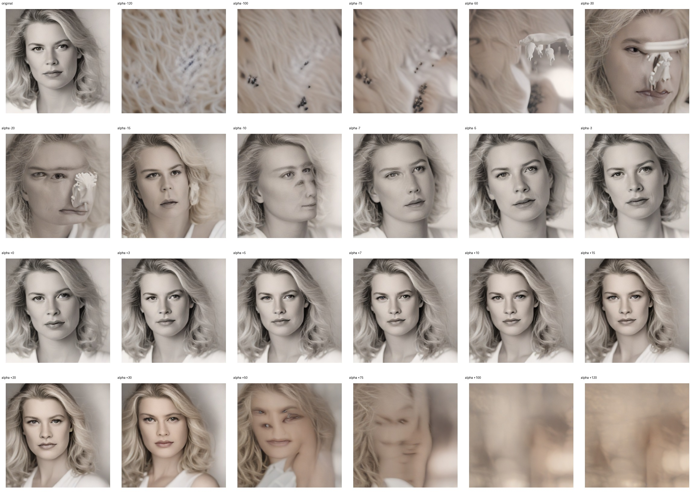
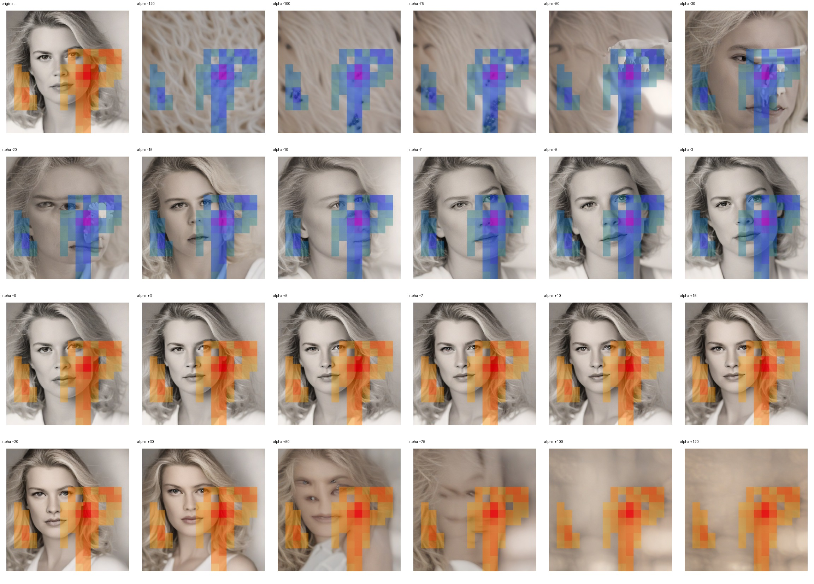
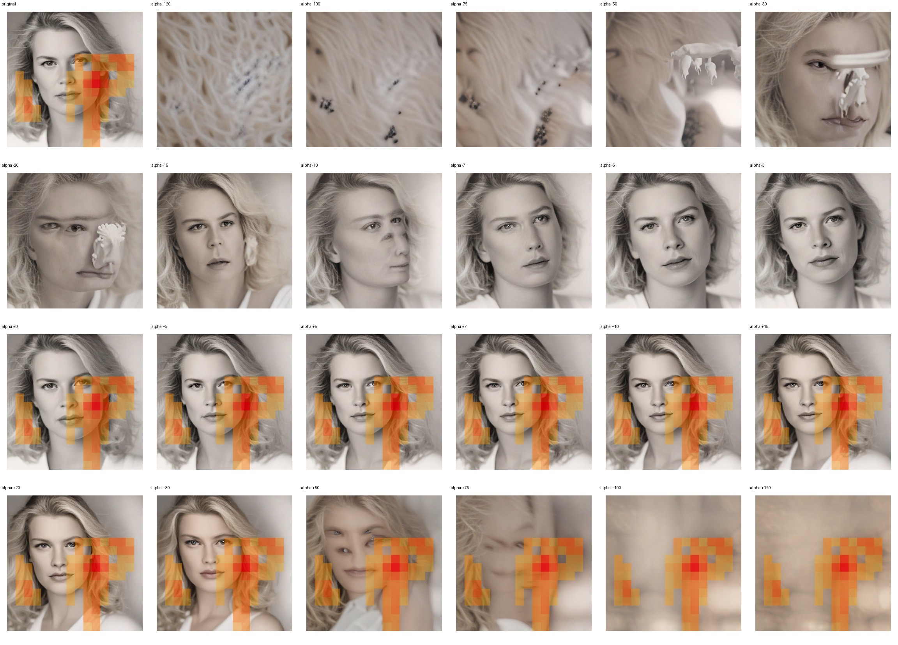

# Feature 546 — White Woman

Biased dataset; original prompt and seed replay for seeds 0–19. Values are means across 20 source images. The table reports the mean post-re-encoded activation of feature 546, the active spatial fraction, mean RGB pixel MAE versus the original image (0–255 scale), and coefficient change magnitudes for each alpha.

## Activation graph

## Mean metrics by alpha

| Alpha | Mean post-reencoded feature 546 activation | Active spatial fraction | Mean pixel change (MAE) | Mean absolute coefficient change | Mean absolute scaled coefficient |
|---:|---:|---:|---:|---:|---:|
| -120 | 0.000 | 0.000 | 45.372 | 516.335 | 512.068 |
| -100 | 0.000 | 0.000 | 44.536 | 430.991 | 426.723 |
| -75 | 0.000 | 0.000 | 43.761 | 324.310 | 320.043 |
| -50 | 0.000 | 0.000 | 42.891 | 217.629 | 213.362 |
| -30 | 0.000 | 0.000 | 41.240 | 132.284 | 128.017 |
| -20 | 0.000 | 0.000 | 38.338 | 89.612 | 85.345 |
| -15 | 0.000 | 0.000 | 34.946 | 68.276 | 64.009 |
| -10 | 0.000 | 0.000 | 30.778 | 46.940 | 42.672 |
| -7 | 0.000 | 0.000 | 27.817 | 34.138 | 29.871 |
| -5 | 0.000 | 0.000 | 25.331 | 25.603 | 21.336 |
| -3 | 0.000 | 0.000 | 19.899 | 17.069 | 12.802 |
| +0 | 0.001 | 0.000 | 7.507 | 4.267 | 0.000 |
| +3 | 11.590 | 0.237 | 11.492 | 8.534 | 12.802 |
| +5 | 18.912 | 0.237 | 16.764 | 17.069 | 21.336 |
| +7 | 26.235 | 0.237 | 20.005 | 25.603 | 29.871 |
| +10 | 37.219 | 0.237 | 23.233 | 38.405 | 42.672 |
| +15 | 55.526 | 0.237 | 26.479 | 59.741 | 64.009 |
| +20 | 73.832 | 0.237 | 27.935 | 81.077 | 85.345 |
| +30 | 110.445 | 0.237 | 29.138 | 123.750 | 128.017 |
| +50 | 183.671 | 0.237 | 36.148 | 209.094 | 213.362 |
| +75 | 275.204 | 0.237 | 36.586 | 315.775 | 320.043 |
| +100 | 366.737 | 0.237 | 36.896 | 422.456 | 426.723 |
| +120 | 439.962 | 0.237 | 37.816 | 507.801 | 512.068 |

## Per-seed grids

Each 4×6 sheet contains the original followed by the 23 alpha variants in ascending alpha order, from −120 through +120.

### Plain images

[All 20 plain-image grids](seed_sheets/)

### Signed coefficient overlays

[All 20 signed coefficient grids](signed_coefficient_overlays/)

### Post-re-encoded activation overlays

[All 20 post-activation grids](post_activation_overlays/)

### Intervention-footprint overlays

[All 20 intervention-footprint grids](intervention_footprint_overlays/)

Zero is transparent. Negative coefficient colors progress green through blue to purple; positive colors progress yellow through orange to red. Each map tile is normalized individually for visibility. The original and alpha-zero tiles show the pre-intervention feature map so its location remains visible.
