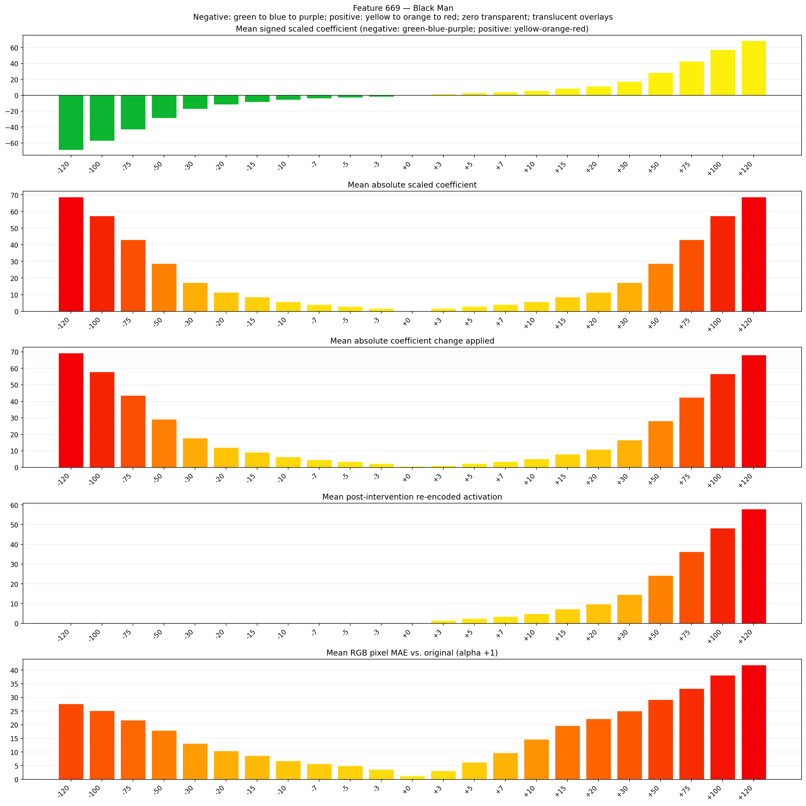
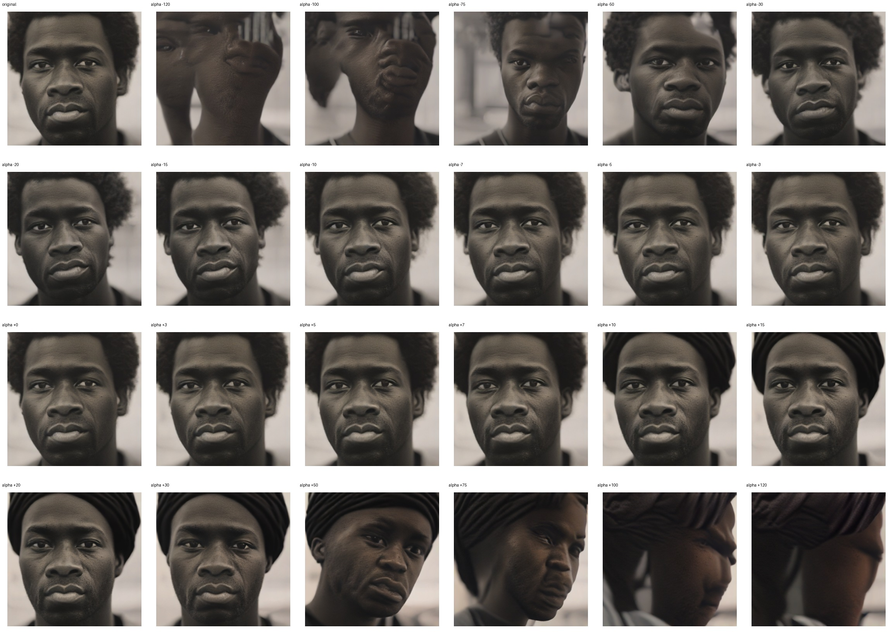
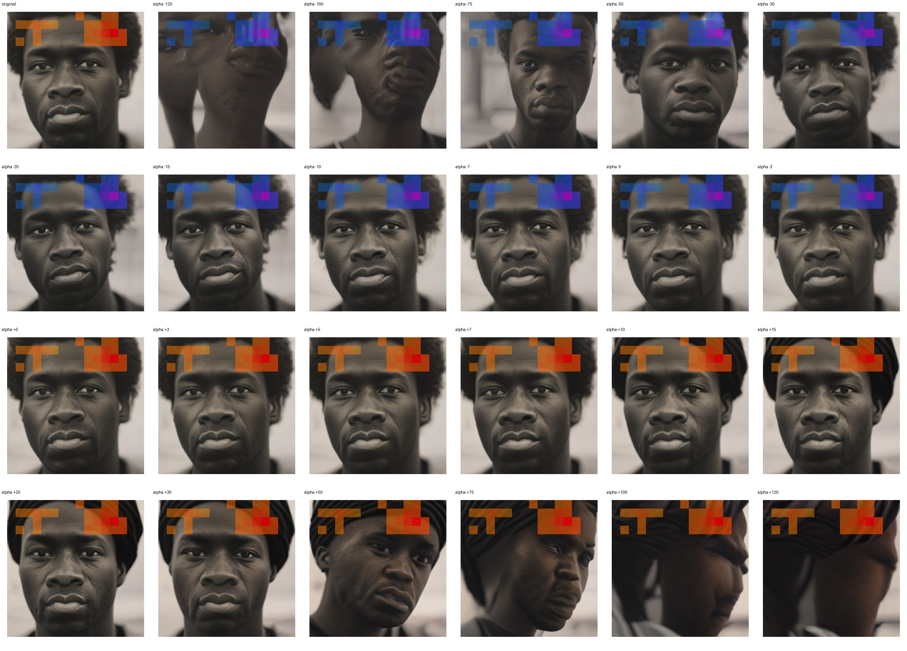
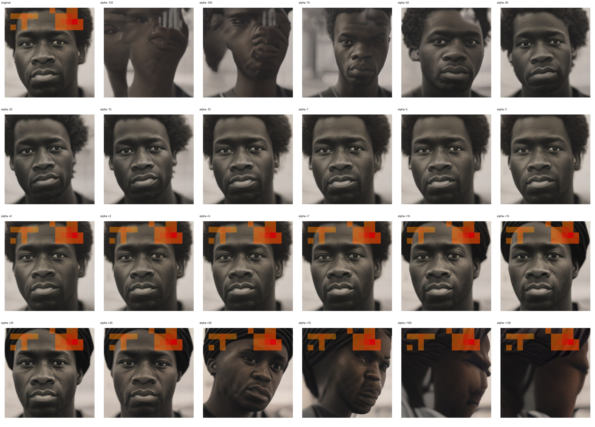

# Feature 669 — Black Man

Biased dataset; original prompt and seed replay for seeds 0–19. Values are means across 20 source images. The table reports the mean post-re-encoded activation of feature 669, the active spatial fraction, mean RGB pixel MAE versus the original image (0–255 scale), and coefficient change magnitudes for each alpha.

## Activation graph

## Mean metrics by alpha

| Alpha | Mean post-reencoded feature 669 activation | Active spatial fraction | Mean pixel change (MAE) | Mean absolute coefficient change | Mean absolute scaled coefficient |
|---:|---:|---:|---:|---:|---:|
| -120 | 0.000 | 0.000 | 27.689 | 69.361 | 68.788 |
| -100 | 0.000 | 0.000 | 25.120 | 57.896 | 57.323 |
| -75 | 0.000 | 0.000 | 21.716 | 43.565 | 42.992 |
| -50 | 0.000 | 0.000 | 17.952 | 29.235 | 28.661 |
| -30 | 0.000 | 0.000 | 13.205 | 17.770 | 17.197 |
| -20 | 0.000 | 0.000 | 10.447 | 12.038 | 11.465 |
| -15 | 0.000 | 0.000 | 8.710 | 9.172 | 8.598 |
| -10 | 0.000 | 0.000 | 6.773 | 6.306 | 5.732 |
| -7 | 0.000 | 0.000 | 5.727 | 4.586 | 4.013 |
| -5 | 0.000 | 0.000 | 4.984 | 3.439 | 2.866 |
| -3 | 0.000 | 0.000 | 3.602 | 2.293 | 1.720 |
| +0 | 0.000 | 0.000 | 1.286 | 0.573 | 0.000 |
| +3 | 1.537 | 0.047 | 3.128 | 1.146 | 1.720 |
| +5 | 2.502 | 0.047 | 6.233 | 2.293 | 2.866 |
| +7 | 3.466 | 0.047 | 9.705 | 3.439 | 4.013 |
| +10 | 4.912 | 0.047 | 14.635 | 5.159 | 5.732 |
| +15 | 7.323 | 0.047 | 19.670 | 8.025 | 8.598 |
| +20 | 9.734 | 0.047 | 22.234 | 10.891 | 11.465 |
| +30 | 14.555 | 0.047 | 25.022 | 16.624 | 17.197 |
| +50 | 24.197 | 0.047 | 29.215 | 28.088 | 28.661 |
| +75 | 36.251 | 0.047 | 33.208 | 42.419 | 42.992 |
| +100 | 48.304 | 0.047 | 38.052 | 56.750 | 57.323 |
| +120 | 57.946 | 0.047 | 41.863 | 68.214 | 68.788 |

## Per-seed grids

Each 4×6 sheet contains the original followed by the 23 alpha variants in ascending alpha order, from −120 through +120.

### Plain images

[All 20 plain-image grids](seed_sheets/)

### Signed coefficient overlays

[All 20 signed coefficient grids](signed_coefficient_overlays/)

### Post-re-encoded activation overlays

[All 20 post-activation grids](post_activation_overlays/)

### Intervention-footprint overlays

[All 20 intervention-footprint grids](intervention_footprint_overlays/)

Zero is transparent. Negative coefficient colors progress green through blue to purple; positive colors progress yellow through orange to red. Each map tile is normalized individually for visibility. The original and alpha-zero tiles show the pre-intervention feature map so its location remains visible.
