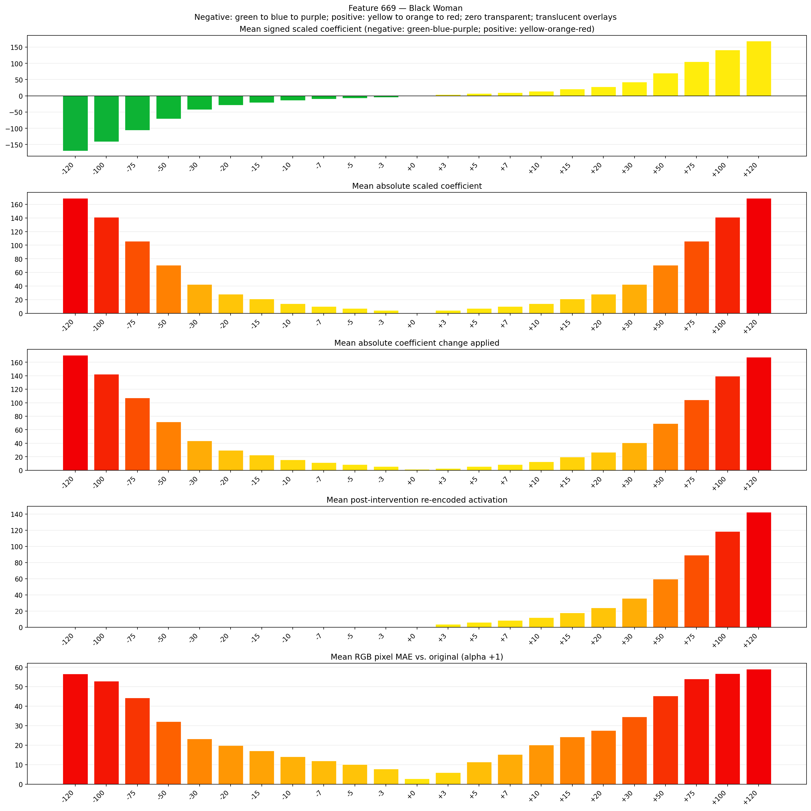
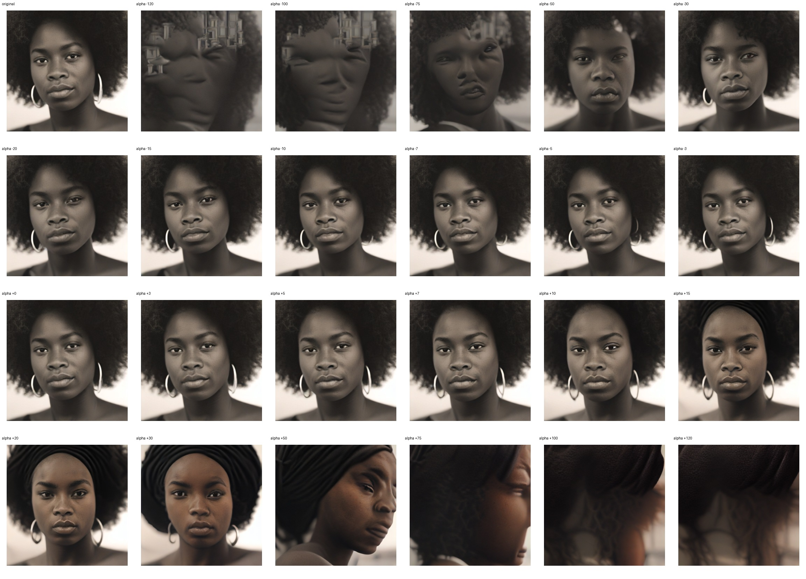
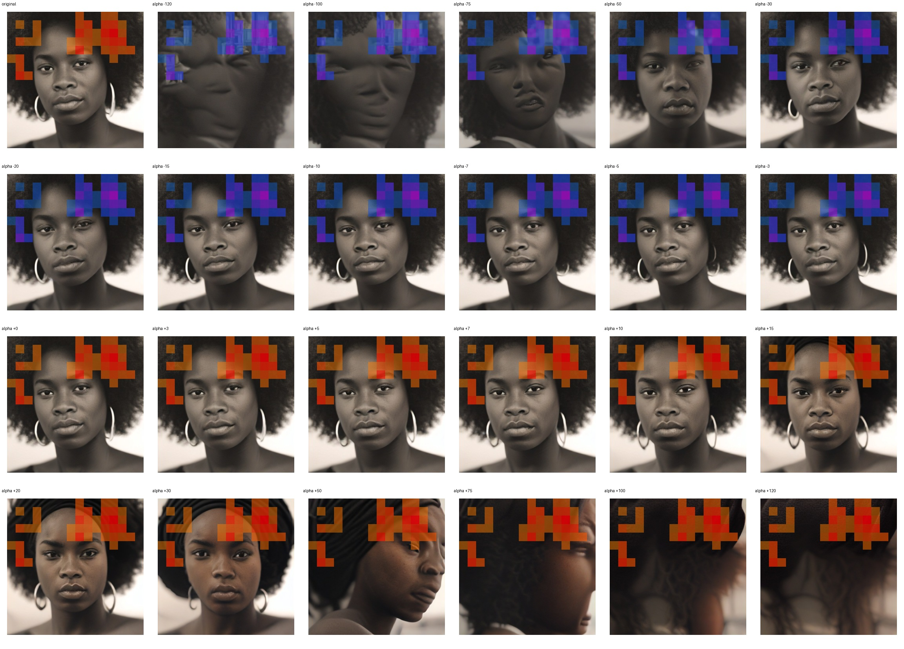
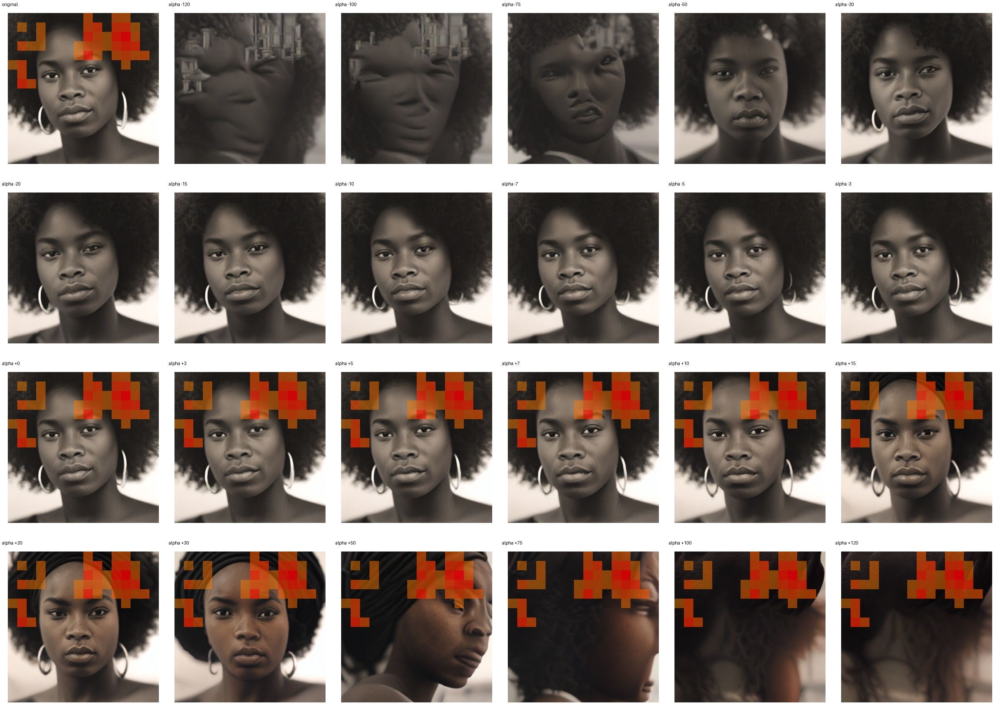

# Feature 669 — Black Woman

Biased dataset; original prompt and seed replay for seeds 0–19. Values are means across 20 source images. The table reports the mean post-re-encoded activation of feature 669, the active spatial fraction, mean RGB pixel MAE versus the original image (0–255 scale), and coefficient change magnitudes for each alpha.

## Activation graph

## Mean metrics by alpha

| Alpha | Mean post-reencoded feature 669 activation | Active spatial fraction | Mean pixel change (MAE) | Mean absolute coefficient change | Mean absolute scaled coefficient |
|---:|---:|---:|---:|---:|---:|
| -120 | 0.000 | 0.000 | 56.662 | 170.577 | 169.167 |
| -100 | 0.000 | 0.000 | 52.829 | 142.382 | 140.972 |
| -75 | 0.000 | 0.000 | 44.318 | 107.139 | 105.729 |
| -50 | 0.000 | 0.000 | 32.124 | 71.896 | 70.486 |
| -30 | 0.000 | 0.000 | 23.301 | 43.701 | 42.292 |
| -20 | 0.000 | 0.000 | 19.886 | 29.604 | 28.194 |
| -15 | 0.000 | 0.000 | 17.157 | 22.556 | 21.146 |
| -10 | 0.000 | 0.000 | 14.126 | 15.507 | 14.097 |
| -7 | 0.000 | 0.000 | 11.972 | 11.278 | 9.868 |
| -5 | 0.000 | 0.000 | 10.132 | 8.458 | 7.049 |
| -3 | 0.000 | 0.000 | 7.877 | 5.639 | 4.229 |
| +0 | 0.000 | 0.000 | 2.902 | 1.410 | 0.000 |
| +3 | 3.781 | 0.094 | 5.993 | 2.819 | 4.229 |
| +5 | 6.152 | 0.094 | 11.397 | 5.639 | 7.049 |
| +7 | 8.524 | 0.094 | 15.297 | 8.458 | 9.868 |
| +10 | 12.081 | 0.094 | 20.107 | 12.688 | 14.097 |
| +15 | 18.009 | 0.094 | 24.276 | 19.736 | 21.146 |
| +20 | 23.938 | 0.094 | 27.622 | 26.785 | 28.194 |
| +30 | 35.794 | 0.094 | 34.527 | 40.882 | 42.292 |
| +50 | 59.508 | 0.094 | 45.284 | 69.076 | 70.486 |
| +75 | 89.150 | 0.094 | 53.968 | 104.320 | 105.729 |
| +100 | 118.792 | 0.094 | 56.784 | 139.563 | 140.972 |
| +120 | 142.505 | 0.094 | 59.039 | 167.757 | 169.167 |

## Per-seed grids

Each 4×6 sheet contains the original followed by the 23 alpha variants in ascending alpha order, from −120 through +120.

### Plain images

[All 20 plain-image grids](seed_sheets/)

### Signed coefficient overlays

[All 20 signed coefficient grids](signed_coefficient_overlays/)

### Post-re-encoded activation overlays

[All 20 post-activation grids](post_activation_overlays/)

### Intervention-footprint overlays

[All 20 intervention-footprint grids](intervention_footprint_overlays/)

Zero is transparent. Negative coefficient colors progress green through blue to purple; positive colors progress yellow through orange to red. Each map tile is normalized individually for visibility. The original and alpha-zero tiles show the pre-intervention feature map so its location remains visible.
