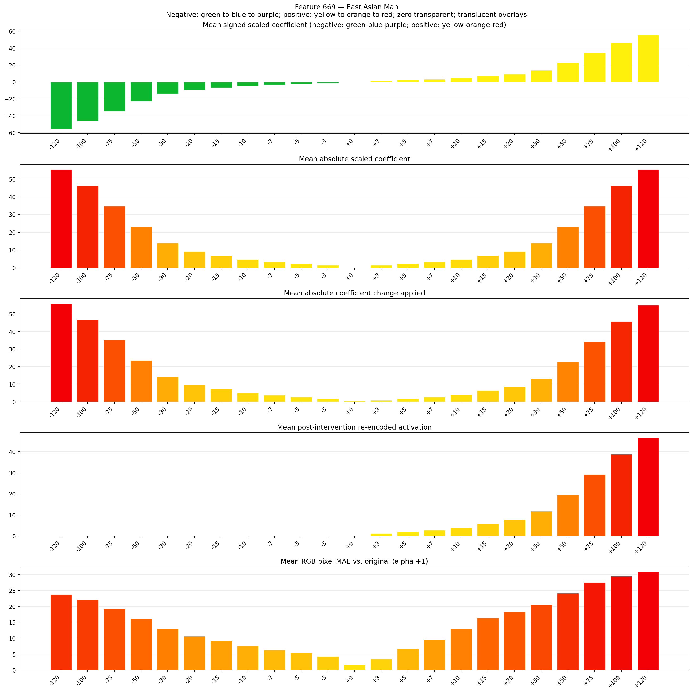
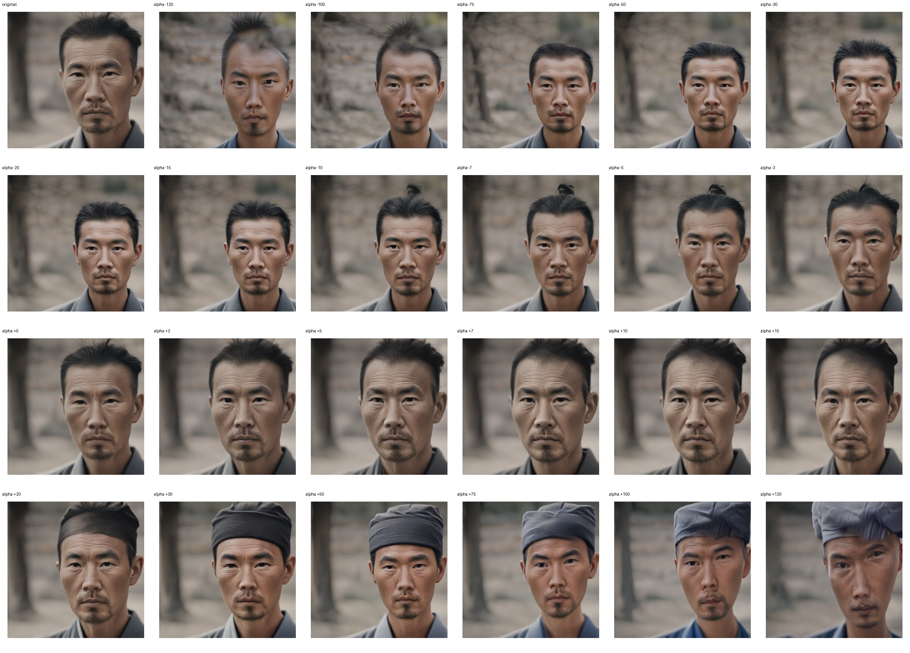
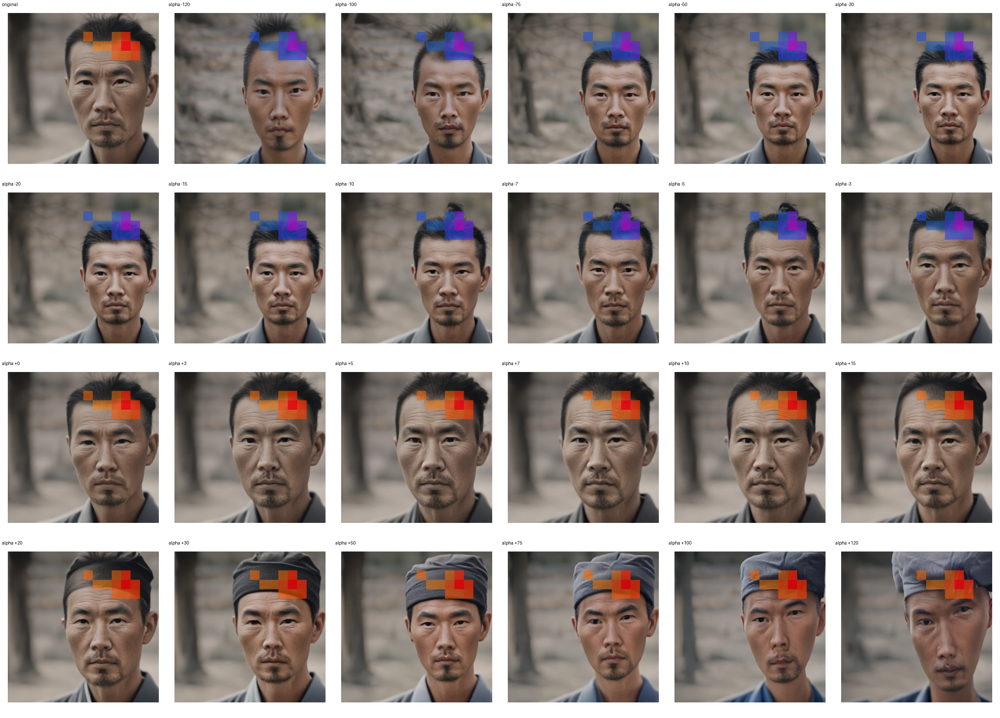
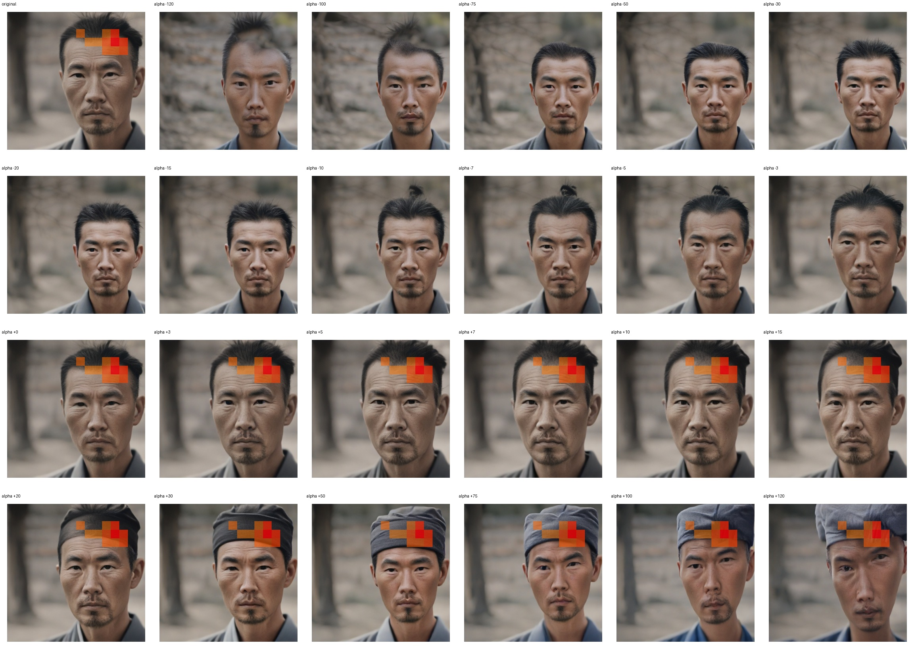

# Feature 669 — East Asian Man

Biased dataset; original prompt and seed replay for seeds 0–19. Values are means across 20 source images. The table reports the mean post-re-encoded activation of feature 669, the active spatial fraction, mean RGB pixel MAE versus the original image (0–255 scale), and coefficient change magnitudes for each alpha.

## Activation graph

## Mean metrics by alpha

| Alpha | Mean post-reencoded feature 669 activation | Active spatial fraction | Mean pixel change (MAE) | Mean absolute coefficient change | Mean absolute scaled coefficient |
|---:|---:|---:|---:|---:|---:|
| -120 | 0.000 | 0.000 | 23.760 | 55.908 | 55.446 |
| -100 | 0.000 | 0.000 | 22.206 | 46.667 | 46.205 |
| -75 | 0.000 | 0.000 | 19.296 | 35.116 | 34.654 |
| -50 | 0.000 | 0.000 | 16.154 | 23.565 | 23.103 |
| -30 | 0.000 | 0.000 | 13.066 | 14.324 | 13.862 |
| -20 | 0.000 | 0.000 | 10.674 | 9.703 | 9.241 |
| -15 | 0.000 | 0.000 | 9.284 | 7.393 | 6.931 |
| -10 | 0.000 | 0.000 | 7.618 | 5.083 | 4.621 |
| -7 | 0.000 | 0.000 | 6.366 | 3.696 | 3.234 |
| -5 | 0.000 | 0.000 | 5.405 | 2.772 | 2.310 |
| -3 | 0.000 | 0.000 | 4.310 | 1.848 | 1.386 |
| +0 | 0.000 | 0.000 | 1.718 | 0.462 | 0.000 |
| +3 | 1.239 | 0.039 | 3.524 | 0.924 | 1.386 |
| +5 | 2.017 | 0.039 | 6.675 | 1.848 | 2.310 |
| +7 | 2.794 | 0.039 | 9.653 | 2.772 | 3.234 |
| +10 | 3.960 | 0.039 | 13.005 | 4.158 | 4.621 |
| +15 | 5.903 | 0.039 | 16.316 | 6.469 | 6.931 |
| +20 | 7.846 | 0.039 | 18.195 | 8.779 | 9.241 |
| +30 | 11.732 | 0.039 | 20.513 | 13.399 | 13.862 |
| +50 | 19.504 | 0.039 | 24.159 | 22.640 | 23.103 |
| +75 | 29.220 | 0.039 | 27.457 | 34.192 | 34.654 |
| +100 | 38.935 | 0.039 | 29.529 | 45.743 | 46.205 |
| +120 | 46.708 | 0.039 | 30.859 | 54.984 | 55.446 |

## Per-seed grids

Each 4×6 sheet contains the original followed by the 23 alpha variants in ascending alpha order, from −120 through +120.

### Plain images

[All 20 plain-image grids](seed_sheets/)

### Signed coefficient overlays

[All 20 signed coefficient grids](signed_coefficient_overlays/)

### Post-re-encoded activation overlays

[All 20 post-activation grids](post_activation_overlays/)

### Intervention-footprint overlays

[All 20 intervention-footprint grids](intervention_footprint_overlays/)

Zero is transparent. Negative coefficient colors progress green through blue to purple; positive colors progress yellow through orange to red. Each map tile is normalized individually for visibility. The original and alpha-zero tiles show the pre-intervention feature map so its location remains visible.
