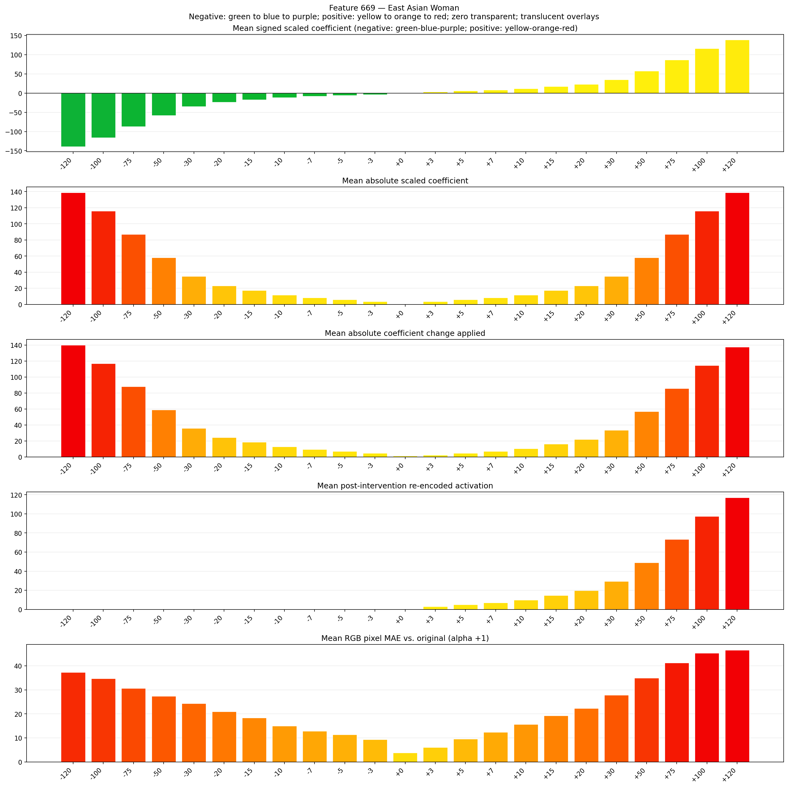
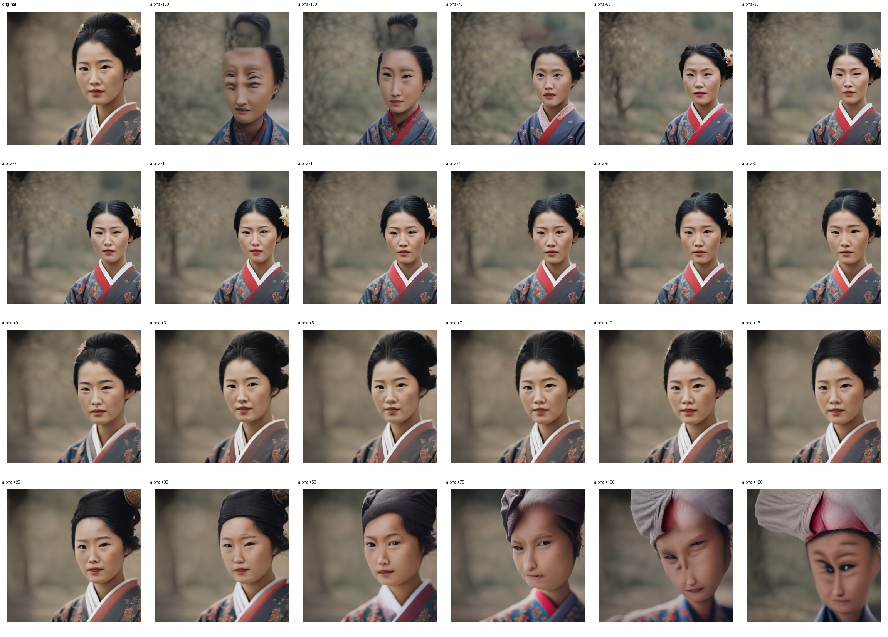
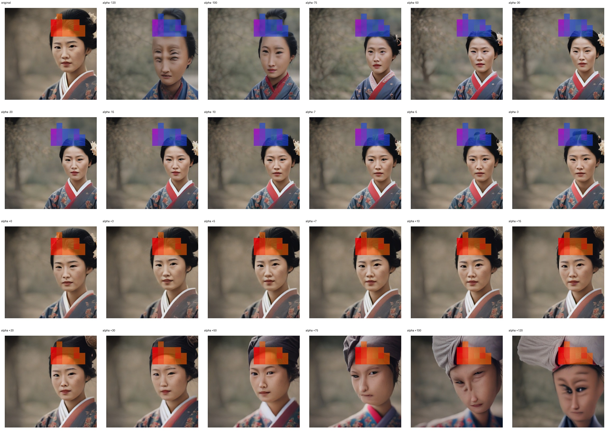
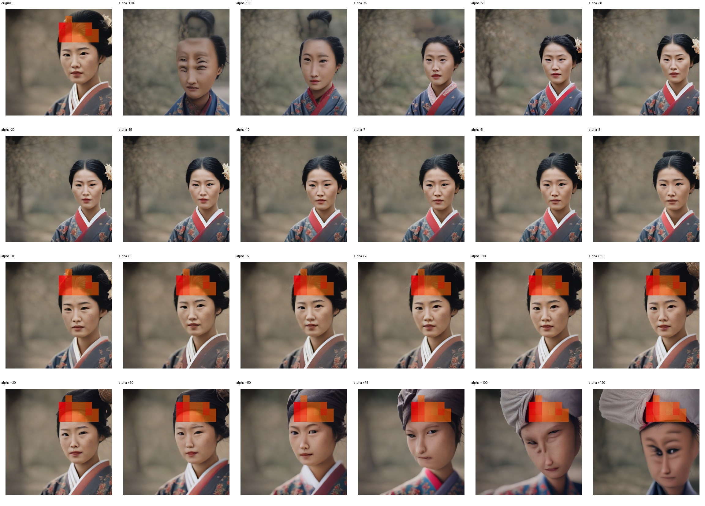

# Feature 669 — East Asian Woman

Biased dataset; original prompt and seed replay for seeds 0–19. Values are means across 20 source images. The table reports the mean post-re-encoded activation of feature 669, the active spatial fraction, mean RGB pixel MAE versus the original image (0–255 scale), and coefficient change magnitudes for each alpha.

## Activation graph

## Mean metrics by alpha

| Alpha | Mean post-reencoded feature 669 activation | Active spatial fraction | Mean pixel change (MAE) | Mean absolute coefficient change | Mean absolute scaled coefficient |
|---:|---:|---:|---:|---:|---:|
| -120 | 0.000 | 0.000 | 37.286 | 140.102 | 138.944 |
| -100 | 0.000 | 0.000 | 34.649 | 116.945 | 115.787 |
| -75 | 0.000 | 0.000 | 30.636 | 87.998 | 86.840 |
| -50 | 0.000 | 0.000 | 27.346 | 59.051 | 57.894 |
| -30 | 0.000 | 0.000 | 24.298 | 35.894 | 34.736 |
| -20 | 0.000 | 0.000 | 20.974 | 24.315 | 23.157 |
| -15 | 0.000 | 0.000 | 18.373 | 18.526 | 17.368 |
| -10 | 0.000 | 0.000 | 15.001 | 12.737 | 11.579 |
| -7 | 0.000 | 0.000 | 12.797 | 9.263 | 8.105 |
| -5 | 0.000 | 0.000 | 11.319 | 6.947 | 5.789 |
| -3 | 0.000 | 0.000 | 9.348 | 4.631 | 3.474 |
| +0 | 0.000 | 0.000 | 3.775 | 1.158 | 0.000 |
| +3 | 3.106 | 0.077 | 6.048 | 2.316 | 3.474 |
| +5 | 5.053 | 0.077 | 9.585 | 4.631 | 5.789 |
| +7 | 7.001 | 0.077 | 12.324 | 6.947 | 8.105 |
| +10 | 9.922 | 0.077 | 15.592 | 10.421 | 11.579 |
| +15 | 14.792 | 0.077 | 19.269 | 16.210 | 17.368 |
| +20 | 19.661 | 0.077 | 22.301 | 22.000 | 23.157 |
| +30 | 29.400 | 0.077 | 27.761 | 33.578 | 34.736 |
| +50 | 48.876 | 0.077 | 34.913 | 56.736 | 57.894 |
| +75 | 73.223 | 0.077 | 41.170 | 85.682 | 86.840 |
| +100 | 97.569 | 0.077 | 45.303 | 114.629 | 115.787 |
| +120 | 117.046 | 0.077 | 46.525 | 137.787 | 138.944 |

## Per-seed grids

Each 4×6 sheet contains the original followed by the 23 alpha variants in ascending alpha order, from −120 through +120.

### Plain images

[All 20 plain-image grids](seed_sheets/)

### Signed coefficient overlays

[All 20 signed coefficient grids](signed_coefficient_overlays/)

### Post-re-encoded activation overlays

[All 20 post-activation grids](post_activation_overlays/)

### Intervention-footprint overlays

[All 20 intervention-footprint grids](intervention_footprint_overlays/)

Zero is transparent. Negative coefficient colors progress green through blue to purple; positive colors progress yellow through orange to red. Each map tile is normalized individually for visibility. The original and alpha-zero tiles show the pre-intervention feature map so its location remains visible.
